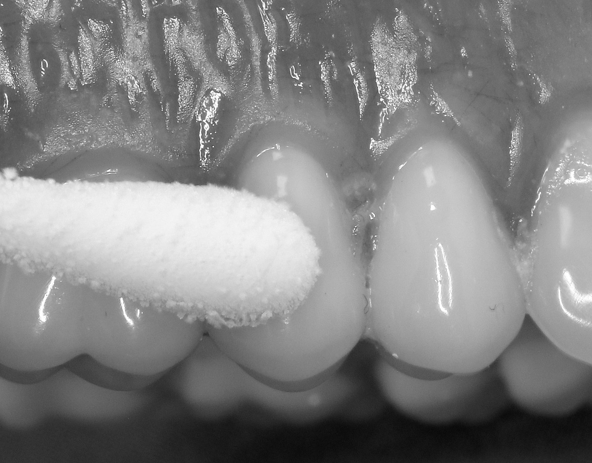

Короткий гострий біль на холод, повітря, солодке або дотик щітки, який зникає майже одразу після подразника, зазвичай означає оголений дентин. Довгий ниючий біль, особливо вночі або без холодної води, — інша історія: так частіше поводиться запалена пульпа. Плутати їх дорого. У першому випадку допомагають паста, обережне чищення і час. У другому зуб потрібно лікувати, і паста для чутливих зубів це відкладає.

Novadent розрізняє ці два стани на огляді, холодовою пробою і, коли треба, прицільним знімком. Консультація безкоштовна. Окремого «лікування чутливості» однією універсальною процедурою в кабінеті немає, бо причини різні.

## Де ховається дентин

Емаль вкриває коронку, цемент — корінь, а під ними дентин пронизаний тонкими канальцями, що ведуть до пульпи. Поки канальці закриті емаллю або яснами, холод майже не доходить до нервових закінчень. Коли покрив зникає, рідина в канальцях рухається від подразника, і людина відчуває укол.

Причин оголення кілька, і вони можуть співіснувати. Ясна відійшли, і корінь стоїть над яснами: рецесія після років жорсткого чищення, після пародонтиту або просто з віком. Емаль стерлась там, де зуби змикаються, або біля ясен з’явився клиноподібний дефект. Кислота не з бактерій нальоту — лимонади, вино, сік, сік шлунка — пом’якшує поверхню, і тоді навіть звичайна щітка знімає більше тканини. Lussi і Carvalho описують ерозивне стирання саме як таку пару: хімічне пом’якшення і механічне зняття вже м’якого шару. Свіжа професійна чистка теж відкриває корінь, який до того був під каменем. Край старої пломби, що відійшов, дає той самий укол локально, в одній точці.

<figure>

<figcaption>На розрізі видно емаль, дентин і порожнину пульпи. Чутливість з’являється там, де дентин утратив покрив. Навчальна схема, не пацієнт Novadent. Автори: Ian Furst і Goran tek-en, <a href="https://commons.wikimedia.org/wiki/File:Cross_sections_of_teeth_labels.png" target="_blank" rel="noopener noreferrer">CC BY-SA 3.0</a>.</figcaption>
</figure>

Кілька зубів одразу, симетрично, на холодне повітря взимку — типова картина оголених коренів. Один зуб, який болить дедалі довше, в таку картину не вписується. Його дивляться окремо.

## Паста, якій потрібен повтор

Пасти для чутливих зубів працюють двома шляхами, інколи одразу обома. Одні заспокоюють провідність нервових закінчень у канальцях, інші звужують самі канальці. Жоден шлях не закриває дентин з першого чищення. Склад має лягати на те саме місце день за днем. Піну випльовують і не споліскують водою, інакше на корені майже нічого не лишається. Delivering Better Oral Health якраз так і радить поводитися з фторидною пастою: вечір перед сном і ще один раз, без полоскання одразу після.

Якщо за два вечори «нічого не змінилося» і тюбик відклали, спроба ще не відбулася. Розумний термін, щоб зрозуміти, чи ця паста ваша, — тижні щоденного користування, а не вихідні. Відсоток людей, яким допомагає конкретний склад, тут наводити ні з чого: дослідження розходяться в тому, кого і як міряли, і обіцянка з реклами не є прогнозом для вашого кореня. Якщо за кілька тижнів короткі уколи рідшають, пасту залишають. Якщо біль стає довшим, тюбик не змінюють на дорожчий — зуб показують.

Жорсткі «відбілювальні» пасти для оголеного кореня — поганий вибір. Абразив знімає вже пом’якшену поверхню, і канальців стає більше. Кабінет відбілювання як послуги не пропонує, і домашня абразивна паста цю послугу не замінює. Звичайна паста з фторидом 1350–1500 ppm для дорослого закриває і чутливість частково, і захист кореня від карієсу. Огляд Walsh показав, що фторид у пасті зменшує новий карієс порівняно з пастою без фториду. Оголений корінь якраз та поверхня, якій цей захист потрібен щодня.

Після звичайного чищення пасту для чутливих зубів зручно втерти пальцем у шийки і лишити на ніч без води. Склад тоді лежить на канальцях довше, ніж якщо його розмішати по всьому роті і проковтнути з піною. Щітку тримають легше, ніж здається правильним. Сильний горизонтальний рух біля ясен поглиблює клиноподібний дефект і відкриває нові канальці, тож від «ретельнішого» тиску чутливість може зрости. Якщо уколи з’явились після домашніх відбілювальних смужок, смужки паузують. Біль від гелю не лікують новою порцією того самого гелю.

Один зуб, який болить на накушування або довго після гарячого, у схему «чутливі шийки» не входить. Його дивляться окремо, навіть якщо сусідні зуби теж озиваються на морозиво.

## Холодова проба розрізняє два болі

На прийомі сухий зуб торкаються ваткою з холодовим агентом і дивляться дві речі: чи є відповідь і як швидко вона згасає. Живий зуб із оголеним дентином відповідає гостро і відпускає за секунди, так само як сусідні зуби, тільки інколи сильніше. Запалена пульпа відповідає сильніше і довше, інколи біль наростає вже після того, як ватку прибрали. Зуб, який не відповідає зовсім, може мати загиблу пульпу, і це теж не «просто чутливість», навіть якщо людину турбує сусідній зуб.

<figure>

<figcaption>Холодова проба: коротка відповідь і довга відповідь ведуть до різних рішень. Навчальне фото, не пацієнт Novadent. Автор: Coronation Dental Specialty Group, <a href="https://commons.wikimedia.org/wiki/File:Cold_test_with_ethyl_chloride.jpg" target="_blank" rel="noopener noreferrer">CC BY-SA 3.0</a>.</figcaption>
</figure>

Проба дешева за змістом і дорога за наслідком помилки. Закрити «чутливий» зуб пломбою, коли нерв уже запалений необоротно, означає повернутися з нічним болем. Навпаки, лікувати канали в зубі, який лише реагує на морозиво дві секунди, — зайве. Як виглядає шлях від глибокого карієсу до каналів, описано в записі [«Лікування карієсу і пульпіту»](2026-07-01-therapy.html). Анестезія, якщо вона потрібна для лікування, в прайсі коштує 200 гривень і не є лікуванням чутливості сама по собі.

## Що має сенс закрити

Паста не приклеїть ясна назад і не наростить емаль у клині біля шийки. Якщо дефект глибокий, край гострий і їжа забивається, невелика реставрація закриває дентин і прибирає щабель, на якому збирається наліт. Це роблять, коли є що закривати: порожнина, відколений край, щілина під пломбою. Рівний оголений корінь без порожнини пломба не «утеплює» назавжди, бо край реставрації сам стає місцем, де збирається наліт.

Після зняття каменю має сенс пережити кілька днів і користуватися пастою, перш ніж просити запломбувати всі шийки. Якщо укол лишився в одній точці і зонд чіпляє край, тоді реставрація доречна. Коронку на зуб лише через чутливість не ставлять: коронка потрібна, коли треба зв’язати слабкі стінки або відновити зруйновану жувальну поверхню.

Поки вирішуєте, приберіть часті кислотні ковтки між їжею і не тріть оголені шийки горизонтально. Короткий біль на холод при цьому може лишитись надовго, якщо корінь відкритий, і це сумісне зі спокійним нервом. Кабінет у Вінниці на вул. Гоголя 15, телефон [075 177 75 67](tel:+380751777567). Якщо біль один, довгий і нічний, краще не чекати кінця тюбика.

Цей текст не ставить особистий діагноз і не замінює холодову пробу вашого зуба.

## Джерела

<ol class="blog-sources">
<li><a href="https://doi.org/10.1159/000360380" target="_blank" rel="noopener noreferrer">Lussi A, Carvalho TS. Erosive tooth wear: a multifactorial condition of growing concern and increasing knowledge. Monographs in Oral Science, 2014.</a></li>
<li><a href="https://www.gov.uk/government/publications/delivering-better-oral-health-an-evidence-based-toolkit-for-prevention" target="_blank" rel="noopener noreferrer">Delivering better oral health: an evidence-based toolkit for prevention. Department of Health and Social Care, NHS England.</a> Паста з фторидом, без споліскування одразу після чищення; профілактика стирання.</li>
<li><a href="https://doi.org/10.1002/14651858.CD007868.pub3" target="_blank" rel="noopener noreferrer">Walsh T, Worthington HV, Glenny AM, Marinho VCC, Jeroncic A. Fluoride toothpastes of different concentrations for preventing dental caries. Cochrane Database of Systematic Reviews, 2019.</a></li>
</ol>
