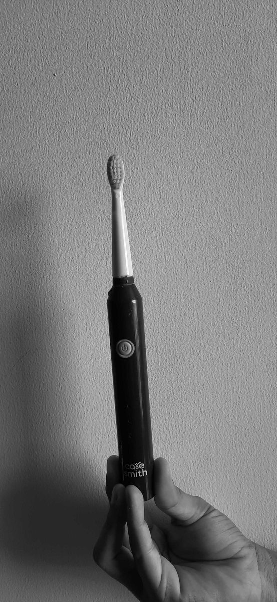

Дорослому достатньо простої схеми: двічі на день паста з фторидом, увечері обов’язково перед сном, піну виплюнути і не споліскувати водою. Концентрація, яка має сенс у звичайній пасті, лежить у діапазоні 1000–1500 ppm, тобто частин фториду на мільйон. Британський набір Delivering Better Oral Health для дорослих звужує пораду до 1350–1500 ppm. Марка ручки, колір щетини і те, чи є на щітці «режим полірування», вирішують менше, ніж інше питання: чи кожна поверхня сьогодні була справді почищена.

Це не ритуал «три хвилини і совість чиста». Карієс і гінгівіт починаються там, куди ворс не дійшов: уздовж ясен, за останніми зубами, з язикового боку різців. Систематичний прохід по дузі важливіший за ціну щітки.

## Фторид, який лишають на зубах

Кокрейнівський огляд Walsh і співавторів зібрав дослідження паст різної концентрації. Паста з фторидом зменшує новий карієс порівняно з пастою без фториду. Для постійних зубів дітей і підлітків це добре показано в діапазоні приблизно 1000–1250 ppm і ще трохи сильніше для 1450–1500 ppm. У дорослих паста близько 1000–1100 ppm теж зменшувала карієс порівняно з пастою без фториду. Практичний висновок спокійний: беріть звичайну сімейну пасту з фторидом у верхній частині побутового діапазону, а не «натуральну» без нього і не дитячу з символічною дозою, якщо вам більше семи років.

Піну випльовують. Вода одразу після щітки змиває те, заради чого пасту взагалі брали. Ополіскувач, якщо він є, не ставлять у ту саму хвилину: він розводить фторид, що лишився на емалі. Вечірній раз важливіший за ранковий не тому, що вночі зуби «відновлюються», а тому, що уві сні слини мало. Delivering Better Oral Health окремо просить не їсти і не пити солодке перед сном, коли слина вже не буферує кислоту як удень. Паста, яку не змили, лишається на зубах на цей довгий сухий проміжок.

У ванній це виглядає буденно. Почистили, виплюнули піну, не набираєте воду «прополоскати смак» і не ковтаєте ополіскувач слідом. Якщо смак пасти дратує, наступного разу беріть меншу порцію, а не склянку. Їсти і пити щось, крім води, одразу після вечірньої щітки теж не варто: фторид ще лежить на емалі.

Кількості вистачає невеликої. Велика стрічка на всю щітку дає багато піни, і рука сама тягнеться до склянки. Дорослим окремої «горошини з настанови» немає, але невелика порція якраз допомагає не сполоснути рот. Дітям міра вже жорстка, і це єдина дитяча ремарка в цьому записі: до трьох років на щітці мазок пасти з фторидом не нижче 1000 ppm, з трьох до шести — горошина такої пасти, чистить дорослий. Повний дитячий протокол тут не розбираємо.

<figure>

<figcaption>Звичайної щітки достатньо, якщо нею проходять усі поверхні. Навчальне фото, не з кабінету Novadent. <a href="https://commons.wikimedia.org/wiki/File:A_Toothbrush.JPG" target="_blank" rel="noopener noreferrer">CC BY 3.0</a>.</figcaption>
</figure>

## Як пройти рот, щоб не лишити останні зуби

Жодної техніки, яка б у дослідженнях стабільно перемагала всі інші, Delivering Better Oral Health не виділяє. Важливо інше: кожна поверхня і стик зуба з яснами. Зручний порядок — завжди з одного місця і далі по дузі, спочатку зовнішні поверхні, потім внутрішні, потім жувальні. Останні зуби чистять навмисно, а не «якщо щітка дотягнеться». На внутрішній бік нижніх різців дивляться в дзеркало хоча б раз на тиждень: там камінь виростає тихо, бо протоки слинних залоз поруч, а щітка часто ковзає повз.

Ворс ставлять до лінії ясен і рухають коротким ходом, щоб щетина зайшла в борозну і вийшла. Сильне горизонтальне пиляння полірує клиноподібний дефект біля шийки і погано знімає наліт із ясенного краю. Середня жорсткість і невелика головка підходять більшості: надто жорстка щетина легше ранить ясна, товста головка не заходить за сьомий зуб. Коли ворс розпушився вбік, щітка вже не чистить лінію ясен, її міняють, навіть якщо «ще не минуло трьох місяців».

Дві хвилини в настанові потрібні не як магічне число, а як час, за який реально встигнути обійти всі поверхні. Таймер на телефоні чесніший за відчуття «я сьогодні довго чистив». Розкривні таблетки, якщо вони є в аптеці, показують фіолетовий наліт там, де рука звикла проскакувати. Це навчальний прийом на кілька вечорів, а не щоденний обов’язок.

Проміжки між зубами ця схема не закриває. Щітка їх не дістає, навіть електрична. Йоршик або нитка — окрема звичка, і про неї написано в записі [«Йоршик, нитка і проміжки між зубами»](2025-02-10-interdental.html).

## Електрична щітка і межа її користі

Огляд Yaacob і співавторів у Кокрейні порівняв електричні щітки з мануальними. Електричні зменшували наліт і гінгівіт сильніше і в перші місяці, і пізніше. Автори прямо пишуть, що клінічне значення цієї різниці лишається неясним. Побічні ефекти, якщо про них взагалі повідомляли, були місцевими і короткочасними. Delivering Better Oral Health додає практичну рамку: добре почистити можна і тією, і тією щіткою, а доказів, що якийсь один тип мотора явно кращий за інші, недостатньо. Для стирання зубів електрична щітка не показала себе ні безпечнішою, ні шкідливішою за звичайну.

<figure>

<figcaption>Електрична щітка трохи краще знімає наліт у дослідженнях. Навчальне фото, не пацієнт Novadent. Автор: GautamSudhanshu, <a href="https://commons.wikimedia.org/wiki/File:Rechargeable_Electric_Toothbrush.jpg" target="_blank" rel="noopener noreferrer">CC BY-SA 4.0</a>.</figcaption>
</figure>

З цього не випливає, що мануальна щітка «застаріла». Якщо нею вже проходять усі поверхні двічі на день із фторидом, заміна мотора не скасує солодкі перекуси і не почистить проміжок. Електрична доречна, коли рука слабка, техніка хаотична або людина згодна користуватися нею щодня. Головку ведуть повільно, від зуба до зуба, і не натискають: мотор не потребує сили, а сильний натиск гальмує щетину і тре шийку. Датчик натиску, якщо він є, корисний саме цим.

Паста на електричній щітці та сама, з фторидом. Режим «відбілювання» на ручці не замінює фторид і не є медичним відбілюванням. Кабінет таку послугу не надає.

## Що лишається поза щіткою

Навіть ідеальне чищення не тримає карієс, якщо вільний цукор надходить у рот багато разів на день. Паста і дієта працюють у парі: фторид робить емаль стійкішою до кислоти, рідші солодкі ковтки дають слині час повернути pH. Всесвітня організація охорони здоров’я описує карієс як хворобу, якій можна запобігти, і ставить вільні цукри серед головних причин. Щітка цей факт не скасовує.

Якщо ясна кровлять, чищення не припиняють. Кров у перші дні означає запалення від нальоту, який якраз треба зняти. Якщо кров не стихає тижнями, зуб реагує довгим болем або біля ясен з’явився твердий край, це вже огляд, а не нова щітка. У Novadent консультація безкоштовна, зняття відкладень коштує 800 гривень, візіограф на місці — 100. Кабінет на вул. Гоголя 15, телефон [075 177 75 67](tel:+380751777567).

Цей текст узагальнює поради щодо чищення і не підбирає пасту під ваш конкретний ризик.

## Джерела

<ol class="blog-sources">
<li><a href="https://doi.org/10.1002/14651858.CD007868.pub3" target="_blank" rel="noopener noreferrer">Walsh T, Worthington HV, Glenny AM, Marinho VCC, Jeroncic A. Fluoride toothpastes of different concentrations for preventing dental caries. Cochrane Database of Systematic Reviews, 2019.</a></li>
<li><a href="https://doi.org/10.1002/14651858.CD002281.pub3" target="_blank" rel="noopener noreferrer">Yaacob M, Worthington HV, Deacon SA, et al. Powered versus manual toothbrushing for oral health. Cochrane Database of Systematic Reviews, 2014.</a></li>
<li><a href="https://www.gov.uk/government/publications/delivering-better-oral-health-an-evidence-based-toolkit-for-prevention" target="_blank" rel="noopener noreferrer">Delivering better oral health: an evidence-based toolkit for prevention. Department of Health and Social Care, NHS England.</a></li>
<li><a href="https://www.who.int/news-room/fact-sheets/detail/oral-health" target="_blank" rel="noopener noreferrer">World Health Organization. Oral health. Fact sheet.</a></li>
</ol>
