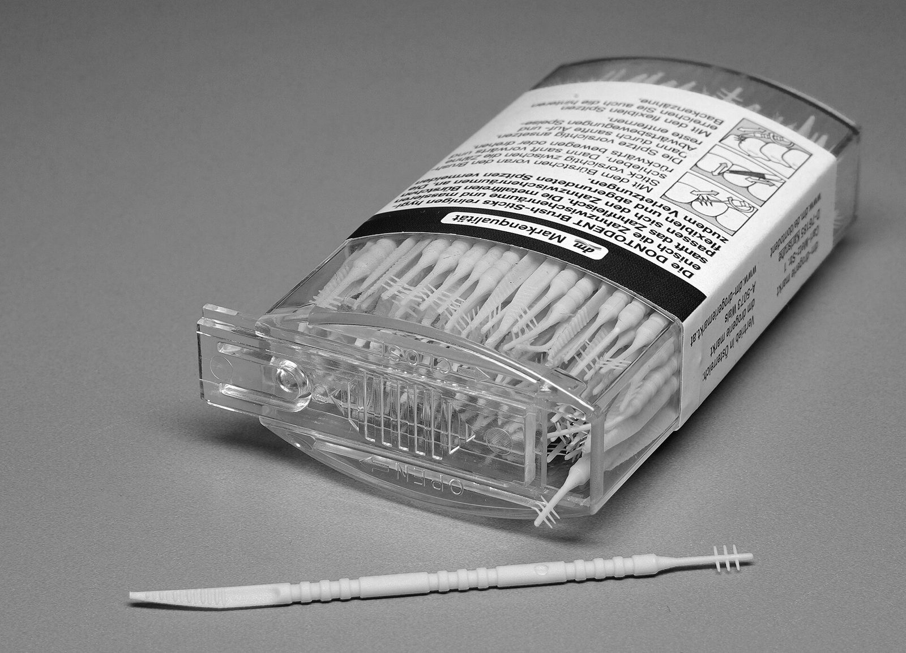
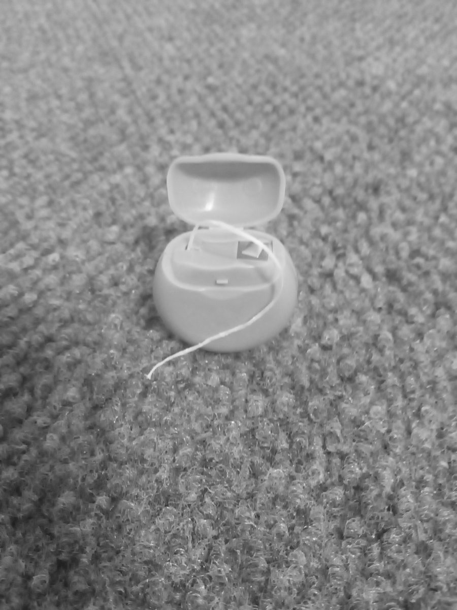

Зубна щітка, навіть електрична, чистить доступні поверхні і лінію ясен. Між зубами, нижче контактної точки, лишається наліт, якого вона не дістає. Саме там часто починається і карієс, якого не видно в дзеркалі, і запалення сосочка, через яке кров з’являється «ніби з нічого». Delivering Better Oral Health радить дорослим щодня чистити проміжки, нижче краю ясен. Щітка з фторидом при цьому нікуди не дівається: проміжок і паста вирішують різні задачі.

Засіб підбирають під ширину щілини, а не під рекламний набір. Де входить маленький йоршик, він чистить більше поверхні, ніж нитка. Де зуби стоять щільно, йоршик лише травмує сосочок, і там працює нитка.

## Йоршик там, де є щілина

Йоршик — це тонка йоржиста головка на дротику або ручці. Його вводять у проміжок біля ясен, проходять наскрізь або кілька разів уперед-назад і виймають. Ворс має торкатися обох зубів. Якщо йоршик бовтається в порожнечі, він нічого не знімає, і беруть більший розмір. Якщо він складається і не проходить без болю, розмір завеликий. Легке тертя — норма. Біль і відчуття, що дріт ріже ясна, — ні.

У одного рота рідко один розмір. Між різцями тісно, між премолярами вже є щілина, біля моляра після рецесії щілина широка. Два або три йоршики в стакані — звичайна картина, а не надмірність. Delivering Better Oral Health якраз так і формулює пораду: де є місце під міжзубний йоршик, користуються ним; для вузьких проміжків лишають нитку або стрічку. Докази, що йоршик переважає нитку, не найвищої якості, і клінічна вага різниці в оглядах обережна. Практична логіка все одно проста: ворс обходить поверхню зуба, нитка ковзає лінією.

Чистити проміжки зручно до щітки, щоб це не відкладалось на «потім, якщо не втомився». Настанова вважає такий порядок добрим способом прив’язати звичку. Пасту на йоршик наносити не обов’язково. Фторид прийде зі щітки одразу після, якщо піну не змити.

<figure>

<figcaption>Міжзубні йоршики різного розміру: кожен проміжок підбирають окремо. Навчальне фото, не пацієнт Novadent. Автор: Berthold Werner, <a href="https://commons.wikimedia.org/wiki/File:Brush_Sticks_BW.jpg" target="_blank" rel="noopener noreferrer">CC BY-SA 3.0</a>.</figcaption>
</figure>

Після пародонтиту проміжки стають ширшими, бо сосочок сів разом із кісткою. Там йоршик майже завжди доречніший за нитку: нитка пролітає трикутну діру і не тре корінь. Розмір з часом змінюють. Той, що пасував рік тому, сьогодні може висіти без діла.

## Нитка там, де контакт щільний

Нитка потрібна, де зуби торкаються одне одного і йоршик не входить. Її заводять обережно крізь контакт, не клацаючи з розмаху по ясні. Далі обіймають один зуб, проводять під край ясен і вгору, потім так само другий зуб того самого проміжку. Один рух «туди-сюди посередині» пропускає саме ті боки, де починається карієс.

Кров на нитці в новому проміжку означає запалений сосочок, а не «нитка мені не підходить». Привід чистити далі, спокійніше і щодня. За кілька тижнів регулярного проходу кров зазвичай меншає, якщо це був гінгівіт від нальоту. Якщо не меншає, проміжок показують: під сосочком може бути камінь або вже глибша кишеня. Про цю різницю — в записі [«Кровоточивість ясен»](2025-01-06-gingivitis.html).

Нитка не замінює пасту і не лікує вже існуючу порожнину. Вона прибирає наліт із місця, куди щітка не заходить, щоб нова порожнина там виникала рідше. Руки, яким нитка не дається, не треба мучити роками. Тоді шукають тримач нитки, вузький йоршик або інший засіб, яким людина справді користуватиметься щовечора. Ідеальний засіб у шухляді програє посередньому, який виходить з дому в кишені.

<figure>

<figcaption>Нитка потрібна у вузькому контакті, де йоршик не входить. Навчальне фото, не пацієнт Novadent. Автор: Texas Lane, <a href="https://commons.wikimedia.org/wiki/File:Dental_Floss.jpg" target="_blank" rel="noopener noreferrer">CC BY-SA 4.0</a>.</figcaption>
</figure>

Перший тиждень проміжки зручніше чистити ввечері біля дзеркала. Видно, чи йоршик входить уздовж ясен, а не встромляється в сосочок зверху. Дріт не згинають гачком: зігнутий кінчик коле. Йоршик, у якого ворс витерся до голого металу, викидають. Голий дріт уже не знімає наліт, він шкребе корінь. Розмір, який справді пасує, не лишає набряклий сосочок наступного ранку. Якщо після першої спроби ясна припухли, наступного вечора беріть тонший йоршик і не надолужуйте пропуск подвійною силою.

Якщо нитка щоразу рветься в одному контакті, товстішу з ривком не беруть. Рваний край пломби або камінь ріже і нитку, і ясна. Після того як край підшліфують, та сама нитка зазвичай проходить без клацання. Це частіша причина фрази «нитка мені не підходить», ніж невмілі пальці.

## Іригатор і те, чого він не замінює

Іригатор вимиває частину м’якого нальоту струменем води. Він виручає, коли пальці погано тримають тонкий йоршик, після моста, де проміжок важко нащупати, або коли людина інакше не чистить між зубами взагалі. Delivering Better Oral Health оцінює докази щодо іригаторів як обмежені й неоднорідні. Це додаток, а не заміна.

Струмінь не кладе фторид на емаль замість пасти. Він також гірше за йоршик знімає наліт там, де йоршик входить щільно і тре поверхню кореня. Розумний порядок для людини з нормальними руками: йоршик або нитка, потім щітка з фторидною пастою, піну виплюнути. Іригатор можна лишити тим, кому цей порядок фізично не дається, або додати його, а не ставити замість пасти. Вода в резервуарі без фторидної пасти ввечері карієс не стримує. Про саму пасту і вечірнє чищення — в записі [«Як чистити зуби»](2025-02-03-brushing.html).

Кровоточивість від іригатора в перші дні читають так само, як кров на йоршику: ясна запалені. Струмінь не роблять болючим «щоб пробити». Якщо ясна набрякли після агресивного напору, силу зменшують. Тиждень тиші, коли проміжки знову не чистять, повертає наліт швидше, ніж сосочок встигає заспокоїтись.

## Коли проміжок треба показати

Щоденне чищення не замінює огляд, якщо їжа застрягає в одному й тому самому місці, нитка рветься об край пломби або сосочок набрякає з одного боку. Порваний край, нависла пломба і камінь у проміжку тримають наліт попри будь-яку техніку. Їх видно зондом за хвилину. У кабінеті такий край можна поправити реставрацією, а камінь зняти: зняття відкладень коштує 800 гривень.

Знімний протез, якщо він є, теж збирає наліт під базисом і на кламерах. Його чистять окремо і на ніч знімають, а зуби під ним проходять йоршиком так само, як зуби без протеза. Інакше опора, на якій протез тримається, запалюється першою.

Кабінет Novadent на вул. Гоголя 15 у Вінниці, телефон [075 177 75 67](tel:+380751777567). На консультації, вона безкоштовна, можна принести свій йоршик і перевірити розмір на місці, а не вгадувати за кольором ручки в магазині.

Цей текст не підбирає розмір йоршика заочно і не є особистим планом гігієни.

## Джерела

<ol class="blog-sources">
<li><a href="https://www.gov.uk/government/publications/delivering-better-oral-health-an-evidence-based-toolkit-for-prevention" target="_blank" rel="noopener noreferrer">Delivering better oral health: an evidence-based toolkit for prevention. Department of Health and Social Care, NHS England.</a> Щоденне чищення проміжків: йоршик де є місце, нитка у вузькому контакті; докази щодо іригаторів обмежені.</li>
<li><a href="https://doi.org/10.1002/14651858.CD007868.pub3" target="_blank" rel="noopener noreferrer">Walsh T, Worthington HV, Glenny AM, Marinho VCC, Jeroncic A. Fluoride toothpastes of different concentrations for preventing dental caries. Cochrane Database of Systematic Reviews, 2019.</a> Паста з фторидом лишається окремим захистом від карієсу.</li>
<li><a href="https://doi.org/10.1002/jper.17-0719" target="_blank" rel="noopener noreferrer">Chapple ILC, Mealey BL, Van Dyke TE, et al. Periodontal health and gingival diseases and conditions on an intact and a reduced periodontium. Journal of Periodontology, 2018.</a></li>
</ol>
