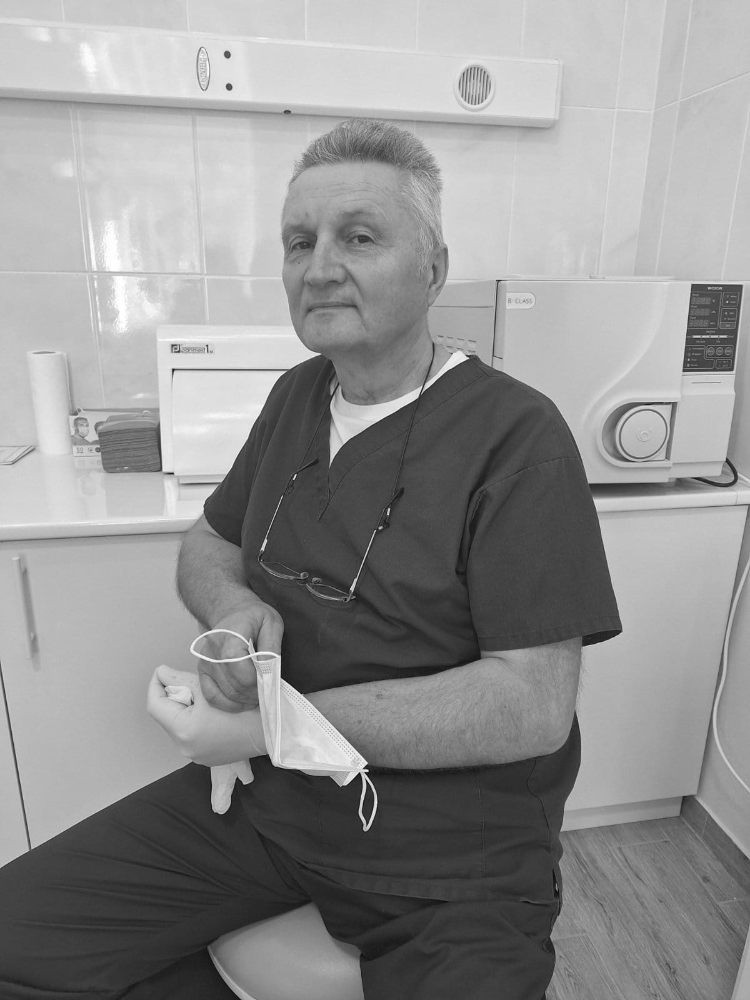

Слина весь день робить тиху роботу: змиває залишки їжі, розбавляє кислоту, повертає мінерали в емаль і змащує слизову, щоб протез і щока не терли одне одного. Коли її мало, рот не просто некомфортний. Зуби втрачають захист саме в той час, коли наліт і цукор ніхто не прибирає так швидко, як раніше. Людина це відчуває як потребу пити вночі, липкий язик, труднощі з сухою їжею, інколи печіння слизової.

Сухість рідко буває «просто віком» без причини. Часто її дають ліки, інколи хвороба або опромінення. Стоматолог не скасовує ці ліки і не ставить діагноз синдрому Шегрена. Він бачить наслідки в роті і може зробити так, щоб вони наростали повільніше.

## Чому без слини зуби псуються швидше

У звичайному роті кислота після їжі не тримається годинами: слина її буферує і змиває цукор. Delivering Better Oral Health окремо попереджає про солодке перед сном, бо вночі потік слини і так падає. Якщо потік низький ще й удень, кожен солодкий ковток лишається на зубах довше. Найвразливіший корінь біля ясен. Емалі там немає, дентин м’якший, карієс іде швидше і часто кільцем охоплює зуб. Такий карієс виглядає як темна смуга біля ясен, а не як дірка на жувальній поверхні, і його легко проґавити, доки зуб не відколовся.

Наліт при сухих яснах тримається щільніше. Запалення ясен і неприємний запах підсилюються, навіть якщо людина чистить зуби. Знімний протез, якому не вистачає змащення, натирає. На пошкодженій слизовій легше сідає кандидоз: білясті знімні нальоти, печіння, червона слизова під базисом. Це привід показати рот, а не зчищати наліт щіткою до крові.

<figure>

<figcaption>На прийомі називають ліки, які вже п’єте: багато з них зменшують слину. Лікар Голуб Олександр Олексійович, Novadent.</figcaption>
</figure>

Кисле питво, яким намагаються «розмочити» рот, додає другу проблему. Лимон у воді, кислі льодяники без цукру, оцет. Цукру може не бути, але кислота пом’якшує емаль і дентин. Lussi і Carvalho описують ерозивне стирання як якраз таку втрату тканини кислотою не з бактерій. При малій слині цей шар змивається гірше. Вода заспокоює спрагу без цієї кислоти.

## Ліки і хвороби, про які треба сказати

Багато поширених препаратів зменшують потік слини. Серед груп, які це роблять часто, є засоби від тиску, антидепресанти й антигістамінні. Список довший, і перераховувати торгові назви тут немає сенсу: важлива ваша коробочка, а не абстрактна аптека. Delivering Better Oral Health просить стоматолога пояснювати ризик, якщо ліки сушать рот, і обговорювати, як рот вести далі. Самостійно скасовувати призначений препарат через сухість не можна. Інколи лікар, який його виписав, може замінити молекулу або час прийому. Це його рішення, після того як стоматолог описав, що відбувається з зубами.

Окремі причини лежать поза стоматологією. Променева терапія ділянки голови і шиї може пошкодити слинні залози надовго. Синдром Шегрена і деякі інші хвороби теж зменшують слину, але діагноз ставить профільний лікар, а не огляд у кріслі. Стоматологу потрібен цей діагноз у картці, бо прогноз коренів і частота оглядів від нього залежать. Якщо сухість нова, різка, з набряком залози під щелепою або з сухістю очей, починати варто з сімейного лікаря, а зубний кабінет підключати паралельно, а не замість.

На безкоштовну консультацію в Novadent беріть написаний список: назва, доза, відколи п’єте. Лікар вищої категорії Олександр Олексійович Голуб подивиться корені і слизову вже з цією підказкою, а не з питання «чи не здається вам, що в роті сухо».

## Що реально робити щодня

Вода має бути під рукою, зокрема вночі, якщо прокидаєтесь від сухості. П’ють воду, а не солодкий чай маленькими ковтками до ранку: нічний цукор при малій слині якраз найдовше лежить на коренях. Настанова ВООЗ просить зменшувати вільні цукри; при сухості ця порада стає терміновою, бо кліренс і так повільний. Сік, мед і «корисні» смузі тут рахуються так само, як добавлений цукор.

Паста з фторидом — щоденний захист тих самих коренів. Огляд Walsh показав, що фторидна паста зменшує новий карієс порівняно з пастою без фториду. Дорослій людині розумно брати 1350–1500 ppm, чистити двічі на день і особливо перед сном, піну виплюнути і не споліскувати. Якщо корені вже активно руйнуються, інколи доречна паста з вищим вмістом фториду. Це вирішують на огляді, а не за відчуттям сухості. Звичайна вечірня паста при цьому нікуди не зникає.

<figure>

<figcaption>Корінь укритий не емаллю, а тоншим шаром. При сухій слині карієс часто починається саме біля ясен. Навчальна схема, не пацієнт Novadent. Автори: Ian Furst і Goran tek-en, <a href="https://commons.wikimedia.org/wiki/File:Cross_sections_of_teeth_labels.png" target="_blank" rel="noopener noreferrer">CC BY-SA 3.0</a>.</figcaption>
</figure>

Зручний вечір короткий. Паста з фторидом, виплюнути, після цього не пити солодкого. Вода стоїть на тумбочці, чаю з цукром там немає. Знімний протез спить у коробці, а не в роті: нічна слизова і так суха, базис її лише тре. Вранці знову паста, і вже потім сніданок. Удень, коли рот клеїться, частіше допомагає ковток води, ніж льодяник. На ніч пасту можна додатково втерти пальцем у шийки, де корінь уже відкритий, і не змивати.

Нова сухість разом із набряком під щелепою, температурою або раптовою сухістю очей не чекає планової чистки. Це привід до сімейного лікаря найближчим часом. Стоматолог паралельно дивиться, чи не пішла темна смуга по коренях. Якщо такі смуги вже є, огляд «раз на рік як усім» запізнюється: корінь при малій слині руйнується швидше за коронку, і інтервал скорочують за знахідкою, а не за звичкою календаря.

Жувальна гумка без цукру може розігнати залишок слини, якщо свої зуби ще є і жувальні м’язи це виносять. Кислі льодяники «від сухості» з цукром або без, якщо їх смокчуть весь день, дають або карієс, або ерозію. Спиртовий ополіскувач, який щипає і сушить ще дужче, рот не лікує. Замінники слини у вигляді гелю існують; чи потрібні вони вам, видно після огляду, а не з полиці навмання.

Протез на ніч знімають, слизову під ним промивають, базис чистять окремо від зубів. Печіння і білий наліт під протезом не лікують міцнішою фіксацією: фіксуючий крем на запалену слизову лише маскує тертя. Карієс кореня, якщо він уже є, пломбують. Як влаштоване лікування порожнини, описано в записі [«Лікування карієсу і пульпіту»](2026-07-01-therapy.html).

Кабінет на вул. Гоголя 15, телефон [075 177 75 67](tel:+380751777567). Візіограф на місці коштує 100 гривень і потрібен, коли біля ясен уже є підозра на карієс кореня, якого в дзеркалі майже не видно.

Цей текст не є особистим діагнозом причини сухості і не замінює розмову з лікарем, який призначив ліки.

## Джерела

<ol class="blog-sources">
<li><a href="https://www.gov.uk/government/publications/delivering-better-oral-health-an-evidence-based-toolkit-for-prevention" target="_blank" rel="noopener noreferrer">Delivering better oral health: an evidence-based toolkit for prevention. Department of Health and Social Care, NHS England.</a> Слина вночі, солодке перед сном, ліки, що сушать рот, паста з фторидом.</li>
<li><a href="https://doi.org/10.1002/14651858.CD007868.pub3" target="_blank" rel="noopener noreferrer">Walsh T, Worthington HV, Glenny AM, Marinho VCC, Jeroncic A. Fluoride toothpastes of different concentrations for preventing dental caries. Cochrane Database of Systematic Reviews, 2019.</a></li>
<li><a href="https://www.who.int/publications/i/item/9789241549028" target="_blank" rel="noopener noreferrer">World Health Organization. Guideline: sugars intake for adults and children. Geneva: WHO, 2015.</a></li>
<li><a href="https://doi.org/10.1159/000360380" target="_blank" rel="noopener noreferrer">Lussi A, Carvalho TS. Erosive tooth wear: a multifactorial condition of growing concern and increasing knowledge. Monographs in Oral Science, 2014.</a></li>
</ol>
