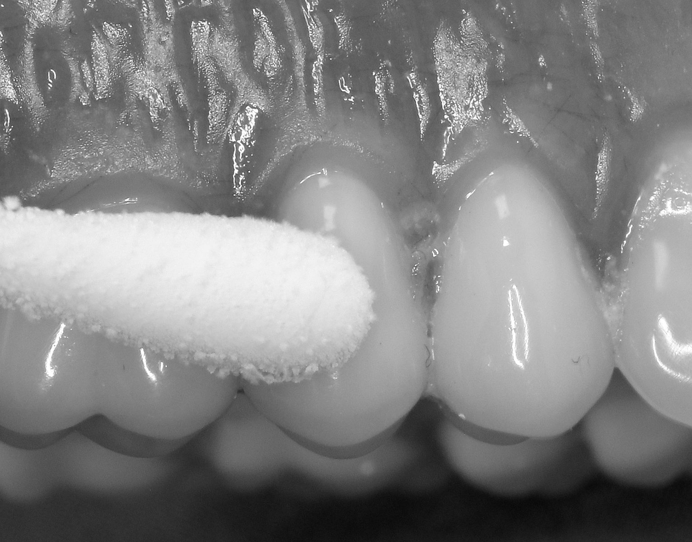

Біль, який з’являється в момент накушування і стає гострішим, коли зуби вже розмикаються, часто дає тріщина горбика. Поруч зазвичай велика стара пломба: стінки зуба тонкі і злегка розходяться під навантаженням. На звичайному знімку такої лінії часто немає. Зуб виглядає «цілим», бормашина ніби не потрібна, а жувати яблуко все одно страшно.

Не кожна рисочка на емалі є цією тріщиною. І не кожен такий зуб приречений. Прогноз залежить від того, де лінія закінчується: в емалі, в дентині, в пульпі чи вже в корені.

## Рисочка на передньому зубі і тріщина, яка болить

У багатьох дорослих на різцях видно тонкі вертикальні лінії. Вони відбивають світло, ніготь їх не чіпляє, холод вони не тримають довше за сусідні зуби. Це поверхневі лінії в емалі. Їх не лікують коронкою і не «склеюють» за проханням прибрати косметичну дрібницю, якщо вони не фарбуються і не болять.

Тріщина, яка заважає жити, заходить у дентин і дозволяє горбику злегка гнутися. Коли ви стискаєте їжу, частини розходяться. Коли відпускаєте, вони сходяться і щипають тканину всередині. Тому біль часто сильніший саме на розмикання, а не поки зуб ще тисне. Солодке і холодне можуть домішуватися, якщо лінія відкрила дентин, але головний провокатор — жування. Велика пломба робить це ймовірнішим: свої стінки тонші, вони працюють як пелюстки.

Інколи біль на накушування дає завищена пломба або запалення біля кореня, а не тріщина. Це розрізняють у кріслі, а не за описом «болить, коли їм». Поки йдете на прийом, не перевіряйте зуб горіхами і не жуйте ним «щоб зрозуміти, минуло чи ні». Кожне таке випробування розхитує лінію ще трохи.

## Що можна перевірити, а чого знімок не покаже

Лікар просить накусити паличку або валик то одним горбиком, то іншим. Біль на одному горбику і полегшення, коли цей горбик виводять із контакту, добре пасує до тріщини. Холодова проба відповідає на сусіднє питання: чи жива пульпа і чи біль від холоду короткий. Короткий укол сумісний із тріщиною в дентині. Довгий біль, який не відпускає, означає, що пульпа вже втягнута, і далі розмова йде про її лікування, а не лише про скріплення стінок. Як влаштована ця розвилка, описано в записі [«Лікування карієсу і пульпіту»](2026-07-01-therapy.html).

<figure>

<figcaption>Холодова проба показує, чи пульпа ще відповідає коротко. Навчальне фото, не пацієнт Novadent. Автор: Coronation Dental Specialty Group, <a href="https://commons.wikimedia.org/wiki/File:Cold_test_with_ethyl_chloride.jpg" target="_blank" rel="noopener noreferrer">CC BY-SA 3.0</a>.</figcaption>
</figure>

Прицільний знімок на візіографі в кабінеті коштує 100 гривень. Він рідко малює саму тріщину: лінія тонка, і промінь часто йде повз неї. Знімок відповідає на інше. Яка стара пломба всередині, як близько вона до нерва, чи змінилася кістка навколо кореня, чи немає окремого вогнища біля верхівки, яке болить на накушування з іншої причини. Темніше на плівці — менш щільна кістка. Чистий знімок тріщину не скасовує. Про межі кадру докладніше написано в записі [«Знімок на візіографі»](2026-10-01-scan.html).

<figure>

<figcaption>Так на плівці виглядає кістка навколо коренів. Тонку тріщину цей кадр часто не показує. Навчальний знімок, не пацієнт Novadent. Автор: Coronation Dental Specialty Group, <a href="https://commons.wikimedia.org/wiki/File:Abscessed_tooth_periapical_radiograph.jpg" target="_blank" rel="noopener noreferrer">CC BY-SA 3.0</a>.</figcaption>
</figure>

Огляд також шукає лінію під збільшенням, якщо воно є, і під яснами, якщо підозра, що тріщина пішла вниз. Не завжди її видно навіть так. Діагноз тоді лишається клінічним: біль на конкретний горбик, велика реставрація, знімок без іншої очевидної причини. Це чесна невизначеність, і її краще назвати, ніж обіцяти, що «на знімку все чисто, значить зуб здоровий».

## Від чого залежить, чи зуб вдасться зберегти

Лінія лише в емалі лікування зазвичай не потребує. Тріщина горбика, яка ще не розділила зуб на два окремі шматки, часто заспокоюється, коли горбик перестає гнутися. Це робить накладка або коронка: вона охоплює стінки і тримає їх разом. Велика пломба без перекриття горбика може лишити ту саму гру, і біль повертається на першому ж твердому шматку. Коронки в Novadent роблять. Рішення між накладкою, коронкою і ще однією пломбою залежить від того, скільки своєї тканини лишилось і чи тримає зуб контакт.

Якщо лінія дійшла до пульпи, зуб може потребувати лікування каналів до того, як його закриють коронкою. Вартість каналів у прайсі залежить від їхньої кількості, а не від факту тріщини. Анестезія, якщо потрібна, коштує 200 гривень. Канали не «склеюють» тріщину. Вони прибирають запалену тканину всередині. Стінки після цього все одно треба зв’язати, інакше зуб із мертвою пульпою і тріщиною ламається далі.

Якщо зуб уже розійшовся на частини, особливо коли лінія пішла під ясна і вздовж кореня, зберегти його зазвичай не виходить. Частини рухаються окремо, кістка поруч запалюється, будь-яка пломба між ними намокає. Такий зуб видаляють. Видалення розщепленого кореня буває непростим, і його можуть направити на хірургічний прийом. Складної хірургії зубів мудрості цей кабінет не бере. Огляд, проба, знімок, реставрація і коронка — так.

Відсотків «скільки таких зубів живе п’ять років» тут не буде. Вони залежать від глибини лінії, від того, чи встигли зв’язати горбик до розколу, і від жування, зокрема нічного стискання. Капа має сенс, якщо горбики стираються і вночі є скрегіт: вона не лікує вже існуючу тріщину, але зменшує розклинення на сусідніх зубах.

На прийомі може лишитися чесна розвилка. Лінію не видно, холод короткий, знімок без вогнища, а біль сидить на одному горбику. Тоді розумно вивести цей горбик із контакту або одразу накрити його, а не чекати розколу «для впевненості». Якщо після цього жувати спокійніше і холод лишається коротким, пульпу не чіпають. Якщо біль стає довшим або приходить уночі, план змінюють до коронки, а не після неї. Коронка на зуб із уже запаленою пульпою цей біль не вимикає.

Кисле питво не головна причина тріщини. Воно пом’якшує поверхню, і та сама механіка знімає більше тканини. Lussi і Carvalho описують саме цю пару: кислота не з нальоту готує емаль і дентин, а жування і щітка знімають уже м’який шар. Вода замість частого лимонаду коронку не замінює і не заважає їй.

## Поки чекаєте на рішення

Жуйте іншим боком. Не відкривайте пакети зубами і не гризіть кісточки. Якщо біль став нічним, з’явився набряк або зуб реагує на гаряче довгим болем, це вже не терпить планової коронки «наступного місяця»: пульпа просить рішення раніше. Якщо біль лише на тверде і швидко минає, час на спокійне рішення є, але горбик краще не навантажувати.

Консультація безкоштовна. На ній якраз можна почути, чи лінія схожа на ту, що тримається коронкою, чи зуб уже розділений. Кабінет на вул. Гоголя 15 у Вінниці, телефон [075 177 75 67](tel:+380751777567). План і кошторис називають до початку роботи, включно з тим варіантом, де зуб зберегти не вийде.

Цей текст не є особистим діагнозом тріщини і не замінює пробу накушування.

## Джерела

<ol class="blog-sources">
<li><a href="https://doi.org/10.1159/000360380" target="_blank" rel="noopener noreferrer">Lussi A, Carvalho TS. Erosive tooth wear: a multifactorial condition of growing concern and increasing knowledge. Monographs in Oral Science, 2014.</a> Кислота не з нальоту пом’якшує поверхню зуба, після чого механічне навантаження знімає більше тканини.</li>
</ol>
