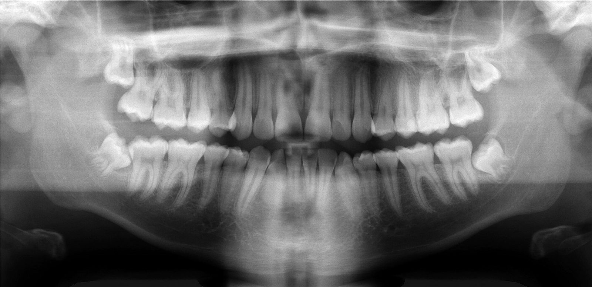
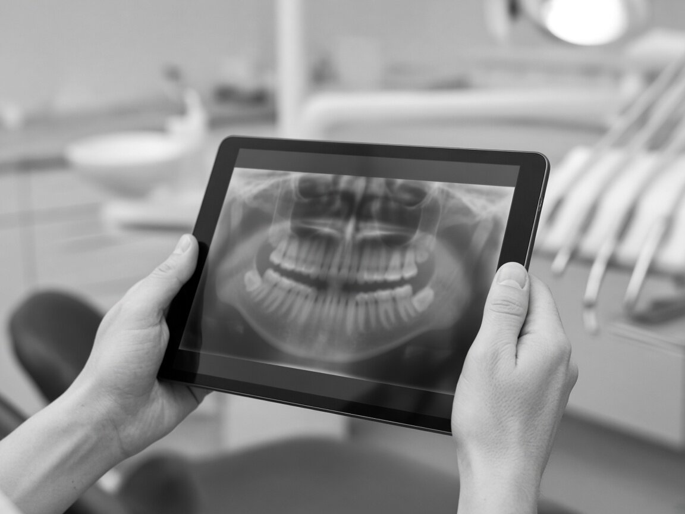

Зуб мудрості — це останній жувальний зуб, третій моляр. Йому часто не вистачає місця, тож він лишається під яснами, виходить лише наполовину або впирається в сусідній зуб. Сам факт, що зуб «є на знімку», ще не означає операцію. У кабінеті Novadent у Вінниці, на вул. Гоголя 15, лікар Голуб Олександр Олексійович дивиться, чи є хвороба: запалення ясенного каптура, дірка в сусідньому зубі, кіста. Прицільний знімок на візіографі роблять тут же, він коштує 100 гривень. Хірургічне видалення ретенованого зуба частіше є візитом до хірурга, а не процедурою в цьому кріслі.

Довготривала оцінка NICE радить не видаляти профілактично ретеновані зуби мудрості, які вільні від хвороби. Видалення розглядають, коли є патологія: інфекція, карієс, який уже не відновити, або шкода сусідньому зубу. Здоровий зуб, що глибоко лежить у кістці і нічим не нагадує про себе, не «прибирають про всяк випадок».

## Що означає «зуб лізе»

Повністю прорізаний зуб мудрості чистять, як і інші, якщо до нього дістає щітка. Проблема починається, коли над коронкою лишається клапоть ясен, каптур. Під нього потрапляє їжа, і вичистити це місце вдома майже неможливо. Зуб може стояти рівно, а може нахилитися вперед і впертися в задню стінку другого моляра. Тоді між ними утворюється щілина, яку не бачить дзеркало, доки там не з’явиться дірка, що вже болить на солодке або на холод.

Нижня щелепа тісніша частіше, ніж верхня, але правило «нижній завжди видаляють, верхній завжди лишають» немає. Дивляться кожен зуб окремо: чи вийшов він, чи є кишеня під каптуром, чи цілий сусід, чи немає набряку. Біль біля вуха і в скроні інколи йде саме звідти, бо жувальні м’язи і суглоб поруч. Це привід для огляду, а не для висновку з фотографії в телефоні.

<figure>

<figcaption>Панорамний знімок показує всі зуби мудрості разом із сусідами. Він оглядовий. Навчальний знімок, не пацієнт Novadent. Автор: Coronation Dental Specialty Group, <a href="https://commons.wikimedia.org/wiki/File:Basic_panoramic_radiograph.jpg" target="_blank" rel="noopener noreferrer">CC BY 3.0</a>.</figcaption>
</figure>

## Перикороніт: запалення каптура

Перикороніт — це запалення ясен над зубом, що прорізався частково. Каптур набрякає, болить, коли стуляєш зуби, з-під нього йде неприємний смак. Інколи щока припухає, рот відкривається гірше, біль віддає в горло або вухо. Так буває, бо під клаптем живуть бактерії нальоту, а слина і щітка туди не доходять. Всесвітня організація охорони здоров’я описує неліковані інфекції порожнини рота як частину хвороб, з якими не варто сидіти вдома, доки набряк росте.

NICE розрізняє епізоди. Перший, якщо він не тяжкий, сам по собі ще не є наказом на операцію: дивляться, знімають гостре запалення, пояснюють, як промивати доступне місце і коли повертатися. Повторні епізоди або тяжкий перебіг, коли є значний набряк, температура, складно ковтати чи відкривати рот, уже є патологією, заради якої зуб розглядають до видалення. Чекати «поки само мине» тиждень за тижнем, коли щока більшає, не треба. І не треба витягати зуб ниткою, викруткою з домашньої аптечки чи будь-яким іншим способом. Ретенований зуб сидить у кістці поруч із нервом і сусіднім коренем. Самодіяльне видалення тут не лікує, а додає рану і інфекцію.

У цьому кабінеті такий зуб оглядають, за потреби знеболюють і знімають прицільний кадр. Анестезія в прайсі коштує 200 гривень, якщо вона потрібна для роботи в кріслі. Розріз каптура або видалення зуба з кістки планують там, де є умови для хірургії. Лікар прямо каже, що з цього можна зробити на Гоголя 15, а з чим їхати до хірурга.

## Дірка в другому молярі і кіста

Найнеприємніша тиха шкода — карієс задньої стінки другого моляра. Зуб мудрості закриває її від щітки. Наліт і цукор лишаються там годинами. Настанова ВООЗ щодо вільних цукрів нагадує, що для емалі важливі і кількість солодкого, і те, як часто воно потрапляє в рот. Кожен солодкий напій між їжею — окремий кислотний епізод у місці, яке й так не чиститься. Другий моляр до цього був здоровим жувальним зубом. Втратити його через сусіда, який навіть не працює в прикусі, прикро і дорого.

Таку порожнину інколи не видно, доки зонд або знімок не покаже розм’якшення. Якщо зуб мудрості й далі закриває дірку, пломба в ній не витримає: край знову буде в нальоті. Тоді лікують обидві речі. Порожнину другого моляра можна закрити тут, після огляду і знімка. Питання, чи прибирати зуб мудрості, вирішують за тим, чи можна після цього нормально вичистити і запломбувати сусіда. Карієс, який уже не відновити, NICE якраз називає серед приводів до видалення.

Інший тихий варіант — кіста. Навколо коронки зуба, що так і не вийшов, інколи росте мішечок із рідиною. Він не болить, поки малий. На знімку це прозора зона біля коронки, якої не було раніше або яка вже розсуває кістку. Це хвороба фолікула, а не «особливість знімка». Такий зуб не лишають без плану: його показують хірургу, бо оболонка кісти має бути прибрана разом із причиною. Наскільки часто так буває, з одного огляду не виводять. Важливо не пропустити знахідку, коли знімок уже зроблено з іншого приводу.

<figure>

<figcaption>Знімок дивляться разом: на ньому корені і кістка, а не лише коронка в дзеркалі. Прицільний кадр на візіографі в Novadent коштує 100 гривень.</figcaption>
</figure>

## Коли зуб можна лишити

Глибоко ретенований зуб без скарг, без дірки в сусіді, без кишені, що запалюється, і без кісти на знімку не видаляють лише тому, що йому вісімнадцять чи тридцять років і «колись він завадить». NICE прямо виступила проти такої профілактичної практики. Спостереження теж є планом. Воно означає чистити доступні поверхні фторвмісною пастою двічі на день, не збирати солодке в частих ковтках і приходити, якщо з’явилися набряк, присмак, застрягання їжі або чутливість другого моляра. Кокранівський огляд щодо фторпасти підтверджує, що паста з фтором захищає емаль краще, ніж паста без нього. Для зуба мудрості це не заміна рішення про видалення, а спосіб не додати карієс там, де щітка ще дістає.

Прицільний знімок у кабінеті добре показує цей зуб, його корені і контакт із другим моляром. Усі чотири зуби мудрості на одному кадрі і хід каналу нижньощелепного нерва краще читаються на панорамному знімку. Той апарат інший. Якщо для хірурга потрібен саме оглядовий кадр, лікар скаже, де його зробити, і не підмінить його серією випадкових прицільних «для кількості». Знімок, який нічого не змінить у плані, можна не робити.

Варто повернутися раніше за плановий огляд, якщо рот відкривається гірше, ніж учора, набряк переходить на щоку або під щелепу, болить ковтати, або з-під каптура тече і піднімається температура. Це вже не привід читати форуми. Телефон кабінету [075 177 75 67](tel:+380751777567). Консультація безкоштовна: на ній буде зрозуміло, чи це спостереження, лікування сусіднього зуба, чи направлення до хірурга. Видаляти зуб удома не пропонують ні в якому вигляді.

Цей текст пояснює, коли зуб мудрості лікують, а коли за ним спостерігають. Він не ставить діагноз і не замінює огляд.

## Джерела

<ol class="blog-sources">
<li><a href="https://www.nice.org.uk/guidance/ta1" target="_blank" rel="noopener noreferrer">NICE. Guidance on the extraction of wisdom teeth (TA1)</a>. Довготривала оцінка радить не видаляти профілактично ретеновані зуби мудрості без ознак хвороби. Привід до видалення — патологія, зокрема інфекція, карієс, який не відновити, і шкода сусідньому зубу.</li>
<li><a href="https://www.who.int/news-room/fact-sheets/detail/oral-health" target="_blank" rel="noopener noreferrer">World Health Organization. Oral health</a>. Фактологічна довідка про хвороби порожнини рота, зокрема карієс і наслідки нелікованої інфекції.</li>
<li><a href="https://www.who.int/publications/i/item/9789241549028" target="_blank" rel="noopener noreferrer">World Health Organization. Guideline: sugars intake for adults and children</a>. Вільні цукри і частота солодких контактів мають значення для карієсу, зокрема там, де поверхню важко вичистити.</li>
<li><a href="https://doi.org/10.1002/14651858.CD007868.pub3" target="_blank" rel="noopener noreferrer">Walsh T, Worthington HV, Glenny AM, Marinho VCC, Jeroncic A. Fluoride toothpastes of different concentrations for preventing dental caries. Cochrane Database of Systematic Reviews. 2019</a>. Фторвмісна паста запобігає карієсу краще, ніж паста без фтору.</li>
</ol>
