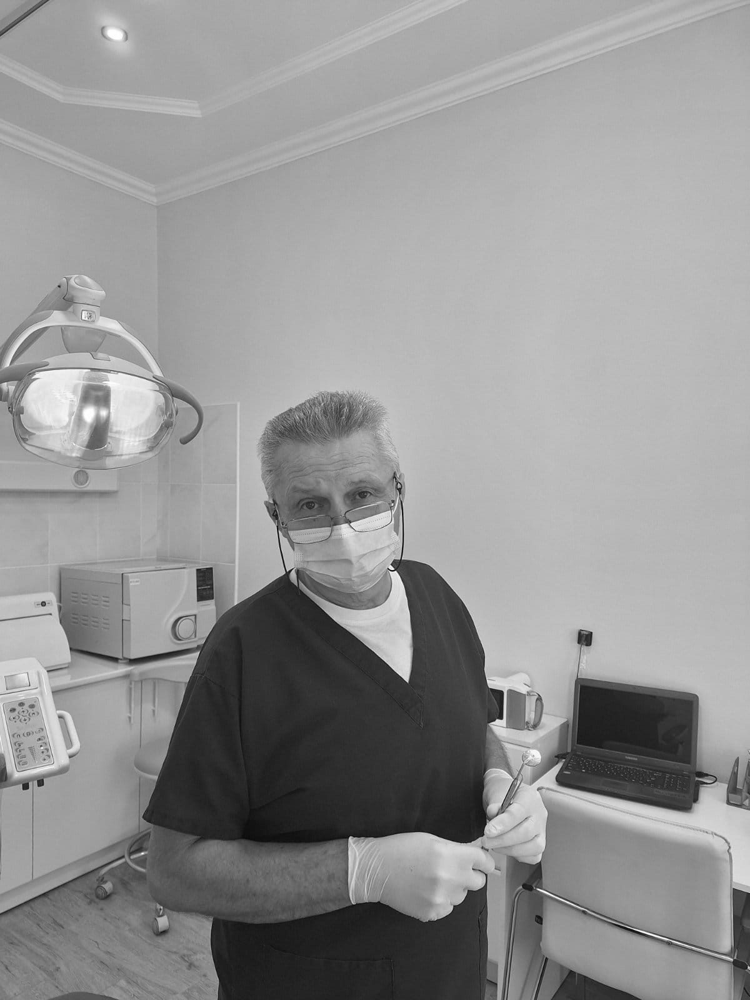
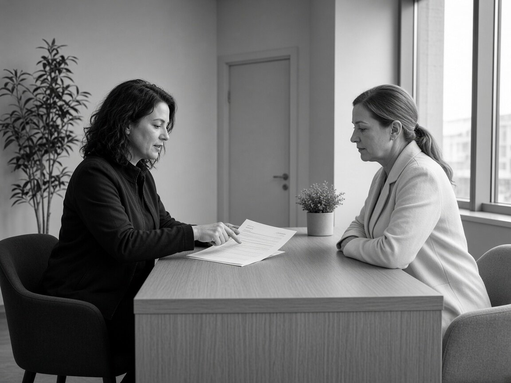

Вагітність не є причиною відкласти зубний біль до пологів. Інфекція, набряк і глибокий карієс у ці місяці не стають безпечнішими від очікування. Американська стоматологічна асоціація в матеріалі про здоров’я порожнини рота під час вагітності тримає просту лінію: потрібна стоматологічна допомога є доречною в будь-якому триместрі. Відбілювання заради відтінку і заміна цілої пломби лише через колір можуть почекати. Лікування, без якого є біль або вогнище інфекції, не відкладають «на потім, коли буде зручніше».

У Novadent, Вінниця, вул. Гоголя 15, лікар Голуб Олександр Олексійович приймає вагітних на звичайній безкоштовній консультації. На ній називають термін, ліки, які вже призначив акушер, і те, що болить. Прицільний знімок, якщо він змінює лікування, роблять на місці за 100 гривень. Окремої «вагітної програми» з набором зайвих процедур немає.

## Ясна кровоточать не «через гормони» самі по собі

У багатьох жінок у другому триместрі ясна набрякають і кровлять під час чищення. Гормони змінюють відповідь ясен на той самий наліт: там, де раніше було тихо, з’являється запалення. Прибрати гормони не можна і не потрібно. Прибрати наліт можна. Якщо лишити чищення «бо кров лякає», наліт наростає, і кровоточивість стає більшою, а не меншою. Всесвітня організація охорони здоров’я описує хвороби ясен як частину хвороб порожнини рота, які лікують, а не перечікують.

Це ще не означає, що кожна крапля крові на щітці є пародонтитом із втратою кістки. Часто це гінгівіт: запалення краю ясен без глибоких кишень. Його зменшує щоденне чищення фторпастою і зняття нальоту там, де щітка не доходить, зокрема між зубами. Якщо ясна болять, з них іде гній або зуб хитається, огляд потрібен швидше за плановий. Чекати пологів із такою картиною не радять.

Нудота додає іншу задачу. Після блювання на емалі лишається кислота, найчастіше з внутрішнього боку верхніх зубів. У цю хвилину рот прополіскують водою і не чистять одразу: щітка по розм’якшеній кислотою поверхні знімає емаль швидше. Чистять пізніше, коли слина вже розвела кислоту, звичайною фторпастою. Кокранівський огляд Walsh і співавторів підтверджує роль фторпасти в захисті емалі. Спльовувати піну варто без великої склянки води, як і поза вагітністю. Солодкі часті ковтки «щоб заїсти нудоту» тримають і кислоту, і цукор. Якщо їсти хочеться часто і малими порціями, для спраги між ними краще вода.

<figure>

<figcaption>До огляду називають термін вагітності і ліки від акушера. Лікар Голуб у кабінеті Novadent.</figcaption>
</figure>

## Що лікують зараз, а що може почекати

Зараз лікують біль, набряк, зламаний зуб, карієс, який уже дійшов до чутливості або близько до нерва, і запалення, через яке не можна жувати. Пломба і, якщо потрібно, початок лікування каналів у вагітної — звичайна допомога, а не подвиг. Відкласти можна те, що не несе інфекції: відбілювання, заміну задовільної пломби з естетики, косметичні правки, без яких жінка спокійно їсть.

Виправданий знімок не скасовують через вагітність. Без нього легко пропустити вогнище біля кореня або недооцінити глибину порожнини і розкрити нерв там, де можна було обійтися меншим втручанням. Як обирають кадр і чому вагітність не є забороною на потрібний знімок, розібрано в записі [«Знімок на візіографі»](2026-10-01-scan.html). Старі знімки, якщо вони є, варто взяти з собою: інколи нового кадру не потрібно.

Знеболення для такої роботи — місцева анестезія. У побуті це «укол у ясна». Звичайний препарат для цього — лідокаїн. Окремих «категорій ризику» з старих листівків тут наводити не будемо: їх більше не використовують як спосіб пояснити безпеку, і саморобна таблиця доз у статті лише заплутає. Дозу обирає лікар під конкретний зуб. У прайсі кабінету анестезія коштує 200 гривень. Терпіти глибокий карієс без знеболення не потрібно ні вагітній, ні будь-кому іншому: біль заважає і якісній роботі.

Знеболювальна таблетка вдома — окрема розмова з акушером. Першим засобом, який зазвичай обговорюють, є парацетамол. Доз у цьому тексті немає навмисно: їх погоджують із тим, хто веде вагітність, а не з блогом. Інші протизапальні таблетки самовільно не додають «бо зубний біль особливий». Якщо біль не знімається тим, що дозволив акушер, або з’являється набряк і температура, це привід до стоматолога найближчим часом, а не до другої упаковки.

<figure>

<figcaption>У плані розділяють те, що лікують через біль чи інфекцію, і те, що можна відкласти до спокійнішого часу.</figcaption>
</figure>

Кров на щітці не є сигналом припинити чищення. М’яка щетина біля краю ясен двічі на день якраз і є домашня половина лікування такого гінгівіту. Якщо щітку прибрати «поки не перестане кровлити», наліт стає товщим, і наступного тижня крові більше. Між зубами обережно проходять ниткою або йоршиком, де є місце. Перші дні нитка теж може фарбуватися: це запалений край, а не привід лишити проміжок брудним.

Інколи на яснах між зубами виростає м’який червоний вузлик, який кровлить від дотику щітки. У підручниках його називають епулісом вагітних. Це надмірна відповідь ясен на наліт, а не пухлина, яку лікують як онкологію. У цьому кабінеті онкологічного лікування немає. Багато таких вузликів зменшуються після пологів. Якщо через нього важко їсти, кров сильна або ви не впевнені, що це саме він, його дивляться. Огляд і, за потреби, направлення замінюють і очікування навмання, і спробу зрізати його вдома.

## Як сидіти в третьому триместрі

У третьому триместрі довге лежання навзнак саме по собі може стати неприємним: матка тисне на великі судини, паморочиться в голові, нудить, пітніють долоні. Це не привід скасовувати лікування інфекції. Це привід зробити візит коротшим, тримати спинку крісла вище і, якщо жінці так легше, повернути її трохи на лівий бік. Якщо паморочиться, роботу зупиняють, дають сісти і віддихатися. Кілька коротких візитів кращі за один героїчний, після якого погано і лікарю, і пацієнтці.

У першому триместрі нудота може заважати довго тримати рот відкритим. І тут потрібну допомогу не переносять на післяпологовий період. Обирають час доби, коли нудоти менше, і обсяг на один візит. Плановий огляд і чищення, якщо ясна кровлять, теж доречні в середині вагітності, а не лише «коли заболить».

На консультацію корисно сказати термін у тижнях, чи є підвищений тиск, діабет вагітних, загроза, яку вже пояснив акушер, і які ліки призначені. Обмінну карту приносять, якщо вона під рукою. Без неї огляд усе одно починають: біль не чекає печатки. Лікар не замінює акушера і не змінює призначену схему. Він лікує зуб так, щоб не суперечити їй.

Після пологів, коли з’явиться час, можна повернутися до відкладеного: заміни старої пломби, яка не боліла, питання відбілювання, якщо воно взагалі цікаве. Грудне вигодовування саме по собі не забороняє пломбу і місцеву анестезію, але це вже інший візит і інша розмова, без змішування з порадами для вагітності.

Кабінет працює у будні з 9:00 до 18:00, у суботу з 9:00 до 15:00. Телефон [075 177 75 67](tel:+380751777567). Якщо щока набрякла сьогодні, не чекайте «зручного тижня після пологів».

Цей текст пояснює, яку стоматологічну допомогу під час вагітності не відкладають. Він не замінює пораду акушера і не ставить діагноз.

## Джерела

<ol class="blog-sources">
<li><a href="https://www.ada.org/resources/ada-library/oral-health-topics/pregnancy" target="_blank" rel="noopener noreferrer">American Dental Association. Pregnancy</a>. Потрібна стоматологічна допомога доречна під час вагітності; її не відкладають через сам факт очікування дитини.</li>
<li><a href="https://www.who.int/news-room/fact-sheets/detail/oral-health" target="_blank" rel="noopener noreferrer">World Health Organization. Oral health</a>. Хвороби ясен і нелікований карієс є частиною хвороб порожнини рота, які потребують допомоги.</li>
<li><a href="https://doi.org/10.1002/14651858.CD007868.pub3" target="_blank" rel="noopener noreferrer">Walsh T, Worthington HV, Glenny AM, Marinho VCC, Jeroncic A. Fluoride toothpastes of different concentrations for preventing dental caries. Cochrane Database of Systematic Reviews. 2019</a>. Фторпаста лишається щоденним захистом емалі, зокрема після кислотних епізодів.</li>
<li><a href="https://www.gov.uk/government/publications/delivering-better-oral-health-an-evidence-based-toolkit-for-prevention" target="_blank" rel="noopener noreferrer">Office for Health Improvement and Disparities. Delivering better oral health: an evidence-based toolkit for prevention</a>. Щоденна профілактика: фторпаста, наліт і частота цукру, без «паузи» на місяці вагітності.</li>
</ol>
