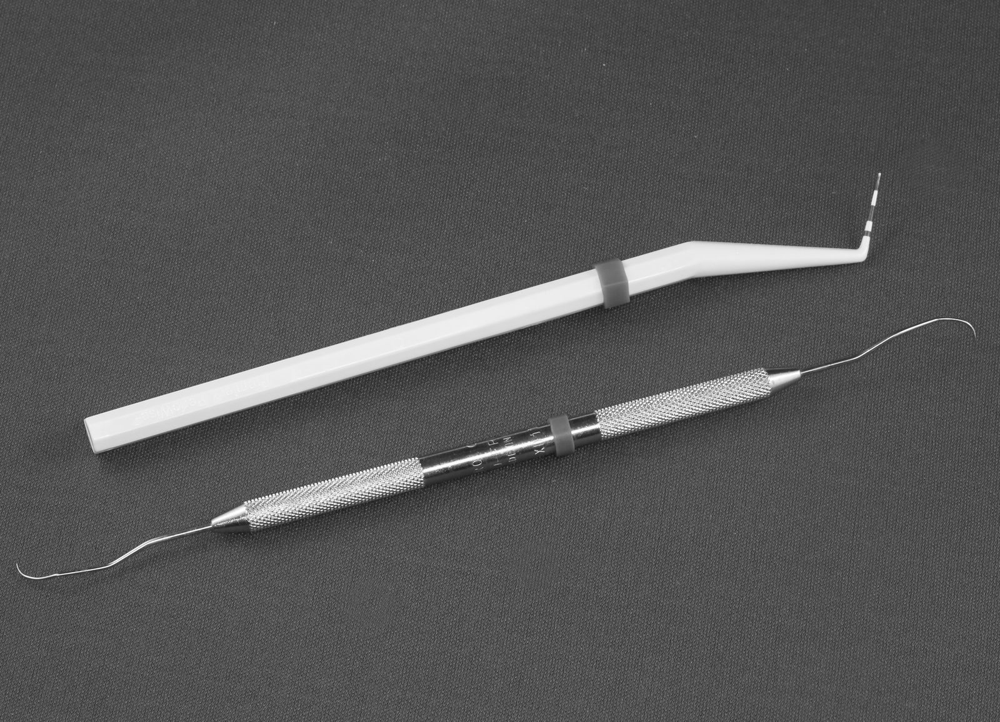

Діабет і запалення ясен ходять разом частіше, ніж людям кажуть на прийомі в ендокринолога і на прийомі в стоматолога окремо. Спільний семінар Європейської федерації пародонтології та Американської академії пародонтології 2013 року, звіт якого підготували Chapple і Genco, описує цей зв’язок як двосторонній. Гірший контроль глюкози ускладнює перебіг пародонтиту. Важке запалення ясен, своєю чергою, бачать разом із гіршим глікемічним контролем. Це не гасло «ясна викликають діабет» і не обіцянка, що чистка замінить ліки.

Всесвітня організація охорони здоров’я в довідці про здоров’я порожнини рота називає діабет серед станів, які йдуть поруч із гіршим станом ясен. Цифр і відсотків тут не буде: для людини в кріслі важливіше, що робити на візиті. У Novadent, вул. Гоголя 15 у Вінниці, лікар Голуб Олександр Олексійович починає з безкоштовної консультації. Візьміть список ліків і коротке уявлення, якою останнім часом була глюкоза.

## Що означає «в обидва боки» без зайвих обіцянок

Наліт на зубах запалює край ясен у будь-кого. При діабеті та сама кількість нальоту частіше дає глибші кишені, більше крові на щітці і швидшу втрату кістки навколо кореня, якщо глюкоза довго тримається високо. Зворотний бік семінару такий: коли пародонтит уже важкий, глікемічний контроль у дослідженнях виглядає гірше, ніж без цього запалення. Механізм спрощено пояснюють хронічним запаленням, яке не сидить лише в роті. Для пацієнта висновок спокійний. Рот лікують заради рота. Ліки від діабету не скасовують, навіть якщо ясна стали чистішими.

Вплив пародонтологічного лікування на глікований гемоглобін, якщо він взагалі є, скромний. Він не привід чекати, що після зняття каменю цукор «сам налагодиться», і не привід пропускати метформін, інсулін чи те, що призначив ендокринолог. Будь-яке покращення на глюкометрі обговорюють із лікарем, який веде діабет, а не зараховують автоматично на рахунок стоматолога. Привід лікувати ясна інший: щоб зуби трималися, щоб не було нариву, запаху і болю під час їжі.

Настанова ВООЗ щодо вільних цукрів стосується і карієсу, і загального режиму. Часті солодкі напої б’ють по емалі навіть тоді, коли «цукор у крові сьогодні ніби нічого». Для зубів важливий кожен ковток, не лише десерт після обіду. Заміну солодкого режиму стоматолог не виписує замість дієтолога. Він може показати, де наліт уже зробив порожнину, і попросити не запивати спрагу соком протягом дня.

<figure>

<figcaption>Пародонтальний зонд вимірює борозну між зубом і яснами. Кров і глибока кишеня — це розмова про ясна, а не лише про дірку в емалі. Навчальне фото. Автор: Coronation Dental Specialty Group, <a href="https://commons.wikimedia.org/wiki/File:Dental_explorer_and_periodontal_probe.jpg" target="_blank" rel="noopener noreferrer">CC BY-SA 3.0</a>.</figcaption>
</figure>

## Що принести і про що сказати на початку

Найкорисніше на консультації — список препаратів із дозами, не з пам’яті «білі таблетки вранці». Якщо є інсулін, скажіть, який і коли колоте відносно їжі. Корисно назвати, чи були останніми тижнями гіпоглікемії, о котрій годині ви зазвичай їсте і чи глюкоза в ці дні «пливе». Ідеальний щоденник не обов’язковий. Фраза «вранці часто низько, якщо не поїм» уже змінює, як ставити довгий прийом.

Скажіть і про ускладнення, якщо вони є: нирки, зір, серце, загоєння ран, про які попереджав ендокринолог. Стоматолог не лікує діабет, але інфекцію в зубі при високій глюкозі не залишає «поспостерігати до літа». Нарив і зруйнований зуб, у якому живе бактерія, є навантаженням. Їх прибирають як стоматологічну задачу, з знеболенням і знімком, якщо кадр змінює план. Візіограф на місці коштує 100 гривень, анестезія 200 гривень. Про показання до знімка — у записі [«Знімок на візіографі»](2026-10-01-scan.html).

Куріння посилює і ясна, і судинні ризики, які при діабеті і так обговорюють. Якщо палите, про це теж варто сказати без сорому: план чищення від цього не скасовують. Окремо про дим і рот — у записі [«Куріння і рот»](2025-05-12-smoking.html).

## Їжа, інсулін і довге крісло

Якщо ви на інсуліні, не приходьте на довгу роботу навмисно голодними, «щоб не заважати лікарю». Пропущений обід у поєднанні зі звичайною дозою інсуліну може закінчитися гіпоглікемією в кріслі: піт, тремтіння, різкий голод, плутанина в голові. Попередьте лікаря на початку, що таке з вами буває, і візьміть те, чим зазвичай знімаєте гіпоглікемію: сік, цукор, те, що порадив лікар із діабету. На перших ознаках скажіть. Роботу зупиняють, вас саджають рівно, і ви випиваєте або з’їдаєте те, що взяли з собою. Бормашину не тримають увімкненою, поки тремтять руки. Прийом можна перервати і дати час. Це звичайна обережність, а не надзвичайна подія.

Не змінюйте дозу інсуліну вранці лише тому, що сьогодні пломба, якщо ендокринолог не просив інакше. Стоматолог дозу інсуліну не підбирає. Якщо лікування планується довге, його ділять на візити навколо вашого звичного прийому їжі, а не ставлять у вікно, де ви завжди «на нулі». Таблетовані схеми теж називайте: деякі ліки п’ють разом із їжею, і пропускати сніданок заради ранкового запису не варто.

Загоєння після видалення або глибокого чищення при довго високій глюкозі може йти гірше. Це не заборона на допомогу. Інфекцію все одно лікують, а про шов або лунку кажуть, на що дивитися вдома: набряк, що росте, біль, який не вкладається в очікуване, присмак. Температура і щока, яка більшає, це дзвінок у кабінет, а не чекання планового огляду через місяць.

<figure>

<figcaption>На розмові до лікування корисний список ліків і те, як останнім часом поводиться глюкоза. Огляд усе одно вирішує, що робити з зубом.</figcaption>
</figure>

## Рот лікують навіть якщо цукор ще не ідеальний

Інколи люди відкладають стоматолога, доки «не налагоджу цукор». Гостра інфекція цього плану не слухає. Її прибирають паралельно з тим, як ендокринолог веде глюкозу, а не після ідеальних аналізів. Планове глибоке чищення і пломби справді зручніше робити, коли самопочуття передбачуване, і про це можна домовитися. Але набряк, нічний біль і свищ на яснах не є плановою естетикою.

Підтримка після лікування ясен — частина роботи, а не комплімент. Кишені знову збирають наліт, якщо повернутися лише через біль. Інтервал оглядів підбирають за тим, як кровлять ясна і як виходить чищення вдома, а не за абонементом. Щітка двічі на день і міжзубний засіб лишаються щоденними, навіть якщо раз на пів року в кабінеті «все почистили».

Безкоштовна консультація ні до чого не зобов’язує: можна піти зі списком, що лікувати спочатку. Кабінет працює у будні з 9:00 до 18:00, у суботу з 9:00 до 15:00. Телефон [075 177 75 67](tel:+380751777567). Якщо в день візиту глюкоза поводиться незвичайно низько або високо і вам погано, скажіть про це ще на порозі, до того як ляжете в крісло.

Цей текст описує двосторонній зв’язок діабету і ясен без підміни ендокринолога. Він не змінює ваші ліки і не замінює огляд.

## Джерела

<ol class="blog-sources">
<li><a href="https://www.who.int/news-room/fact-sheets/detail/oral-health" target="_blank" rel="noopener noreferrer">World Health Organization. Oral health</a>. Діабет названо серед станів, пов’язаних із гіршим здоров’ям ясен. Тут немає підстав вигадувати відсотки.</li>
<li><a href="https://doi.org/10.1111/jcpe.12077" target="_blank" rel="noopener noreferrer">Chapple ILC, Genco R. Diabetes and periodontal diseases: consensus report of the Joint EFP/AAP Workshop on Periodontitis and Systemic Diseases. J Clin Periodontol. 2013</a>. Семінар описує двосторонній зв’язок діабету і пародонтиту. Чисел цей запис із нього не наводить.</li>
<li><a href="https://www.who.int/publications/i/item/9789241549028" target="_blank" rel="noopener noreferrer">World Health Organization. Guideline: sugars intake for adults and children</a>. Вільні цукри і часті солодкі контакти мають значення для карієсу окремо від того, як глюкоза виглядає на глюкометрі.</li>
<li><a href="https://www.gov.uk/government/publications/delivering-better-oral-health-an-evidence-based-toolkit-for-prevention" target="_blank" rel="noopener noreferrer">Office for Health Improvement and Disparities. Delivering better oral health: an evidence-based toolkit for prevention</a>. Щоденний наліт, фторпаста і догляд за яснами лишаються основою, поряд із лікуванням діабету в свого лікаря.</li>
</ol>
