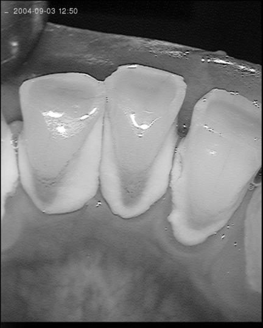
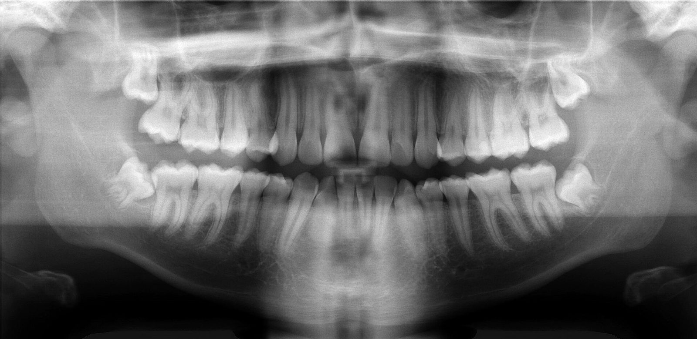

Сигарета змінює рот тихіше, ніж здається з запаху диму. Ясна в людини, яка палить, можуть майже не кровлити і виглядати блідими саме тоді, коли під ними вже йде запалення і втрачається кістка. Нікотин звужує судини. Кров, яка в іншого була б сигналом «час до лікаря», тут ховається. Відсутність крові на щітці в курця не доводить, що ясна здорові.

Цей запис про тютюн, який курять: сигарети, самокрутки, люльку. Без докорів і без умови «спершу кинь, тоді лікуватимемо». У Novadent на вул. Гоголя 15 у Вінниці лікар Голуб Олександр Олексійович оглядає, знімає наліт і камінь, лікує карієс і ясна в того, хто палить зараз. Консультація безкоштовна. Онкологічне лікування в цьому кабінеті не проводять: підозрілу виразку дивляться і направляють до лікаря, який цим займається.

## Що дим робить із яснами, емаллю і загоєнням

Пародонтит у курців перебігає тяжче. Кишені глибші, кістка навколо коренів іде швидше, відповідь на лікування ясен гірша, ніж у людини з тим самим нальотом, але без диму. Консенсус Sanz і співавторів 2020 року нагадує, що куріння є спільним ризиком і для пародонтиту, і для серцево-судинних хвороб. Зв’язок цей не означає, що чистка ясен запобігає інфаркту. Він означає, що дим сидить в обох розмовах, і рот усе одно лікують заради рота. Докладніше про цю межу — у записі [«Ясна і серце»](2025-05-05-gums-heart.html).

Наліт у димі темніє. Коричневий шар сідає на емаль, у тріщини і по краях пломб. Зубний камінь, твердий наліт біля шийок, у курця часто помітніший і темніший. Професійне чищення знімає цей шар. Воно не скасовує кишеню і не «обнуляє» роки паління. Після чищення зуби світлішають настільки, наскільки дозволяв власний колір емалі під нальотом, і знову потемніють, якщо дим лишається щодня.

Загоєння після видалення зуба або після лікування ясен іде гірше, коли в рану потрапляє дим. Лунка болить довше, краї ясен розходяться неохоче. Це не мораль, а причина не планувати видалення «між двома сигаретами» і сказати лікарю чесно, скільки ви палите. Пораду зменшити дим у день втручання дають без сорому. Якщо не виходить зовсім, лікування гострого болю все одно не відкладають на невизначений термін «поки кинеш».

Всесвітня організація охорони здоров’я ставить тютюн серед головних чинників хвороб порожнини рота, поруч із алкоголем і вільними цукрами. Британський посібник Delivering better oral health тримає ту саму профілактичну логіку: запитати про паління, порадити зупинку і запропонувати допомогу. Це коротка розмова, не допит.

<figure>

<figcaption>Зубний камінь біля шийок на навчальному фото. У курця він часто темніший через дим, але темний шар сам по собі не каже, чи глибока кишеня. Автор: Michael Ottenbruch, <a href="https://commons.wikimedia.org/wiki/File:Calculus.jpg" target="_blank" rel="noopener noreferrer">GFDL</a>.</figcaption>
</figure>

## Як про це говорять на прийомі

Коротка порада складається з трьох кроків, без лекції на пів години. Лікар питає, чи палите ви і як самі до цього ставитесь. Якщо палите, каже прямо: відмова від тютюну — одна з найкорисніших речей, які можна зробити для ясен і для загоєння. Далі пропонує допомогу: підказати, до кого звернутися, якщо ви хочете зупинитися. Якщо говорити про це сьогодні не хочеться, тему не розтягують. Пломбу і огляд ясен від цього не скасовують і не перетворюють на іспит.

Сором у цій розмові заважає. Людина, якій дорікнули, рідше називає справжню кількість сигарет і рідше повертається, коли лунка болить. Названа цифра потрібна для плану, а не для оцінки характеру. Спроби кинути, які не втрималися, теж нормальна частина історії. Їх не розбирають як провал на стоматологічному кріслі.

Після відмови ясна інколи починають кровлити сильніше, ніж під час паління. Судини вже не затиснуті нікотином, і запалення, яке було тихим, стає видимим. Це не доказ, що «без сигарет стало гірше» і не привід повертатися до диму. Це привід дочистити наліт і дати яснам заспокоїтися. Якщо кров не зменшується за час, про який домовились, приходять на огляд знову.

## Виразка, пляма, ущільнення

Тютюн разом із алкоголем підвищує ризик раку порожнини рота. Наскільки саме, цей текст не рахує: якісного сигналу досить, щоб не додавати міцний алкоголь «за компанію» і не чекати, що біль сама мине. Два орієнтири для візиту, без самодіагнозу по фото. Виразка, яка не загоюється понад два тижні, червона або біла пляма, ущільнення в щоці, на язиці чи під щелепою потребують огляду стоматолога або лікаря. Кабінет може подивитися і направити. Лікувати пухлину тут не беруться.

Прицільний знімок на візіографі, 100 гривень, показує кістку навколо коренів, якщо ясна довго мовчали і кровоточивості не було як підказки. Панорамний кадр, його роблять на іншому апараті, дає огляд висоти кістки всіх зубів одразу. Він не є «перевіркою на рак». Пухлину м’яких тканин шукають очима і пальцями, а не лише тінями коренів.

<figure>

<figcaption>Оглядовий знімок показує, скільки кістки лишилося навколо коренів, коли ясна довго не кровлили. Це не пошук пухлини. Навчальний знімок. Автор: Coronation Dental Specialty Group, <a href="https://commons.wikimedia.org/wiki/File:Basic_panoramic_radiograph.jpg" target="_blank" rel="noopener noreferrer">CC BY 3.0</a>.</figcaption>
</figure>

## Кілька рядків про вейп

Електронні сигарети і нагрівання тютюну — окрема історія з менш повною базою даних, ніж у горючого тютюну. Називати їх нешкідливими для ясен і слизової не варто: аерозоль теж подразнює рот, і «це лише пара» не є медичним висновком. Цей запис свідомо не розбирає вейп докладніше. Якщо ви перейшли на нього, щоб кинути сигарети, скажіть про це на консультації так само спокійно, як про пачку. План лікування зубів від марки пристрою не починається.

Коли ясна в курця не кровлять, лікар дивиться не на колір щітки, а на кишеню зондом, на камінь під яснами, на оголені шийки і, якщо це змінить план, на кістку на знімку. Коричнева борозенка теж не діагноз. Дим сідає нальотом, який знімається чищенням. Карієс під тією самою фарбою м’який під зондом. Обидва виглядають темними, тому фраза «дірок немає, це лише наліт курця» без огляду не працює, а відбілювальна паста не замінює зонд.

Після відмови від сигарет огляд ясен має сенс у найближчі місяці, а не тоді, коли заболить. Кров, яка з’явилася, є приводом виміряти кишені. Вона не є приводом знову закурити, щоб «як раніше не кровіло».

Алкоголь у розмові про рот згадують поруч із тютюном не для нотації. Міцний алкоголь сушить слизову і разом із димом тримає той самий ризик, про який ішлося вище. Щоденне пиво або вино «для ясен» нічого не лікує. Вода і фторпаста двічі на день лишаються нудною основою, яку посібник із профілактики не скасовує через паління. Паління не є причиною класти менше пасти або рідше чистити. Навпаки, наліт у курця краще прибирати ретельно, включно з проміжками, де кишеня починається непомітно.

Кабінет працює у будні з 9:00 до 18:00, у суботу з 9:00 до 15:00. Телефон [075 177 75 67](tel:+380751777567). Можна прийти, не кинувши напередодні. Огляд і план від цього не гірші, а розмова про зупинку лишається пропозицією, а не умовою.

Цей текст описує, як куріння змінює ясна, загоєння і на що дивитися на слизовій. Він не дорікає і не замінює огляд.

## Джерела

<ol class="blog-sources">
<li><a href="https://www.who.int/news-room/fact-sheets/detail/oral-health" target="_blank" rel="noopener noreferrer">World Health Organization. Oral health</a>. Тютюн і алкоголь названі серед чинників хвороб порожнини рота, включно з ризиком для слизової.</li>
<li><a href="https://www.gov.uk/government/publications/delivering-better-oral-health-an-evidence-based-toolkit-for-prevention" target="_blank" rel="noopener noreferrer">Office for Health Improvement and Disparities. Delivering better oral health: an evidence-based toolkit for prevention</a>. Коротка порада щодо тютюну: запитати, порадити зупинку, запропонувати допомогу.</li>
<li><a href="https://doi.org/10.1111/jcpe.13189" target="_blank" rel="noopener noreferrer">Sanz M, Marco del Castillo A, Jepsen S, et al. Periodontitis and cardiovascular diseases: Consensus report. J Clin Periodontol. 2020</a>. Куріння є спільним ризиком пародонтиту і серцево-судинних хвороб. Лікування ясен не подають як профілактику інфаркту.</li>
</ol>
