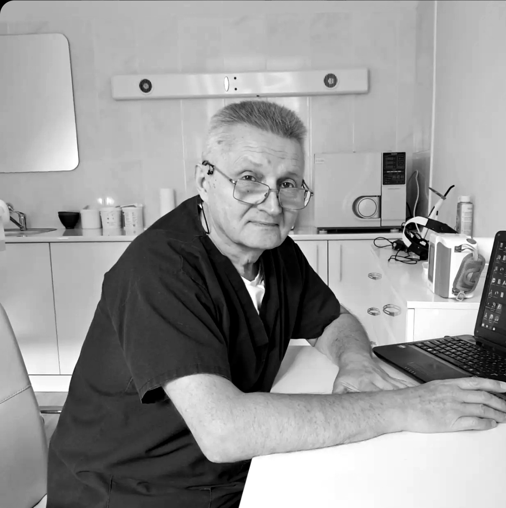

Більшість виразок у роті закриваються самі. Мала афта і прикус щоки якраз такі: болять кілька днів і минають. Інша історія починається там, де ділянка лишається, змінює колір або під нею з’являється ущільнення. Цей текст про те, коли огляд уже не варто відкладати, і про те, що саме робить із такою знахідкою кабінет Novadent.

Лікар-стоматолог вищої категорії Голуб Олександр Олексійович оглядає слизову, язик, щоки, ясна і видимий підхід до зіва. Якщо картина виходить за межі простої травми або афти, людину направляють туди, де можуть узяти тканину на дослідження. Біопсія не входить до послуг, які тут пропонують, і в прайсі її немає. Огляд і направлення — так, операція із забору тканин як окрема «послуга кабінету» — ні.

## Що має насторожити

Привід показати рот лікареві — виразка, яка не закривається, червона або біла пляма, що тримається, вузол у роті або на губі, оніміння губи, підборіддя чи язика, зуб, що раптом став рухомим без хвороби ясен, ущільнення на шиї, стійке утруднення ковтання. Одна така ознака ще не є діагнозом. Кілька разом або одна, що не минає, вже є причиною прийти, а не чекати планової чистки «колись».

Настанова NICE NG12 про розпізнавання підозри на онкологічне захворювання формулює поріг для порожнини рота прямо: незрозуміла виразка, що триває понад три тижні. Саме понад три тижні. Мала афта зазвичай укладається в коротший строк, близько одного-двох тижнів, і про це окремо написано в записі [«Виразки в роті: афти»](2025-05-19-aphthae.html). Виразка, яка перейшла третій тиждень і не має зрозумілої причини, під цю настанову підпадає як привід для термінової оцінки. Поряд NICE згадує стійкий незрозумілий вузол на шиї, а також утворення на губі чи в роті і червону або червоно-білу пляму, коли вони виглядають підозріло. Білий наліт, який знімається щіткою, і пігментна пляма відомого походження — інша розмова. Її теж дивляться, але не називають діагнозом за фотографією.

Зуб, що захитався, частіше говорить про ясна або про корінь. Якщо ясна спокійні, кишені неглибокі, а зуб усе одно рухається або поруч є виразка, це дивляться окремо, разом зі знімком. Прицільний кадр на візіографі в кабінеті коштує 100 грн. Він показує кістку навколо кореня і не замінює огляд слизової. Про те, коли знімок взагалі потрібен, є запис [«Знімок на візіографі»](2026-10-01-scan.html).

<figure>

<figcaption>Голуб Олександр Олексійович у кабінеті на вул. Гоголя 15. Підозрілу ділянку тут оглядають і за потреби направляють далі.</figcaption>

</figure>

## Тютюн, алкоголь і окремо вірус папіломи

Довідка Всесвітньої організації охорони здоров’я об’єднує рак губи, інших відділів рота і ротоглотки і ставить цю групу на 13-те місце серед онкологічних хвороб у світі. Серед провідних причин раку рота ВООЗ називає тютюн, алкоголь і жування арекової пальми, відоме як бетель. Ризик зростає, коли тютюн і алкоголь ідуть разом, і він вищий у людей старшого віку. Це не вирок кожному, хто палить. Це причина назвати звичку на прийомі і показати виразку раніше, ніж за два місяці.

Там само ВООЗ зазначає, що в Північній Америці та Європі інфекція вірусом папіломи людини дає зростаючу частку таких пухлин у молодших людей. Тут потрібне спокійне уточнення, якого в одній фразі довідки немає. Пухлина, пов’язана з цим вірусом, частіше сидить у ротоглотці: мигдалики, корінь язика, ділянка за ними. Це інше місце, ніж виразка на щоці, яснах або боковій поверхні язика, яку людина бачить у дзеркалі. Стоматологічний огляд усе одно дивиться рот, язик, щоки і те, що видно ближче до зіва. Він не замінює огляд ЛОР-лікаря і не є тестом на вірус. Якщо щось у цій зоні не збігається зі звичайною афтою, звідси направляють, а не спостерігають роками.

Британський профілактичний набір Delivering Better Oral Health розглядає тютюн і алкоголь як фактори, про які стоматологічна команда питає і в яких підтримує відмову. Чистка зубів фторованою пастою рак не скасовує. Кокранівський огляд Walsh і співавторів стосується іншого: така паста попереджає карієс. Це прибирає окрему причину болю, щоб на огляді було видно слизову, а не лише наліт і кров.

<figure>

<figcaption>Огляд слизової йде разом із оглядом зубів: зонд допомагає не пропустити край, який сам поранив щоку. Навчальне фото. Автор: Coronation Dental Specialty Group, <a href="https://commons.wikimedia.org/wiki/File:Dental_explorer_and_periodontal_probe.jpg" target="_blank" rel="noopener noreferrer">CC BY-SA 3.0</a>.</figcaption>

</figure>

## Що відбувається на прийомі

Розмова коротка і конкретна. Коли ділянка з’явилася, чи болить, чи була травма, чи є протез, який тре, чи змінювався смак, чи є оніміння, чи пальпується щось на шиї. Далі світло, дзеркало і пальці в рукавичках: щоки, язик з боків і знизу, дно рота, піднебіння, ясна, червона облямівка губ. Гострий край зуба або шорстка пломба, які сидять рівно навпроти виразки, добре пояснюють травму. Тоді прибирають зачіпку і дивляться, чи закривається слизова. Якщо зачіпки немає, а виразка щільна або вже перейшла поріг у три тижні, шлях інший: письмове пояснення, що видно, і направлення.

Знеболення на такому огляді зазвичай не потрібне. Якщо того самого дня треба згладити зуб або закрити порожнину, анестезія в прайсі коштує 200 грн. Консультація, з якої все починається, безкоштовна. На неї можна прийти саме через пляму або виразку, навіть якщо зуби «не болять».

Самостійні засоби, які припікають слизову, лише заважають наступному лікарю побачити край. Полоскання, яке на кілька годин знімає печіння, не замінює огляд, якщо дефект не меншає. Антибіотик не лікує підозрілу пляму. Його місце — поширена інфекція, і про це інша розмова, в записі про антибіотики, коли зубний біль плутають із приводом для таблетки.

Є стан, який не чекає направлення і не чекає наступного тижня. Набряк, що наростає, разом із температурою, утруднене ковтання або дихання — це відділення невідкладної допомоги того ж дня. Так виглядає поширена інфекція або загроза дихальним шляхам. Тиха виразка без цих ознак іде через стоматологічний огляд і направлення, а не через нічну чергу, але й не через звичку «ще подивлюся».

## Після направлення

Направлення не означає, що діагноз уже поставлено. Воно означає, що відповісти на питання може лише той, хто має право і можливість дослідити тканину. Поки людина чекає цього кроку, зуби і протези все одно можна привести до ладу, якщо це не чіпає саму підозрілу ділянку. Гострий край, який ріже здорову слизову поруч, прибирають. Карієс лікують. Про це спокійно сказано на [консультації](2026-06-01-consult.html): план ділить те, що роблять тут, і те, що роблять в іншому кабінеті.

Кабінет Novadent у Вінниці на вул. Гоголя 15. Телефон — [075 177 75 67](tel:+380751777567). На прийом варто взяти список ліків і сказати, скільки тижнів ви бачите цю ділянку. Фотографія в телефоні, зроблена тиждень тому, інколи допомагає порівняти розмір, але рішення все одно приймають із живого огляду, а не зі знімка екрана.

Цей текст передає пороги настанови і формулювання довідки ВООЗ. Він не ставить діагноз за описом і не замінює огляд.

## Джерела

<ol class="blog-sources">
<li><a href="https://www.nice.org.uk/guidance/ng12" target="_blank" rel="noopener noreferrer">National Institute for Health and Care Excellence. Suspected cancer: recognition and referral. NICE guideline NG12.</a> Порожнина рота: незрозуміла виразка, що триває понад 3 тижні.</li>
<li><a href="https://www.who.int/news-room/fact-sheets/detail/oral-health" target="_blank" rel="noopener noreferrer">World Health Organization. Oral health. Fact sheet.</a> Рак губи, рота і ротоглотки; тютюн, алкоголь, арека; вірус папіломи людини.</li>
<li><a href="https://www.gov.uk/government/publications/delivering-better-oral-health-an-evidence-based-toolkit-for-prevention" target="_blank" rel="noopener noreferrer">Office for Health Improvement and Disparities. Delivering better oral health: an evidence-based toolkit for prevention.</a></li>
<li><a href="https://doi.org/10.1002/14651858.CD007868.pub3" target="_blank" rel="noopener noreferrer">Walsh T, Worthington HV, Glenny AM, Marinho VC, Jeroncic A. Fluoride toothpastes of different concentrations for preventing dental caries. Cochrane Database Syst Rev. 2019;CD007868.</a></li>
</ol>
