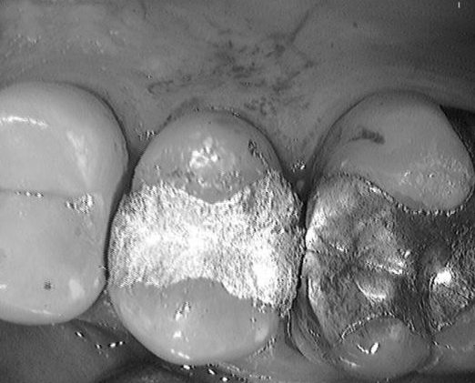

Емаль можна втратити без жодної «дірки від бактерій». Кислота розчиняє мінерал із поверхні, і зуб поступово коротшає, блищить інакше, а ріжучий край стає прозорим. Це ерозивне зношування. Адріан Луссі та Тьяго Карвалью в огляді 2014 року описують його як хімічний процес: кислоти, не пов’язані з бактеріями зубного нальоту. Карієс працює інакше. Там бактерії нальоту перетворюють цукор на кислоту в одному місці, під бляшкою, і з’являється порожнина. Ерозія розлита по поверхнях, до яких кислота просто доторкається.

У кабінеті Novadent цю різницю видно на огляді. Лікар-стоматолог вищої категорії Голуб Олександр Олексійович дивиться форму зубів, старі пломби і те, чим людина п’є і їсть протягом дня. Консультація безкоштовна. Кабінет у Вінниці на вул. Гоголя 15, телефон [075 177 75 67](tel:+380751777567).

## Звідки береться кислота

Зовнішня кислота приходить із напоями і їжею. Газована вода з кислим смаком, енергетики, вино, сік, цитруси, ягоди, оцет, маринад. Навіть «натуральний» сік лишається кислотою для емалі. Цукор у тому самому напої окремо годує карієс. Настанова ВООЗ про вільні цукри радить знизити їхню частку до менш ніж 10 відсотків енергії раціону, а за можливості — до менш ніж 5. Для ерозії окремо важлива частота ковтків. Склянка соку за обідом — один кислотний епізод. Та сама склянка, розтягнута на годину дрібними ковтками, тримає емаль у кислоті весь цей час. Луссі і Карвалью якраз підкреслюють, що зношування складається з багатьох факторів: хімія напою, час контакту, слина, а потім ще й механічне стирання.

Внутрішня кислота приходить зі шлунка. Рефлюкс, часта печія, кислий присмак уранці, блювота. На внутрішніх поверхнях верхніх зубів це інколи помітно раніше, ніж людина пов’язує зуби зі шлунком. Стоматолог бачить наслідок і радить звернутися до лікаря. Ліки, які пригнічують кислоту шлунка, стоматолог не призначає і не скасовує. Це рішення терапевта або гастроентеролога, разом із пошуком причини.

Якщо за кислотою стоїть розлад харчової поведінки, розмова на прийомі має лишатися спокійною і без розпитувань про подробиці. Людині варто знати, що зуби можна захистити і відновити, і що медична допомога з самим розладом — окремий і доречний крок. Стоматолог не замінює цю допомогу. Він може сказати, що бачить на емалі, і підтримати звернення до лікаря.

<figure>

<figcaption>Емаль — зовнішній шар на схемі. Кислота тоншає саме його, і під ним раніше проступає дентин. Схема: Ian Furst, Goran tek-en, <a href="https://commons.wikimedia.org/wiki/File:Cross_sections_of_teeth_labels.png" target="_blank" rel="noopener noreferrer">CC BY-SA 3.0</a>.</figcaption>

</figure>

## Чому не чистять зуби одразу після кислоти

Кислота на кілька хвилин пом’якшує самий верх емалі. Жорстка щітка і абразивна паста в цей момент знімають уже послаблений шар. Тому зуби не чистять одразу після соку, вина, оцту чи епізоду рефлюксу. Краще прополоскати рот водою, дати слині повернути нейтральне середовище і почистити зуби пізніше, звичайним вечірнім або ранковим разом. Точної «хвилини для всіх» у цьому тексті немає: різна слина і різна кислота. Практичне правило просте. Чистка йде за розкладом дня, а не слідом за келихом.

Фторована паста потрібна щодня. Огляд Walsh і співавторів показує, що вона попереджає карієс порівняно з пастою без фтору. Для ерозії фтор не відрощує втрачений край зуба, але зміцнює той мінерал, який ще є, і зменшує шанс карієсу на вже витонченій поверхні. Delivering Better Oral Health ставить фторовану пасту і рідші кислі перекуси в основу профілактики. Доросла людина зазвичай користується звичайною фторованою пастою двічі на день, якщо лікар не порадив іншу концентрацію. Слину після чистки випльовують, а не полощуть одразу великою кількістю води, щоб фтор лишився на зубі довше. Це звична порада того самого профілактичного набору.

Жувати лід, гризти нігті і сильно тиснути щіткою біля ясен додають механічне зношування до хімічного. Луссі і Карвалью описують ерозивне зношування саме як поєднання: кислота готує поверхню, тертя її забирає. М’яка щітка і спокійний тиск тут доречніші за «сильне полірування».

## Коли пломба починає стирчати

Металева або композитна пломба в кислоті майже не розчиняється. Емаль і дентин навколо нее розчиняються. З часом реставрація виглядає ніби вищою за зуб, хоча лікар її не нарощував. Краї темнішають, їжа застрягає, ясна біля «бортика» запалюються. На навчальному фото нижче якраз реставрації на жувальних зубах: якщо емаль навколо такої пломби тане, пломба починає виглядати високою. Це привід до огляду, а не до самостійного спилювання.

<figure>

<figcaption>Навчальне фото реставрацій. Коли емаль навколо пломби розчиняється, пломба може виглядати «високою», бо сама вона в кислоті майже не змінюється. Автор: Michael Ottenbruch, <a href="https://commons.wikimedia.org/wiki/File:Human_teeth_with_metal_fillings.jpg" target="_blank" rel="noopener noreferrer">CC BY-SA 3.0</a>.</figcaption>

</figure>

Відновити форму можна пломбою або, якщо втрачено багато висоти і краї тонкі, коронкою. Це вже лікування і протезування, якими кабінет займається. Чутливість на холод при тонкій емалі часто зменшується, коли поверхню закрито і кислота більше не тримається на відкритому дентині. Поки порожнина або стертий край відкриті, домашні спроби змінити колір лише додають чутливості. Відбілювання не входить до прайсу Novadent. Про докази щодо кольору є окремий запис [«Відбілювання зубів: що кажуть огляди»](2025-06-16-whitening.html). Тут завдання інше: зупинити втрату тканин. На схемі розрізу видно, чому стертий зуб жовтіє. Тонша емаль відкриває дентин, а дентин темніший за емаль. Це не наліт, який зніме паста.

Якщо кислотна чутливість сусідить із болем, який триває довго після холодного, або з нічним болем, дивляться, чи не залучений нерв. Тоді розмова вже про лікування зуба, і вона починається на [консультації](2026-06-01-consult.html). Прицільний знімок на візіографі, коли він потрібен, коштує 100 грн. Анестезія для пломби або обробки чутливого зуба — 200 грн.

## Що змінити в питті, не перетворюючи день на дієту

Вода лишається напоєм між їжею. Кисле і солодке збирають до столу, а не розтягують на вечір. Соломинку інколи радять, щоб напій менше омивав передні зуби, але вона не скасовує частоту: багато дрібних ковтків лишаються багатьма контактами кислоти з емаллю. Після кислого корисно з’їсти шматочок твердого сиру або просто прополоскати рот водою. Жувати жуйку без цукру можна, якщо щелепа це дозволяє: вона зганяє слину. Людям із болем у суглобі це не обов’язкова порада. Вода між їжею і фторована паста в свій звичайний час уже закривають більшу частину того, що людина робить сама, без окремої «дієти для емалі».

Рефлюкс, нічний кашель, кислий смак і часта печія записують і несуть лікарю, який веде загальне здоров’я. Стоматолог може описати, які зуби змінені, і повторити, що таблетку «від кислоти» він не виписує. Якщо емаль уже втрачена настільки, що зуб ріже язик або не тримає висоту прикусу, відновлення планують тут: пломба, де вистачає тканин, коронка, де ні. План і кошторис називають до початку роботи.

Цей текст спирається на огляд Луссі і Карвалью, настанову ВООЗ щодо цукрів і профілактичні джерела про фтор. Він не замінює огляд ваших зубів і не є призначенням ліків.

## Джерела

<ol class="blog-sources">
<li><a href="https://doi.org/10.1159/000360380" target="_blank" rel="noopener noreferrer">Lussi A, Carvalho TS. Erosive tooth wear: a multifactorial condition of growing concern and increasing knowledge. Monogr Oral Sci. 2014;25:1–15.</a></li>
<li><a href="https://www.who.int/publications/i/item/9789241549028" target="_blank" rel="noopener noreferrer">World Health Organization. Guideline: sugars intake for adults and children. Geneva: WHO; 2015.</a></li>
<li><a href="https://doi.org/10.1002/14651858.CD007868.pub3" target="_blank" rel="noopener noreferrer">Walsh T, Worthington HV, Glenny AM, Marinho VC, Jeroncic A. Fluoride toothpastes of different concentrations for preventing dental caries. Cochrane Database Syst Rev. 2019;CD007868.</a></li>
<li><a href="https://www.gov.uk/government/publications/delivering-better-oral-health-an-evidence-based-toolkit-for-prevention" target="_blank" rel="noopener noreferrer">Office for Health Improvement and Disparities. Delivering better oral health: an evidence-based toolkit for prevention.</a></li>
<li><a href="https://www.who.int/news-room/fact-sheets/detail/oral-health" target="_blank" rel="noopener noreferrer">World Health Organization. Oral health. Fact sheet.</a></li>
</ol>
