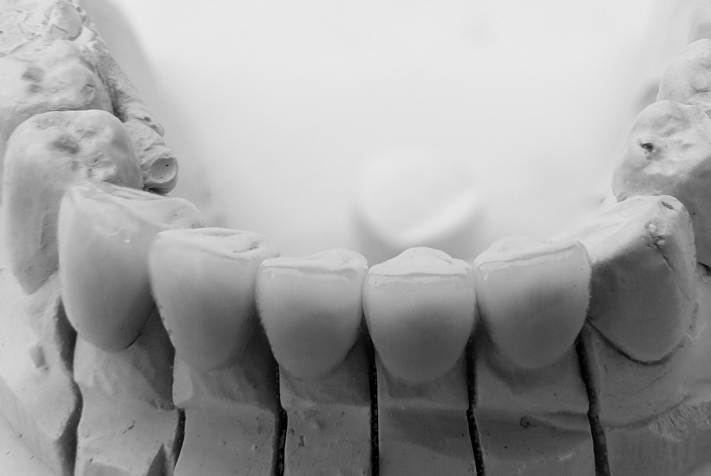
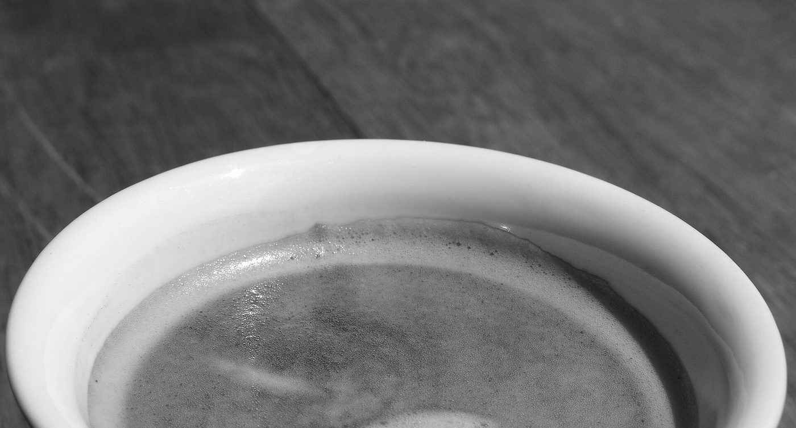

Відбілювання змінює колір власного зуба. Воно не лікує карієс, не закриває корінь і не перефарбовує пломбу чи коронку. Саме з цієї межі варто починати розмову, бо реклама зазвичай показує рівний ряд без старих реставрацій. У Novadent відбілювання немає в прайсі. Кабінет лікує зуби і робить протези. Лікар-стоматолог вищої категорії Голуб Олександр Олексійович може пояснити, що відомо про колір, і не обіцяє курс відбілювання «у нас». Безкоштовна консультація у Вінниці на вул. Гоголя 15 для цього підходить. Телефон — [075 177 75 67](tel:+380751777567).

## Що саме світлішає

Зуб має свій колір через емаль і через дентин під нею. З віком, від чаю, кави, тютюну і деяких ліків він темнішає. Засоби на основі перекису водню або перекису карбаміду проникають у тверді тканини і змінюють забарвлені сполуки всередині. Це не зняття нальоту щіткою. Наліт і камінь прибирають чисткою, і зуб після цього може виглядати світлішим просто тому, що з нього зняли м’який шар. Справжнє відбілювання претендує на колір самого зуба.

Чутливість під час такого курсу трапляється часто і зазвичай минає, коли контакт із перекисом закінчується. Відкриті шийки, тріщини і свіжі пломби цей дискомфорт підсилюють. Тому порожнини і оголені корені спочатку лікують, а вже потім хтось взагалі думає про колір. Поки дентин відкритий, перекис потрапляє ближче до нерва. Це поганий порядок.

Дітям перекисні відбілювальні засоби не призначені: їхні зуби ще формуються, пульпа велика, а користь від косметики не переважує подразнення. Вагітність — час відкласти відбілювання. Лікувати біль і карієс у цей період потрібно, міняти відтінок посмішки — ні. Якщо сумнів є, його проговорюють із лікарем, який веде вагітність, а не з рекламою набору.

Окремо варто відрізнити поверхневий наліт від кольору всередині зуба. Чай, кава і тютюн сідають на емаль і часто світлішають після звичайної професійної чистки. Колір, який іде з дентину, після зняття нальоту лишається. Саме його намагаються змінити перекисні засоби, і саме він не зміниться в коронці. Людина, яка бачить «жовтизну» біля ясен, інколи бачить оголений корінь, а не наліт. Корінь перекисом не освітлюють, поки він відкритий і чутливий. Його або закривають, або лишають у спокої і прибирають кислоту й жорстке тертя. Це рішення огляду, не інструкції з коробки.

<figure>

<figcaption>Керамічні коронки на моделі. Їхній колір задають у лабораторії, і відбілювання його не змінить. Фото: Bin im Garten, <a href="https://commons.wikimedia.org/wiki/File:VMK-Krone_Dental_crown_Focus_stacking_with_freeware_CombineZP_02.jpg" target="_blank" rel="noopener noreferrer">CC BY-SA 3.0</a>.</figcaption>

</figure>

## Коронка лишається того кольору, якого її зробили

Пломба, керамічна коронка, металокераміка і штучний зуб у протезі не містять живого дентину. Перекис їх не освітлює. Після відбілювання власні зуби можуть стати світлішими за реставрацію, яка до того збігалася. Різниця помітна на передніх зубах: одна коронка раптом «стоїть» темнішим прямокутником. Тому колір обговорюють до того, як фіксувати нову коронку, якщо людина взагалі планує колись змінювати відтінок. У цьому кабінеті коронку підганяють до зубів такими, які вони є зараз. Обіцяти, що потім «усе відбілимо в тон», тут не будуть, бо такого курсу в роботі кабінету немає.

Це практичне питання протезування, а не заборона хотіти світліші зуби. Якщо відбілювання роблять в іншому місці, розумніше завершити його і лише потім знімати колір для коронки. Інакше лабораторія повторить сьогоднішній відтінок, а через місяць він уже не зійдеться. Старі пломби на видимих поверхнях мають ту саму логіку: їх інколи міняють після зміни кольору зубів, і це окрема робота, окремий кошторис.

Емаль, яку вже стоншила кислота, відбілювання не лікує. Луссі і Карвалью описують ерозивне зношування як хімічну втрату тканин без бактерій. На такій поверхні будь-яке додаткове подразнення, включно з перекисом і з жорстким тертям, додає чутливості. Спочатку зменшують кислі ковтки і закривають стерті ділянки, якщо вони болять. Про це є запис [«Кислота і емаль»](2025-06-09-erosion.html).

## Вугілля не є доказовим відбілюванням

Чорна паста виглядає як простий замінник перекису. Огляд Brooks і співавторів у Journal of the American Dental Association (2017) цього не підтверджує. Висновок такий: вугільні пасти часто абразивні, і достатніх клінічних доказів того, що вони безпечні й ефективні для відбілювання, немає. Чисел абразивності в цьому тексті не буде: огляд якраз показує, що покупцеві нема на що спертися, а не дає «безпечний поріг» для домашнього експерименту. Докладніше про саму пасту — в записі [«Вугільна паста»](2025-10-20-charcoal.html).

Абразив знімає поверхневий наліт і може зняти тонкий шар емалі там, де щіткою тиснуть роками. Емаль не відростає. Дентин під нею жовтіший, тож зуб після старанного тертя інколи виглядає темнішим, ніж до «відбілювання». Кокранівський огляд Walsh і співавторів відповідає на інше питання, і відповідь корисна саме тут: карієс стримує фторовмісна паста, а не колір тюбика. Заміна звичайної фторованої пасти на вугільну без фтору забирає засіб, для якого докази є, і ставить на його місце засіб, для якого доказів відбілювання немає.

<figure>

<figcaption>Кава фарбує наліт і поверхневий шар емалі. Щітка знімає наліт, а колір самої емалі змінює вже перекис, не напій. Фото: Egien, <a href="https://commons.wikimedia.org/wiki/File:Coffee_cup.jpg" target="_blank" rel="noopener noreferrer">CC BY 2.5</a>.</figcaption>

</figure>

## Що з цього випливає в кріслі

Delivering Better Oral Health тримає профілактику в нудному і робочому вигляді: фторована паста двічі на день, рідші солодкі і кислі перекуси, чисті проміжки. Це не робить зуби білими за тиждень. Це зменшує нові плями від карієсу і не додає стирання. Довідка ВООЗ про здоров’я порожнини рота ставить у центр карієс, хворобу ясен і доступ до лікування, а не відтінок емалі. Колір — розмова про комфорт і зовнішній вигляд після того, як біль і порожнини вже розібрані.

На консультації в Novadent можна чесно сказати: «хочу світліше». Відповідь буде про те, що саме темне. Наліт і камінь. Стара пломба. Коронка, яку відбілити не можна. Тютюн. Тонка емаль, крізь яку просвічує дентин. Від цих причин залежать різні дії, і жодна з них у цьому кабінеті не називається курсом відбілювання. Пломба, лікування каналів, коронка — так. Їхні ціни є в розділі [цін](/index.html#prices). Анестезія, якщо вона потрібна для лікування, коштує 200 грн. Знімок на візіографі, коли від нього залежить план, — 100 грн.

Якщо людина все ж вирішить відбілювати зуби деінде, варто зробити це до нової коронки і не починати, поки є неліковані порожнини, оголені корені, дитячий вік або вагітність. Чутливість, якщо вона з’явиться, зазвичай тимчасова, але це не привід терпіти біль від відкритого карієсу під виглядом «так і має бути від гелю». Біль, який триває вночі, до відбілювання не належить. Його дивляться як біль зуба. З чого почати, якщо незрозуміло, чи це колір, чи хвороба, краще на [консультації](2026-06-01-consult.html): вона ні до чого не зобов’язує, і бормашина того дня не є умовою розмови.

Цей текст передає межі оглядів про вугілля, фтор і ерозію і пояснює, чого відбілювання не робить з реставраціями. Він не є запрошенням на курс відбілювання і не замінює огляд.

## Джерела

<ol class="blog-sources">
<li><a href="https://jada.ada.org/article/S0002-8177(17)30438-X/fulltext" target="_blank" rel="noopener noreferrer">Brooks JK, Bashirelahi N, Reynolds MA. Charcoal and charcoal-based dentifrices: a literature review. J Am Dent Assoc. 2017;148:661–670.</a></li>
<li><a href="https://doi.org/10.1002/14651858.CD007868.pub3" target="_blank" rel="noopener noreferrer">Walsh T, Worthington HV, Glenny AM, Marinho VC, Jeroncic A. Fluoride toothpastes of different concentrations for preventing dental caries. Cochrane Database Syst Rev. 2019;CD007868.</a></li>
<li><a href="https://doi.org/10.1159/000360380" target="_blank" rel="noopener noreferrer">Lussi A, Carvalho TS. Erosive tooth wear: a multifactorial condition of growing concern and increasing knowledge. Monogr Oral Sci. 2014;25:1–15.</a></li>
<li><a href="https://www.gov.uk/government/publications/delivering-better-oral-health-an-evidence-based-toolkit-for-prevention" target="_blank" rel="noopener noreferrer">Office for Health Improvement and Disparities. Delivering better oral health: an evidence-based toolkit for prevention.</a></li>
<li><a href="https://www.who.int/news-room/fact-sheets/detail/oral-health" target="_blank" rel="noopener noreferrer">World Health Organization. Oral health. Fact sheet.</a></li>
</ol>
