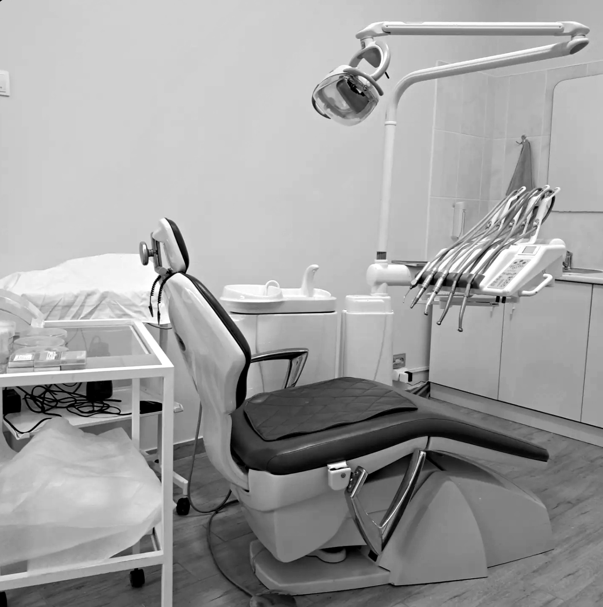

Страх стоматолога зустрічається часто. Його не вигадують «нестійкі люди» і не лікують жартами в кріслі. Огляд Армфілда і Гітон у Australian Dental Journal якраз про це: страх поширений, через нього люди відкладають візит, а відкладений візит залишає біль і складніше лікування. Автори розбирають, що в кабінеті реально знижує напругу. Серед робочих прийомів — пояснити, показати, зробити; дати людині спосіб зупинити лікаря; не розтягувати перший контакт; повернути відчуття контролю.

У Novadent це можна почати без бормашини. Консультація безкоштовна. Лікар-стоматолог вищої категорії Голуб Олександр Олексійович може спершу просто поговорити: що болить, чого ви боїтеся, що вже пробували. Кабінет у Вінниці на вул. Гоголя 15. Телефон — [075 177 75 67](tel:+380751777567). Ніхто не зобов’язаний того самого дня лягати в крісло і відкривати рот «раз уже прийшли».

## Що допомагає, крім сили волі

Прийом «поясни, покажи, зроби» звучить просто, бо він простий. Людина чує, що буде далі, бачить інструмент поза ротом і лише потім відчуває його в роті. Несподіваний звук і несподіваний дотик якраз підживлюють страх. Коли крок названий, мозок встигає зрозуміти, що це не аварія.

Сигнал зупинки домовляють до початку. Піднята рука означає паузу, і пауза справді настає. Якщо сигнал ігнорують, довіра падає швидше, ніж будь-яке заспокоєння її лагодить. Контроль у цьому і полягає: людина може проковтнути, перепочити, запитати. Короткий перший візит має сенс навіть тоді, коли зубів, які потребують роботи, кілька. Зробити один зрозумілий крок і піти додому з планом часто корисніше, ніж героїчно закрити все за раз і потім не повернутися.

Армфілд і Гітон описують і ширший спектр: десь застосовують седацію або загальне знеболення. У цьому кабінеті таких послуг немає, і рекламувати їх звідси не будуть. Тут інструменти інші. Розмова, передбачуваний порядок, сигнал зупинки, місцева анестезія, коли доходить до лікування. Місцеве знеболення якраз знімає біль, через який страх часто й тримається. Воно в прайсі коштує 200 грн. Як воно працює і чому губа потім німіє, розібрано в записі [«Знеболення у стоматолога»](2025-06-30-anesthesia.html).

<figure>

<figcaption>Крісло кабінету Novadent. Перший візит може обмежитися розмовою біля нього, без бормашини.</figcaption>

</figure>

## Чого на прийомі не роблять

Зі страху не кепкують. Фрази на кшталт «усі терплять» і «нічого страшного» не зменшують пульс, вони зменшують бажання сказати правду наступного разу. Якщо вам погано від вигляду шприца, про це кажуть до того, як його набирають. Лікар може показати його збоку, пояснити, куди піде засіб, і дочекатися кивка. Це не примха. Це частина того самого контролю, про який пише огляд.

Довідка Всесвітньої організації охорони здоров’я нагадує, що більшість хвороб порожнини рота можна попередити або лікувати на ранньому етапі, і що біль, дискомфорт і відкладання допомоги мають ціну. Страх якраз один із шляхів, яким невелика порожнина стає нічним болем. Британський набір Delivering Better Oral Health тримає щоденну профілактику конкретною: фторована паста, чисті проміжки, рідший цукор. Кокранівський огляд Walsh і співавторів показує, що фторована паста попереджає карієс порівняно з пастою без фтору. Для людини, яка боїться крісла, це не дрібниця. Менше нового карієсу означає менше приводів знову чути бор.

Домашній догляд не замінює візит, якщо зуб уже болить. Він зменшує кількість майбутніх візитів. Це чесна формула, без обіцянки «більше ніколи не лікуватися».

<figure>

<figcaption>Консультація може бути розмовою за столом. Знімок ілюстративний, це не фото прийому в Novadent.</figcaption>

</figure>

## Як може виглядати перший раз

Запис роблять на консультацію, не на «видалити все». У розмові називають найгірший минулий досвід, якщо він був: біль без знеболення, укол, який не спрацював, відчуття, що вас не чули. Лікар дивиться стільки, скільки ви готові показати того дня. Інколи це лише передні зуби і розмова. Інколи вже можна зробити знімок. Прицільний кадр на візіографі коштує 100 грн і потрібен, коли від нього залежить план, а не «для комплекту».

План записують простими словами. Що болить зараз. Що може почекати. Що буде, якщо почекати довго. Скільки це коштує. Людина забирає цей план і вирішує вдома. Безкоштовна консультація ні до чого не зобов’язує. Наступний крок можна призначити коротшим, ніж «повне лікування за один ранок».

Якщо в якийсь момент стає забагато, працює сигнал зупинки. Візит на цьому не провалений. Зупинка і є доказом, що домовленість справжня. Далі або продовжують після паузи, або переносять решту. Соромитися переносу не потрібно. Гірший варіант — мовчки терпіти і потім роками не приходити.

Є речі, які страх не скасовує. Набряк, що наростає, температура, утруднене ковтання або дихання — це відділення невідкладної допомоги того ж дня, навіть якщо думка про лікарню теж лякає. Звичайний тривожний запис на консультацію так не виглядає. Тихий зуб, який ниє тиждень, можна розбирати тут, зі знеболенням, без гонки.

Дехто боїться не болю, а втрати контролю, запаху кабінету, звуку, блювотного рефлексу або того, що доведеться лежати. Це різні задачі. Їх називають на початку, і під них підлаштовують темп: вище спинка крісла, паузи, робота короткими відрізками. Седацію і наркоз під цю задачу тут не пропонують. Якщо людині потрібен саме такий рівень допомоги, про це кажуть прямо, щоб вона шукала заклад, де це є, а не чекала послуги, якої в прайсі немає.

Коли телефонуєте на [075 177 75 67](tel:+380751777567), можна одразу сказати: «хочу консультацію, боюся лікування». Цього достатньо, щоб перший візит не поставили як довге свердління. На місці допомагає проста послідовність. Спершу розмова за столом, не в положенні лежачи. Потім, якщо ви згодні, огляд стільки зубів, скільки готові показати. Потім пауза і план на папері. Бормашина в цей день може взагалі не вмикатися. Якщо вмикається, то після знеболення і після того, як ви самі підтвердили, що сьогодні робите лише один зуб.

Із собою варто взяти список ліків і, якщо так спокійніше, близьку людину, яка посидить у коридорі або поряд. Супроводжувати не означає відповідати за вас. Рішення про роботу все одно ваше. Запізнення через те, що довго не могли вийти з дому, теж краще назвати, ніж скасувати мовчки: час прийому можна зрушити, а зникнути на рік через сором за спізнення — гірший підсумок.

Після візиту корисно назвати одну річ, яка виявилася терпимою. Не як вправу з книжки, а як пам’ять на наступний раз: крісло, пауза, укол, після якого свердління не відчувалось. Страх рідко зникає за одну зустріч. Він зменшується, коли досвід перестає підтверджувати найгірший сценарій. Огляд Армфілда і Гітон якраз проти того, щоб соромити людину за цей час.

Цей текст спирається на огляд про страх у стоматологічному кабінеті і на профілактичні джерела. Він не оцінює ваш страх і не замінює розмову на прийомі.

## Джерела

<ol class="blog-sources">
<li><a href="https://doi.org/10.1111/adj.12118" target="_blank" rel="noopener noreferrer">Armfield JM, Heaton LJ. Management of fear and anxiety in the dental clinic: a review. Aust Dent J. 2013;58:390–407.</a></li>
<li><a href="https://www.who.int/news-room/fact-sheets/detail/oral-health" target="_blank" rel="noopener noreferrer">World Health Organization. Oral health. Fact sheet.</a></li>
<li><a href="https://www.gov.uk/government/publications/delivering-better-oral-health-an-evidence-based-toolkit-for-prevention" target="_blank" rel="noopener noreferrer">Office for Health Improvement and Disparities. Delivering better oral health: an evidence-based toolkit for prevention.</a></li>
<li><a href="https://doi.org/10.1002/14651858.CD007868.pub3" target="_blank" rel="noopener noreferrer">Walsh T, Worthington HV, Glenny AM, Marinho VC, Jeroncic A. Fluoride toothpastes of different concentrations for preventing dental caries. Cochrane Database Syst Rev. 2019;CD007868.</a></li>
</ol>
