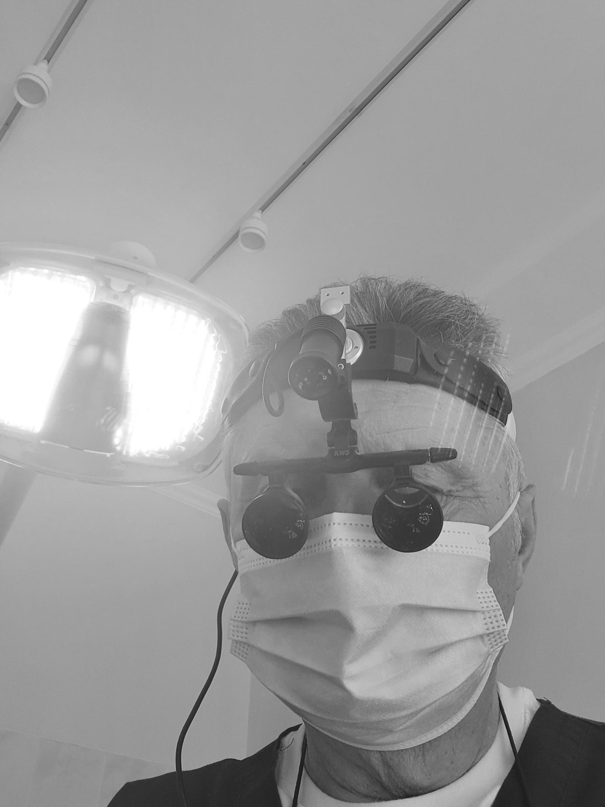

Пломба і лікування каналів стають терпимими тоді, коли зуб німіє. Місцева анестезія якраз для цього: засіб уводять біля зуба, біль від роботи зникає, свідомість лишається. У Novadent це звичайна частина лікування, а не окрема «послуга для особливо чутливих». У прайсі анестезія коштує 200 грн. Лікар-стоматолог вищої категорії Голуб Олександр Олексійович підбирає її після короткої розмови про алергію, ліки і те, як ви переносили уколи раніше. Кабінет у Вінниці на вул. Гоголя 15, телефон [075 177 75 67](tel:+380751777567). Консультація, на якій це можна обговорити ще до бормашини, безкоштовна.

## Що відчувається і що робити з німою губою

Укол відчувається як тиск і розпирання. Далі щока, губа або язик стають ватними. Працювати в зубі можна, коли холод і зондування вже не гострі. Якщо оніміння неповне, про це кажуть одразу. Додати засіб нормально. Терпіти «щоб не затримувати» не потрібно: біль заважає і людині, і якості роботи. Страх часто тримається саме на пам’яті про лікування без знеболення. Огляд Армфілда і Гітон називає передбачуваність і контроль серед того, що зменшує цей страх. Знеболення — частина контролю. Сигнал, що вам боляче, має зупиняти лікаря. Про страх докладніше — в записі [«Страх стоматолога»](2025-06-23-anxiety.html).

Запалений зуб інколи німіє повільніше. Тканина навколо гнійного вогнища гірше тримає засіб там, де він потрібен, тож лікар може змінити місце уколу, зачекати довше або додати анестетик. Це не привід скасувати знеболення і «потерпіти швидко». Це привід сказати, якщо біль під час роботи повернувся. Назва ліків від тиску, які ви випили зранку, теж належить цій розмові: їх не пропускають заради візиту, і лікар має знати, що вони вже в крові.

Губа або язик лишаються німими ще кілька годин після візиту. У цей час їх легко прикусити, особливо за їжею або в дитини, яка перевіряє щоку пальцями. Поки оніміння не мине, не жують на цей бік і не п’ють гаряче наосліп: опік теж не відчувається вчасно. Слина може підтікати. Це мине разом із засобами. Якщо оніміння тримається наступного дня або з’явився набряк, телефонують у кабінет, а не чекають мовчки до планового огляду.

<figure>

<figcaption>Лікар Голуб працює в збільшенні. Знеболення роблять до того, як зуб починають лікувати.</figcaption>

</figure>

## Алергія, адреналін і високий тиск

Перед уколом називають алергію, якщо вона була. Важлива справжня реакція: висип, набряк, задишка, непритомність після анестетика, а не просто «мені було неприємно німіти». Непритомність від вигляду голки теж варто назвати, але це інша подія, і лікар поставить її окремо від алергії на ліки. Латекс, якщо на нього є реакція, теж згадують: рукавички і хустки бувають різні.

Адреналін у карпулі стоматологічного анестетика потрібен малою кількістю, щоб звузити судини в місці уколу. Тоді засіб довше лишається біля зуба і не розходиться одразу з кров’ю. У цьому тексті немає міліграмних меж і «дозволених доз для всіх». Їх не вираховують зі статті. Людина каже про свої побоювання щодо адреналіну, про аритмію, про ліки від тиску, і лікар вирішує, який карпул доречний того дня.

Дуже високий тиск, який не контролюється, є причиною перенести планову роботу. Це не причина свердлити без анестетика. Перенос стосується дня і стабільності тиску. Біль усе одно не пропонують терпіти «наживо», коли лікування вже почалось і тиск дозволяє працювати. Якщо тиск високий просто зараз, у кріслі, планову пломбу відкладають і радять звернутися до лікаря, який веде гіпертензію. Гострий біль і інфекцію при цьому не залишають без плану.

Серцева історія має бути названа окремо. Наукова заява Американської кардіологічної асоціації 2021 року (Wilson і співавт.) говорить про вузьке питання: кому перед деякими втручаннями в роті взагалі розглядають антибіотик для профілактики інфекційного ендокардиту. Це люди з найвищим ризиком несприятливого перебігу, наприклад після протезування клапана або після вже перенесеного ендокардиту. Заява не є інструкцією з адреналіну і не замінює розмову про знеболення. Вона пояснює, чому протез клапана називають уголос до уколу: інколи поруч виникає окреме питання про профілактику, і його не плутають із краплею адреналіну в карпулі.

<figure>

<figcaption>Після знеболення зондом перевіряють, чи зуб уже не відповідає болем. Навчальне фото. Автор: Coronation Dental Specialty Group, <a href="https://commons.wikimedia.org/wiki/File:Dental_explorer_and_periodontal_probe.jpg" target="_blank" rel="noopener noreferrer">CC BY-SA 3.0</a>.</figcaption>

</figure>

## Ліки, які розріджують кров, і вагітність

Антикоагулянти й антиагреганти перед уколом і перед пломбою самотужки не скасовують. Шотландська настанова SDCEP якраз про те, щоб лікувати, не обриваючи таку схему на власний розсуд. Кровотеча і тромб — різні ризики, і перерва в таблетці «на всяк випадок» їх не врівноважує. Повний розбір є в записі [«Препарати, що розріджують кров, і стоматолог»](2025-09-15-anticoagulants.html). На прийом приносять назви ліків. Цього достатньо, щоб не починати ранок із сюрпризу.

Вагітність не є причиною терпіти біль без знеболення. Потрібна місцева анестезія прийнятна. Обсяг і день узгоджують: інфекцію і біль лікувати доречно, косметичну роботу можна відкласти. Засіб і кількість обирає лікар. У статті немає переліку торгових назв і доз. Якщо жіноча консультація вже дала обмеження, його проговорюють на початку.

Довідка ВООЗ описує карієс і його ускладнення як біль і інфекцію, які потребують допомоги, а не очікування. Знеболення якраз дозволяє цю допомогу надати. Настанова Lockhart і співавторів про антибіотики додає сусідню межу: таблетка не замінює лікування зуба. Пульпіт і локальне запалення біля кореня, коли зуб можна відкрити, пролікувати канали або видалити і немає поширеної інфекції, антибіотиком не закривають. Їх лікують під анестезією. Як влаштована пломба і канали, описано в записі [«Лікування карієсу і пульпіту»](2026-07-01-therapy.html).

Після візиту німа губа — очікувана частина, а не ускладнення. Прикушена слизова наступного дня болить уже по-своєму, і це наслідок жування в онімінні, а не «алергія, що проявилася ввечері». Алергічна реакція виглядає інакше: висип, свербіж, набряк, якому тісно дихати. Якщо дихання або ковтання утруднені, чи набряк наростає разом із температурою, це відділення невідкладної допомоги, а не запис на наступну пломбу. Звичайне оніміння губи на кілька годин так не виглядає.

Після того як зуб закритий, оніміння не є сигналом перевірити пломбу жуванням. Нова пломба і свіжий край коронки в цей час легко прикусити разом із щокою. Їжу відкладають, доки губа знову відчуває дотик. Вода кімнатної температури безпечніша за чай, поки чутливість не повернулася. Якщо до вечора оніміння минуло, а біль у самому зубі наростає або щока пухне, це вже не «відходить заморозка». Тоді телефонують у кабінет того ж дня.

На консультації можна запитати про анестезію ще до того, як зуб розкриють. Хто боїться уколу, каже про це. Хто пам’ятає, що минулого разу засіб «не брав», теж каже: інколи потрібна інша техніка або більше часу, інколи біль уже йшов від запаленої пульпи, і це враховують. План без сюрпризу переноситься легше за будь-яку загальну фразу «буде не боляче».

Цей текст пояснює, навіщо потрібне місцеве знеболення і про що попередити лікаря. Він не підбирає препарат і не замінює огляд.

## Джерела

<ol class="blog-sources">
<li><a href="https://doi.org/10.1111/adj.12118" target="_blank" rel="noopener noreferrer">Armfield JM, Heaton LJ. Management of fear and anxiety in the dental clinic: a review. Aust Dent J. 2013;58:390–407.</a></li>
<li><a href="https://www.sdcep.org.uk/published-guidance/anticoagulants-and-antiplatelets/" target="_blank" rel="noopener noreferrer">Scottish Dental Clinical Effectiveness Programme. Management of Dental Patients Taking Anticoagulants or Antiplatelet Drugs.</a></li>
<li><a href="https://doi.org/10.1161/CIR.0000000000000969" target="_blank" rel="noopener noreferrer">Wilson WR, Gewitz M, Lockhart PB, et al. Prevention of viridans group streptococcal infective endocarditis: a scientific statement from the American Heart Association. Circulation. 2021;143:e963–e978.</a></li>
<li><a href="https://doi.org/10.1016/j.adaj.2019.08.020" target="_blank" rel="noopener noreferrer">Lockhart PB, Tampi MP, Abt E, et al. Evidence-based clinical practice guideline on antibiotic use for the urgent management of pulpal- and periapical-related dental pain and intraoral swelling. J Am Dent Assoc. 2019;150:906–921.e12.</a></li>
<li><a href="https://www.who.int/news-room/fact-sheets/detail/oral-health" target="_blank" rel="noopener noreferrer">World Health Organization. Oral health. Fact sheet.</a></li>
</ol>
