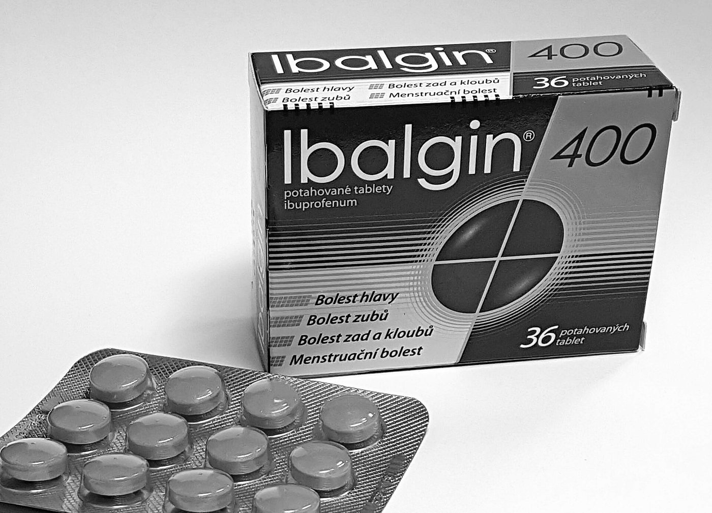

Зубний біль надійно закінчується тоді, коли вилікуваний зуб. Таблетка може зробити ніч або дорогу до кабінету терпимими. Вона не вичищає карієс, не гасить запалену пульпу і не спорожнює гній біля кореня. У Novadent саме з цього починають розмову: що болить, чи можна це закрити пломбою, каналами або, якщо зуб уже не врятувати, видаленням. Лікар-стоматолог вищої категорії Голуб Олександр Олексійович складає цей план на огляді. Консультація безкоштовна. Кабінет у Вінниці на вул. Гоголя 15, телефон [075 177 75 67](tel:+380751777567).

## Що можна прийняти до візиту

Для короткого полегшення часто добре працюють протизапальні знеболювальні, зокрема ібупрофен, якщо людині їх можна. «Можна» тут означає просту річ: ваш лікар їх не забороняв. Є стани, за яких такий клас ліків не беруть. Серед них виразкова хвороба шлунка або дванадцятипалої кишки в загостренні, хвороба нирок, пізній термін вагітності і частина засобів, що змінюють зсідання крові. Якщо хоч один пункт ваш, не перевіряють це на собі «половиною таблетки». Беруть те, що вже дозволив лікар, який вас веде, або питають його.

Парацетамол — звичайна альтернатива, коли ібупрофен не підходить. Він знімає біль інакшим шляхом і не замінює протизапальну дію, але для багатьох людей саме він є робочим варіантом до ранку. У цьому тексті немає схем у міліграмах і немає розкладу «кожні стільки-то годин». Дозу, яку вам уже призначили, не підвищують від відчаю. Подвійна порція не лікує зуб удвічі швидше, а печінку і шлунок навантажує по-справжньому.

Опіоїдні знеболювальні не є звичайним лікуванням зубного болю. Сильний зубний біль краще відповідає на протизапальний засіб, якщо він дозволений, плюс на роботу в зубі, ніж на наркотичний анальгетик «про запас». Просити такий препарат замість візиту до стоматолога не варто. Кабінет його не пропонує як стандарт.

Настанова Lockhart і співавторів 2019 року написана про антибіотики, і її корисно тримати поруч. Антибіотик не є знеболювальним. При пульпіті і локальному абсцесі, коли зуб можна лікувати і немає поширеної інфекції, настанова якраз не радить антибіотик. Біль у ці дні закривають знеболювальним і стоматологічною роботою. Докладніше про межу, де таблетка від інфекції зайва, є в записі [«Коли зубний біль не лікують антибіотиком»](2025-07-07-antibiotics.html).

<figure>

<figcaption>Ібупрофен часто знімає зубний біль на кілька годин, якщо його можна приймати. Таблетка не лікує зуб. Фото: Mvejr, <a href="https://commons.wikimedia.org/wiki/File:Ibuprofen.jpg" target="_blank" rel="noopener noreferrer">CC BY-SA 4.0</a>.</figcaption>

</figure>

## Чому таблетка програє лікуванню зуба

Карієс, який дійшов до дентину, не заспокоюється надовго від ібупрофену. Холод або солодке знову будять нерв, щойно дія дози мине. Пульпіт будить уночі незалежно від того, чи була таблетка ввечері. Періодонтит біля кореня болить на накушування, поки вогнище в кістці не почали лікувати через канал. Усі ці стани описані в записі [«Лікування карієсу і пульпіту»](2026-07-01-therapy.html). Знеболення в кріслі, щоб цю роботу можна було зробити, коштує 200 грн. Прицільний знімок, якщо без нього незрозуміло, чи є вогнище біля кореня, — 100 грн.

Поки візит не відбувся, допомагають прості речі, які не замінюють ліки і не є дозуванням. Не жують на хворий бік. Не гріють щоку, якщо є набряк: тепло роздуває поширену інфекцію. Холодний компрес зовні, через тканину, інколи зменшує розпирання. Голову на ніч тримають вище. Солодке і дуже гаряче відкладають, якщо від них біль спалахує. Це догляд на години, не на тижні.

Якщо знеболювальне, яке вам дозволене, перестало тримати біль узагалі, це привід прискорити візит, а не шукати сильніший клас ліків у домашній аптечці. Зуб, який не спить навіть на максимумі вже призначеної дози, зазвичай потребує розкриття, а не третьої упаковки.

<figure>

<figcaption>Вогнище біля кореня на навчальному знімку. Таблетка його не спорожнює. Автор: Coronation Dental Specialty Group, <a href="https://commons.wikimedia.org/wiki/File:Abscessed_tooth_periapical_radiograph.jpg" target="_blank" rel="noopener noreferrer">CC BY-SA 3.0</a>.</figcaption>

</figure>

## Кому особливо не варто експериментувати

Пізня вагітність і протизапальні знеболювальні погано поєднуються. Якщо ви вагітні, схему каже лікар, який веде вагітність, або стоматолог після цієї розмови. Самостійно «позичати» ібупрофен у когось вдома в третьому триместрі не потрібно. Парацетамол у багатьох таких ситуаціях лишається тим засобом, про який питають першим, але й його приймають у вже знайомій вам дозволеній кількості, без самовільного почастішання.

Нирки і виразка шлунка — теж не поле для перевірки. Протизапальний засіб може посилити кровотечу зі слизової шлунка і навантажити нирки, особливо якщо людина мало п’є або вже приймає кілька ліків. Фраза «ваш лікар цього не забороняв» існує саме тут. Якщо заборони не було, короткий прийом ібупрофену часто ефективний при зубному болю. Якщо заборона була, її не обходять, бо «це ж лише зуб».

Засоби, що змінюють зсідання, додають окремий ризик кровотечі, коли зверху лягає протизапальний знеболювальний. Варфарин, прямі антикоагулянти, подвійна антиагрегантна схема після стента — приводи назвати ліки вголос і не додавати ібупрофен з власної ініціативи. Шотландська настанова SDCEP докладно розбирає, чому ці препарати не скасовують перед стоматологом. Сусідня тема знеболення в тому, що новий засіб теж може чіпати зсідання або слизову шлунка. Повний текст про варфарин і антиагреганти є в записі [«Препарати, що розріджують кров, і стоматолог»](2025-09-15-anticoagulants.html).

Довідка ВООЗ нагадує, що хвороби порожнини рота спричиняють біль і що їх лікують, а не маскують. Британський профілактичний набір додає щоденну частину: фтор і рідший цукор зменшують нові причини болю. На вже запалений нерв паста не діє. Вона діє на наступний місяць, коли цей зуб уже спокійний.

## Коли таблетка не є планом навіть на ніч

Набряк, що наростає, температура, утруднене ковтання або дихання — це відділення невідкладної допомоги, а не ібупрофен до пломби наступного тижня. Так виглядає поширена інфекція. Знеболювальне може трохи притлумити фон і водночас відкласти допомогу, якщо через нього людина вирішить «і так зійде до ранку». При цих ознаках ранок у кріслі не є безпечним планом.

Після лікування біль на накушування день або два буває очікуваним. Він має слабшати. Біль, який наростає, набряк або температура після пломби чи каналів — привід зателефонувати в кабінет. Додавати собі антибіотик із шухляди в цей момент не потрібно: спершу має побачити лікар, чи це звична реакція тканин, чи щось, що треба відкрити знову.

Перед виходом запишіть, що вже прийняли сьогодні: назву, приблизний час і чи була від цього користь. Лікарю не потрібен ваш розклад у міліграмах із цієї статті. Йому потрібно не дати вам випадково подвоїти те, що вже є в крові, і не запропонувати клас ліків, який вам заборонений. Аркуш у кишені закриває це краще за пам’ять після безсонної ночі.

На консультацію можна прийти ще до того, як домашня упаковка закінчилась. Назвіть, що вже прийняли і чи є заборона від вашого лікаря. Цього достатньо, щоб план не почався з випадкового засобу. Огляд і знімок вирішують, чи це пломба, канали чи інший шлях. Таблетка лишається містком до цього рішення, а не самим рішенням.

Цей текст пояснює, чим коротке знеболення відрізняється від лікування зуба. Він не дає розкладу доз і не замінює пораду вашого лікаря, якщо той уже обмежив певні ліки.

## Джерела

<ol class="blog-sources">
<li><a href="https://doi.org/10.1016/j.adaj.2019.08.020" target="_blank" rel="noopener noreferrer">Lockhart PB, Tampi MP, Abt E, et al. Evidence-based clinical practice guideline on antibiotic use for the urgent management of pulpal- and periapical-related dental pain and intraoral swelling. J Am Dent Assoc. 2019;150:906–921.e12.</a></li>
<li><a href="https://www.sdcep.org.uk/published-guidance/anticoagulants-and-antiplatelets/" target="_blank" rel="noopener noreferrer">Scottish Dental Clinical Effectiveness Programme. Management of Dental Patients Taking Anticoagulants or Antiplatelet Drugs.</a></li>
<li><a href="https://www.who.int/news-room/fact-sheets/detail/oral-health" target="_blank" rel="noopener noreferrer">World Health Organization. Oral health. Fact sheet.</a></li>
<li><a href="https://www.gov.uk/government/publications/delivering-better-oral-health-an-evidence-based-toolkit-for-prevention" target="_blank" rel="noopener noreferrer">Office for Health Improvement and Disparities. Delivering better oral health: an evidence-based toolkit for prevention.</a></li>
</ol>
