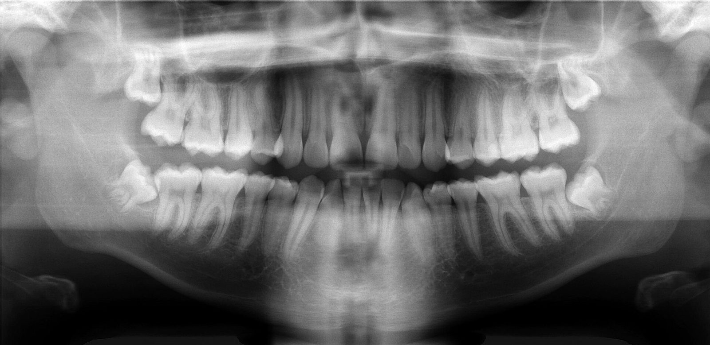

Вибитий або вбитий у ясна молочний зуб лякає сильніше, ніж більшість дитячих падінь. Перше правило, яке батьки плутають із порадою для постійних зубів: молочний зуб, що випав цілком, назад у лунку не ставлять. Міжнародна асоціація дентальної травматології в настанові 2020 року для молочного прикусу каже це прямо. Корінь молочного зуба лежить поруч із зачатком постійного. Повернення вибитого зуба може пошкодити той зачаток. Постійний зуб, вибитий повністю, є іншою невідкладною ситуацією: його якраз намагаються повернути в лунку, і поради для молочного зуба там не діють.

У Novadent на вул. Гоголя 15 у Вінниці лікар Голуб Олександр Олексійович оглядає дитину того ж дня, якщо зуб сильно змістився, дитина не може звести зуби або уламок зник. Прицільний знімок на візіографі, коли він потрібен, коштує 100 гривень. Окремої дитячої хірургії і седації «як у лікарні» в цьому кабінеті немає. Огляд, кадр і рішення, чи достатньо спостереження, роблять тут. Якщо зуб треба видаляти в умовах, яких у кріслі немає, лікар направляє.

## Вибитий зуб: не вставляти

Авульсія означає, що зуб вийшов із лунки повністю. У руці або на підлозі лежить цілий молочний зуб із коренем. Його не миють щіткою, не вставляють у ясна і не просять дитину «прикусити, щоб прижився». Лунку не колупають. Якщо зуб знайшли, принесіть його в сухій серветці, щоб лікар побачив: це молочний зуб і він цілий. У лунку його не ставлять.

Порожня лунка кровоточить. Чиста марля або складена серветка, яку дитина прикушує, зазвичай зупиняє кров за кілька хвилин. Довга кров, яку не стримати прикусом, або дитина, якій важко дихати, це вже швидка медична допомога, не очікування ранкового запису. Розбита губа і підборіддя майже завжди супроводжують таке падіння. Їх промивають водою. Питання щеплення від правця, якщо рана брудна, ставлять педіатру, не шукають календар у стоматологічному блозі.

Якщо сумніваєтесь, молочний перед вами чи постійний, не вставляйте зуб самі. Везіть дитину і зуб на огляд. Вік допомагає зорієнтуватися: передній молочний зуб у дошкільника менший, постійний різець у школяра більший, навіть якщо обидва стоять спереду. Поки це неясно, діє правило молочного зуба: назад не ставити.

<figure>

<figcaption>Корінь молочного зуба короткий і лежить близько до зачатка постійного, якого на схемі дорослого зуба немає, але саме він пояснює, чому вибитий молочний зуб не повертають у лунку. Автори: Ian Furst, Goran tek-en, <a href="https://commons.wikimedia.org/wiki/File:Cross_sections_of_teeth_labels.png" target="_blank" rel="noopener noreferrer">CC BY-SA 3.0</a>.</figcaption>
</figure>

## Зуб став коротшим, потемнів або зламався

Інтрузія — це коли зуб не випав, а вбився вглиб. Батькам здається, що зуба немає, а він сидить вище в яснах, і на його місці кров і згусток. Тягнути його пальцями вниз не можна. Часто такий молочний зуб залишають і чекають, чи вийде він назад сам протягом тижнів. Інколи знімок показує, що корінь пішов у бік зачатка постійного зуба, і тоді зуб видаляє лікар, а не родина вдома. Потемніння теж не є автоматичним вироком. Сірий або бурий колір через дні чи тижні буває від крові в каналі або від того, що нерв загинув. Якщо немає набряку, нориці на яснах і болю, зуб не завжди видаляють того ж дня. Його дивляться в динаміці. Свищ, щока, біль на накушування або зміни на знімку план змінюють.

Відкол коронки — частіша історія за повний вивих. Дитина вдарилася в край басейну або в підвіконня, кут різця лишився в руці або на підлозі. Шматочок приносять із собою. Побутовим клеєм його не приклеюють: клей дратує пульпу і заважає лікарю побачити, чи відкритий нерв. Невеликий відкол емалі інколи лише згладжують. Якщо відкол дійшов до нерва, зуб болить на холод довго, і це вже лікування, а не «само зашліфується». Знеболення, якщо воно потрібне, у прайсі кабінету коштує 200 гривень. Обіцянки, що кожен відкол закриють сьогодні, немає: дитина має посидіти, а обсяг залежить від того, чи відкрита пульпа.

Зачаток постійного зуба може постраждати навіть тоді, коли молочний «начебто встав на місце». Постійний різець потім може прорізатися з білою плямою, з вигином кореня або пізніше за пару на іншій стороні. Жоден огляд у день падіння цього не обіцяє і не виключає. Батькам варто пам’ятати факт травми і сказати про нього стоматологу через роки, коли постійний зуб лише лізе. Саме тому в картці коротко записують, що сталося, навіть якщо сьогодні зуб лише спостерігають.

<figure>

<figcaption>Оглядовий знімок допомагає побачити зачатки постійних зубів поруч із коренями молочних. У цьому кабінеті на місці роблять прицільний кадр. Панорама, якщо вона потрібна, є іншим апаратом. Навчальний знімок. Автор: Coronation Dental Specialty Group, <a href="https://commons.wikimedia.org/wiki/File:Basic_panoramic_radiograph.jpg" target="_blank" rel="noopener noreferrer">CC BY 3.0</a>.</figcaption>
</figure>

## Коли їхати того ж дня

Того ж дня, не «на наступному тижні, якщо не пройде», дивляться три ситуації. Дитина не може звести зуби або змикання явно змінилося: так буває, коли зуб змістився назад, уперед або висить на яснах. Зуб сильно зміщений, короткий, подовжений або його немає в дузі, хоча вранці він був. Уламок коронки не знайшли. Проковтнутий шматочок емалі часто виходить природним шляхом, але вдихнутий уламок — уже медична невідкладність. Якщо дитина кашляє, хрипить, їй важко дихати або шматочок зник безслідно, не обмежуйтесь стоматологом: потрібен огляд, який виключить, що уламок у дихальних шляхах.

На прийом кажуть, як ударилася дитина, об що і о котрій годині. Напрямок удару інколи важливіший за розмір синця на губі. Голову на колінах лікаря оглядають коротко, батько поруч, як на звичайному першому візиті. Прицільний знімок роблять, якщо треба побачити, куди пішов корінь відносно зачатка і чи немає перелому. Кадр «для заспокоєння бабусі», який нічого не змінить, можна не робити. Дитина чутливіша до накопиченої дози просто тому, що попереду довге життя, тож планка виправданості тут висока. Про це докладніше в записі [«Знімок на візіографі»](2026-10-01-scan.html).

Після огляду може бути три спокійні підсумки, і всі вони нормальні. Спостерігати: м’яка їжа кілька днів, зуби чистити м’якою щіткою, прийти раніше, якщо з’явиться набряк, нічний біль або пухирець на яснах. Закрити невеликий відкол тут, у кріслі. Направити, якщо потрібне видалення в умовах, яких цей кабінет не тримає як дитячу хірургію. Домашніх способів «дотягнути зуб» не існує в жодній із цих гілок.

Телефон [075 177 75 67](tel:+380751777567). Будні з 9:00 до 18:00, субота з 9:00 до 15:00. Якщо подія в неділю і є кровотеча, яку не зупинити, порушене дихання або дитина не може ковтнути, це швидка допомога, а не очікування понеділка. Консультація в робочий час безкоштовна, і прийти з цілим, але темним після старого удару зубом теж варто: потемніння якраз перевіряють, а не ховають до зміни прикусу.

Цей текст розрізняє травму молочного зуба і вибитий постійний зуб. Він не замінює огляд дитини після удару.

## Джерела

<ol class="blog-sources">
<li><a href="https://doi.org/10.1111/edt.12576" target="_blank" rel="noopener noreferrer">Day PF, Flores MT, O’Connell AC, et al. International Association of Dental Traumatology guidelines for the management of traumatic dental injuries: 3. Injuries in the primary dentition. Dent Traumatol. 2020</a>. Вибитий молочний зуб не повертають у лунку. Інтрузію і потемніння спостерігають, видалення не є автоматичним.</li>
<li><a href="https://www.iadt-dentaltrauma.org/" target="_blank" rel="noopener noreferrer">International Association of Dental Traumatology</a>. Настанови асоціації з травм зубів, окремо для молочного і постійного прикусу.</li>
<li><a href="https://doi.org/10.1111/edt.12573" target="_blank" rel="noopener noreferrer">Fouad AF, Abbott PV, Tsilingaridis G, et al. International Association of Dental Traumatology guidelines for the management of traumatic dental injuries: 2. Avulsion of permanent teeth. Dent Traumatol. 2020</a>. Вибитий постійний зуб — інша невідкладність: його намагаються повернути в лунку. Цю пораду не переносять на молочний зуб.</li>
<li><a href="https://www.who.int/news-room/fact-sheets/detail/oral-health" target="_blank" rel="noopener noreferrer">World Health Organization. Oral health</a>. Травма зубів входить до хвороб порожнини рота, з якими звертаються по огляд, а не лишають «поки само мине».</li>
</ol>
