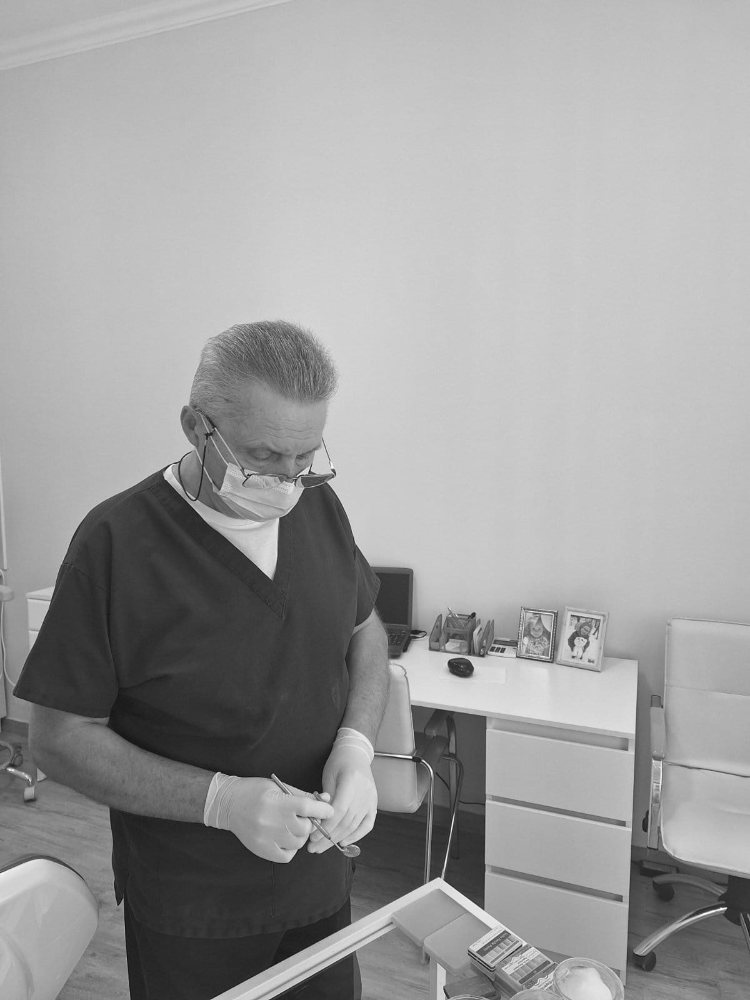
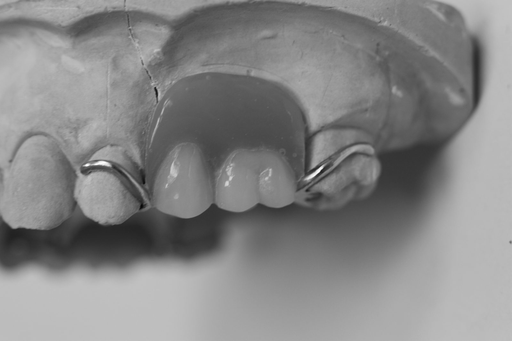

Після шістдесяти рот рідко «просто старіє». Частіше сходяться три речі: ліки, які сушать слину, корені, які вже не закриті яснами, і протез, який носять довше, ніж його край відповідає щелепі. Фактологічна довідка ВООЗ від 17 березня 2025 року оцінює, що хвороби порожнини рота зачіпають майже 3,7 мільярда людей. Повна втрата зубів у світі — майже 7% серед людей від 20 років і близько 23% серед людей 60 років і старших. Це глобальні оцінки, не статистика кабінету у Вінниці. Вони показують інше: втрата зубів зазвичай є кінцем довгого карієсу і хвороб ясен, а не окремим «віковим зносом», з яким нічого не зробити.

У Novadent після огляду планують пломби і знімні протези: акрил, нейлон, бюгель на ацеталі або на металевому каркасі, а також коронки. Лікар Голуб Олександр Олексійович приймає на вул. Гоголя 15. Консультація безкоштовна, телефон [075 177 75 67](tel:+380751777567). Імплантатів у цьому кабінеті не ставлять.

## Сухість від ліків і корінь

Вік сам по собі не вимикає слину так, як це робить аптечка. Препарати від тиску, антидепресанти, засоби від алергії, частина ліків при хворобі Паркінсона і при проблемах сечового міхура зменшують слину помітно. Без слини кислота на корені лишається довше, протез тре суху слизову, а смак їжі біднішає. На прийом приносять список усіх ліків, включно з тими, що «просто від тиску» і краплями. Скасовувати їх через сухість самостійно не можна. Можна назвати побічну дію тому, хто їх призначив, і паралельно берегти зуби.

Оголений корінь псується швидше за емаль: цемент і дентин мінералізовані слабше. Рані м’які плями інколи зупиняються, якщо прибрати наліт і лишити фтор. Порожнина, де застрягає їжа, потребує пломби. Паста з фторидом 1000–1500 ppm двічі на день — базова порада і ВООЗ, і Кокранівського огляду Walsh і співавторів: фтор у пасті зменшує карієс порівняно з пастою без фтору. Детальніше про корінь є запис [«Карієс кореня»](2025-08-25-root-caries.html).

Солодке між прийомами їжі і смоктання льодяників «щоб з’явилася слина» працюють проти цієї пасти. Вода поруч із ліжком доречніша. Якщо пече під протезом або з’явилися тріщини в кутах рота, це показують, а не заклеюють клеєм на місяці.

<figure>

<figcaption>Лікар Голуб Олександр Олексійович. На консультації дивляться список ліків: сухість рота часто йде від них.</figcaption>
</figure>

## Протез на ніч знімають

Огляд Gendreau і Loewy (Journal of Prosthodontics, 2011) пов’язує протезний стоматит — почервоніння слизової під базисом, часто за участю грибів Candida — із нічним носінням і поганою гігієною. Протез на ніч знімають, промивають і тримають у вологому середовищі. Ясна лишаються вільними. Суха серветка на батареї акрил коробить. Паста для емалі дряпає пластмасу, у подряпині швидше сідає наліт.

Вранці протез чистять окремою м’якою щіткою. Свої зуби і ясна чистять так само, навіть якщо «там уже нічого немає»: наліт на язиці й на останніх зубах нікуди не дівся. Клей не замінює край, який перестав відповідати щелепі. Кістка під базисом з роками тоншає, протез сідає вільніше, і людина звикає до посадки, яка вже натирає. Перебазування або новий акриловий протез у цьому кабінеті якраз про це. Нейлон і бюгель обирають за іншими межами: не кожен вільний повний протез стає нейлоновим лише тому, що старий акрил намуляв.

Консенсус Макгілла 2002 року в літературі пропонував для повністю беззубої нижньої щелепи покривний протез на двох імплантатах як базовий варіант. Це позиція публікації, не послуга цієї кімнати. Імплантатів тут не встановлюють. Людині з робочим знімним протезом не кажуть, що без імплантатів жувати «неправильно». Їй підганяють той протез, який можна зняти, полагодити і зняти на ніч.

Поки свої зуби ще є, їх не списують через вік. Корінь під кламером пломбують, якщо там порожнина. Коронку ставлять, коли стінки вже не тримають жування. Частковий протез тоді сідає на спокійну опору, а не на зуб, який розхитається за сезон. Слизову щік, язика і під язиком дивляться так само уважно, як зуби: довідка ВООЗ нагадує, що рак ротової порожнини частіше трапляється в старшому віці, особливо там, де є тютюн і алкоголь. Пляма або виразка, яка не загоюється, не чекає загального протезування. Її показують окремо і скоро.

<figure>

<figcaption>Частковий акриловий протез. На ніч його знімають, а опорні зуби під кламерами чистять окремо: там часто починається карієс кореня. Фото: Sterilgutassistentin, <a href="https://commons.wikimedia.org/wiki/File:Oberkiefer_Teilprothese_20100112_022.JPG" target="_blank" rel="noopener noreferrer">CC BY-SA 3.0</a>.</figcaption>
</figure>

## Коли щітку важко тримати

Артрит, тремор і слабкість кисті змінюють гігієну сильніше, ніж марка пасти. Ручка має лягати в долоню. Її можна потовщити зручним захватом, якщо тонка щітка вислизає. Кокранівський огляд Yaacob і співавторів показав, що електричні щітки, насамперед з коливально-обертальною голівкою, зменшують наліт і гінгівіт сильніше за ручні в коротких і довших дослідженнях, які вони зібрали. Різниця реальна. Вона не привід соромити людину, яка ретельно чистить ручною щіткою. Для руки, яка болить після хвилини, мотор і товста ручка інколи взагалі роблять чищення можливим.

Таймер допомагає не кидати справу на двадцятій секунді. Датчик тиску допомагає не дерти оголені корені. Голівку міняють, коли щетина роз’їхалася. Паста лишається фторованою: карієс стримує вона, а не тип ручки. Міжзубні проміжки, особливо біля кламерів, йоршик закриває краще за полоскання. Ополіскувач не замінює цього руху.

Якщо людина бачить гірше, дзеркало і гарне світло біля раковини важливіші за нову формулу пасти. Стояти довго важко — стілець біля умивальника теж є частиною гігієни, не лише «зручність квартири».

## Дім, де протези легко переплутати

У закладі догляду протез підписують ім’ям. Однаковий рожевий акрил у спільній ванній кімнаті легко опиняється в чужій склянці, а чужий протез натирає і не тримається. Підпис роблять способом, безпечним для пластмаси, а не першим маркером із шухляди. Персоналу варто знати просту річ: ввечері протез знімають, вранці повертають господарю, зуби і ясна допомагають чистити, якщо людина сама не дотягується.

Сухість, біль під базисом і раптова відмова їсти — привід показати рот, а не лише змінити страву на протерту. Протерта солодка їжа кілька разів на день якраз підгодовує карієс коренів, які ще є. Фторована паста двічі на день лишається доречною і там, де жувальних зубів уже мало.

Родина може прийти на консультацію разом із людиною або з її протезом у коробці. По телефону корисно сказати, чи є біль, чи протез зламаний, чи людина приймає ліки, які сушать рот. План і кошторис називають до роботи. Кабінет працює в будні з 9:00 до 18:00, у суботу з 9:00 до 15:00. Телефон [075 177 75 67](tel:+380751777567).

Текст спирається на оцінки ВООЗ для старшого віку і на фактори протезного стоматиту. Він не замінює перегляд ліків і огляд рота.

## Джерела

<ol class="blog-sources">
<li><a href="https://www.who.int/news-room/fact-sheets/detail/oral-health" target="_blank" rel="noopener noreferrer">World Health Organization. Oral health. Fact sheet, 17 March 2025.</a> Майже 3,7 мільярда людей із хворобами порожнини рота; повна втрата зубів близько 7% від 20 років і близько 23% у віці 60 років і старших; паста з фторидом 1000–1500 ppm двічі на день.</li>
<li><a href="https://doi.org/10.1111/j.1532-849X.2011.00700.x" target="_blank" rel="noopener noreferrer">Gendreau L, Loewy ZG. Epidemiology and etiology of denture stomatitis. J Prosthodont. 2011;20:251–260.</a> Нічне носіння і погана гігієна — фактори ризику протезного стоматиту.</li>
<li><a href="https://doi.org/10.1002/14651858.CD002281.pub3" target="_blank" rel="noopener noreferrer">Yaacob M, Worthington HV, Deacon SA, et al. Powered versus manual toothbrushing for oral health. Cochrane Database Syst Rev. 2014;CD002281.</a></li>
<li><a href="https://doi.org/10.1002/14651858.CD007868.pub3" target="_blank" rel="noopener noreferrer">Walsh T, Worthington HV, Glenny AM, Marinho VC, Jeroncic A. Fluoride toothpastes of different concentrations for preventing dental caries. Cochrane Database Syst Rev. 2019;CD007868.</a></li>
</ol>
