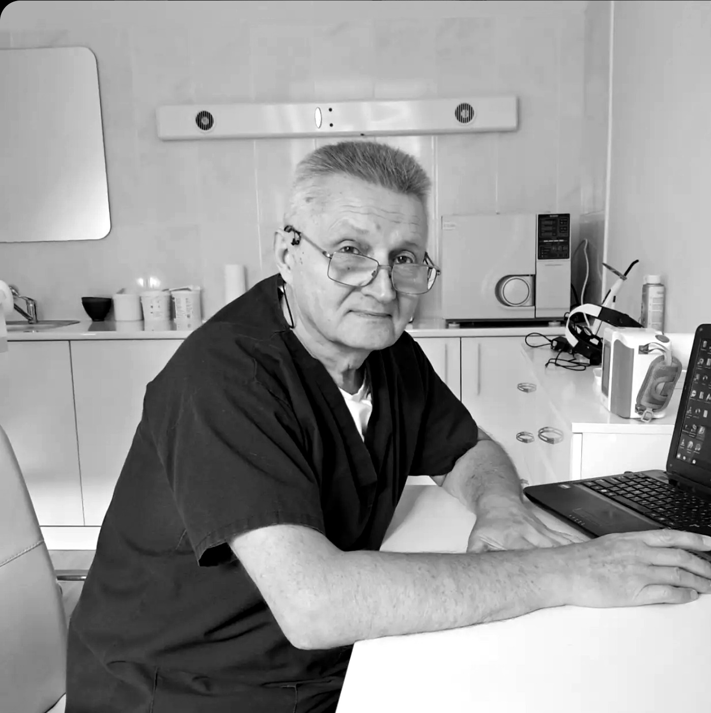

Людина на варфарині, аспірині чи клопідогрелі часто скасовує таблетку сама за день до стоматолога, бо боїться крові. Шотландська настанова SDCEP щодо стоматологічних пацієнтів на антикоагулянтах і антиагрегантах якраз від цього застерігає. Ризик тромбу від перерви може перевищити ризик кровотечі від зуба. Кров після видалення зазвичай зупиняють місцево. Інсульт або тромб стента від пропущених днів ліків так не зупинити в кріслі.

У побуті ці ліки називають «розріджувачами крові». Точніше, вони змінюють зсідання. Варфарин і прямі оральні антикоагулянти діють на фактори зсідання. Аспірин і клопідогрель діють на тромбоцити. Для стоматолога це різні схеми, і жодна з них не є дозволом скасувати препарат удома перед пломбою чи видаленням.

У Novadent це проговорюють до анестезії. Лікар Олександр Олексійович Голуб на безкоштовній консультації дивиться список ліків, а не напис «для серця» на коробці. Кабінет у Вінниці на вул. Гоголя 15, телефон [075 177 75 67](tel:+380751777567).

## Чого не скасовують самовільно

Настанова прямо каже лікувати, не перериваючи варфарин чи інший антагоніст вітаміну К, якщо INR у прийнятному для стоматології діапазоні. Пацієнта на одному антиагреганті або на двох одразу теж лікують, не скасовуючи ліки. Аспірин, навіть мала доза «для крові», входить у цей перелік. Клопідогрель теж. Подвійна схема після стента особливо не терпить самовільної паузи: її не обривають без письмової поради кардіолога, бо ціна перерви — тромб у стенті, а не довша серветка після зуба.

Сказати треба кожен препарат, який чіпає зсідання. Сюди входить аспірин, який людина не вважає «серйозними ліками», комбінована таблетка від тиску, якщо в складі є антиагрегант, і засіб, який інший лікар призначив «тимчасово». Назва сусіда не є схемою. Якщо препарат інший, ніж ті, що названі тут, його все одно проговорюють уголос: настанова розбирає групи, а не вгадує за кольором упаковки.

Пломба рідко кровоточить так, як лунка після видалення. Краї ясен під час роботи можуть закровити, і цього зазвичай досить гачку і тиску. Видалення, розріз і глибоке зняття каменю з кількох ділянок за один візит — інший масштаб. Рішення «продовжувати ліки» не означає робити все за один раз будь-якою ціною. Лікар може обмежити першу ділянку, подивитися, як зупиняється кров, і решту перенести на інший день.

Вечір напередодні — не час для самостійного експерименту. Пропущена «про всяк випадок» таблетка варфарину, аспірину чи клопідогрелю не робить ранок безпечнішим. Вона робить зсідання непередбачуваним саме того дня, коли лікар розраховував на звичну схему. Якщо хтось уже встиг скасувати дозу, про це кажуть на початку прийому, а не після того, як кров пішла не так, як чекали.

<figure>

<figcaption>Список препаратів має бути на столі до лікування. Аспірин «для серця» теж називають. Фото ілюстративне: це не прийом у кабінеті Novadent.</figcaption>
</figure>

## Варфарин: свіжий INR, а не скасована таблетка

Для варфарину орієнтир — INR, показник зсідання саме для цього класу ліків. SDCEP просить перевірити його близько до втручання, яке може кровоточити, насамперед до видалення. В ідеалі аналіз зроблений у межах останніх 24 годин. Якщо INR стабільний, приймають результат не давніший за 72 години. Стабільним у цьому тексті настанови вважають людину, якій не потрібен щотижневий контроль і в якої за останні два місяці INR не піднімався до 4 і вище. Якщо є привід думати, що старий аналіз уже не про сьогоднішній стан — різка зміна їжі, пронос, пропущена чи подвоєна доза, новий антибіотик — аналіз повторюють ближче до прийому.

Поріг у настанові — близько 4. Якщо INR нижчий за 4, багато стоматологічних втручань проводять, не скасовуючи варфарин, і спираються на місцеву зупинку крові. Якщо INR 4 або вищий, втручання, яке кровоточить, відкладають, поки показник знизять, і про це повідомляють того, хто веде антикоагуляцію. Терміновий випадок скеровують, а не героїчно лікують у кріслі з високим INR. Лікар підтверджує актуальний результат. Пацієнт не «підганяє» дозу напередодні, щоб цифра виглядала гарніше: різкий самовільний стрибок дози якраз робить аналіз ненадійним.

Місцеві заходи — це те, що робить лікар у лунці: тиск, за потреби шов і пакування. Це не привід принести з дому випадковий кровоспинний засіб. Після видалення дають зрозумілу інструкцію, як притиснути марлю і коли телефонувати. Полоскати лунку в перші години, щоб «подивитися, чи ще тече», якраз збиває згусток. Якщо кров не зупиняється тим тиском, який показали, телефонують у кабінет. Препарат через це самотужки не скасовують.

Пломба з фотополімеру — Лателюкс, Карісма, Градія чи нанокомпозит CeramX — зазвичай лишається в групі малого ризику кровотечі. Як лікують карієс і коли вже потрібні канали, розібрано в записі [«Лікування карієсу і пульпіту»](2026-07-01-therapy.html). Коронка, якщо край іде під ясна, може дати більше крові за звичайну пломбу, але це все ще не лунка. Коронки і знімні протези в кабінеті роблять на місці; про коронку є запис [«Коронка на зуб»](2026-08-01-crowns.html). Знімок відбитка сам по собі майже не кровоточить. Якщо того ж дня планують видалення, розмова про протез не замінює розмову про варфарин.

<figure>

<figcaption>Олександр Олексійович Голуб у кабінеті Novadent. Перед втручанням, яке може кровоточити, тут дивляться препарат і для варфарину свіжий INR.</figcaption>
</figure>

## Прямі антикоагулянти: зсувають ранок, а не скасовують тиждень

Апіксабан, ривароксабан і близькі до них дабігатран та едоксабан не ведуть за INR. Звичайний аналіз «як на варфарин» для них не підходить, і просити лабораторію зробити INR про всяк випадок немає сенсу. Для процедури з низьким ризиком кровотечі настанова радить лікувати, не перериваючи препарат. Для процедури з вищим ризиком дозу не скасовують на кілька днів. Її прив’язують до ранку втручання: для апіксабану і дабігатрану ранкову дозу в день лікування інколи пропускають, для ривароксабану й едоксабану — зсувають. Це умовна рекомендація самої настанови, бо докази тут тонкі. Її озвучує лікар під конкретний зуб, а не інструкція з інтернету на всі випадки.

Пропуск має бути той, який назвали на прийомі. Подвоїти вечірню дозу «щоб надолужити», пропустити ще два дні «для спокою» або перенести схему сусіда з іншим препаратом — три різні помилки. Якщо процедуру перенесли, план ранкової дози теж перепитують, а не використовують учорашню записку. Людина, яка приймає препарат увечері, а не вранці, не копіює ранкову схему з пам’ятки для іншого режиму: час доби тут і є зміст поради.

Після втручання кровотеча, яка не зупиняється тиском так, як показали, набряк дна рота, кров, яку доводиться ковтати, або слабкість — привід зателефонувати в кабінет і тому, хто призначив антикоагулянт. Самотужки препарат усе одно не скасовують до понеділка. І не починають додатковий аспірин від зубного болю, не сказавши про обидва ліки.

## Що принести на консультацію

Достатньо аркуша: назва, доза, ранок чи вечір, хто призначив, чи є стент і відколи, коли був останній INR, якщо це варфарин. Старі знімки теж корисні, але для цієї теми головне — ліки. Безкоштовна консультація ні до чого не зобов’язує. Можна з’ясувати, чи пломба взагалі потрібна цього тижня, і забрати план із собою.

Кабінет не веде антикоагуляцію замість кардіолога чи сімейного лікаря. Він не скасовує і не призначає варфарин, аспірин чи клопідогрель. Він вирішує, чи стоматологічна робота в цей день безпечна при тій схемі, яка вже є, і чи вистачить місцевої зупинки крові. Якщо показник або схема цього не дозволяють, чесне рішення — перенести зуб, а не героїчно скасувати ліки від тромбу.

Цей текст передає логіку настанови SDCEP. Дозу і рішення про конкретний ранок визначає огляд, а не стаття.

## Джерела

<ol class="blog-sources">
<li>Scottish Dental Clinical Effectiveness Programme. Management of dental patients taking anticoagulants or antiplatelet drugs. <a href="https://www.sdcep.org.uk/published-guidance/anticoagulants-and-antiplatelets/" target="_blank" rel="noopener noreferrer">sdcep.org.uk</a></li>
</ol>
