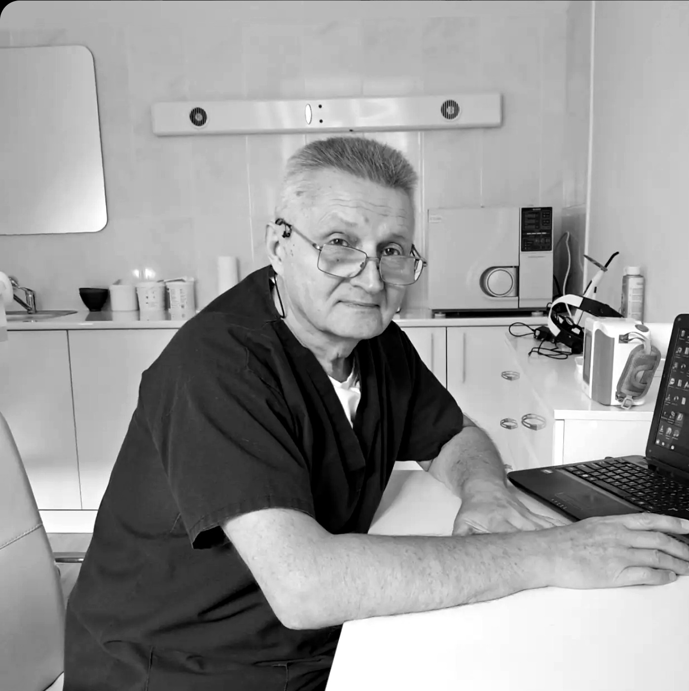

Таблетку «від серця перед стоматологом» багато хто тримає вдома з чужих слів. Наукова заява Американської асоціації серця 2021 року (Wilson і співавт., Circulation) звужує антибіотикову профілактику інфекційного ендокардиту до невеликої групи людей і до невеликої групи процедур. Решті ця таблетка перед оглядом або звичайною пломбою не показана. Залишок упаковки з минулої застуди тим більше не є профілактикою.

Ендокардит — запалення внутрішньої оболонки серця, часто на клапані. Частина бактерій потрапляє в кров із рота, коли травмують ясна. Заява якраз про те, що така профілактика має сенс лише там, де серцевий ризик найвищий, а втручання справді чіпає ясна, зону біля верхівки кореня або проходить крізь слизову. Звичайний огляд у цей перелік не входить. Пломба вище ясен, якщо вона ясна не чіпає, теж часто не входить.

У Novadent це з’ясовують до анестезії. Лікар Голуб Олександр Олексійович на безкоштовній консультації записує діагноз так, як він названий кардіологом, а не як «щось із серцем». Кабінет у Вінниці на вул. Гоголя 15, телефон [075 177 75 67](tel:+380751777567). Доз у цьому тексті немає навмисно: препарат і кількість залежать від діагнозу, алергії і самої процедури. Блог для таблиці доз не місце.

## Кому це взагалі обговорюють

Wilson і співавтори залишають профілактику для найвищого ризику. Сюди входить штучний клапан, у тому числі поставлений через судину, і матеріал, яким клапан ремонтували. Сюди входить перенесений інфекційний ендокардит. Сюди входить частина вроджених вад: невиправлена ціанотична вада, повністю виправлена вада з протезним матеріалом у перші шість місяців після процедури, і виправлена вада, якщо біля латки чи пристрою лишився дефект. Сюди входить частина людей після пересадки серця, якщо на пересадженому серці з’явилася вада клапана.

Поруч є стани, які звучать серйозно і в цей перелік не входять. Шум у серці сам по собі, пролапс мітрального клапана без тих ознак, що названі вище, стент у вінцевій артерії, шунтування і кардіостимулятор не роблять людину кандидатом на таблетку перед кожним зубом. Їх все одно називають лікарю. Називають, щоб не сплутати стент зі штучним клапаном і щоб знати, які ліки людина вже п’є. Не називають для того, щоб автоматично отримати антибіотик.

Папір від кардіолога з назвою операції і роком допомагає більше за пам’ять родини. «Мені міняли клапан» і «мені ставили стент» для цієї заяви — різні речення. Якщо формулювання розмите, стоматолог не вгадує на користь таблетки. Він просить уточнення. Планову пломбу можна перенести на день, коли діагноз уже написаний. Гострий біль і набряк не відкладають на тижні лише через неясний папір: інфекцію в зубі лікують, а питання профілактики ставлять по телефону кардіологу або за наявними виписками того самого дня.

<figure>

<figcaption>Лікар Голуб Олександр Олексійович. Серцевий діагноз називають до лікування: шум, стент і штучний клапан для профілактики ендокардиту не одне й те саме.</figcaption>
</figure>

## Яка процедура потрапляє в перелік

Навіть людині з штучним клапаном антибіотик перед зубом потрібен не «на будь-який візит». Заява прив’язує його до процедур, які маніпулюють тканиною ясен, ділянкою навколо верхівки кореня або проходять крізь слизову. Зняття каменю з кровоточивих ясен, видалення, розріз, робота біля кореня — це той бік списку.

Поза ним лишаються речі, які якраз лякають людей даремно. Огляд. Знімок. Зняття відбитка і здача знімного протеза. Анестезія крізь неінфіковану тканину в багатьох схемах теж не є приводом. Пломба вище рівня ясен, якщо лікар не відсуває ясна і не заводить під них матрицю, часто не кваліфікується. Щойно робота йде під ясна, розмова інша, і її ведуть до початку, а не після уколу.

Тому фраза «мені завжди кололи перед стоматологом» потребує дати і діагнозу. Рекомендації звужувалися роками. Те, що призначали при шумі в серці двадцять років тому, заява 2021 року не повторює. Новий лікар має право не продовжити стару звичку. Це не неуважність, а інша межа ризику: антибіотик теж має ціну, від алергії до добору стійких бактерій.

Щоденна гігієна в цій логіці важливіша за одну таблетку на рік. Фактологічна довідка ВООЗ нагадує, що хвороби рота і інші неінфекційні хвороби, серед них серцево-судинні, ділять спільні чинники, і погана гігієна входить у цей перелік поруч із цукром, тютюном і алкоголем. Довідка не є таблицею профілактики ендокардиту. Вона про інше: наліт і запалені ясна — щоденна історія, а не рідкісний візит. Чистити зуби фторованою пастою і не запускати кровоточивість потрібно і людям зі штучним клапаном, і всім іншим. Кровоточиві ясна дають бактеріям у кров привід частіше, ніж одна акуратна пломба на рік.

## Залишок таблеток удома

Почати ввечері «про всяк випадок» залишок амоксициліну — погана ідея з кількох боків. Препарат може бути не тим. Доза майже напевно не та, яку мали б дати перед конкретною процедурою, якби вона взагалі була потрібна. Курс виходить обірваний. Алергію так теж не перевіряють. Якщо наступного дня з’явиться висип або набряк, лікар не знатиме, що саме людина випила з домашньої шафки.

Профілактику, коли вона показана, призначають під процедуру, а не заднім числом після обіду. Людина не приносить схему з форуму. Вона приносить діагноз. Лікар вирішує, чи ця пломба або це зняття каменю взагалі входить у перелік, і чи немає алергії на групу пеніциліну. Якщо антибіотик потрібен, його узгоджують так, щоб він був у крові на час втручання, а не «три дні до і три дні після про всяк випадок». Довгий самовільний курс не робить візит безпечнішим.

Те саме стосується сусідської поради і аптеки без рецепта там, де його не мали б продати. Інфекційний ендокардит лікують у стаціонарі, довго і серйозно. Саме тому таблетку не роздають усім підряд: вона не замінює лікування зуба і не страхує серце, яке не входить у групу найвищого ризику.

<figure>

<figcaption>Діагноз краще принести написаним: назва операції і рік відрізняють клапан від стента. Фото ілюстративне, це не прийом у Novadent.</figcaption>
</figure>

## Суглоб після заміни — інше питання

Ендопротез кульшового чи колінного суглоба не стоїть у тому самому списку, що штучний клапан серця. Рутинна антибіотикова профілактика перед звичайним стоматологічним лікуванням для людини зі заміненим суглобом не є автоматичною. Окремі ортопеди досі просять таблетку в перші місяці після операції або за особливих обставин. Тоді потрібна їхня письмова думка, а не домашня упаковка «бо суглоб металевий».

Стоматологу кажуть і про суглоб, і про серце. Це різні рядки картки. Змішувати їх в одну фразу «мені не можна без антибіотика» означає отримати або зайву таблетку, або, гірше, пропущену профілактику там, де клапан справді штучний. Якщо ортопед і кардіолог дають різні папірці, їх приносять разом і не обирають суворіший «для спокою» самотужки.

Пломба, коронка і знімний протез у цьому кабінеті плануються після того, як список ліків і діагнозів уже на столі. Знімок на візіографі роблять, коли він змінює рішення, і сам по собі він не є приводом для антибіотика. Видалення, якщо воно потрібне, обговорюють окремо: це вже інша травма слизової, і для людини зі штучним клапаном якраз той випадок, де заяву Wilson перечитують до запису, а не в коридорі.

На консультацію візьміть виписку, список ліків і алергій. Скажіть, чи був ендокардит, чи є штучний клапан, чи була пересадка серця, чи міняли суглоб. Цього досить, щоб не призначити таблетку тим, кому вона не потрібна, і не пропустити тих, кому вона належить перед конкретною процедурою. Запис — [075 177 75 67](tel:+380751777567). Вінниця, вул. Гоголя 15.

Текст передає межі профілактики за заявою Wilson 2021 року. Він не є схемою доз і не замінює виписку кардіолога.

## Джерела

<ol class="blog-sources">
<li><a href="https://doi.org/10.1161/CIR.0000000000000969" target="_blank" rel="noopener noreferrer">Wilson WR, Gewitz M, Lockhart PB, et al. Prevention of viridans group streptococcal infective endocarditis: a scientific statement from the American Heart Association. Circulation. 2021.</a> Профілактика обмежена найвищим серцевим ризиком і процедурами, які чіпають ясна, перипікальну ділянку або проходять крізь слизову.</li>
<li><a href="https://www.who.int/news-room/fact-sheets/detail/oral-health" target="_blank" rel="noopener noreferrer">World Health Organization. Oral health. Fact sheet, 17 March 2025.</a> Хвороби порожнини рота ділять чинники ризику з іншими неінфекційними хворобами, зокрема серцево-судинними; серед чинників названо погану гігієну, цукор, тютюн і алкоголь. Довідка не встановлює показань до антибіотика перед стоматологічним візитом.</li>
</ol>
