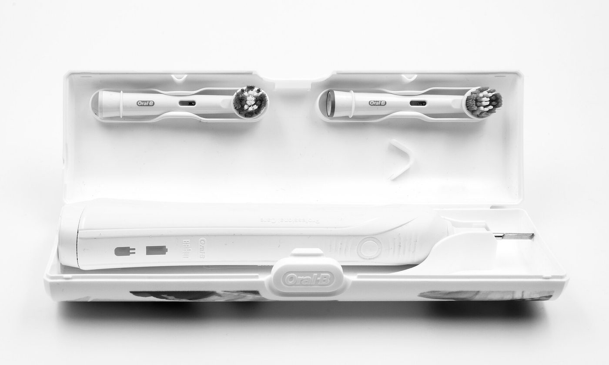

Електрична щітка не лікує карієс мотором. Вона знімає наліт, і в зібраних дослідженнях робить це трохи краще за ручну. Карієс стримує фтор у пасті. Кокранівський огляд Yaacob і співавторів порівнював електричні щітки з ручними. Електричні, насамперед із коливально-обертальною голівкою, зменшували наліт і гінгівіт сильніше і в коротких випробуваннях, і в довших, які автори звели разом. Різниця справжня. Вона невелика на тлі того, що дає акуратне чищення будь-якою щіткою, і не є приводом соромити людину, яка двічі на день спокійно чистить ручною щіткою з фтором.

Огляд Walsh і співавторів стосується вже пасти. Паста з фторидом зменшує карієс порівняно з пастою без фтору, і концентрація має значення. ВООЗ для щоденного чищення називає 1000–1500 ppm. Цю пасту видавлюють і на електричну, і на звичайну голівку. Дитяча паста «без фтору, бо сучасна» цієї роботи не виконує. Вугільна паста теж: належних доказів, що вона відбілює, бракує, і вона може бути абразивною. Про це є запис [«Вугільна паста»](2025-10-20-charcoal.html). Для вибору між двома щітками головне інше: паста має містити фтор.

У Novadent на консультації дивляться, чи доходить людина до ясен і міжзубних проміжків, а не марку ручки. Лікар Голуб Олександр Олексійович, Вінниця, вул. Гоголя 15, телефон [075 177 75 67](tel:+380751777567). Консультація безкоштовна.

## Що саме показав огляд

Yaacob і колеги дивилися наліт і запалення ясен, не дірки в емалі. Це важлива межа. Менше нальоту і спокійніші ясна — очікуваний наслідок, якщо голівка справді проходить по краю ясен і людина не кидає справу за двадцять секунд. Зменшення карієсу з цього огляду не випливає. Хто купує електричну щітку «щоб більше не було дірок» і лишає солодкий чай щогодини, купує не те.

Коливально-обертальні моделі в огляді мали найбільше досліджень. Звукові і більш прості вібраційні щітки теж існують. Огляд не зобов’язує вибирати найдорожчий корпус. Він каже, що мотор із такою голівкою в середньому знімає наліт трохи краще за руку. Середнє по дослідженнях не описує кожну людину. Той, хто ручною щіткою вже чистить дві хвилини без крові на щітці, виграє мало. Той, хто шкрябає одну щоку і забуває внутрішній бік нижніх різців, виграє більше, бо голівка і таймер закривають прогалину звички.

Тиск лишається за людиною. Електрична щітка не вибачає, якщо її вдавлювати як ручну. Щетина має ковзати по краю ясен. Білий або рожевий ободок на яснах після чищення означає, що тиск зайвий, хоч би який логотип на ручці. Кількість режимів на коробці тут ні до чого: таймер і датчик тиску змінюють звичку, а зайва програма не чистить проміжок між зубами.

<figure>

<figcaption>Кругла голівка, що обертається, — той тип, який у Кокранівському огляді частіше порівнювали з ручною щіткою. Фото: Jacek Halicki, <a href="https://commons.wikimedia.org/wiki/File:2023_Szczoteczka_do_z%C4%99b%C3%B3w_Oral-B_Pro_750_(2).jpg" target="_blank" rel="noopener noreferrer">CC BY-SA 4.0</a>.</figcaption>
</figure>

## Паста важливіша за ручку

Техніка однакова за змістом. Вранці і ввечері. Паста з фторидом розміром із невелику горошину для дорослого, для малої дитини — ще менше, як порадить лікар. Виплюнути, не запивати одразу великим ковтком води і не полоскати рот ополіскувачем у ту ж хвилину: фтор має лишитися на зубах. Цю звичку британський набір Delivering Better Oral Health тримає окремо від марки щітки. Про ополіскувач є запис [«Ополіскувач: коли він доречний»](2025-10-06-mouthwash.html).

Міжзубний проміжок не чистить ні ручна, ні електрична щітка. Йоршик або нитка лишаються. Кровоточивість, яка не стихає за тиждень нормального чищення, — привід на огляд, а не привід купити третю голівку. Ясна кровлять від нальоту, який ще лежить у кишені, або від каменю, який щітка вже не знімає.

Сухий рот, оголені корені і часті солодкі перекуси перекривають дрібну перевагу мотора. Тоді розмова про пасту, воду і частоту цукру важить більше. Настанова ВООЗ щодо вільних цукрів тримає їх нижче 10% енергії, за можливості нижче 5%. Для зубів кожен окремий солодкий ковток між їжею — новий кислотний епізод. Щітка ввечері це не відміняє.

## Датчик тиску і таймер

Дві функції справді змінюють поведінку тих, кому вони адресовані. Таймер, зазвичай на дві хвилини, зупиняє людей, які щиро вважають, що вже почистили, хоча встигли лише передні зуби. Датчик тиску блимає або вимикає рух, коли людина тре так, ніби знімає нагар. Саме такі сліди — клиноподібні дефекти біля ясен і оголені корені — щітка «сильніше» тільки поглиблює.

Голівку міняють, коли щетина розійшлася в боки, зім’ялася або минуло кілька місяців і вона вже не пружинить. Розчепірена щетина не входить у борозну біля ясен і дряпає щоку. Те саме правило для ручної щітки: її не доношують, поки пучки не стануть віялом. Одна людина псує щетину за місяць сильним тиском, інша носить її довше. Дивляться на форму, не лише на календар.

Для руки з артритом товста ручка і мотор інколи важливіші за ту невелику різницю з огляду Yaacob. Якщо пальці не втримують тонку ручну щітку, електрична робить гігієну можливою. Ручку можна потовщити і на звичайній щітці. Про це є запис [«Рот після 60 років»](2025-09-01-after-60.html). Дитині електричну щітку обирають за віком і за тим, чи чистить вона сама, чи ще за неї водять батьки. Мотор не замінює дорослого, який перевіряє внутрішні поверхні.

<figure>

<figcaption>Ручна щітка з рівною щетиною. Якщо пучки розійшлися, її міняють: така щетина вже не прибирає край ясен і дряпає зуб.</figcaption>
</figure>

## Кому ручної досить

Досить, коли нальоту на краю ясен після чищення не видно, кров не з’являється щодня, а людина не тікає з ванної за пів хвилини. Тоді міняти ручку лише через рекламу немає клінічної причини. Гроші спокійніше покласти в пасту з нормальним вмістом фтору і в йоршики потрібного розміру.

Електрична доречніша, коли рух хаотичний, коли таймер дисциплінує, коли тиск треба обмежити датчиком, коли кисть слабка. Вона не потрібна «всім сучасним людям». Вона потрібна тим, у кого ручна техніка вже показала свою стелю, або хто фізично не може цю техніку виконати.

Нічна капа, спортивна капа і ортодонтичний апарат чистять окремо. Щітка по них не замінює чищення зубів під ними. Протез теж чистять не цією ж пастою до дірок у акрилі: для пластмаси беруть м’який засіб, інакше поверхня дряпається і збирає наліт. Опорні зуби під кламером якраз потребують і щітки, і фтору, бо карієс кореня там починається тихо.

На огляді в кабінеті можна принести свою щітку. По щетині видно тиск краще, ніж по розповіді. Якщо ясна кровлять, дивляться кишені, а не одразу продають іншу голівку. Пломби і коронки тут роблять, коли тканина вже втрачена. Щітка цю втрату не відновлює, вона зменшує шанс наступної. Запис на безкоштовну консультацію — [075 177 75 67](tel:+380751777567).

Текст передає висновок Cochrane про наліт і гінгівіт, а не про карієс. Карієс у цих порівняннях лишається за фтором у пасті.

## Джерела

<ol class="blog-sources">
<li><a href="https://doi.org/10.1002/14651858.CD002281.pub3" target="_blank" rel="noopener noreferrer">Yaacob M, Worthington HV, Deacon SA, et al. Powered versus manual toothbrushing for oral health. Cochrane Database Syst Rev. 2014;CD002281.</a></li>
<li><a href="https://doi.org/10.1002/14651858.CD007868.pub3" target="_blank" rel="noopener noreferrer">Walsh T, Worthington HV, Glenny AM, Marinho VC, Jeroncic A. Fluoride toothpastes of different concentrations for preventing dental caries. Cochrane Database Syst Rev. 2019;CD007868.</a></li>
<li><a href="https://www.who.int/news-room/fact-sheets/detail/oral-health" target="_blank" rel="noopener noreferrer">World Health Organization. Oral health. Fact sheet, 17 March 2025.</a> Двічі на день паста з фторидом 1000–1500 ppm.</li>
<li><a href="https://www.who.int/publications/i/item/9789241549028" target="_blank" rel="noopener noreferrer">World Health Organization. Guideline: sugars intake for adults and children. Geneva: WHO; 2015.</a></li>
<li><a href="https://www.gov.uk/government/publications/delivering-better-oral-health-an-evidence-based-toolkit-for-prevention" target="_blank" rel="noopener noreferrer">Office for Health Improvement and Disparities. Delivering better oral health: an evidence-based toolkit for prevention.</a> Після чищення пасту спльовують і не змивають її одразу водою.</li>
<li><a href="https://jada.ada.org/article/S0002-8177(17)30438-X/fulltext" target="_blank" rel="noopener noreferrer">Brooks JK, Bashirelahi N, Reynolds MA. Charcoal and charcoal-based dentifrices: a literature review. J Am Dent Assoc. 2017;148:661–670.</a> Для вугільних паст бракує належних доказів відбілювання, і вони можуть бути абразивними.</li>
</ol>
