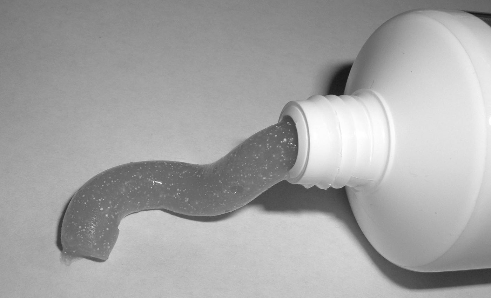

Вугільна паста виглядає переконливо: чорна смужка на щітці, обіцянка світліших зубів, інколи ще й «детокс» рота. Огляд Джона Брукса і колег у Journal of the American Dental Association якраз про цю прірву. Рекламні твердження пішли далі за випробування. Клінічних і лабораторних даних не вистачило, щоб підтвердити безпеку і користь вугілля та паст на його основі. Обіцянка надійного відбілювання в нормальних випробуваннях не виконана. Натомість частина таких засобів може бути абразивною і може не містити фтору. Стирання плюс відсутній фтор — поганий обмін.

У Novadent вугільну пасту не радять і не продають як догляд. Лікар Олександр Олексійович Голуб на безкоштовній консультації дивиться, чи емаль уже стерта, чи плями — це наліт, чи карієс. Кабінет у Вінниці на вул. Гоголя 15, телефон [075 177 75 67](tel:+380751777567). Відбілювального пакета в прайсі цього кабінету немає.

## Реклама попереду випробувань

Брукс із колегами переглянули і дослідження, і те, що пишуть у рекламі вугільних засобів. Серед обіцянок були відбілювання, антибактерійна дія і очищення від «токсинів». Для цих тверджень не знайшлося достатніх клінічних і лабораторних доказів. Окремі старі описи чищення сирим вугіллям або сажею теж не склалися в доказ користі: частина повідомляла про шкоду, включно зі стиранням емалі і карієсом. Автори прямо пишуть, що потрібні більші і краще сплановані роботи, перш ніж такі пасти можна вважати перевіреними.

З цього не випливає, що кожна чорна паста на полиці однаково шкідлива. Випливає скромніше і важливіше: покупець не може перевірити абразивність і наявність фтору за кольором тюбика. Маркетинг заповнив цю діру словом «натуральне». Вугілля в пасті не є ні ліками від карієсу, ні професійним відбілюванням. Воно може зняти поверхневий наліт так само, як будь-який абразив знімає м’який наліт, і водночас подряпати те, що вже не відросте.

Емаль — зовнішній шар на схемі зуба. Під нею дентин, у центрі пульпа. Емаль не має живих клітин, які залатають подряпину. Щоденне тертя радістю «чим чорніше, тим чистіше» тонку емаль робить тоншою. Дентин під нею жовтіший і м’якший, тож зуб може виглядати темнішим саме після старанного «відбілювання» абразивом. Людина тоді купує ще жорсткішу пасту. Коло замикається без жодного випробування, яке б це виправдало.

<figure>

<figcaption>Ручна щітка знімає наліт разом із пастою. Вугілля на ній не замінює фтор. Фото ілюстративне.</figcaption>
</figure>

## Жорстка паста без фтору

Абразив і відсутній фтор шкодять різними шляхами, і разом це гірше, ніж кожен окремо. Абразив знімає тонкий шар емалі там, де людина тисне найдужче: біля ясен, на іклах, на зовнішній поверхні, яку видно в дзеркалі. Фтор у нормальній пасті якраз допомагає емалі протистояти кислоті зубного нальоту. Паста, в якій фтору немає або його мізерно, цього не робить, навіть якщо вона чорна і «детокс».

Огляд Волша і колег щодо паст різної концентрації фтору показує робочий діапазон 1000–1500 ppm. Саме така паста, а не вугільна, є засобом із випробуваннями проти карієсу. Британський набір Delivering Better Oral Health тримає ту саму базу: чистити двічі на день фторпастою і спльовувати, не споліскуючи рот водою одразу, щоб фтор лишився на зубах. Вугільна паста в цю схему не вбудовується, якщо вона замінює фтор або додає зайве тертя.

«М’яка» на етикетці теж нічого не гарантує. Брукс зазначав, що частина реклами називає засіб щадним до емалі без даних, які б це підтвердили. Поки виробник не показав і абразивність, і фтор, і відбілювання в нормальному випробуванні, чорний тюбик лишається модою. Мода на зубах коштує емалі, яку не повернути другою баночкою.

Плями від кави, чаю і тютюну сидять у нальоті або в поверхневому шарі. Їх інколи знімає звичайне чищення і професійне зняття відкладень, яке є в прайсі кабінету. Вони не є доказом, що потрібне вугілля. Темна фісура, під якою зонд провалює емаль, — це вже карієс, і його не полірують пастою. Тоді розмова про пломбу: Лателюкс, Карісма, Градія або нанокомпозит CeramX. Про це є запис [«Лікування карієсу і пульпіту»](2026-07-01-therapy.html).

<figure>

<figcaption>На щітку кладуть горошину пасти з фтором, не таку стрічку. Вугільна паста часто цього фтору не має. Фото: Scott Ehardt, <a href="https://commons.wikimedia.org/wiki/File:Toothpaste.jpg" target="_blank" rel="noopener noreferrer">суспільне надбання</a>.</figcaption>
</figure>

## Якщо хочеться світліших зубів

Відбілювання, коли воно взагалі доречне, — це питання пероксиду після того, як рот здоровий: немає відкритого карієсу, ясна спокійні, чутливість зрозуміла. Пероксид і абразивне вугілля — не одне й те саме. Пероксид змінює колір пігменту в тканині зуба. Вугілля, у кращому разі, тре поверхню. У гіршому — тре її без фтору і без доказу, що колір справді зміниться так, як на рекламі.

У прайсі Novadent немає відбілювального пакета, кап із гелем і «курсу для посмішки». Це свідоме обмеження кабінету, а не тимчасова акція. Якщо зуб темний, бо під старою пломбою карієс, або мертвий після удару, або закритий металокерамікою з сірим краєм, паста будь-якого кольору його не вибілить. Тоді дивляться реставрацію або коронку. Коронки тут роблять: литу, металокераміку, прес-кераміку, цирконій. Про вибір є запис [«Коронка на зуб»](2026-08-01-crowns.html).

Порошок вугілля з кухні чи з баночки нічим не кращий за чорну пасту. Його наносять щільніше і тиснуть дужче, а фтору в цьому жесті як не було, так і немає. Емаль від порошку не отримує того, що дає звичайна фторпаста, і може втратити більше. Домучувати куплене «щоб не пропадало» не варто.

Чутливі шийки, клини, де емаль уже зійшла, і зуби після кислотних напоїв — погане місце для експерименту з абразивом. Кислота розм’якшує поверхню, щітка її знімає. Додати ще й жорстку пасту означає прискорити те, що людина хотіла виправити кольором. Вода між прийомами їжі і фторпаста двічі на день дають більше за чорний тюбик. Про напої, які розчиняють емаль, є окремий запис, і він не про вугілля: [«Напої, які розчиняють емаль»](2025-11-03-acid-drinks.html).

Всесвітня організація охорони здоров’я серед базових речей для рота називає фтор і обмеження вільних цукрів, а не активоване вугілля. Настанова ВООЗ щодо цукрів тримає вільні цукри нижче 10% енергії раціону, а за можливості нижче 5%. Для зубів важлива і частота: кожен солодкий перекус між їжею — окремий епізод для нальоту. Вугільна паста цей розклад не скасовує.

На консультації можна принести тюбик, яким чистите зараз, і почути пряму відповідь, чи там є фтор у діапазоні 1000–1500 ppm і чи не трете ви вже голий дентин. Це безкоштовно і ні до чого не зобов’язує. Якщо паста звичайна фторована, міняти її на чорну немає за що.

Цей текст спирається на огляд Брукса і на огляди щодо фтору. Він не підбирає тюбик заочно і не є рекламою відбілювання.

## Джерела

<ol class="blog-sources">
<li>Brooks JK, Bashirelahi N, Reynolds MA. Charcoal and charcoal-based dentifrices: a literature review. J Am Dent Assoc. 2017. <a href="https://jada.ada.org/article/S0002-8177(17)30438-X/fulltext" target="_blank" rel="noopener noreferrer">jada.ada.org</a></li>
<li>Walsh T, Worthington HV, Glenny AM, Marinho VCC, Jeroncic A. Fluoride toothpastes of different concentrations for preventing dental caries. Cochrane Database of Systematic Reviews. 2019. <a href="https://doi.org/10.1002/14651858.CD007868.pub3" target="_blank" rel="noopener noreferrer">doi:10.1002/14651858.CD007868.pub3</a></li>
<li>Office for Health Improvement and Disparities, Department of Health and Social Care, NHS England. Delivering better oral health: an evidence-based toolkit for prevention. <a href="https://www.gov.uk/government/publications/delivering-better-oral-health-an-evidence-based-toolkit-for-prevention" target="_blank" rel="noopener noreferrer">gov.uk</a></li>
<li>World Health Organization. Guideline: sugars intake for adults and children. <a href="https://www.who.int/publications/i/item/9789241549028" target="_blank" rel="noopener noreferrer">who.int</a></li>
<li>World Health Organization. Oral health. <a href="https://www.who.int/news-room/fact-sheets/detail/oral-health" target="_blank" rel="noopener noreferrer">who.int, fact sheet</a></li>
</ol>
