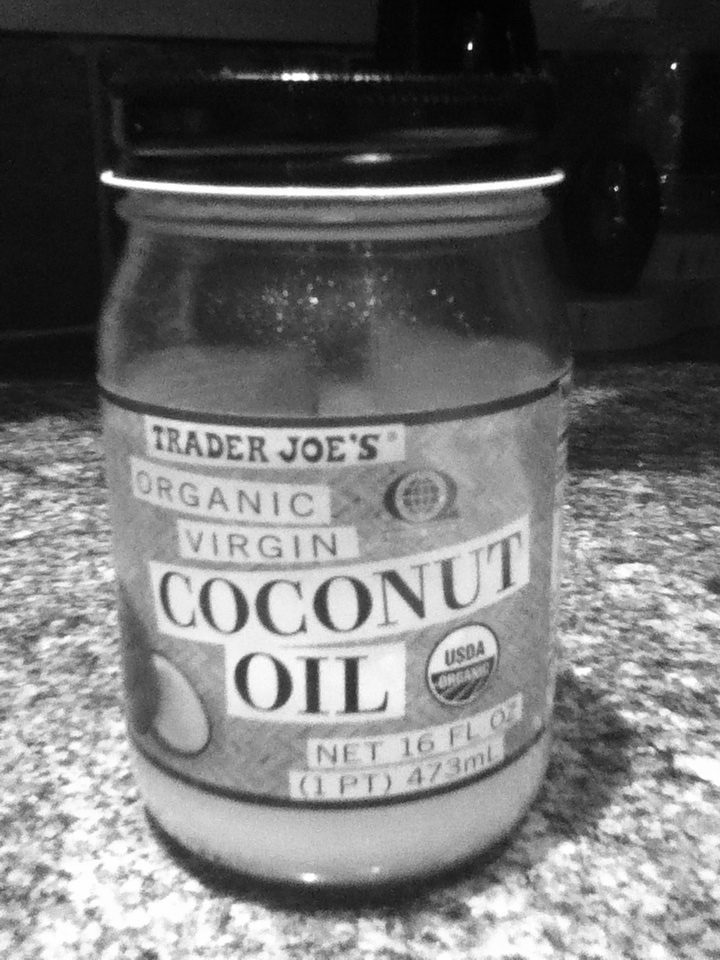
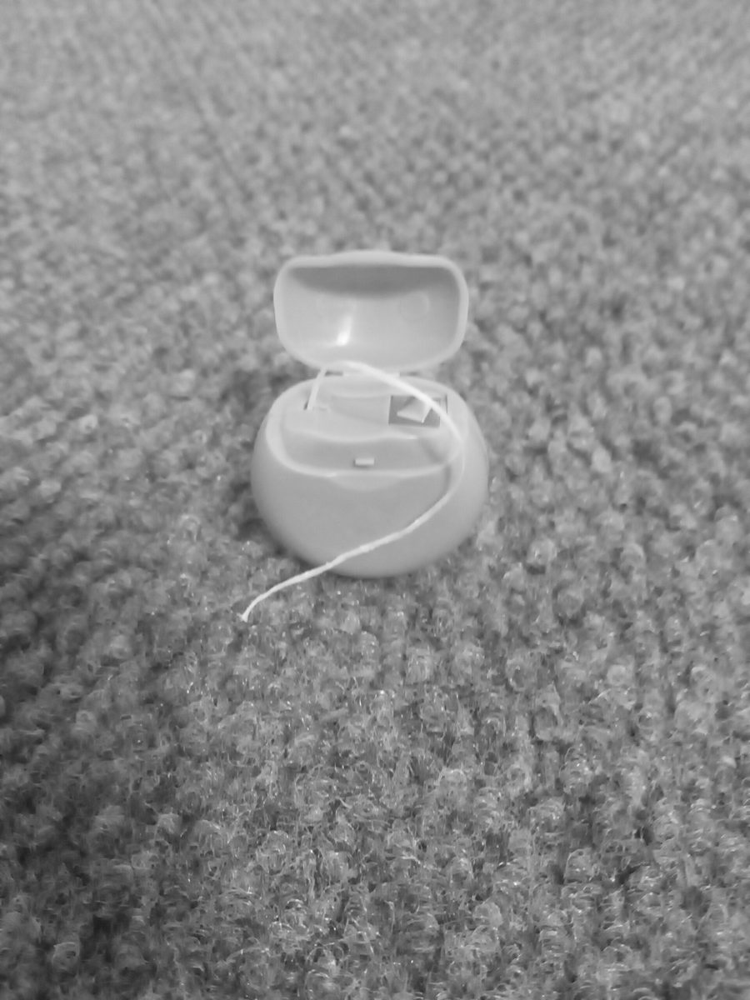

Полоскання рота олією, найчастіше кунжутною або кокосовою, радять як давній спосіб «витягнути» бактерії. Робити це пропонують довго, натщесерце, інколи замість пасти. Надійного корпусу випробувань, які б показали, що таке полоскання дорівнює пасті з фтором, немає. Воно не замінює чищення ні вранці, ні ввечері. Для дитини і для будь-кого, хто легко поперхається, ковток олії в дихальні шляхи — це вже ризик, а не дрібниця ритуалу.

У Novadent олію не призначають ні замість пасти, ні «курсом для ясен». Лікар Олександр Олексійович Голуб на безкоштовній консультації дивиться наліт, камінь і те, чим людина справді чистить зуби. Кабінет у Вінниці на вул. Гоголя 15, телефон [075 177 75 67](tel:+380751777567).

## Чого випробування не показали

Пасту з фтором перевіряли в багатьох рандомізованих роботах. Огляд Волша і колег якраз про концентрації: робочий діапазон, на якому тримається профілактика карієсу, — 1000–1500 ppm. Британський набір Delivering Better Oral Health ставить цю пасту двічі на день у центр щоденного догляду, разом із спльовуванням без одразу ж споліскування водою, щоб фтор лишився на емалі. Полоскання олією в цю доказову базу не входить.

Окремі невеликі спостереження і ролики не складаються в доказ рівності. Немає того масиву порівнянь, де олія виграла б у фторпасти за новими порожнинами, а побічні ефекти були б пораховані так само прискіпливо, як для звичайної пасти. Популярність методу цього масиву не замінює. «Натуральне» не є синонімом «перевірене проти карієсу». Кунжут і кокос у їжі — це їжа. Та сама олія, яку довго ганяють між зубами і потім спльовують, не стає від цього зубною пастою.

Олія не містить фтору. Вона не заходить у міжзубний проміжок так, як нитка або йоршик, і не знімає щільний наліт біля ясен так, як щетина. Можна відчути, що рот «чистіший», бо слиз і м’який наліт частково змилися. Відчуття свіжості не дорівнює відсутності карієсу через рік. Карієс роблять бактерії нальоту за наявності цукру. Поки цукор частий, а проміжки не чищені, ранкове полоскання олією цей механізм не вимикає.

Всесвітня організація охорони здоров’я в настанові щодо цукрів радить тримати вільні цукри нижче 10% енергії раціону, а за можливості нижче 5%. Для зубів окремо важлива частота: кожен солодкий напій між їжею — новий епізод кислоти від нальоту. Фактологічна довідка ВООЗ щодо здоров’я рота серед основних чинників хвороб називає вільні цукри, тютюн, алкоголь і погану гігієну, а захистом — фтор. Олії в цьому переліку немає.

<figure>

<figcaption>Кокосова олія — частий вибір для полоскання. Вона не замінює щітку з фторпастою. Фото: Selinarif, <a href="https://commons.wikimedia.org/wiki/File:Coconut_oil.jpg" target="_blank" rel="noopener noreferrer">CC BY-SA 3.0</a>.</figcaption>
</figure>

## Олія в дихальних шляхах

Полоскати олією означає тримати в роті слизьку рідину і не ковтати її. Доросла людина з нормальним ковтанням зазвичай справляється. Дитина — ні. У дитини ковтання і утримання рідини в роті ще ненадійні, увага коротша, а олія не розчиняється у воді і погано відкашлюється, якщо пішла не в той бік. Аспірація, тобто потрапляння олії в дихальні шляхи, для дитини є реальним ризиком цього ритуалу. Давати таке полоскання дитині не потрібно. Дитяча профілактика — це паста з фтором під наглядом дорослого, а не сімейна ложка олії.

Той самий ризик є в людини, яка поперхається водою, має слабке ковтання після інсульту, хворобу Паркінсона, виражену сухість або просто не тримає рідину в роті. Їй не радять «почати з малого об’єму і потерпіти». Олія в бронхах не дорівнює ковтку води, який відкашляли.

Описані поодинокі клінічні випадки ліпоїдної пневмонії після того, як олія потрапляла в легені. Це рідкісні описи окремих людей, не статистика, якою лякають, і не відсоток «у кожного десятого». Їх достатньо, щоб не романтизувати метод і не ставити його дитині чи людині з поганим ковтанням. Їх замало, щоб оголосити кожне доросле полоскання небезпечним експериментом. Дорослий, який уже робить це обережно і не замінює ним щітку, не отримує з цієї статті заборону. Він отримує інше: олія не купує йому право пропустити фтор.

Якщо під час полоскання олія пішла в горло і почалося поперхування, його припиняють. Стійкий кашель, задишка або біль у грудях після такого епізоду — привід до лікаря, який дивиться легені, а не до нової ложки «щоб дополоскати курс». Стоматолог легені не лікує і антибіотик «від олії» не виписує: це не зубна інфекція.

<figure>

<figcaption>Нитка знімає наліт у проміжку, куди не дістає щітка. Олія цього контакту не замінює. Фото ілюстративне.</figcaption>
</figure>

## Що робити замість ритуалу

Практичне закриття коротке, і воно не нове. Фторпаста 1000–1500 ppm двічі на день. Сплюнути, не споліскувати одразу великою кількістю води. Раз на день пройтись між зубами ниткою або йоршиком того розміру, який не рве ясна і не застрягає. Солодке і кисле пити з їжею, а не потягувати довго. Вода між прийомами їжі. Цього достатньо, щоб олія не мала роботи, яку вона все одно не вміє робити краще за пасту.

Олія не дочищає те, що щітка пропустила біля ясен. Якщо після ритуалу ясна кровілять, це не знак, що олії було замало. Це знак, що наліт лишився або вже стоїть камінь. Причина зазвичай у нальоті і камені, а не в «недостатньо древньому» полосканні. Камінь знімають у кріслі. Хлоргексидин, якщо він взагалі потрібен, — це короткий курс додатку до щітки, з власними побічними ефектами, а не олійна заміна. Про нього є окремий запис [«Хлоргексидин»](2025-10-13-chlorhexidine.html). Вугільна паста теж не рятує ситуацію, якщо комусь запропонували «натуральний» набір із олії і чорного тюбика: про вугілля написано поруч, і висновок там той самий — фтор важливіший за моду, [«Вугільна паста»](2025-10-20-charcoal.html).

Пломба потрібна там, де емаль уже провалена. Лателюкс, Карісма, Градія і нанокомпозит CeramX у кабінеті закривають порожнину, а не змагаються з ранковим ритуалом. Як відрізнити пляму, яку можна спостерігати, від дірки, є в записі [«Лікування карієсу і пульпіту»](2026-07-01-therapy.html). Олія під діряву пломбу не затікає лікувальним чином. Вона не лікує і пульпіт: нічний біль — це нерв, а не «токсини», які треба виполоскати.

На консультацію можна прийти з простим питанням: чи те, що я роблю вранці, взагалі чіпає карієс. Відповідь зазвичай про пасту, проміжки і цукор. Якщо олію хочеться лишити як звичку після того, як зуби вже почищені, дорослій людині без проблем із ковтанням це не забороняють силою. Їй кажуть чітко: це не заміна фтору, і дитині цей ритуал не передають.

Цей текст не вигадує огляд, якого немає. Він ставить полоскання олією поруч із тими засобами, для яких випробування є, і лишає щітку на місці.

## Джерела

<ol class="blog-sources">
<li>Walsh T, Worthington HV, Glenny AM, Marinho VCC, Jeroncic A. Fluoride toothpastes of different concentrations for preventing dental caries. Cochrane Database of Systematic Reviews. 2019. <a href="https://doi.org/10.1002/14651858.CD007868.pub3" target="_blank" rel="noopener noreferrer">doi:10.1002/14651858.CD007868.pub3</a></li>
<li>Office for Health Improvement and Disparities, Department of Health and Social Care, NHS England. Delivering better oral health: an evidence-based toolkit for prevention. <a href="https://www.gov.uk/government/publications/delivering-better-oral-health-an-evidence-based-toolkit-for-prevention" target="_blank" rel="noopener noreferrer">gov.uk</a></li>
<li>World Health Organization. Guideline: sugars intake for adults and children. <a href="https://www.who.int/publications/i/item/9789241549028" target="_blank" rel="noopener noreferrer">who.int</a></li>
<li>World Health Organization. Oral health. <a href="https://www.who.int/news-room/fact-sheets/detail/oral-health" target="_blank" rel="noopener noreferrer">who.int, fact sheet</a></li>
</ol>
