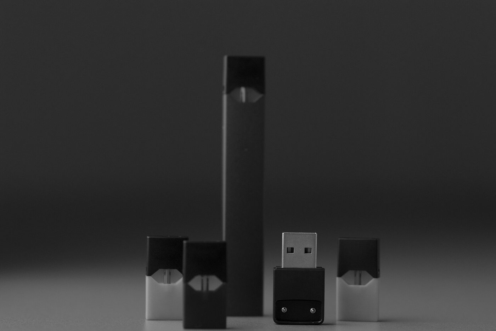

Електронна сигарета — не дим від тютюну, який горить, і не водяна пара з чайника. У рот потрапляє нагрітий аерозоль: у ньому є нікотин, якщо він є в рідині, і хімія смаку, розчинники, дрібні краплі. Це інший вплив, ніж сигаретний дим. З цього не випливає, що він нешкідливий. Дані про рот зібрані гірше, ніж дані про сигарети, і чесна відповідь зараз коротка: сухість і подразнення описують часто, а довгий рахунок щодо раку рота і ясен ще не закритий.

У Novadent про це питають так само, як про сигарети. Лікар Олександр Олексійович Голуб записує тютюн у будь-якій формі на безкоштовній консультації. Кабінет у Вінниці на вул. Гоголя 15, телефон [075 177 75 67](tel:+380751777567). Обіцянки «кинути за допомогою вейпа» кабінет не дає.

## Не дим і не чистий рахунок

Сигаретний дим — відомий чинник раку рота, хвороб ясен і гіршого загоєння. Фактологічна довідка Всесвітньої організації охорони здоров’я щодо здоров’я рота ставить тютюн серед основних причин цих хвороб, поруч із вільними цукрами і алкоголем. Йдеться про тютюн, який курять і жують у звичних формах. Переносити кожну цифру з досліджень сигарет на електронну сигарету не можна: склад аерозолю інший, температура інша, смол і продуктів горіння в тому самому вигляді немає. І не можна перевернути це в дозвіл: «раз не сигарета, значить рот нічого не помічає».

Що можна сказати без вигадування катастрофи. Слизова отримує нагрітий аерозоль багато разів на день. Нікотин звужує судини і сам по собі не є доглядом за яснами, незалежно від того, з диму він чи з рідини. Ароматизатори і розчинники — це речовини, які не перевіряли як зубну пасту. Люди описують сухість рота і подразнення слизової. Сухість має значення, бо слини стає менше, а слина якраз розбавляє кислоту і допомагає змивати наліт. Подразнення — привід показати рот, а не доказ, що в цієї людини вже є передрак.

Чого казати не можна. Не можна обіцяти, що вейп не має стосунку до раку рота, бо довгих спостережень, порівнянних із десятиліттями даних про сигарети, ще немає. Не можна і казати, що електронна сигарета вже доведено викликає рак рота так само, як пачка сигарет: такого перенесення докази не тримають. Обидві фрази продають упевненість, якої в літературі немає. Для людини в кріслі корисніша третя: вплив є, він не дорівнює диму, і він не є порожнім.

<figure>

<figcaption>Електронна сигарета і змінні картриджі. Це не водяна пара і не привід відкладати огляд. Фото: Fair Expert, <a href="https://commons.wikimedia.org/wiki/File:Electronic_cigarette.jpg" target="_blank" rel="noopener noreferrer">CC BY-SA 4.0</a>.</figcaption>
</figure>

## Ясна, наліт і те, чого ми ще не знаємо

Хвороба ясен від сигарет описана добре: кровотік у яснах гірший, кишені глибші, лікування тримається слабше, кровоточивість інколи навіть маскується, бо судини звужені. Для електронних сигарет такі висновки рано штампувати як остаточні. Є роботи про подразнення, про зміну слизової і про наліт, і вони не складаються в той самий масив, що дослідження горілого тютюну. Чесно сказати «дані щодо ясен і раку при вейпі ще неповні» — це і є висновок, а не відмова від теми.

Сухість і наліт при цьому лишаються практичними. Якщо рот сухий, наліт тримається легше, карієс отримує спокійніше місце, запах змінюється. Камінь, як на навчальному фото, утворюється з нальоту, який не зняли щіткою. Вейп його не розчиняє. Людина, яка палить електронну сигарету і не чистить проміжки, має звичайний карієс від цукру плюс сухість, а не окрему «хворобу вейпа», яку можна зняти одним ополіскувачем.

Фторпаста 1000–1500 ppm двічі на день і чищення між зубами лишаються базою незалежно від того, що людина вдихає. Це висновок огляду Волша щодо паст і щоденна схема Delivering Better Oral Health, а не спеціальна програма для вейпа. Хлоргексидин «щоб прибрати хімію» на місяці не потрібен: у нього власні плями і зміна смаку, і він не скасовує аерозоль. Вода, якщо сушить, доречніша за солодкий напій, яким запивають сухість і годують наліт. Настанова ВООЗ щодо цукрів тут та сама, що для будь-кого: вільні цукри нижче 10% енергії, за можливості нижче 5%, і рідше протягом дня.

Подразнена слизова, біла пляма, яка не сходить, або виразка, що не гоїться тижнями, — це не «норма вейпа». Її дивляться так само, як будь-яку іншу підозрілу ділянку. Орієнтир NICE для незрозумілої виразки в роті, яка тримається понад три тижні, — подумати про скерування шляхом підозри на рак, а не чекати, що само мине, бо «я ж не курю сигарети». Три тижні не є діагнозом. Це строк, після якого незрозумілу виразку не залишають без оцінки.

<figure>

<figcaption>Щітка і фторпаста потрібні і тим, хто палить сигарети, і тим, хто користується електронною. Фото ілюстративне.</figcaption>
</figure>

## Повна заміна диму і подвійне паління

Для людини, яка палить сигарети, розмова про повний перехід на електронну сигарету — це розмова про зменшення шкоди від продуктів горіння. Вона належить службі, яка займається відмовою від тютюну, або лікарю, який це веде. Стоматолог може сказати, що дим для рота — встановлений ризик, і що кинути горілий тютюн варто. Він не обіцяє, що конкретний пристрій безпечний, не підбирає рідину і не продає вейп як зубну послугу. Такої позиції в прайсі немає і не буде.

Подвійне вживання — сигарети плюс електронна сигарета — залишає дим у житті. Шкода горілого тютюну нікуди не дівається, якщо ранкова сигарета лишилась, а вейп додався «між ними». Для ясен і для раку рота це не перехід. Це два джерела, одне з яких уже добре вивчене як шкідливе. Чесна ціль, якщо людина взагалі обирає цей шлях зменшення шкоди, — повністю прибрати сигарету, а не колекціонувати пристрої. І навіть тоді це не стоматологічна гарантія здорового рота.

Нікотин лишається нікотином. Залежність від нього не лікують пломбою. Якщо людина хоче зменшити і його, це знову розмова не в кріслі: є засоби замісної терапії, які призначає той, хто веде відмову. Стоматолог не вигадує дозу пластиру і не радить «просто міцнішу рідину».

На прийомі питання звучить буденно: сигарети, електронна сигарета, тютюн для жування, кальян, суміш усього цього. Відповідь пишуть у картку, бо вона змінює очікування від загоєння після видалення і від ясен навколо коронки. Коронки і знімні протези в кабінеті роблять. Дим і сухість не скасовують роботу, але край коронки і ясна під протезом у сухому, подразненому роті вимагають чеснішої гігієни. Про коронку є запис [«Коронка на зуб»](2026-08-01-crowns.html), про протез — [«Знімний і бюгельний протез»](2026-09-01-denture.html).

Пломба від цього не стає іншою. Лателюкс, Карісма, Градія і нанокомпозит CeramX тримаються на сухому зубі і чистому краї, а не на тому, чим людина дихає між візитами. Карієс від частого цукру йде своїм шляхом. Якщо болить зуб, електронна сигарета його не заспокоїть і не замінить лікування, про яке написано в записі [«Лікування карієсу і пульпіту»](2026-07-01-therapy.html).

Безкоштовна консультація — нормальне місце, щоб назвати звичку без лекції. Далі буде огляд ясен і слизової, а не мораль. Якщо потрібно кинути сигарети, кабінет підкаже, що це завдання для служби відмови, і не підмінить її собою.

Цей текст навмисно не ставить електронну сигарету ні в ряд із водою, ні в ряд із доведеною копією сигаретного диму. Докази посередині ще не дописані. Щітка і чесна відповідь на прийомі дописані.

## Джерела

<ol class="blog-sources">
<li>World Health Organization. Oral health. <a href="https://www.who.int/news-room/fact-sheets/detail/oral-health" target="_blank" rel="noopener noreferrer">who.int, fact sheet</a></li>
<li>Walsh T, Worthington HV, Glenny AM, Marinho VCC, Jeroncic A. Fluoride toothpastes of different concentrations for preventing dental caries. Cochrane Database of Systematic Reviews. 2019. <a href="https://doi.org/10.1002/14651858.CD007868.pub3" target="_blank" rel="noopener noreferrer">doi:10.1002/14651858.CD007868.pub3</a></li>
<li>Office for Health Improvement and Disparities, Department of Health and Social Care, NHS England. Delivering better oral health: an evidence-based toolkit for prevention. <a href="https://www.gov.uk/government/publications/delivering-better-oral-health-an-evidence-based-toolkit-for-prevention" target="_blank" rel="noopener noreferrer">gov.uk</a></li>
<li>World Health Organization. Guideline: sugars intake for adults and children. <a href="https://www.who.int/publications/i/item/9789241549028" target="_blank" rel="noopener noreferrer">who.int</a></li>
<li>National Institute for Health and Care Excellence. Suspected cancer: recognition and referral. NICE guideline NG12. <a href="https://www.nice.org.uk/guidance/ng12" target="_blank" rel="noopener noreferrer">nice.org.uk/guidance/ng12</a></li>
</ol>
