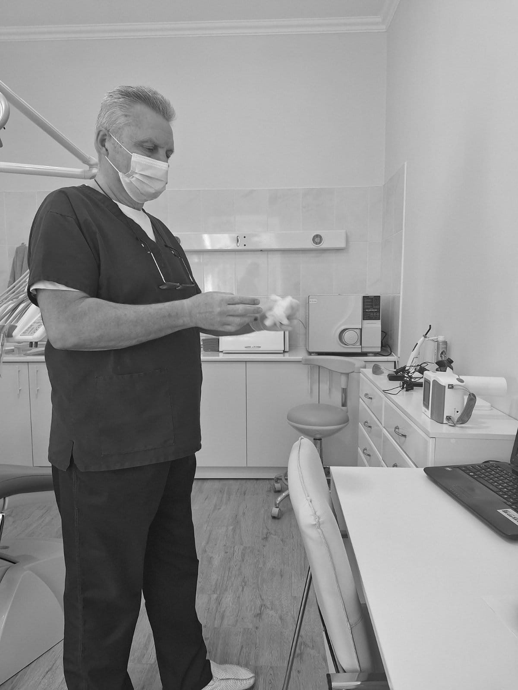

Плоский лишай слизової рота часто виглядає як білі мереживні лінії на щоках, інколи з малюнком, схожим на папороть. Слизова при цьому може майже не боліти. Інша форма болить: ясна червоні, блискучі, ніби з них зійшов поверхневий шар. Це називають десквамативним гінгівітом, і за ним теж може стояти плоский лишай. Діагноз ставить лікар, який бачить рот. Біла лінія сама по собі ще не є назвою хвороби.

У Novadent таку слизову дивляться і, якщо треба, скеровують туди, де візьмуть біопсію. Біопсію в цьому кабінеті не роблять. Лікар Олександр Олексійович Голуб на безкоштовній консультації відрізняє те, що можна спостерігати, від того, що має побачити інший фахівець. Кабінет у Вінниці на вул. Гоголя 15, телефон [075 177 75 67](tel:+380751777567).

На фотографіях до цього запису немає висипу. Немає вдалого знімка саме цієї хвороби, і випадкову виразку видавати за лишай не варто. Як виглядають лінії і червоні ясна, нижче сказано словами.

## Мереживо, прикушена щока і червоні ясна

Типовий спокійний малюнок сидить на слизовій щік, інколи на язиці або яснах: білі лінії, які перетинаються, не знімаються марлею, не схожі на наліт. Поруч буває почервоніння. Людина може роками не знати, що це є, поки лікар не відсуне щоку. Болюча форма інакша. Їсти кисле і гостре стає важко, ясна реагують на щітку, інколи з’являються ерозії, тобто поверхневі зриви слизової без глибокої дірки.

Біла лінія від прикушування щоки — інша річ. Вона йде там, де зуби змикаються, зазвичай з одного боку, де людина сама знає за собою звичку прикусити. Лінія грубіша, рівніше лежить по лінії прикусу, без мережива на обидві щоки. Її не лікують як плоский лишай і не лякають нею. Досить помітити звичку і подивитися, чи немає гострого краю зуба або пломби, який щоку ріже. Якщо край пломби гострий, його згладжують. Матеріали пломб у кабінеті — Лателюкс, Карісма, Градія і нанокомпозит CeramX. Про реставрацію є запис [«Лікування карієсу і пульпіту»](2026-07-01-therapy.html).

Кандидозний наліт теж білий, але він зазвичай знімається, і під ним лишається червоне. Мереживо плоского лишаю не стирається серветкою. Молочниця і лишай можуть зустрітися в одному роті, особливо під протезом, який носять уночі. Це не привід назвати все одним словом. Про грибок і протез є запис [«Герпес і молочниця в роті»](2025-12-08-herpes-candida.html).

Червоні болючі ясна без нальоту і без каменю як єдиної причини теж не автоматичний лишай. Так виглядає десквамативний гінгівіт, за яким можуть стояти різні стани слизової. Зонд і огляд показують, чи є звичайний наліт і кишені, чи слизова зривається від дотику. Навчальне фото інструментів нижче — про цей огляд, а не про вигляд висипу.

<figure>

<figcaption>Олександр Олексійович Голуб у кабінеті Novadent. Діагноз слизової ставлять оглядом.</figcaption>
</figure>

## Ліхеноїдна реакція — не те саме, що ідіопатичний лишай

Частина білих і червоних плям є реакцією на ліки або на контакт із матеріалом, найчастіше в розмові згадують метал пломби, який торкається щоки. Таку реакцію називають ліхеноїдною. Вона схожа на плоский лишай і не тотожна йому. Ідіопатичний плоский лишай не має такого зовнішнього вимикача. Ліхеноїдна пляма інколи сидить точно навпроти старої металевої пломби і повторює її контур. Це бачить лікар, а не людина в дзеркалі ванної.

Заміна пломби в такому разі — клінічне рішення після огляду, інколи після того, як інший фахівець підтвердить характер плями. Це не програма «вивести ртуть» і не детокс. У прайсі кабінету немає рядка зняти амальгаму заради очищення організму. Пломбу міняють, якщо є показ: контактна пляма, злам, щілина, карієс. Політика Європейського Союзу щодо ртуті обмежує амальгаму з екологічних причин. Вона не є медичною інструкцією розсвердлити кожну стару пломбу в здоровому зубі.

Ліки теж вміють давати схожий малюнок. Називати їх треба всі: від тиску, від подагри, від цукру, знеболювальні, те, що людина купила сама. Стоматолог не скасовує серцевий чи інший системний препарат через білу лінію на щоці. Якщо підозра на лікарську реакцію, це обговорюють із тим, хто препарат призначив. Самовільно кинути таблетку «бо в інтернеті так лікують лишай» небезпечніше за саму пляму.

<figure>

<figcaption>Зонд і пародонтальний зонд потрібні, щоб не сплутати запалення від нальоту з хворобою слизової. На фото немає плоского лишаю. Автор: Coronation Dental Specialty Group, <a href="https://commons.wikimedia.org/wiki/File:Dental_explorer_and_periodontal_probe.jpg" target="_blank" rel="noopener noreferrer">CC BY-SA 3.0</a>.</figcaption>
</figure>

## Нагляд, зміна плями і скерування

Злоякісна зміна при плоскому лишаї рота трапляється нечасто, і вона реальна. Відсоток тут не наводиться: у різних роботах його рахують по-різному, і кругла цифра в статті лише лякає або, навпаки, заспокоює без огляду. Практичний висновок спокійніший. Спокійне мереживо без болю спостерігають. Пляму, яка змінюється, болить, ущільнюється, червоніє суцільною плямою або не гоїться, не залишають «до наступного року». Її скеровують.

Настанова NICE NG12 дає зрозумілий орієнтир, і він не лише про лишай. Незрозумілу виразку в роті, яка тримається понад три тижні, розглядають як привід для скерування шляхом підозри на рак. Червону або червоно-білу пляму, що виглядає як еритроплакія чи еритролейкоплакія, теж не спокійно спостерігають роками. Три тижні не означають, що це рак. Вони означають, що незрозуміла виразка вже не є «просто застудою слизової». Кабінет може побачити це першим і скерувати на біопсію. Саму біопсію тут не беруть і не обіцяють «подивимось під мікроскопом у нас».

Поки людина чекає на скерування або між контрольними оглядами, їй не потрібен домашній рецепт стероїдної мазі. Дозу, форму і те, чи стероїд взагалі доречний на слизовій, вирішує той, хто веде діагноз. Саморобна суміш із аптечного крему для шкіри на щоку дратує слизову і змазує картину до біопсії. Антибіотик мереживо не прибирає. Настанова Локгарта і колег не радить антибіотик там, де немає бактерійної інфекції за межами зуба, і лишай до цієї ситуації не належить.

## Що можна змінити без самолікування

Гостре, кисле, дуже солоне і жорсткі скоринки часто підсилюють біль, якщо форма вже ерозивна. Прибрати ці тригери на час загострення — нормальна побутова міра, не лікування причини. Гігієна лишається. Наліт на і так болючих яснах додає звичайне запалення зверху на хворобу слизової. Щітка м’яка, паста з фтором 1000–1500 ppm, як у огляді Волша, без героїчного тертя по червоних яснах. Міжзубне чищення підбирають так, щоб не рвати слизову. Камінь, якщо він є, знімають у кріслі, коли слизова це дозволяє, а не «до крові будь-що».

Протез, який тре в зоні почервоніння, показують. Інколи біль дає край базису, а не лишай. Знімні протези в кабінеті роблять і підганяють. Як влаштований догляд за ними, є в записі [«Знімний і бюгельний протез»](2026-09-01-denture.html). Коронка з гострим краєм теж може різати щоку і підтримувати білу лінію прикусу. Коронки тут виготовляють; про матеріал є запис [«Коронка на зуб»](2026-08-01-crowns.html).

Фактологічна довідка ВООЗ називає тютюн і алкоголь серед чинників хвороб рота. До плями, яку спостерігають, їх не додають як побутовий фон. Це не твердження, що лишай від них почався.

Консультація безкоштовна. На неї можна прийти з відчуттям «шорстко на щоці» або з яснами, які болять без дірки в зубі. Результат прийому може бути нудним і добрим: це лінія від прикусу, нічого скеровувати не треба. Може бути іншим: схоже на лишай, дивимось у динаміці або пишемо скерування. Обидва результати кращі за мазь, змішану вдома.

Цей текст описує, як плоский лишай рота виглядає і чому його не лікують за фотографією. Він не ставить діагноз.

## Джерела

<ol class="blog-sources">
<li>National Institute for Health and Care Excellence. Suspected cancer: recognition and referral. NICE guideline NG12. <a href="https://www.nice.org.uk/guidance/ng12" target="_blank" rel="noopener noreferrer">nice.org.uk/guidance/ng12</a></li>
<li>Walsh T, Worthington HV, Glenny AM, Marinho VCC, Jeroncic A. Fluoride toothpastes of different concentrations for preventing dental caries. Cochrane Database of Systematic Reviews. 2019. <a href="https://doi.org/10.1002/14651858.CD007868.pub3" target="_blank" rel="noopener noreferrer">doi:10.1002/14651858.CD007868.pub3</a></li>
<li>World Health Organization. Oral health. <a href="https://www.who.int/news-room/fact-sheets/detail/oral-health" target="_blank" rel="noopener noreferrer">who.int, fact sheet</a></li>
<li>European Commission. Mercury. <a href="https://environment.ec.europa.eu/topics/chemicals/mercury_en" target="_blank" rel="noopener noreferrer">environment.ec.europa.eu</a></li>
<li>Lockhart PB, Tampi MP, Abt E, et al. Evidence-based clinical practice guideline on antibiotic use for the urgent management of pulpal- and periapical-related dental pain and intraoral swelling. J Am Dent Assoc. 2019. <a href="https://doi.org/10.1016/j.adaj.2019.08.020" target="_blank" rel="noopener noreferrer">doi:10.1016/j.adaj.2019.08.020</a></li>
</ol>
