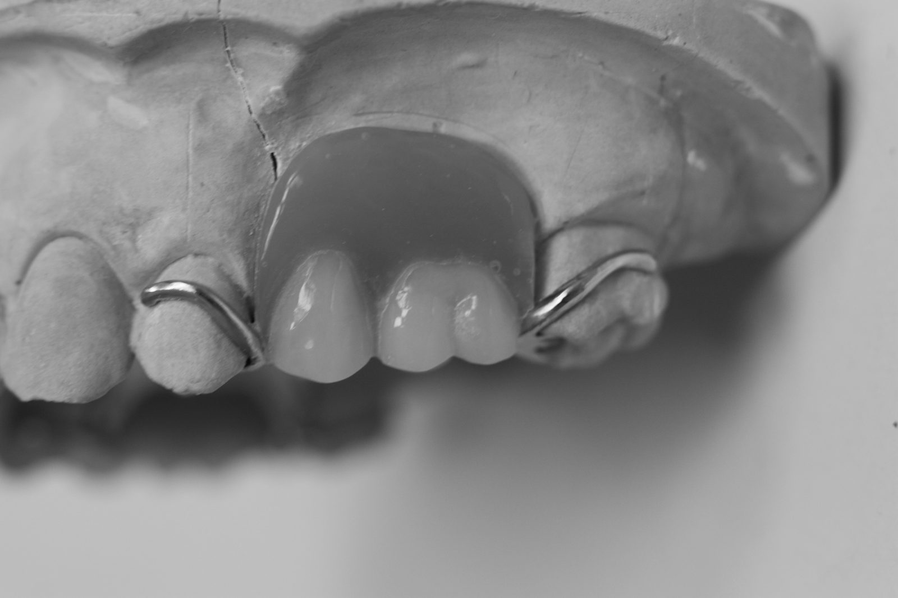

Герпес і кандидоз у роті плутають, бо обидва можуть дати біль, наліт і відкладений візит до стоматолога. Це різні збудники. Герпес — вірус, він заразний у стадії пухирців. Кандида — грибок, який зазвичай уже живе в роті і дає хворобу, коли умови йому зручні: сухість, протез уночі, антибіотик, слабший захист слизової. Антибіотик не лікує жоден із цих двох станів як вірусну інфекцію і не замінює догляд за протезом.

У Novadent це розрізняють оглядом, без біопсії і без обіцянки «зняти все за одне полоскання». Лікар Олександр Олексійович Голуб дивиться слизову на безкоштовній консультації. Кабінет у Вінниці на вул. Гоголя 15, телефон [075 177 75 67](tel:+380751777567). Знімка пухирців і нальоту в цій статті немає навмисно: випадкову виразку легко підписати чужим діагнозом. Нижче вигляд описаний словами. На фото — протез, бо для молочниці під базисом він якраз має значення, і розмова в кабінеті, бо діагноз не ставлять за картинкою.

## Герпес

Герпес губ починається з свербежу або печіння на червоній облямівці, потім з’являються згруповані пухирці на почервонілій шкірі. Вони лопаються, мокнуть і заживають кіркою. Поки є пухирці і свіжа ерозія, вміст заразний. Поцілунок, спільний посуд, рушник і пальці, якими рознесли рідину на іншу ділянку шкіри, переносять вірус. Стоматологічний прийом у цю фазу теж вміє рознести його по роті: ретрактор, валик, рука в рукавичці, якщо працюють по активній рані.

Тому планову роботу на час активного герпесу губ переносять. Не «героїчно швидке пломбування, поки пацієнт уже приїхав», а інший день, коли кірка зійшла і свіжих пухирців немає. Біль зубний, набряк, який наростає, температура від зуба — інша логіка: інфекцію зуба не залишають через герпес без розмови, але й розмазувати вірус по слизовій без потреби не можна. Лікар скаже, що можна відкласти, а що небезпечно відкладати. Пломба почекає кілька днів. Гострий пульпіт чекає гірше. Про зубний біль є запис [«Лікування карієсу і пульпіту»](2026-07-01-therapy.html).

Ацикловір і близькі до нього засоби — це ліки, які призначає лікар, часто той, хто веде людину загалом, а не рядок прайсу стоматолога. Дози в цій статті немає і не буде. Мазь «усім однакова з аптеки на свій розсуд» теж не розписується: частина людей уже має свої ліки, частина не повинна починати їх за порадою сусіда, особливо вагітні і люди зі зниженим імунітетом. Кабінет не підміняє цю консультацію.

У дитини перший контакт із вірусом герпесу може виглядати інакше, ніж звична «застуда» на губі дорослого. Первинний герпетичний гінгівівостоматит: різкий біль у роті, почервонілі набряклі ясна, дрібні ерозії, температура, дитина не їсть і не п’є, бо боляче. Вигляд важкий, і це все одно вірус. Антибіотик його не бере. Настанова Локгарта і колег стосується зубного болю і прикореневого запалення бактерійної природи: антибіотик не замінює лікування зуба, якщо інфекція не вийшла за його межі з набряком і загальними ознаками. Дух цієї межі тут той самий і навіть жорсткіший. Вірус таблеткою від бактерій не лікується. Дитині потрібні пиття, знеболення, яке порадить педіатр, і час. Стоматолог потрібен, якщо треба відрізнити це від гнійного зуба, а не щоб виписати антибіотик «про всяк випадок».

Дорослий із активними пухирцями на губі не цілує немовля і не ділить із дитиною ложку. Коли свіжих пухирців немає, плановий огляд знову доречний.

<figure>

<figcaption>Активний герпес на губі — привід перенести планову роботу, а не фото для діагнозу. На цьому знімку немає пухирців. Фото ілюстративне.</figcaption>
</figure>

## Молочниця

Кандидоз слизової часто виглядає як білі сирнисті плями. Вони знімаються марлею або шпателем, і під ними лишається червона, інколи кров’яниста поверхня. Саме «знімається» відрізняє їх від білого мережива плоского лишаю, яке не стирається. Про лишай є окремий запис [«Плоский лишай рота»](2025-11-24-lichen.html). Біль і змінений смак бувають і без товстого нальоту: слизова просто червона і пече. Тоді легко сказати «чутливий язик» і пропустити грибок. Печіння при справді спокійній слизовій — ще інша розвилка, її розібрано в записі [«Печіння в роті»](2025-12-01-burning-mouth.html).

Окрема форма, яку в кріслі бачать регулярно, — протезний стоматит. Під базисом, який щільно сидить на піднебінні, слизова червона, чітко по межі протеза, може майже не боліти. Людина помічає її, коли знімає протез, або не помічає взагалі. Gendreau і Loewy в огляді пов’язують цей стан із цілодобовим носінням і поганою гігієною протеза. Гриби Candida в цій історії часті гості, але червоність тримається не лише на них: біоплівка на шорсткому акрилі і слизова без нічної паузи важливі так само.

Тому лікування не зводиться до гелю на язик, поки протез лежить у роті або в сухому футлярі з учорашнім нальотом. Протигрибковий засіб, якщо він потрібен, призначає лікар. Назва і схема залежать від того, наскільки процес місцевий і які ще ліки людина приймає. Дози тут немає. Паралельно, і без цього засіб працює гірше, протез чистять і не сплять у ньому.

<figure>

<figcaption>Частковий акриловий протез на моделі. Під таким базисом, якщо його носять уночі і погано чистять, слизова червоніє. Це не фото молочниці. Фото: Sterilgutassistentin, <a href="https://commons.wikimedia.org/wiki/File:Oberkiefer_Teilprothese_20100112_022.JPG" target="_blank" rel="noopener noreferrer">CC BY-SA 3.0</a>.</figcaption>
</figure>

Протез миють окремо від зубів, м’якою щіткою, без абразивної пасти для емалі: вона дряпає акрил, у подряпині грибку зручніше. На ніч його знімають, споліскують і тримають у вологому середовищі, а ясна лишають вільними. Суха серветка на батареї акрил коробить. Клей «на постійно», щоб перекрити погану посадку, не лікує червоність під базисом. Якщо протез просів, його перебазують або міняють. У кабінеті роблять акрилові, нейлонові і бюгельні протези. Як вони відрізняються і чому ніч без протеза — частина догляду, розписано в записі [«Знімний і бюгельний протез»](2026-09-01-denture.html).

Кути рота при кандидозі інколи тріскаються і мокнуть. Це ангулярний хейліт. Його підтримують і грибок, і звичка облизувати складку, і занижена висота прикусу, коли старий протез більше не тримає губи. Мазати лише кут і спати в тому самому протезі — половина роботи. Висоту і край дивиться стоматолог, шкіру за потреби — лікар, який веде шкіру або загальний стан. Знижений імунітет, неконтрольований цукор, сухість від ліків і недавній антибіотик роблять кандидоз імовірнішим. Це не привід соромитися. Це привід сказати про ліки і про цукор на консультації. Глюкозу веде свій лікар. Стоматолог не починає лікування діабету.

Антибіотик, призначений «від білого нальоту», ситуацію частіше погіршує: бактерійну флору він пригнічує, грибку стає вільніше. Його не п’ють про всяк випадок ні при герпесі, ні при молочниці. Якщо антибіотик уже призначив інший лікар з приводу легенів чи нирок, його не скасовують самовільно через наліт у роті. Кажуть про наліт і додають догляд, а не влаштовують другу схему таємно.

Дитині білий наліт не лікують дорослим гелем з полиці. Педіатр відрізняє молочницю немовляти від молочного нальоту, а стоматолог не підміняє його собою.

Після того як наліт зійшов, зуби все одно чистять фторпастою 1000–1500 ppm. Огляд Волша і набір Delivering Better Oral Health не скасовуються на час грибка. Протез і ясна в цю схему входять окремими рядками: зуби своєю щіткою, протез своєю, на ніч рот вільний.

Безкоштовна консультація доречна, коли біле не знімається і лякає, коли під протезом червоно, коли на губі пухирці і вже призначена пломба на завтра. У першому випадку можуть скерувати далі, бо не все біле є грибком. У другому — розберуть гігієну протеза і чи потрібен протигрибковий засіб. У третьому — перенесуть планове і не рознесуть вірус по слизовій.

Цей текст розділяє вірус і грибок. Він не дає дози ацикловіру, антибіотика чи протигрибкового засобу.

## Джерела

<ol class="blog-sources">
<li>Lockhart PB, Tampi MP, Abt E, et al. Evidence-based clinical practice guideline on antibiotic use for the urgent management of pulpal- and periapical-related dental pain and intraoral swelling. J Am Dent Assoc. 2019. <a href="https://doi.org/10.1016/j.adaj.2019.08.020" target="_blank" rel="noopener noreferrer">doi:10.1016/j.adaj.2019.08.020</a></li>
<li>Gendreau L, Loewy ZG. Epidemiology and etiology of denture stomatitis. J Prosthodont. 2011. <a href="https://doi.org/10.1111/j.1532-849X.2011.00700.x" target="_blank" rel="noopener noreferrer">doi:10.1111/j.1532-849X.2011.00700.x</a></li>
<li>Walsh T, Worthington HV, Glenny AM, Marinho VCC, Jeroncic A. Fluoride toothpastes of different concentrations for preventing dental caries. Cochrane Database of Systematic Reviews. 2019. <a href="https://doi.org/10.1002/14651858.CD007868.pub3" target="_blank" rel="noopener noreferrer">doi:10.1002/14651858.CD007868.pub3</a></li>
<li>Office for Health Improvement and Disparities, Department of Health and Social Care, NHS England. Delivering better oral health: an evidence-based toolkit for prevention. <a href="https://www.gov.uk/government/publications/delivering-better-oral-health-an-evidence-based-toolkit-for-prevention" target="_blank" rel="noopener noreferrer">gov.uk</a></li>
</ol>
