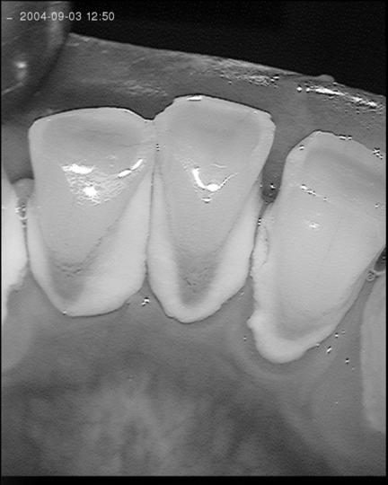

Кров на щітці майже завжди починається з м’якого нальоту, який лишився біля краю ясен. Ясна відповідають запаленням: червоніють, набрякають і кровлять, коли їх зачіпає щетина або нитка. Це гінгівіт, спричинений зубним нальотом. Якщо кістка і зв’язка ще тримають зуб на своїй висоті, таке запалення оборотне. Консенсус Світового семінару 2017 року, який виклали Chapple і співавтори, так і відділяє здорові ясна від гінгівіту на цілому періодонті: запалення є, а втрати прикріплення немає.

Кров лякає, і ділянку починають обминати. Наліт від цього нікуди не дівається. Запалення тримається, доки біля ясен лежить біоплівка. Прибрати її якраз те, про що ясна сигналять, коли кровлять.

## Запалення, яке ще можна прибрати

Гінгівіт живе в яснах, а не в кістці під ними. Край ясен втрачає блідо-рожевий колір, контур стає набряклим, між зубами може з’явитися блискучий валик. Після чищення лишається металевий присмак, піна рожевіє, інколи з’являється запах, якого раніше не було. Біль зазвичай слабкий: лоскіт і дискомфорт, а не нічний ниючий зуб. Ознака, на яку спирається цей діагноз, — кровоточивість під час чищення або від дотику зонда. Спокійні ясна від акуратного дотику не кровлять.

Той самий консенсус окремо описує здоров’я і гінгівіт на цілому періодонті і на вже зниженому. Однакова на вигляд кров означає різні речі. Якщо зуб ніколи не втрачав опори, гінгівіт лишається хворобою ясен: прибрали наліт — набряк спадає, колір повертається, кров зникає. Якщо опора вже була втрачена і процес колись зупинили, ясна теж можуть кровляти від нового нальоту, але коротший корінь і нижча кістка на місці. Тоді це вже не перший епізод гінгівіту: кров прибирають чищенням, а втрачену кістку щітка не повертає.

Не в кожної людини з гінгівітом хвороба піде вглиб. Запалення ясен є умовою, за якої в чутливої людини може початися пародонтит, але кров на щітці сама по собі цього діагнозу не ставить. Привід діяти є все одно. Поки наліт лежить щодня, запалення не заспокоюється само.

<figure>

<figcaption>Зубний камінь біля ясен: шорстка маса, яку щітка вже не знімає. Навчальне фото, не пацієнт Novadent. Автор: Michael Ottenbruch, <a href="https://commons.wikimedia.org/wiki/File:Calculus.jpg" target="_blank" rel="noopener noreferrer">GFDL</a>.</figcaption>
</figure>

## Чому щітку не ховають, коли з’явилась кров

Зупинити чищення там, де кровлить, здається дбайливим. На практиці наліт біля краю ясен і трохи під ним якраз підтримує запалення. Британський набір порад Delivering Better Oral Health ставить фізичне зняття нальоту в центр профілактики гінгівіту: щітка проходить по кожній поверхні і по лінії ясен, а проміжок між зубами вона не закриває. Жорстка щетина і горизонтальне пиляння ясна не лікують. Середня або м’яка щетина і повільний рух дають ворсу зайти в борозну. Орієнтир — щоб наліт зійшов, а не щоб рука втомилась від сили.

Кров у перші дні такого чищення очікувана. Запалена ясна реагує на дотик. Якщо наліт справді знімають двічі на день і проміжки не пропускають, набряк зазвичай спадає і крові стає менше. Однакового календаря для всіх немає: хтось помічає різницю за кілька днів, комусь потрібні тижні, особливо якщо проміжки довго не чистили. Сильний біль, гній, зуб, який став рухомим, або кров, яка не меншає попри акуратне чищення, уже привід показати ясна, а не додавати ще тиждень самотужки.

Окремі стани підсилюють ту саму реакцію на наліт. Під час вагітності ясна часто кровлять рясніше: біоплівка зустрічає змінену відповідь тканин. Чищення в цей час доречне, відкладати все, що кровлить, до пологів не варто, якщо немає окремої акушерської причини змінити план. Деякі ліки роблять ясна об’ємнішими, і під валиком ховається наліт. Призначений препарат через ясна самовільно не скасовують. На прийом беруть список назв, щоб було видно, чи є зв’язок і що реально змінити в гігієні.

Куріння плутає слід. Воно підвищує ризик того, що запалення піде далі, і водночас ясна в людини, яка курить, можуть виглядати блідішими і кровляти скромніше, ніж виглядає масштаб проблеми. Мало крові на щітці в курця не доводить, що ясна спокійні. Набір порад щодо профілактики ясен якраз просить питати про тютюн на кожному візиті, бо це фактор ризику, а не деталь анкети.

## Камінь, який щітка вже не бере

М’який наліт знімається вдома. Коли він мінералізується, виходить зубний камінь: шорстка жовта або коричнева маса. Найчастіше вона сидить із внутрішнього боку нижніх різців і з зовнішнього боку верхніх молярів, там, де в рот відкриваються протоки слинних залоз. Камінь не «з’їдає» кістку сам по собі. Він тримає новий наліт щільно до ясен, і запалення не вимикається, доки ця шкаралупа лежить.

Зняти її щіткою, содою чи твердою їжею не виходить. Її прибирають інструментом. У Novadent зняття відкладень коштує 800 гривень. Після того як камінь зняли з оголеного кореня, зуб кілька днів може реагувати на холод: корінь був прикритий і раптом зустрів повітря. Це очікувана чутливість, а не доказ, що чистка зняла емаль. Докладніше про сам візит — у записі про [професійну чистку](2026-08-02-cleaning.html).

Паста з фторидом лишається окремою щоденною справою. Чистка прибирає те, що вже затверділо. Карієс стримує регулярний фторид на емалі й на оголеному корені, а не сам візит раз на пів року. Для ясен ключове інше: вечір і ранок біля лінії ясен і проміжок, підібраний за шириною. Проміжок, який кровлить, чистять першим, доки це ще свіжа звичка, а не те, що «зроблю, якщо залишиться час».

<figure>

<figcaption>Зонд і пародонтальний зонд: перший перевіряє поверхню зуба, другий — борозну між зубом і яснами. Навчальне фото, не пацієнт Novadent. Автор: Coronation Dental Specialty Group, <a href="https://commons.wikimedia.org/wiki/File:Dental_explorer_and_periodontal_probe.jpg" target="_blank" rel="noopener noreferrer">CC BY-SA 3.0</a>.</figcaption>
</figure>

## Що вимірюють на огляді

Зонд перевіряє, чи поверхня кореня гладка і чи немає каменю в борозні. Пародонтальний зонд міряє глибину борозни і показує, чи є кров у відповідь на легкий дотик. При гінгівіті на цілому періодонті борозна неглибока, але кровляє. Глибока кишеня, в яку зонд заходить уже повз край прикріплення, — це розмова про пародонтит, навіть якщо людину турбує лише кров під час чищення. Огляд без цього вимірювання легко сплутає два стани, бо і там, і там щітка рожевіє.

Знімок додають, коли від нього зміниться висновок. Візіограф у кабінеті є, прицільний кадр коштує 100 гривень. При типовому гінгівіті він потрібен не завжди: кістка ще на місці, і це видно клінічно. Кадр має сенс, коли кишені вже глибокі, зуб рухається або треба зрозуміти, чи втрата кістки взагалі є. Пародонтальну хірургію кишень у цьому кабінеті не роблять. Огляд, вимірювання, зняття відкладень і навчання чищенню — так. Якщо картина тяжка, людину направляють туди, де цим займаються окремо.

Консультація безкоштовна, її проводить лікар вищої категорії Олександр Олексійович Голуб. Має сенс прийти, якщо кров тримається попри щоденне чищення, якщо набряк один сосочок, якщо зуби стали ніби довші або між ними раптом застрягає їжа. Це якраз ті деталі, які відрізняють оборотний гінгівіт від початку втрати опори. Кабінет у Вінниці на вул. Гоголя 15, телефон [075 177 75 67](tel:+380751777567).

Цей текст не є особистим діагнозом і не замінює огляд ясен.

## Джерела

<ol class="blog-sources">
<li><a href="https://doi.org/10.1002/jper.17-0719" target="_blank" rel="noopener noreferrer">Chapple ILC, Mealey BL, Van Dyke TE, et al. Periodontal health and gingival diseases and conditions on an intact and a reduced periodontium: consensus report of workgroup 1 of the 2017 World Workshop on the Classification of Periodontal and Peri-Implant Diseases and Conditions. Journal of Periodontology, 2018.</a></li>
<li><a href="https://www.gov.uk/government/publications/delivering-better-oral-health-an-evidence-based-toolkit-for-prevention" target="_blank" rel="noopener noreferrer">Delivering better oral health: an evidence-based toolkit for prevention. Department of Health and Social Care, NHS England.</a> Розділи про гігієну і профілактику хвороб пародонта.</li>
<li><a href="https://doi.org/10.1111/jcpe.12946" target="_blank" rel="noopener noreferrer">Papapanou PN, Sanz M, Buduneli N, et al. Periodontitis: consensus report of workgroup 2 of the 2017 World Workshop. Journal of Clinical Periodontology, 2018.</a> Тут кровоточивість уже не є єдиною ознакою: діагноз потребує втрати прикріплення.</li>
</ol>
