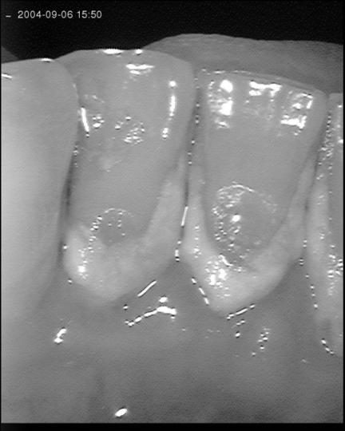
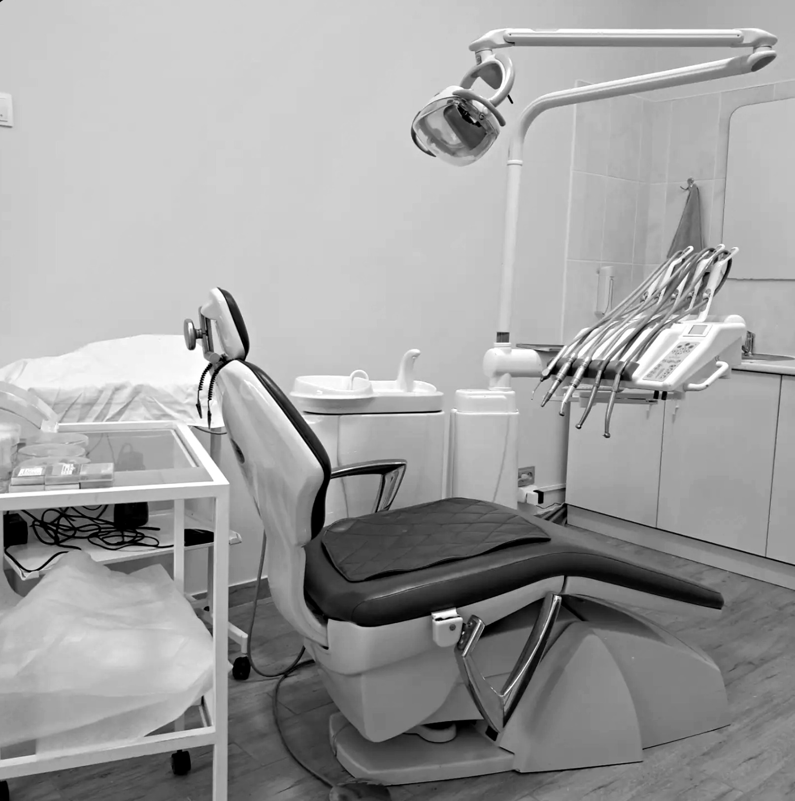

Зняття відкладень у Novadent коштує 800 гривень. На цьому візиті прибирають твердий зубний камінь і щільний наліт, яких щітка вже не бере, і полірують поверхню, щоб вона менше тримала новий наліт. Чистка не нарощує кістку, не закриває дірку і не замінює пасту з фторидом увечері. Користь у неї вужча і конкретна: прибрати те, що мінералізувалось біля ясен і заважає і домашньому чищенню, і загоєнню запалення.

Люди часто записуються «освіжити колір перед святом». Кава, чай і тютюн справді фарбують наліт, і після зняття зуб виглядає світлішим рівно настільки, наскільки його затемнював цей шар. Окремого відбілювання в прайсі кабінету немає. Чистка його не підміняє і не обіцяє тон, якого емаль ніколи не мала.

## Наліт і камінь — різні речі

Наліт — це м’яка біоплівка. Вона наростає щодня, навіть якщо їсти мало солодкого, бо бактеріям вистачає звичайної їжі і самої слини. Щітка і засіб для проміжків цей шар знімають, доки він м’який. Якщо він лишається біля ясен, солі слини з часом перетворюють його на камінь. Камінь шорсткий, жовто-коричневий, сидить щільно, частіше з язикового боку нижніх різців і на щочних поверхнях верхніх жувальних зубів. Зубною щіткою, вугіллям, содою чи «твердим яблуком» він не відколюється. Яблуко стирає м’який наліт на доступній поверхні і не дістає камінь під яснами.

Поки камінь лежить, новий наліт тримається на ньому весь час. Ясна поруч кровлять, навіть якщо людина сумлінно чистить усе, до чого дотягується щетина. Саме тому кровоточивість інколи не минає від однієї лише зміни пасти. Спочатку треба прибрати шкаралупу. Про те, як відрізнити оборотний гінгівіт від втрати кістки, написано в записі [«Кровоточивість ясен»](2026-07-11-gingivitis.html).

<figure>

<figcaption>Навчальне фото відкладень біля лінії ясен, не пацієнт Novadent. Автор: Michael Ottenbruch, <a href="https://commons.wikimedia.org/wiki/File:Calculus-2.jpg" target="_blank" rel="noopener noreferrer">GFDL</a>, Wikimedia Commons.</figcaption>
</figure>

## Що роблять у кріслі і чого не роблять

Інструментами знімають камінь над яснами і той, що доступний біля краю борозни. Рух іде вздовж поверхні кореня, а не «здирає емаль для блиску». Потім поверхню полірують. Мета полірування — менш шорстка емаль і корінь, на яких нальоту важче зачепитися завтра, а не дзеркальний вигляд на фотографії. Якщо під каменем відкрилась порожнина або край старої пломби, це проговорюють окремо: чистка дірку не закриває. Пломби в кабінеті ставлять з Лателюксу, Карісми, Градії або CeramX, і це вже інший візит із власним кошторисом.

Більшість людей витримує зняття каменю без уколу. Коли корінь оголений і реакція на дотик різка, анестезія можлива окремим рядком прайсу, 200 гривень, і її не додають автоматично кожному. Після уколу варто почекати з їжею, доки щока відійде, щоб не прикусити її.

Чистка не лікує пульпіт, не вибілює дентин зсередини і не замінює коронку на зубі, від якого лишились тонкі стінки. Вона також не є лікувальною процедурою «проти пародонтиту одним сеансом». При пародонтиті зняття відкладень — перший шар роботи, після якого кишені міряють знову. Кістка, якої вже немає, на місце не встає. Це чесна межа візиту, і її краще почути до того, як чекати від однієї чистки нерухомих зубів.

Перед візитом їдять як завжди: зняття каменю не вимагає порожнього шлунка. Список ліків візьміть, якщо п’єте щось від тиску, від згортання крові або препарати, що впливають на кістку. Чистка над яснами зазвичай не привід самовільно скасовувати ці ліки, але назву лікар має почути до інструмента. Якщо болить один зуб і ясна набрякли лише з одного боку, почніть з огляду. Під набряком може бути край пломби або вогнище біля кореня, і прохання «просто почистити все» тоді не перший крок.

Після візиту язик часто ловить шорсткість там, де лежав камінь, і зуби здаються довшими. Гострий щабель, який ріже язик і рве нитку, чистка не вирівнює: навислу пломбу підшліфовують окремо, інакше новий камінь сяде на те саме місце. Увечері того ж дня лінію ясен проходять пастою з фторидом без героїчного натиску. Солодке і кисле в цей день краще не розтягувати на години, бо корінь щойно відкрився. Якщо був укол, з їжею чекають, доки щока знову відчуває температуру.

<figure>

<figcaption>Крісло кабінету, де роблять огляд і зняття відкладень.</figcaption>
</figure>

## Чутливість кілька днів потому

Коли камінь довго лежав на корені, він закривав дентин від холоду, повітря і солодкого. Після зняття корінь зустрічає все це одразу. Короткий гострий укол на холод, що минає за секунди, у перші дні очікуваний. Допомагає паста для чутливих зубів, якою користуються щодня, а не один вечір, і чищення тієї ж ділянки м’якою щетиною: якщо її обминати, наліт повернеться на щойно очищений корінь.

Тепла вода замість льоду, і не полоскати рот одразу після пасти з фторидом — практичні дрібниці на цей тиждень. Якщо біль стає довгим, нічним або прив’язаний до одного зуба, який болить і без холодного, це вже не «після чистки», а привід перевірити нерв. Як розрізняють коротку чутливість і запалення пульпи, розібрано в записі про [лікування карієсу і пульпіту](2030-05-19-therapy.html).

Ясна того ж дня можуть кровляти під час чищення. Їх не залишають у спокої на тиждень. Саме регулярний м’який наліт підтримував запалення, і пауза повертає його швидше, ніж корінь встигне заспокоїтись.

## Чому домашня паста лишається головною

Кокрейнівський огляд Walsh і співавторів показав користь пасти з фторидом порівняно з пастою без нього: новий карієс виникає рідше, коли фторид у пасті є, і в звичайному діапазоні концентрацій вищий вміст захищає краще. Delivering Better Oral Health радить дорослим чистити зуби двічі на день пастою з 1350–1500 ppm фториду, ввечері перед сном і ще один раз, і випльовувати піну, не споліскуючи її водою. Професійна чистка цього режиму не скасовує. Вона не тримає фторид на емалі наступні місяці.

Інтервал між чистками теж не універсальний. Хтось нарощує камінь за кілька місяців через склад слини, сухість або пропущену язикову поверхню різців. Хтось роками приходить майже без каменю, якщо щодня проходить лінію ясен і проміжки. Орієнтир — новий твердий край біля ясен і кров, яка повернулась, а не дата в календарі сама по собі. На огляді це видно зондом за одну хвилину.

Кабінет на вул. Гоголя 15, телефон [075 177 75 67](tel:+380751777567). Консультація перед чисткою безкоштовна: на ній якраз вирішують, чи сьогодні потрібне лише зняття відкладень, чи під каменем уже є те, що треба лікувати окремо.

Цей текст описує межі професійної чистки і не є планом лікування для конкретного рота.

## Джерела

<ol class="blog-sources">
<li><a href="https://doi.org/10.1002/14651858.CD007868.pub3" target="_blank" rel="noopener noreferrer">Walsh T, Worthington HV, Glenny AM, Marinho VCC, Jeroncic A. Fluoride toothpastes of different concentrations for preventing dental caries. Cochrane Database of Systematic Reviews, 2019.</a></li>
<li><a href="https://www.gov.uk/government/publications/delivering-better-oral-health-an-evidence-based-toolkit-for-prevention" target="_blank" rel="noopener noreferrer">Delivering better oral health: an evidence-based toolkit for prevention. Department of Health and Social Care, NHS England.</a> Поради щодо пасти з фторидом і зняття нальоту.</li>
<li><a href="https://doi.org/10.1002/jper.17-0719" target="_blank" rel="noopener noreferrer">Chapple ILC, Mealey BL, Van Dyke TE, et al. Periodontal health and gingival diseases and conditions on an intact and a reduced periodontium. Journal of Periodontology, 2018.</a></li>
<li><a href="https://doi.org/10.1111/jcpe.13290" target="_blank" rel="noopener noreferrer">Sanz M, Herrera D, Kebschull M, et al. Treatment of stage I–III periodontitis — The EFP S3 level clinical practice guideline. Journal of Clinical Periodontology, 2020.</a> Професійне зняття нальоту і каменю входить у перший крок лікування, а не замінює його.</li>
</ol>
