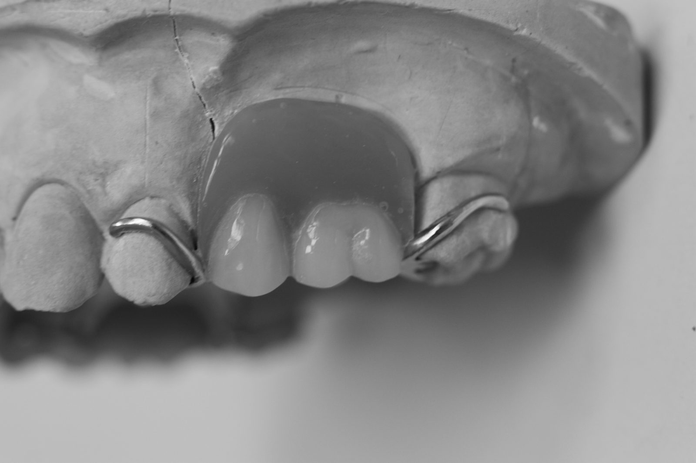
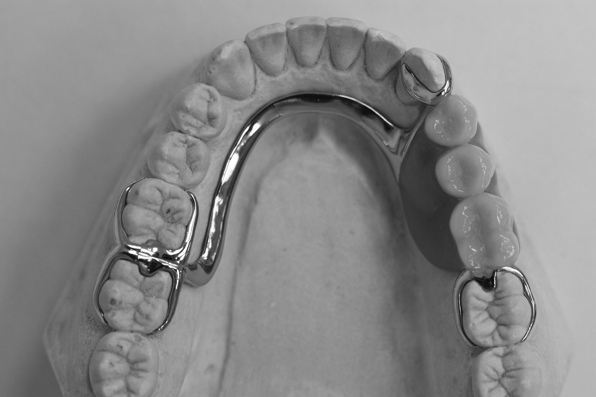

Коли зубів не вистачає, жування, дикція і навантаження на сусідні зуби змінюються не завжди однаково. Інколи людина роками добре їсть без кількох молярів. Інколи один бічний проміжок зсуває щелепу, а передній — заважає посміхатися і різати їжу. У Novadent після огляду і знімка пропонують ту знімну конструкцію, яка закриває саме цю задачу: акриловий протез, нейлоновий, бюгель на ацеталі або бюгель на металевій основі. Імплантатів у цьому кабінеті не ставлять. Розмова тут про протези, які можна зняти.

Не кожен відсутній зуб треба заміщувати. Концепція вкороченого зубного ряду, сформульована Käyser і пізніше розібрана в огляді Kanno і Carlsson (Journal of Oral Rehabilitation, 2006), показує: за збережених передніх зубів і премолярів жування для багатьох людей достатнє, навіть якщо далеких молярів немає. Протез має сенс, коли проміжку забагато для жування, сусідні зуби нахиляються або перевантажуються, а беззуба ділянка заважає зовні. Якщо ряд ще робочий, чесне рішення інколи звучить як «зараз протез не потрібен». Це якраз те, що з’ясовують на консультації, а не в прайсі.

Перед будь-яким протезом дивляться опорні зуби і ясна. Карієс, зруйнована культя і кишені з гноєм не тримають кламер. Рухомий зуб, на який сяде гачок, розхитається швидше. Спочатку лікування і видалення того, що не вистоїть, потім відбитки. Прицільний знімок опорних зубів у кабінеті показує корені й кістку; про те, коли він потрібен, є окремий запис [«Знімок на візіографі»](2026-10-01-scan.html).

## Акрил: зрозуміла база

Акрил — поліметилметакрилат, звична рожева пластмаса зубних протезів. Частковий акриловий протез закриває проміжок базисом і дротяними кламерами, які обіймають сусідні зуби. Повний акриловий протез тримається на щелепі за рахунок точного краю, слини і м’язів, на нижній щелепі зазвичай гірше, ніж на верхній, бо площа опори менша, а язик простір забирає.

Акрил можна полагодити, перебазувати, якщо ясна з часом сіли, і доварити зуб, якщо пізніше видалять ще один. Це практична перевага, яку гнучкі пластмаси часто втрачають. Недолік часткового акрилового протеза в тому, що базис великий, закриває піднебіння або значну частину ясен, а дротяний кламер у посмішці помітний. Якщо немає опори на зуби через маленькі сідла з упорами, жувальний тиск іде в ясна, і кістка під базисом з роками тоншає. Для тимчасового заміщення, для повного ряду і для людини, якій потрібен ремонтний, доступний варіант, акрил лишається робочим матеріалом. У прайсі кабінету це найменша ціна серед знімних протезів.

<figure>

<figcaption>Частковий акриловий протез: рожевий базис і дротяні кламери на сусідніх зубах. Фото: Sterilgutassistentin, <a href="https://commons.wikimedia.org/wiki/File:Oberkiefer_Teilprothese_20100112_022.JPG" target="_blank" rel="noopener noreferrer">CC BY-SA 3.0</a>.</figcaption>
</figure>

## Нейлон: легкий і не для кожного проміжку

Нейлон, або поліамід, — термопластична база без металевих гачків. Кламер вирізають із тієї самої рожевої маси, тому в посмішці він непомітний, а протез тонший і людям часто здається зручнішим у перші тижні. Огляди механічних властивостей, зібрані зокрема Le Bars і співавторами (Polymers, 2023) та раніше Takabayashi (Dental Materials Journal, 2010), описують зворотний бік. Поліамід гнучкіший за акрил, його міцність на згин нижча за вимоги, які висувають до жорстких базисів, поверхня легше дряпається і сильніше фарбується кавою, вином і карі. Вода змінює розміри. Перебазування і починка, звичні для акрилу, для нейлону обмежені або неможливі в кріслі.

Японське товариство протезистів у позиційному огляді Fueki і співавторів (Journal of Prosthodontic Research, 2014) прямо обмежило показання безметалевих кламерних протезів. Вони доречні для невеликих проміжків, коли жорсткий каркас не обов’язковий і людині важливо сховати метал. Вони погано замінюють конструкцію, якій потрібні опора на зуби і жорстка дуга: гнучкий базис передає тиск на ясна. Wadachi і співавтори ще раніше показали, що поліамідний протез сильніше тисне на м’які тканини, ніж жорсткіші базиси. На нижній щелепі при повній відсутності зубів цієї жорсткості для жування часто не вистачає. У Novadent нейлоновий протез є окремим рядком прайсу, і його пропонують там, де ці обмеження не конфліктують із прикусом.

## Бюгель: жорстка дуга і різні кламери

Бюгельний протез — це частковий протез із каркасом. Класичний каркас відливають із кобальт-хрому: тонка дуга за зубами або піднебінням, упори на опорних зубах і кламери. Упори не дають протезу сідати в ясна під час жування, дуга з’єднує боки, кламер утримує. Навантаження ділиться між зубами і слизовою, а не лежить лише на яснах. Огляд Campbell і співавторів (Journal of Prosthetic Dentistry, 2017) називає литий каркас стандартним рішенням для постійного часткового протеза і окремо пише, що галузі досі бракує зручніших конструкцій: метал видно, зуби під кламери інколи треба підточувати під упор. Це чесне обмеження, а не привід відмовлятися від схеми, яка десятиліттями розподіляє тиск передбачувано.

<figure>

<figcaption>Бюгель нижньої щелепи: лита дуга, кламери й сідло з зубами. Упори на зубах забирають частину жувального тиску з ясен. Фото: Sterilgutassistentin, <a href="https://commons.wikimedia.org/wiki/File:Unterkiefer_Teilprothese_20100112_003.JPG" target="_blank" rel="noopener noreferrer">CC BY-SA 3.0</a>.</figcaption>
</figure>

Ацетальний бюгель залишає металеву логіку каркаса, але кламери робить із поліоксиметилену — щільної пластмаси кольору зуба. Їх обирають, коли металевий гачок потрапляє в посмішку. Ацетал пружніший за кобальт-хром. Лабораторні порівняння утримуючої сили за схожої форми кламера зазвичай віддають перевагу металу: полімерний кламер із часом тримає слабше і його легше деформувати. Тому ацетал — компроміс на користь вигляду, а не «той самий бюгель, тільки непомітний». Довгі кінцеві проміжки без надійних упорів він не перетворює на жорстку конструкцію.

Окремий рядок прайсу — бюгель, у якого металева база поєднана з нейлоном і елементами, позначеними як пілоти. Це вже індивідуальна схема фіксації, а не стандартний литий кламер. Її сенс і те, які зуби мають вціліти, лікар показує на моделі після огляду. Заочно з назви рядка цього не вибрати.

## Звикання і догляд

Новий протез перші дні відчувається більшим, ніж виглядає в руці. Дикція і жування повертаються поступово, зазвичай за кілька тижнів, якщо базис не давить на кістку. Точкову болючість знімають корекцією в кріслі, а не домашнім підпилюванням. Їсти одразу тверде і липке не варто: спочатку м’яка їжа на обидва боки.

Знімний протез чистять окремо від зубів, м’якою щіткою і неабразивним засобом. Паста для емалі дряпає акрил і нейлон, у подряпині швидше сідає наліт. На ніч більшість клінічних порад — знімати протез, промивати і тримати у вологому середовищі, а ясна залишати вільними. Огляд Gendreau і Loewy (Journal of Prosthodontics, 2011) пов’язує протезний стоматит — почервоніння слизової під базисом, часто за участю грибів Candida — із цілодобовим носінням і поганою гігієною. Суха серветка на батареї акрил коробить. Якщо під протезом з’явилися білі плями, що не знімаються, тріщини кутів рота або протез раптом став вільним, це привід на огляд, а не на клей «на постійно». Клей інколи допомагає повному протезу на час до перебазування. Він не замінює край, який вже не відповідає яснам.

Опорні зуби під кламерами чистять особливо уважно: карієс там починається там, де гачок заважає щітці. Раз на рік протез і ці зуби варто показувати, навіть якщо нічого не тре. Кістка під сідлом змінюється повільно, і людина звикає до посадки, яка вже тисне.

Обрати між акрилом, нейлоном, ацеталем і металевим бюгелем за фотографією в інтернеті не вийде. Потрібні проміжки, рухомість зубів, прикус і те, чи готовий власник знімати протез на ніч. Це безкоштовна консультація: Вінниця, вул. Гоголя 15, [075 177 75 67](tel:+380751777567).

Текст узагальнює огляди і позиційні документи. Конструкцію підбирають після огляду.

## Джерела

<ol class="blog-sources">
<li>Kanno T, Carlsson GE. A review of the shortened dental arch concept focusing on the work by the Käyser/Nijmegen group. J Oral Rehabil. 2006;33:850–862.</li>
<li>Käyser AF. Shortened dental arches and oral function. J Oral Rehabil. 1981;8:457–462.</li>
<li>Campbell SD, Cooper L, Craddock H, et al. Removable partial dentures: the clinical need for innovation. J Prosthet Dent. 2017;118:273–280.</li>
<li>Fueki K, Ohkubo C, Yatabe M, et al. Clinical application of removable partial dentures using thermoplastic resin. Part I: definition and indication. J Prosthodont Res. 2014;58:3–10. Part II: material properties and clinical features. J Prosthodont Res. 2014;58:71–84.</li>
<li>Takabayashi Y. Characteristics of denture thermoplastic resins for non-metal clasp dentures. Dent Mater J. 2010;29:353–361.</li>
<li>Le Bars P, Bandiaky ON, Le Guéhennec L, Clouet R, Kouadio AA. Different polymers for the base of removable dentures? Part I: a narrative review of mechanical and physical properties. Polymers. 2023;15:3495.</li>
<li>Gendreau L, Loewy ZG. Epidemiology and etiology of denture stomatitis. J Prosthodont. 2011;20:251–260.</li>
</ol>
