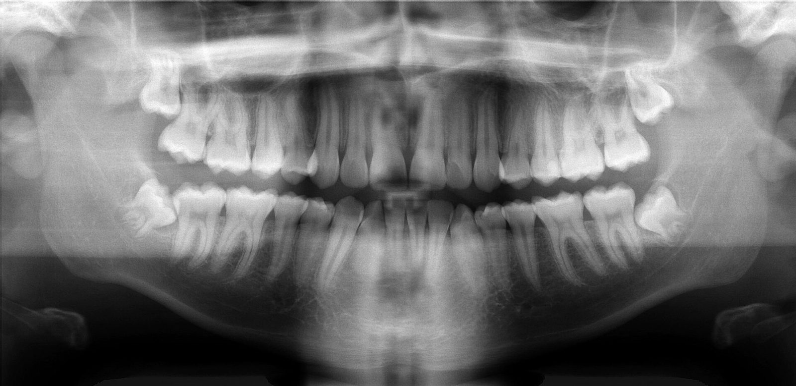

Візіограф у кабінеті Novadent — це цифровий датчик для прицільного знімка кількох зубів разом із коренями. Знімок з’являє на екрані за секунди, їхати в інше місце не потрібно. Коштує він 100 гривень. Роблять його не «для комплекту», а тоді, коли без нього лікування або протезування було б здогадкою.

Слово «рентген» у розмові означає будь-яку картинку зубів. Для рішення лікаря це різні дослідження. Прицільний знімок на візіографі охоплює один-три зуби в натуральнішому масштабі: видно порожнину, дах над нервом, форму каналів, пломбувальний матеріал і кістку навколо верхівки. Панорамний знімок — інший апарат. Він знімає обидві щелепи за один оберт, зручний як огляд «що взагалі є в роті», і помітно гірше показує дрібниці: початок карієсу між зубами, довжину каналу, тріщину кореня. Документ FDA і Американської стоматологічної асоціації щодо відбору пацієнтів на рентгенографію прямо зазначає, що внутрішньоротові знімки точніші за панорамні для оцінки кореня, розсмоктування і стану пульпи. Знімок на планшеті на початку цієї сторінки — ілюстрація того, як дивляться радіограму. Нижче — самі два типи зображень.

<figure>

<figcaption>Прицільний знімок: корені й кістка навколо них. Стрілки показують розрідження біля верхівок — так виглядає прикореневе вогнище. Навчальний знімок, не пацієнт Novadent. Автор: Coronation Dental Specialty Group, <a href="https://commons.wikimedia.org/wiki/File:Abscessed_tooth_periapical_radiograph.jpg" target="_blank" rel="noopener noreferrer">CC BY-SA 3.0</a>.</figcaption>
</figure>

<figure>

<figcaption>Панорамний знімок обох щелеп. Він оглядовий і не замінює прицільний, коли треба бачити канал або контакт між зубами. Автор: Coronation Dental Specialty Group, <a href="https://commons.wikimedia.org/wiki/File:Basic_panoramic_radiograph.jpg" target="_blank" rel="noopener noreferrer">CC BY 3.0</a>.</figcaption>
</figure>

## Коли знімок змінює лікування

Настанова щодо радіаційної безпеки в стоматології (Benavides і співавт., Journal of the American Dental Association, 2024) ставить на перше місце виправданість. Спочатку огляд, розпитування і, якщо вийде, попередні знімки. Новий кадр роблять, коли очікують, що він змінить діагноз або хід роботи. Карієс між зубами часто не видно в дзеркалі, поки не з’явиться порожнина, в яку вже заходить зонд. Глибока пломба може ховати розкритий ріг пульпи. Біль на накушування без дірки буває від вогнища біля кореня, від тріщини або від перевантаженого зуба — знімок відсікає частину цих версій, але не всі.

Перед лікуванням каналів знімок потрібен двічі і тричі, а не один раз «на початку». Європейські рекомендації з якості ендодонтичного лікування (European Society of Endodontology, 2006) описують прицільні знімки до втручання, під час визначення довжини каналу і після пломбування. Без довжини інструмент або не доходить до верхівки, або виходить за неї. Після пломбування кадр показує, чи заповнений канал до робочої межі і чи немає порожнин у матеріалі. Це частина роботи, а не додаткова послуга «на всяк випадок».

Перед коронкою і перед знімним протезом дивляться опору: чи немає карієсу під старою пломбою, запалення на верхівці, кишені, яка вже з’їла кістку навколо кореня. Кламер на зубі з нелікованим вогнищем тримає недовго. Якщо знімок нічого не змінить — наприклад, поверхнева фісура, яку і так добре видно, і зуб живий, — його можна не робити. Серія «про всяк випадок раз на пів року всім» сучасним критеріям відбору не відповідає. Інтервал між контрольними знімками залежить від карієс-ризику, а не від абонемента.

## Скільки це опромінення

Доза одного внутрішньоротового кадру мала на тлі природного фону, але вона не нульова, і кадри складаються за життя. У таблиці настанови 2024 року один цифровий бічний знімок — близько 0,3 мікрозіверта в ділянці премолярів і 1,4 мікрозіверта в ділянці молярів. Це менше ніж доба природного фону. Чотири такі знімки з прямокутним обмеженням променя — 3,4–5 мікрозівертів, усе ще менше ніж доба. Повний статус із 18 кадрів за прямокутної колімації в тій самій таблиці — 34,9 мікрозіверта, а за круглого променя — 170,7. Різниця в кілька разів від самої форми отвору, крізь який виходить промінь. Панорамний знімок на ПЗЗ-датчику — орієнтовно 14–30 мікрозівертів, тобто кілька діб фону, і при цьому він гірше відповідає на питання про один канал.

Цифровий датчик, саме він і є візіографом, дає шанс знизити дозу відносно старої плівки. Огляд FDA щодо відбору пацієнтів оцінює цю можливість у 40–60%. Виграш зникає, якщо знімок повторюють через змазаний рух, зрізаний край або завищену експозицію: цифрова матриця «пробачає» пересвіт і спокушає не зменшувати час. Тому техніка важливіша за марку апарата. Прямокутна колімація, за оглядами, на які спирається настанова ADA, стабільно зрізає дозу більш ніж на 40% порівняно з круглим променем.

Той самий документ 2024 року більше не радить рутинно накривати живіт і щитоподібну залозу фартухом під час діагностичного зубного знімка. Фартух не зупиняє розсіяння, що виникає вже всередині тканин, і може перекрити кадр, через що знімок доводиться повторити. Кращий захист — не робити зайвого кадру, тримати промінь вузьким і користуватися цифровим приймачем. Правила конкретного кабінету і перевірок обладнання можуть вимагати фартуха; якщо його пропонують, це не суперечить малості дози. Якщо ви вагітні або знімок роблять дитині, скажіть до експозиції. Вагітність не є абсолютною забороною на прицільний знімок, коли від нього залежить лікування інфекції. Дитина чутливіша до накопиченої дози, бо попереду довше життя, тож планка «чи змінить цей кадр лікування» для неї ще жорсткіша.

Комп’ютерна томографія зубів дає суттєво більшу дозу, інколи на порядки, і в загальній практиці не замінює візіограф. Її місце — там, де двовимірний знімок не відповідає на питання, наприклад складний корінь перед хірургією. У цьому кабінеті томографа немає, і для пломби, каналів, коронки та знімного протеза прицільного кадру зазвичай досить.

## Чого знімок не покаже

Прицільна радіограма — це тінь. Дві структури, що стоять одна за одною, зливаються. Карієс на щоці або язиці, поки він неглибокий, ховається за масою зуба. Тріщина кореня часто невидима, поки не розійдеться або не дасть кісткового малюнка вздовж лінії. Початок ураження між зубами на знімку менший, ніж у реальності: доки промінь не зловить достатню втрату мінералу, емаль може бути вже розм’якшена. Тому «на знімку чисто» не скасовує огляд зонда і нитки, а темна пляма на емалі без порожнини не завжди означає бормашину того ж дня.

Знімок також не обирає матеріал коронки і не каже, чи готовий пацієнт знімати протез на ніч. Він відповідає на анатомічне питання. Решту закриває розмова, про яку написано в записі про [консультацію](2026-06-01-consult.html).

Після лікування каналів контрольний кадр має сенс не наступного ранку. Кістка навколо кореня перебудовується місяцями. Якщо біль наростає, з’являється набряк або свищ, дивляться раніше і клінічно, а не за календарем. Збережіть диск або файл, якщо вам його віддають: наступний лікар не повторить кадр лише тому, що попередній лишився в чужому архіві. Настанова 2024 року називає спробу отримати старі знімки окремим кроком захисту.

Кабінет на вул. Гоголя 15 робить прицільний знімок на місці, перед лікуванням і перед протезуванням. Запис за телефоном [075 177 75 67](tel:+380751777567). Якщо зуб гостро болить, знімок — частина прийому, а не окремий день.

Текст пояснює порядок доз і показання за опублікованими настановами. Потрібен вам кадр чи ні, вирішують після огляду.

## Джерела

<ol class="blog-sources">
<li>Benavides E, Krecioch JR, Connolly RT, et al. Optimizing radiation safety in dentistry: executive summary and recommendations. J Am Dent Assoc. 2024. Таблиця типових ефективних доз: один цифровий бічний знімок 0,3–1,4 мкЗв; чотири бічні знімки з прямокутною колімацією 3,4–5,0 мкЗв; повний статус 34,9 мкЗв проти 170,7 мкЗв за круглого променя; панорама на ПЗЗ-датчику 14,2–30 мкЗв.</li>
<li>American Dental Association, U.S. Food and Drug Administration. Dental radiographic examinations: recommendations for patient selection and limiting radiation exposure. Оновлення критеріїв відбору; про зниження дози цифровим приймачем на 40–60% і про перевагу внутрішньоротових знімків над панорамними для оцінки кореня і пульпи.</li>
<li>European Society of Endodontology. Quality guidelines for endodontic treatment: consensus report of the European Society of Endodontology. Int Endod J. 2006;39:921–930.</li>
</ol>
