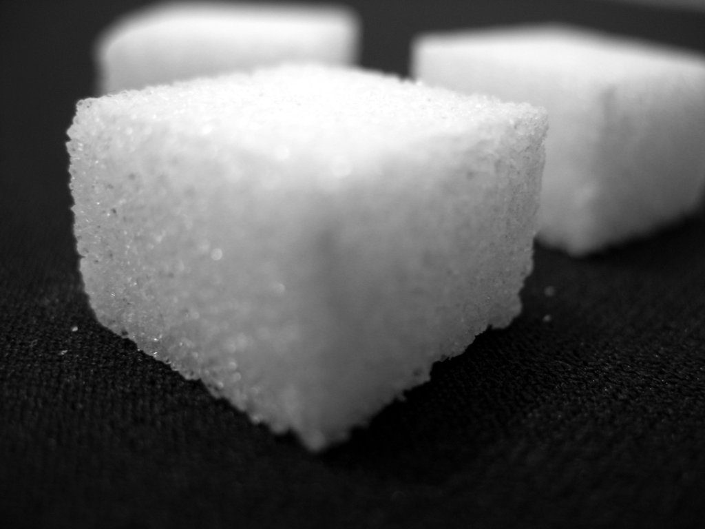
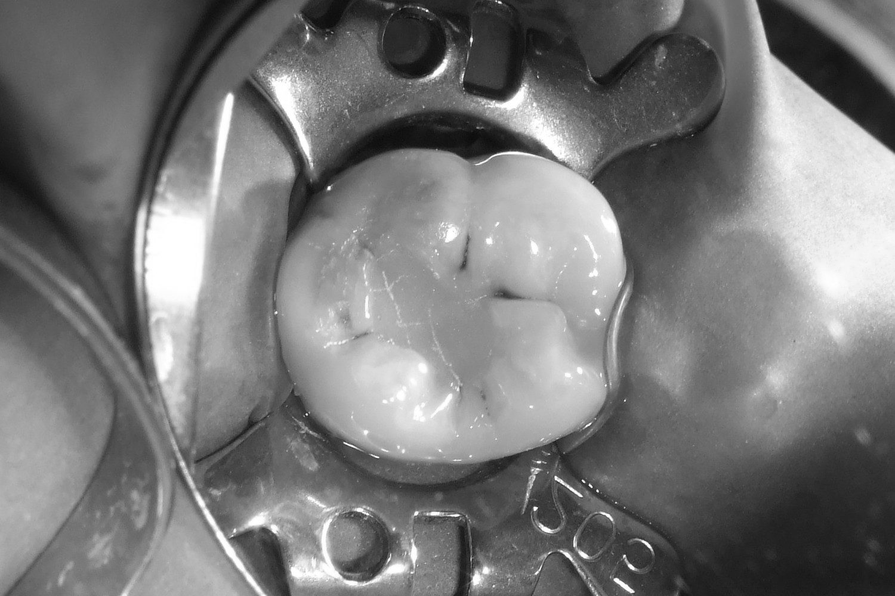

Карієс починається там, де бактерії зубного нальоту отримують вільний цукор і виробляють кислоту. Кислота забирає мінерали з емалі. Слина повертає частину мінералів назад, якщо встигає, а паста з фторидом робить цей ремонт надійнішим. Дірка з’являється, коли кислотних епізодів багато, а відновлення не встигає. Всесвітня організація охорони здоров’я називає вільні цукри головним харчовим фактором карієсу і описує хвороби порожнини рота як такі, яким значною мірою можна запобігти.

Важлива не лише ложка цукру в чаї за обідом. Важливо, скільки разів за день емаль зустрічає нову порцію. Пломба, коли порожнина вже є, цей механізм не скасовує: сусідній зуб і край реставрації живуть у тій самій кислоті.

## Як часто, а не лише скільки

Після солодкого ковтка чи шматка pH у нальоті падає. Слина поступово повертає його до спокійного рівня, якщо нова порція цукру не приходить раніше. Цю ідею вчать як криву Стефана: падіння і відновлення, без секундоміра в кишені. Однакових «хвилин кислоти на кожен стакан» у різних людей немає. Слина, кількість нальоту і те, чи був це ковток за хвилину чи посмоктування годину, змінюють картину.

Звідси практичне правило. Солодке разом з основною їжею — один епізод. Та сама кількість, розмазана на вечір у вигляді чаю з цукром, цукерки, потім соку, — кілька епізодів, і слина не встигає закрити попередній. Повільне пиття солодкого напою особливо підступне: кожен ковток збиває pH знову. Вода між ковтками їжі нічого не «вимиває назавжди», але хоча б не додає нової кислоти.

Настанова ВООЗ щодо цукрів радить тримати вільні цукри нижче 10 відсотків енергії раціону протягом усього життя. Умовна, обережніша порада — нижче 5 відсотків. Вільні цукри тут — це те, що додано в їжу і напої, плюс цукри меду, сиропів і соків. Цукор усередині цілого фрукта і лактоза молока в цю категорію не входять. Delivering Better Oral Health повторює ту саму логіку для стоматолога: зменшувати і кількість, і частоту солодких їжі та напоїв, і не залишати їх на час перед сном, коли слини мало.

<figure>

<figcaption>Вільний цукор — той, який додають у напої і страви, і той, що вже є в соку. Частота ковтків важливіша за один кубик за обідом. Фото: Uwe Hermann, <a href="https://commons.wikimedia.org/wiki/File:Sugar_cubes.jpg" target="_blank" rel="noopener noreferrer">CC BY-SA 3.0</a>.</figcaption>
</figure>

## Де цукор ховається

Чай із двома ложками видно. Складніше з тим, що п’ють «для здоров’я» або між справами. Сік, навіть без доданого цукру, для цієї настанови є джерелом вільних цукрів: клітини плода зруйновані, цукор вільний, пити його легко склянками. Смузі з тієї самої причини не дорівнює цілому яблуку. Мед і сироп на сніданку — теж вільний цукор, попри слово «натуральний». Солодкі йогурти, какао, спортивні напої і чай «з пляшки» часто дають кілька експозицій за день у людини, яка думає, що цукерок не їсть.

Сухофрукти липнуть у фісурах і між зубами. Цукор там лежить довго, слина дістає його гірше, ніж із шматка свіжого яблука, яке ще треба жувати. Свіжий фрукт лишають у їжі. Привід обережності — не фрукт як такий, а сухофрукт як перекус щогодини і сік як заміна воді.

Кисле без цукру — окрема вісь. Газована вода з лимоном, оцет, вино не годують бактерії так, як лимонад, але кислота сама пом’якшує емаль. Lussi і Carvalho описують ерозивне стирання як втрату тканини кислотою не з нальоту, після чого щітка і жування знімають уже м’який шар. Замінити солодку колу на цілий день лимонної води означає змінити карієс на ерозію, а не «закрити тему напоїв». Вода і молоко як напої за замовчуванням цієї пастки уникають. Молоко містить свій цукор, лактозу, але його не кладуть у кошик вільних цукрів настанови, і як питво воно для зубів спокійніше за сік.

Перед сном окреме правило. Слина на ніч спадає, буфер слабшає. Солодкий чай у ліжку або сушка на тумбочці потрапляють у найдовший беззахисний проміжок доби. Якщо напій увечері потрібен, це вода.

На етикетці дивляться не гасло на фасаді, а рядок соку, сиропу, меду або концентрату. Напій через трубочку протягом години для емалі довша подія, ніж та сама склянка за обідом: кожен новий ковток зустрічає наліт, який ще не повернувся до спокійного стану. Пляшка солодкого чаю на робочому столі якраз про частоту, навіть якщо ковток щоразу маленький. Цукор у каві вранці і ще раз удень — уже два епізоди. Третій з’являється, коли та сама чашка доживає до вечора.

## Друга половина захисту — паста

Навіть акуратна дієта не прибирає наліт повністю, а в нальоті кислота виникає і від звичайної їжі. Фторид якраз допомагає емалі вигравати ці дрібні епізоди. Огляд Walsh показав, що паста з фторидом зменшує новий карієс порівняно з пастою без нього, а в побутовому діапазоні вища концентрація захищає краще. Дорослій людині Delivering Better Oral Health радить 1350–1500 ppm, двічі на день, піну виплюнути і не змивати. Вечірній раз збігається з падінням слини, тому його не пропускають «бо втомився».

Дієта без фториду і фторид без жодної уваги до частоти цукру — обидва половинні плани. Разом вони якраз те, що можна робити вдома щодня, без запису в крісло. Проміжки все одно чистять: наліт між зубами отримує цукор так само, а щітка його не знімає.

<figure>

<figcaption>Зуб ізольований під реставрацію. Пломба закриває порожнину, яка вже виникла, і не скасовує часті солодкі напої для сусідніх зубів. Навчальне фото, не пацієнт Novadent. Автор: Albert, <a href="https://commons.wikimedia.org/wiki/File:Composite_resin_fillng_1.jpg" target="_blank" rel="noopener noreferrer">CC BY-SA 3.0</a>.</figcaption>
</figure>

## Коли зміна звички вже не закриє дірку

Біла пляма без порожнини ще може зупинитися, якщо епізодів цукру стане менше, а фторид лягатиме щовечора. Порожнина, куди заходить зонд і де застрягає їжа, сама мінералами не заповнюється. Її закривають пломбою. У кабінеті для цього є Лателюкс, Карісма, Градія і CeramX; сума залежить від зуба і стоїть у розділі [цін](/index.html#prices). Як виглядає лікування, коли процес дійшов глибше, описано в записі [«Лікування карієсу і пульпіту»](2030-05-19-therapy.html).

Після пломби той самий режим лишається. Край реставрації якраз місце, де наліт любить стояти, якщо солодкий напій знову розтягнутий на день. Анестезія для лікування, якщо вона потрібна, коштує 200 гривень і не має стосунку до профілактики наступної дірки.

На консультації, вона безкоштовна, можна розкласти звичайний день напоїв без щоденника на двадцять сторінок: що п’єте в машині, що стоїть на столі під час роботи, що берете ввечері. Цього часто досить, щоб побачити частоту. Кабінет Novadent на вул. Гоголя 15, телефон [075 177 75 67](tel:+380751777567).

Цей текст пояснює зв’язок цукру і карієсу і не є персональною дієтою чи діагнозом.

## Джерела

<ol class="blog-sources">
<li><a href="https://www.who.int/publications/i/item/9789241549028" target="_blank" rel="noopener noreferrer">World Health Organization. Guideline: sugars intake for adults and children. Geneva: WHO, 2015.</a></li>
<li><a href="https://www.who.int/news-room/fact-sheets/detail/oral-health" target="_blank" rel="noopener noreferrer">World Health Organization. Oral health. Fact sheet.</a></li>
<li><a href="https://www.gov.uk/government/publications/delivering-better-oral-health-an-evidence-based-toolkit-for-prevention" target="_blank" rel="noopener noreferrer">Delivering better oral health: an evidence-based toolkit for prevention. Department of Health and Social Care, NHS England.</a></li>
<li><a href="https://doi.org/10.1002/14651858.CD007868.pub3" target="_blank" rel="noopener noreferrer">Walsh T, Worthington HV, Glenny AM, Marinho VCC, Jeroncic A. Fluoride toothpastes of different concentrations for preventing dental caries. Cochrane Database of Systematic Reviews, 2019.</a></li>
<li><a href="https://doi.org/10.1159/000360380" target="_blank" rel="noopener noreferrer">Lussi A, Carvalho TS. Erosive tooth wear: a multifactorial condition of growing concern and increasing knowledge. Monographs in Oral Science, 2014.</a></li>
</ol>
