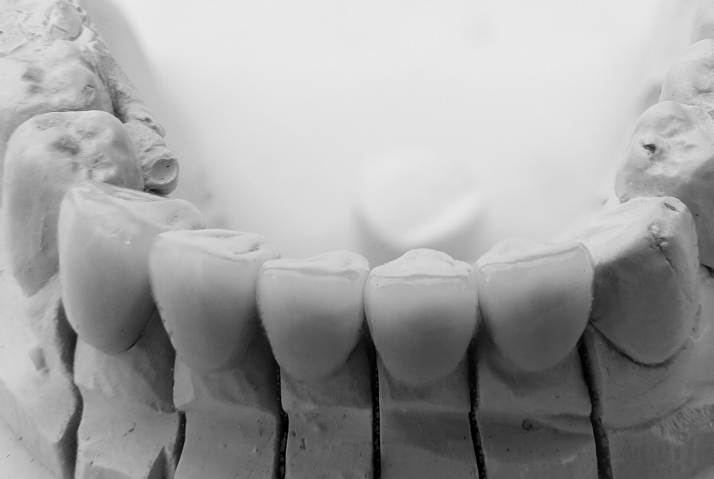
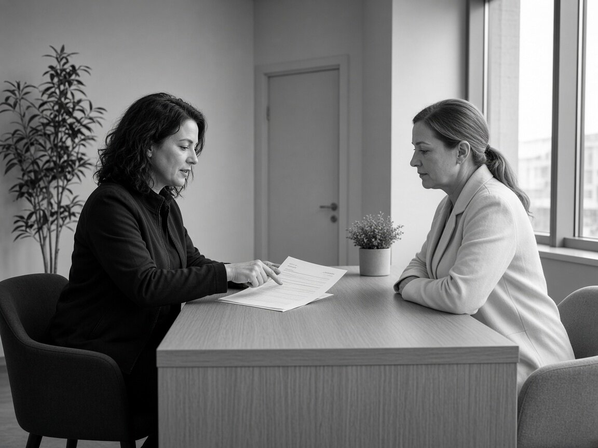

Скрегіт і міцне стискання зубів — це робота жувальних м’язів, а не «поганий прикус», який обов’язково треба переробити. Міжнародна домовленість, яку зібрали Lobbezoo і співавтори, розділяє два прояви. Сонний бруксизм — м’язова активність уві сні, ритмічна або без чіткого ритму. Денний — стискання зубів або напруження щелепи, поки людина не спить, часто за комп’ютером або за кермом. У здорової людини це поведінка, а не хвороба сама по собі. Вона може нічого не псувати і може бути фактором ризику: стерті зуби, тріщини, біль у м’язах. Інколи її розглядають і як можливий захисний фактор, наприклад наприкінці епізоду утрудненого дихання уві сні, але автори домовленості прямо називають такі докази неостаточними. У кріслі рішення спирається на зуби і м’язи, а не на цю гіпотезу.

Кабінет бачить наслідки на зубах. Записати м’язи уві сні приладом тут не можна, і без цього «точний» нічний діагноз не ставлять. Цього зазвичай і не потрібно, щоб вирішити, чи захищати зуби.

## Що можна помітити без приладів

Про сон людина часто дізнається від того, хто поряд: скрегіт чути, вранці скроні втомлені, зуби ніби не розмикаються перші хвилини. Про день людина дізнається сама, якщо зловить себе на стиснутих зубах під час роботи. Це різні звички. Нічна капа не відучить стискати зуби на нараді, а денне нагадування не вимкне сон.

Lobbezoo і співавтори ще й розкладають достовірність. Те, що людина розповідає, — лише можливий бруксизм. Якщо лікар бачить відповідні сліди на зубах, висновок імовірніший. Остаточна фіксація сонної активності потребує запису м’язів під час сну, денної — запису вдень. Для лікування в звичайному кабінеті така точність рідко змінює перший крок. Змінює його інше: чи є свіже стирання, чи болять м’язи, чи тріскаються горбики.

Клацання в суглобі і біль при відкриванні рота — окремі речі. Критерії DC/TMD, які описали Schiffman і співавтори, якраз для болю в м’язі, болю в суглобі, обмеженого відкривання і зміщення диска. Скрегіт може бути одним із факторів поруч, але клацання не доводить, що вночі є скрегіт, а ранкова скутість не завжди вимагає капи. Якщо рот відкривається дедалі гірше або біль живе в суглобі, а не в зубі, це привід до лікарського огляду, а не до щільнішої капи.

<figure>

<figcaption>Модель жувальних поверхонь і коронок. Знімок показує, як виглядають горбики, а не доводить скрегіт. Навчальне фото, не пацієнт Novadent. Автор: Bin im Garten, <a href="https://commons.wikimedia.org/wiki/File:VMK-Krone_Dental_crown_Focus_stacking_with_freeware_CombineZP_02.jpg" target="_blank" rel="noopener noreferrer">CC BY-SA 3.0</a>.</figcaption>
</figure>

## Капа захищає зуби і не вимикає м’яз

Тверда капа на ніч закриває жувальні поверхні. Зуби труться об пластмасу, а не емаль об емаль, горбики менше розклинює. М’язова активність уві сні від цього надійно не зникає. Частина людей скрегоче вже по капі, і вранці на ній видно фасетки. Це не провал роботи. Це нагадування, навіщо капу зробили: прийняти знос на себе. Обіцянка «перестане скреготіти за два тижні» була б нечесною.

М’яку капу з аптеки інколи жують активніше, ніж власні зуби. Це клінічне спостереження, а не закон для кожного рота. Тому спортсменська капа «на одну ніч із полиці» не дорівнює жорсткій накладці, підігнаній по прикусу так, щоб контакт був рівний. Якщо м’язи вранці стали боліти більше, ніж до капи, її показують, а не терплять місяць. Інколи досить підшліфувати контакт, інколи ця конструкція вам не підходить.

Удень працює інше. Зуби не торкаються, губи зімкнені, язик лежить спокійно за верхніми різцями, щелепа не висить у напруженні. Це нагадування, яке людина може зловити, а не прилад. Наліпки на моніторі або на кермі допомагають тим, хто стискає зуби від зосередження. Нічний скрегіт це нагадування не чіпає, і чекати від нього заміни капи не варто.

Дітям капу «на всяк випадок» зазвичай не роблять. Скрегіт уві сні в дитячому віці трапляється часто і часто минає, якщо немає болю і явного стирання, яке вже міняє форму зубів. Дитину спостерігають, а не саджають на нічну конструкцію через звук, який почув батько.

Тиждень позначок відрізняє дві звички краще за загальне «мені здається, я стискаю». У блокноті дві графи. Удень ставте риску, коли зловили стиснуті зуби за роботою. Вранці — якщо щока втомлена або хтось чув скрегіт. Капа на ніч відповідає на ранкову графу. Денні риски зменшує нагадування тримати зуби нарізно, а не пластик, який до вечора лежить у шухляді.

Старі гладкі площини, які не змінюються роками і не болять, не вимагають термінової капи. Свіжий скол горбика, нова чутливість або ямка, що помітно поглибилась, — уже привід показати зуби. Жувальну гумку весь день при болючих скронях краще прибрати: це додаткові цикли для тих самих м’язів. Дитині, крім звуку вночі, дивляться, чи стерлась емаль до дентину і чи болить щока вранці. Сам звук без цих знахідок зазвичай лишають під наглядом. Чи потрібна капа дорослому, вирішують після огляду: одним досить денного нагадування, іншим — нічна накладка, підігнана по змиканню. Коронку обговорюють там, де своєї тканини вже не вистачає жувати.

## Коли до скреготу додається кислота

Свіже стирання буває не лише від зубів. Кислота не з бактерій нальоту пом’якшує поверхню, і тоді навіть звичайний контакт знімає більше тканин. Lussi і Carvalho описують ерозивне стирання як спільну роботу кислоти і механічного зносу. Гладкі увігнуті горбики, зуби, які стали прозорими на краях, більше схожі на кислоту. Плоскі фасетки, що збігаються із зубом навпроти, більше схожі на тертя зуба об зуб. Часто є обидва.

Капа кислоту не прибирає. Якщо є печія, кислий смак уранці, звичні лимонади або смоктання часточок цитруса, це розбирають паралельно з капою. Інакше пластмаса бере на себе тертя, а емаль далі м’якне від кислоти в ті години, коли капи немає. Сімейний лікар потрібен, якщо печія регулярна: стоматолог бачить зуби і не лікує рефлюкс.

<figure>

<figcaption>На консультації з’ясовують, коли зуби стискаються і що вже змінилось на жувальних поверхнях.</figcaption>
</figure>

Коронку на стертий зуб ставлять, коли своєї тканини не вистачає, щоб жувати, або горбик уже тріснув. Робити це, не подумавши про нічний контакт і про кислоту, означає перенести той самий знос на кераміку або на зуб навпроти. У кабінеті коронки роблять. Велику перебудову всієї щелепи і складну хірургію тут не обіцяють: якщо задача виходить за огляд, капу, пломбу або окрему коронку, людину направляють.

Поки рішення немає, не перевіряйте зуби «чи ще болить» твердою їжею і не стискайте щелепу, щоб зрозуміти, який зуб винен. Це якраз навантаження, від якого горбик і тріскається. На безкоштовній консультації достатньо розповісти, коли саме втомлюється щока, і показати зуби. Кабінет у Вінниці на вул. Гоголя 15, телефон [075 177 75 67](tel:+380751777567).

Цей текст не є особистим діагнозом бруксизму і не замінює огляд стертих зубів.

## Джерела

<ol class="blog-sources">
<li><a href="https://doi.org/10.1111/joor.12663" target="_blank" rel="noopener noreferrer">Lobbezoo F, Ahlberg J, Raphael KG, et al. International consensus on the assessment of bruxism: report of a work in progress. Journal of Oral Rehabilitation, 2018.</a></li>
<li><a href="https://doi.org/10.11607/jop.1151" target="_blank" rel="noopener noreferrer">Schiffman E, Ohrbach R, Truelove E, et al. Diagnostic Criteria for Temporomandibular Disorders (DC/TMD) for Clinical and Research Applications. Journal of Oral &amp; Facial Pain and Headache, 2014.</a></li>
<li><a href="https://doi.org/10.1159/000360380" target="_blank" rel="noopener noreferrer">Lussi A, Carvalho TS. Erosive tooth wear: a multifactorial condition of growing concern and increasing knowledge. Monographs in Oral Science, 2014.</a></li>
</ol>
