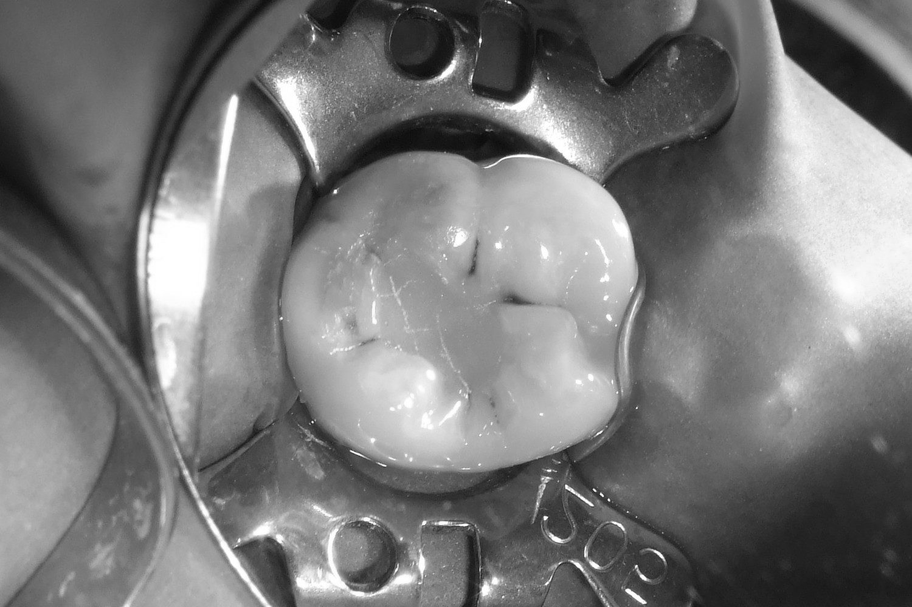
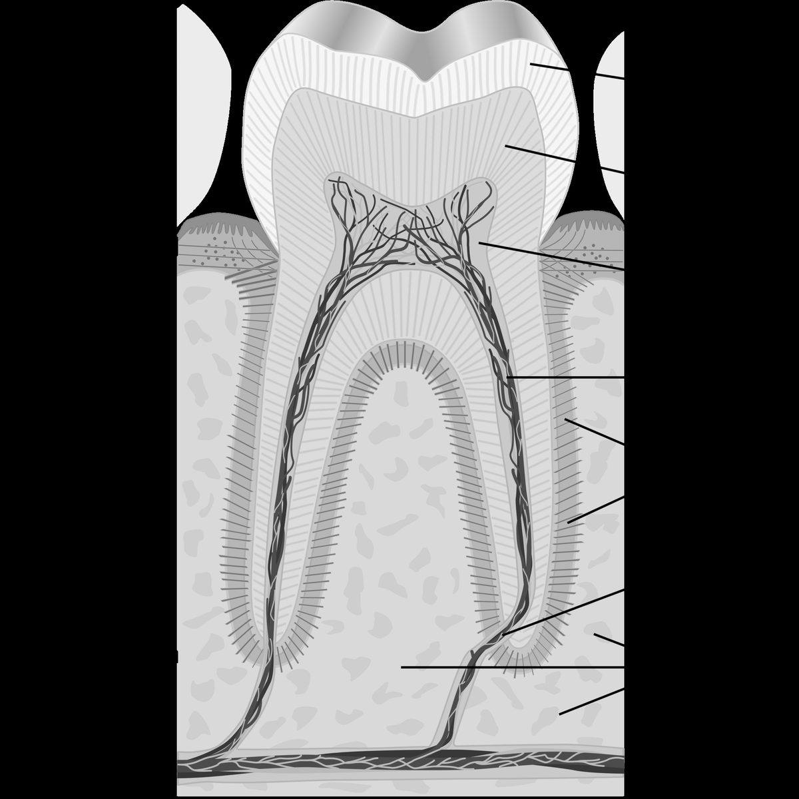

Фісури — це природні борозенки на жувальній поверхні молярів. Щетина щітки в глибину вузької фісури не входить, і наліт лишається там навіть у дитини, яку сумлінно дочищають. Герметик, або фісурит, — це тонкий матеріал, який затікає в чисту борозенку і закриває її від їжі. Він не покриває зуб «шапкою» з усіх боків і не замінює пасту.

Кокранівський огляд Ahovuo-Saloranta і співавторів порівнював герметики з відсутністю герметика на жувальних поверхнях постійних молярів. Висновок якісний і прямий: герметик запобігає карієсу саме на цих поверхнях. Він не є покриттям гладких стінок зуба і не лікує дірку, яка вже є між зубами. У Novadent фісурит коштує 300 гривень. Кабінет на вул. Гоголя 15 у Вінниці, лікар Голуб Олександр Олексійович. Консультація, на якій вирішують, чи потрібен герметик цьому зубу, безкоштовна.

## Кому він потрібен, а кому ні

Найзручніший час — незабаром після того, як постійний моляр прорізався і його жувальну поверхню вже можна тримати сухою. Перші постійні моляри зазвичай з’являються близько шести років, другі — близько дванадцяти, позаду молочних, тож батьки інколи не помічають їх за «останніми дитячими». Поки зуб наполовину під яснами, герметик не ляже: туди тече ясенна рідина. Тоді чекають кілька місяців і дивляться знову. Це не відмова, а технічна умова.

Герметик має сенс, коли фісури глибокі і в них легко затримується наліт, а карієсу з порожниною ще немає. Пігмент у борозенці лікар перевіряє зондом. М’яке дно — це вже не місце для тонкого лаку поверх гнилі, а порожнина під пломбу. Гладкі поверхні з боків зуба, шийки біля ясен і контакт між зубами герметиком не закривають. Там працюють щітка, фторпаста і, де тісно, нитка або йоршик.

Огляд, на який спирається Кокранівський висновок, зроблено для постійних зубів. Молочний моляр із глибокою фісурою дивляться окремо. Інколи його теж герметизують, інколи достатньо пасти і нагляду. Автоматично переносити висновок огляду на кожен молочний зуб не варто. Якщо у фісурі вже є порожнина, її закривають пломбою, а не тонким герметиком поверх розм’якшеного дентину.

<figure>

<figcaption>Жувальна поверхня має бути сухою, інакше герметик не тримається. Навчальне фото ізоляції. Автор: Albert, <a href="https://commons.wikimedia.org/wiki/File:Composite_resin_fillng_1.jpg" target="_blank" rel="noopener noreferrer">CC BY-SA 3.0</a>.</figcaption>
</figure>

## Як це роблять і чому зуб має бути сухим

Борозенку чистять, зуб тримають сухим і наносять матеріал, який потім твердне. Слина в цю хвилину заважає: герметик відшаровується краєм уже в кріслі або в найближчі тижні. Тому дитина має посидіти спокійно з відкритим ротом. Якщо сьогодні не виходить, процедуру переносять. Краще другий спокійний візит, ніж герметик, який зійшов до вечора. Знеболення для чистої фісури зазвичай не потрібне, бормашини теж. Анестезія в прайсі коштує 200 гривень і стосується лікування, яке вже глибше за герметик.

Після нанесення лікар перевіряє, чи не заважає новий шар змиканню. Дитина кусає, зайвий контакт прибирають. Їсти можна, коли зникне відчуття «плівки», про це скажуть у кріслі. Гірка на смак у день процедури буває від ізоляції і матеріалу. Вона минає і не означає, що зуб зіпсований.

Прицільний знімок перед герметиком потрібен не завжди. Якщо фісура сумнівна і є підозра, що карієс уже пішов у дентин, кадр на візіографі змінює план: тоді це пломба, а не герметик. Знімок у кабінеті коштує 100 гривень. Якщо борозенка явно ціла і зуб щойно прорізався, кадр «про всяк випадок» не додає рішення.

## Якщо шматочок відколовся

Герметик не вічний і не зрощений із зубом назавжди. Він може зноситися або відійти краєм. Тоді відкривається частина фісури, і наліт знову має кишеню, інколи навіть зручнішу, ніж була природна борозенка. Тому відколотий герметик не ігнорують і не вважають «ну, значить, не доля». На огляді його лагодять: втрачене місце чистять і закривають знову. Чекати, поки під залишком з’явиться дірка, якраз не треба.

Батькам не потрібно щовечора відколупувати шар «перевірити, чи тримається». Дивляться на прийомі і раніше, якщо дитина каже, що в борозенці знову застрягає м’ясо або край став гострим. Самостійно підклеювати зуб побутовим клеєм не можна.

Ціна 300 гривень стосується фісуриту в цьому кабінеті. Якщо під час огляду з’ясується, що потрібна пломба, кошторис буде іншим, і його назвуть до роботи. Прихованої заміни «герметик перетворився на велику реставрацію» без розмови бути не повинно.

<figure>

<figcaption>Герметик лежить на емалі жувальних борозенок. До дентину і нерва він не має стосунку, якщо порожнини ще немає. Автори схеми: Ian Furst, Goran tek-en, <a href="https://commons.wikimedia.org/wiki/File:Cross_sections_of_teeth_labels.png" target="_blank" rel="noopener noreferrer">CC BY-SA 3.0</a>.</figcaption>
</figure>

## Шестирічний моляр легко не помітити

Перший постійний моляр прорізується позаду останнього молочного, і жоден дитячий зуб перед цим не випадає. Батьки рахують звичний ряд і думають, що «нових немає». Проведіть чистим пальцем по яснах за молочними жувальними. Твердий горбик, якого місяць тому не було, і є той зуб, про який говорить Кокранівський огляд. Герметик на нього кладуть, коли жувальна поверхня вже вийшла достатньо, щоб її висушити, а не в день, коли з ясен здався лише ріжок.

Кілька молярів не обов’язково закривають за один слізний візит. Дві сухі хвилини на одному зубі кращі за чотири вологих. Огляд найчіткіше порівнює герметик із відкритою борозенкою. Якщо слину стримати не виходить, лікар або чекає, або обирає матеріал, який спокійніше ставиться до вологи. Це рішення в кріслі, не домашній набір із аптеки. На наступному огляді герметик дивляться так само, як край пломби. Темна лінія під цілим шаром не є наказом свердлити «про всяк випадок» і не є приводом махнути рукою: зонд відрізняє барвник, що зайшов під час нанесення, від м’якого дна.

## Паста і цукор нікуди не діваються

Герметик закриває одну вразливу геометрію зуба. Решта емалі як і раніше втрачає мінерали там, де наліт і цукор зустрічаються часто. Кокранівський огляд Walsh і співавторів стосується фторпасти: вона лишається щоденною профілактикою, спльовувати треба без полоскання водою. Настанова ВООЗ щодо вільних цукрів нагадує про частоту солодких напоїв. Сік у пляшці протягом дня обходить будь-який герметик по гладкій поверхні і між зубами.

Британський посібник Delivering better oral health ставить пасту, цукор і професійні засоби в один профілактичний набір, а не змагання «що з цього скасовує решту». Зуби з герметиком і далі чистять увечері фторпастою: герметик не замінює щоденне чищення.

Дорослий із глибокими фісурами і новими плямами теж може бути кандидатом, якщо борозенка ще без порожнини і її можна висушити. Вік «тільки для школярів» — зручний міф. Вирішує форма фісури і ризик, а не клас у школі. Якщо сусідній зуб уже лікували з тієї самої причини, про герметик на щойно прорізаному молярі варто запитати на тому самому візиті.

Запис за телефоном [075 177 75 67](tel:+380751777567). Будні з 9:00 до 18:00, субота з 9:00 до 15:00. Якщо дитина втомилася в черзі до іншого лікаря, герметизацію краще ставити окремим коротким візитом, а не «додамо в кінці, поки плаче». Суха фісура вимагає кількох спокійних хвилин.

Цей текст пояснює, навіщо закривають борозенки і чого герметик не замінює. Чи потрібен він конкретному зубу, видно лише в кріслі.

## Джерела

<ol class="blog-sources">
<li><a href="https://doi.org/10.1002/14651858.CD001830.pub5" target="_blank" rel="noopener noreferrer">Ahovuo-Saloranta A, Forss H, Walsh T, et al. Pit and fissure sealants for preventing dental decay in permanent teeth. Cochrane Database of Systematic Reviews. 2017</a>. Герметики запобігають карієсу на жувальних поверхнях постійних молярів порівняно з відсутністю герметика.</li>
<li><a href="https://doi.org/10.1002/14651858.CD007868.pub3" target="_blank" rel="noopener noreferrer">Walsh T, Worthington HV, Glenny AM, Marinho VCC, Jeroncic A. Fluoride toothpastes of different concentrations for preventing dental caries. Cochrane Database of Systematic Reviews. 2019</a>. Фторпаста лишається базовою профілактикою і не скасовується герметиком.</li>
<li><a href="https://www.gov.uk/government/publications/delivering-better-oral-health-an-evidence-based-toolkit-for-prevention" target="_blank" rel="noopener noreferrer">Office for Health Improvement and Disparities. Delivering better oral health: an evidence-based toolkit for prevention</a>. Паста, режим цукру і професійна профілактика доповнюють одне одного.</li>
<li><a href="https://www.who.int/publications/i/item/9789241549028" target="_blank" rel="noopener noreferrer">World Health Organization. Guideline: sugars intake for adults and children</a>. Часті вільні цукри підтримують карієс на поверхнях, які герметик не закриває.</li>
</ol>
