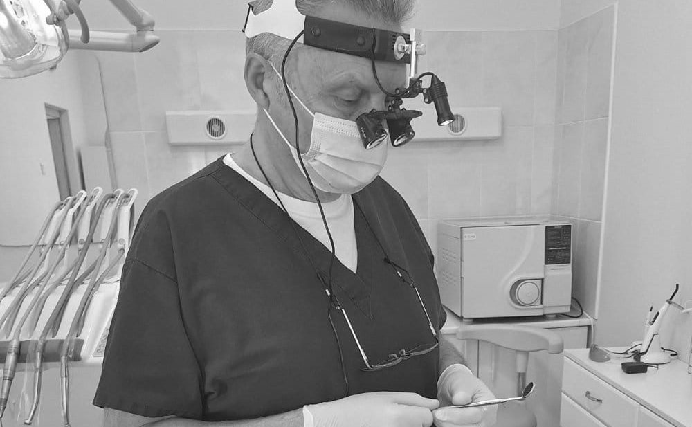
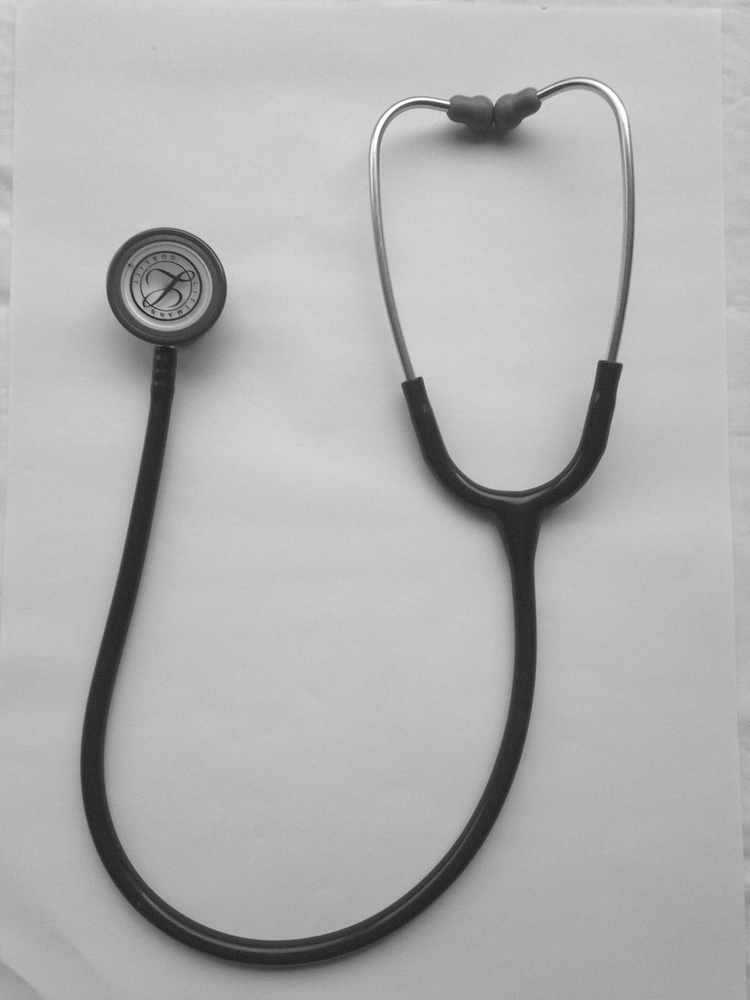

Кров на щітці і хвороба серця в розмовах часто склеюються в одну фразу: «почисти зуби, щоб не було інфаркту». Так говорити не можна. Консенсус Європейської федерації пародонтології і Всесвітньої федерації серця, який виклали Sanz і співавт. у 2020 році, описує інше. Пародонтит пов’язаний із серцево-судинними хворобами. Спільні ризики, зокрема куріння і діабет, сидять в обох історіях. Лікування ясен потрібне роту. Воно не показало себе способом запобігти інфаркту чи інсульту, і цей запис такої обіцянки не дає.

У кабінеті Novadent на вул. Гоголя 15 у Вінниці лікар Голуб Олександр Олексійович лікує зуби і ясна. Серце він не веде і препарати кардіолога не скасовує. Консультація безкоштовна. Якщо ви приймаєте аспірин або інший засіб, що впливає на згортання, скажіть про це на початку і не відміняйте його перед пломбою самотужки.

## Зв’язок є, наказу «чистка рятує серце» немає

Пародонтит — це запалення ясен, яке вже забрало частину кістки навколо кореня. Кишеня стає глибшою, зуб може хитатися, з ясен іде кров, запах тримається, навіть якщо людина чистить зуби. Дослідження багато разів бачили цей стан частіше в людей із хворобами серця і судин. Консенсус 2020 року фіксує асоціацію. Асоціація означає, що речі трапляються разом частіше, ніж випадково. Вона не означає, що ясна «викликають» інфаркт у конкретної людини і що зняття каменю цей інфаркт скасовує.

Чому вони трапляються разом, пояснюють частково спільними причинами. Куріння шкодить і судинам, і пародонту. Діабет теж сидить в обох розмовах: семінар EFP і AAP 2013 року описує двосторонній зв’язок діабету і пародонтиту, знову без простих відсотків для блогу. Вік, тиск, звичний спосіб життя додаються. Хронічне запалення вивчають як одну з можливих ланок, але для пацієнта практичний висновок уже зрозумілий із консенсусу. Рот лікують, бо це рот. Серце лікує кардіолог своїми засобами. Підміняти одне одним шкідливо в обидва боки: і коли людина не п’є призначене, «бо почищу зуби», і коли вона не лікує ясна, «бо серце все одно окремо».

Всесвітня організація охорони здоров’я в довідці про здоров’я порожнини рота ставить тютюн і діабет серед чинників, які погіршують рот, і не обіцяє, що гігієна замінить лікування серцево-судинної хвороби. Британський профілактичний посібник Delivering better oral health теж тримає ясна, тютюн і щоденну щітку як турботу про рот.

<figure>

<figcaption>Лікар Голуб Олександр Олексійович у кабінеті на вул. Гоголя 15. Серцеві ліки називають до лікування.</figcaption>
</figure>

## Кров на щітці лікують заради зубів

Привід прийти з яснами простий і місцевий. Кров під час їжі або чищення, набряклий край ясен, оголені шийки, неприємний запах, зуб, що почав хитатися, гній із кишені. Це заважає жувати і тримає запалення в кістці навколо кореня. Зондом вимірюють глибину борозни. Там, де зонд входить глибше і виходить із кров’ю, вже не «просто чутливі ясна», а кишеня, яку щітка зверху не вичищає. Камінь під яснами знімають у кабінеті. Домашня паста цей шар не розчиняє.

Після чищення ясна можуть кровлити кілька днів сильніше, ніж до неї: запалений край відповідає на дотик. Це не знак, що чистка «розбурхала серце». Це знак, що тканину потривожили там, де був наліт. Якщо набряк росте, біль не вщухає або піднімається температура, телефонують у кабінет, а не чекають, що «так і треба тиждень». Пломба поруч із запаленою яснами теж має сенс: дірка збирає наліт у те саме місце.

Жодного рядка тут не треба читати як профілактику інфаркту. Людина без серцевого діагнозу з кровоточивими яснами все одно потребує лікування ясен. Людина після стента з тихими яснами не отримує від стоматолога «індульгенції» і не припиняє ходити до кардіолога. Усний стан і кардіограма відповідають на різні питання.

## Аспірин і інші ліки перед пломбою не скасовують

Аспірин, клопідогрель та інші засоби, що впливають на згортання або на тиск, призначав лікар, який бачив серце. Перед звичайною пломбою або професійним чищенням їх не відміняють увечері «бо в стоматолога буде кров». Кров із ясен при пломбі місцева, її можна зупинити в кріслі. Скасована таблетка може бути небезпечнішою за цю кров. Рішення про перерву, якщо воно взагалі колись постає, належить лікарю, який призначив препарат, а не сусіду і не пам’ятці з форуму.

На консультації потрібні назви і дози, бажано списком. «П’ю від тиску» замало: від тиску бувають дуже різні ліки. Скажіть, якщо був інфаркт, стент, заміна клапана, якщо ви на антикоагулянті і хто веде цю схему. Для пломби і чищення цього зазвичай досить, щоб працювати, не чіпаючи схему. Видалення зуба — окреме рішення. Його не змішують із пломбою і не готують самостійною відміною ліків напередодні. Якщо видалення потрібне, лікар обговорить обсяг і, за потреби, узгодження з тим, хто веде серце. У цьому кріслі не роблять серцевих процедур і не змінюють кардіологічні дози.

Знеболення для пломби — місцева анестезія, у прайсі 200 гривень. Адреналін у складі деяких карпул інколи обговорюють при тяжких порушеннях ритму або неконтрольованому тиску. Це привід назвати діагноз, а не привід терпіти біль. Дозу і препарат обирають у кріслі. Якщо тиск у день візиту незвичайно високий і вам погано, скажіть до уколу.

<figure>

<figcaption>Серце і ясна ділять частину чинників ризику. Лікування ясен не замінює огляд серця, і навпаки. Фото: ICUnurses, <a href="https://commons.wikimedia.org/wiki/File:Stethoscope.jpg" target="_blank" rel="noopener noreferrer">CC BY-SA 4.0</a>.</figcaption>
</figure>

Прицільний знімок роблять, коли треба бачити кістку навколо кореня або глибину карієсу. Візіограф у кабінеті коштує 100 гривень. Він не показує судини серця і не замінює обстеження, яке призначив кардіолог.

Те, що лікар вимірює в роті, не є кардіограмою. Глибина кишень, кров на зонді, камінь під яснами і, якщо кадр змінить план, рівень кістки на знімку вирішують, як чистити і чи зуб ще тримає навантаження. Вони не оцінюють стент і не змінюють дозу препарату від тиску чи холестерину. Якщо кардіолог просить стоматологічний висновок перед своєю процедурою, в ньому описують, чи є в роті вогнище інфекції. Такий лист не обіцяє, що лікування ясен захистить серце. Він каже, що нарив не варто лишати поруч із запланованою операцією. Терміни узгоджують обидва лікарі. Аспірин заради «чистішого» листа пацієнт не скасовує сам.

Підсумок короткий. Ясна лікують, бо кровоточива кишеня і рухомий зуб — це хвороба рота. Серцеві ліки в день пломби п’ють як завжди, якщо кардіолог не сказав іншого. Куріння і діабет називають уголос: це спільний фон, а не привід для сорому. Запис за телефоном [075 177 75 67](tel:+380751777567), будні з 9:00 до 18:00, субота з 9:00 до 15:00.

Цей текст розрізняє зв’язок ясен і серця та лікування кожної хвороби окремо. Він не замінює кардіолога і не ставить діагноз.

## Джерела

<ol class="blog-sources">
<li><a href="https://doi.org/10.1111/jcpe.13189" target="_blank" rel="noopener noreferrer">Sanz M, Marco del Castillo A, Jepsen S, et al. Periodontitis and cardiovascular diseases: Consensus report. J Clin Periodontol. 2020</a>. Пародонтит пов’язаний із серцево-судинними хворобами. Лікування ясен не показане як спосіб запобігати інфаркту.</li>
<li><a href="https://www.who.int/news-room/fact-sheets/detail/oral-health" target="_blank" rel="noopener noreferrer">World Health Organization. Oral health</a>. Тютюн і діабет серед чинників гіршого стану порожнини рота. Довідка не обіцяє, що чищення зубів замінює лікування хвороби серця.</li>
<li><a href="https://doi.org/10.1111/jcpe.12077" target="_blank" rel="noopener noreferrer">Chapple ILC, Genco R. Diabetes and periodontal diseases: consensus report of the Joint EFP/AAP Workshop on Periodontitis and Systemic Diseases. J Clin Periodontol. 2013</a>. Діабет і пародонтит описані як двосторонній зв’язок, без чисел у цьому записі.</li>
<li><a href="https://www.gov.uk/government/publications/delivering-better-oral-health-an-evidence-based-toolkit-for-prevention" target="_blank" rel="noopener noreferrer">Office for Health Improvement and Disparities. Delivering better oral health: an evidence-based toolkit for prevention</a>. Профілактика хвороб ясен і відмова від тютюну потрібні роту самі по собі.</li>
</ol>
