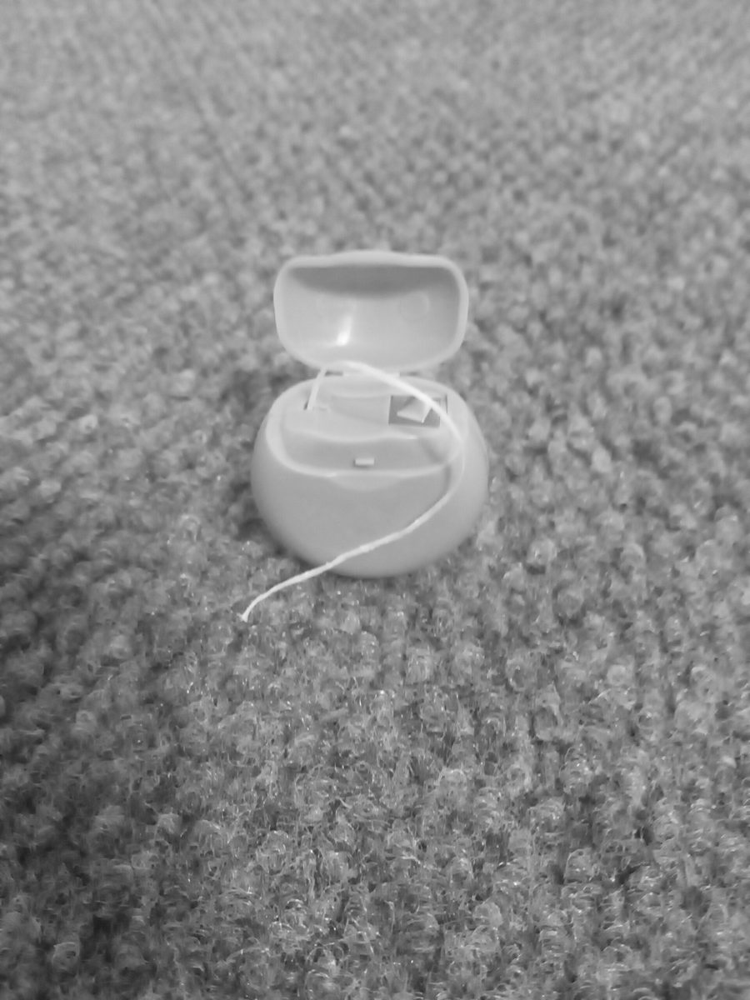

Неприємний запах з рота майже завжди народжується в самому роті. Наліт на спинці язика, м’який зубний наліт, запалені ясна і сухість дають леткі сполуки, які людина інколи відчуває сама, а інколи про них кажуть близькі. Шлунок у цій історії рідкісний гість. Поки рот не оглянутий, починати з таблеток «від кислоти» немає сенсу.

У Novadent це звичайна частина консультації, а не окремий соромний діагноз. Лікар-стоматолог вищої категорії Голуб Олександр Олексійович дивиться язик, ясна, старі пломби, кишені і те, як людина дихає ротом. Безкоштовна консультація у Вінниці на вул. Гоголя 15 якраз для такого спокійного розбору. Телефон кабінету — [075 177 75 67](tel:+380751777567).

## Звідки береться запах

Спинка язика шорстка. Між сосочками збираються залишки їжі і бактерії. Цей наліт часто дає запах навіть тоді, коли зуби виглядають цілими. Далі йде наліт на зубах, особливо між ними, куди щітка не дістає. Запалені ясна додають своє: кров, гній з кишені, камінь. Довідка Всесвітньої організації охорони здоров’я прямо пов’язує хворобу ясен із кровоточивістю, набряком, болем і іноді з неприємним запахом. У тяжчій формі ясна відходять від зуба, кістка зменшується, зуби розхитуються. Основні чинники, які називає ВООЗ, — погана гігієна і тютюн.

Сухість підсилює будь-який із цих запахів. Слина змиває наліт і розбавляє леткі речовини. Коли її мало — через рот уві сні, через ліки, через те, що людина мало п’є, — запах ранковий тримається довше. Вода протягом дня цю частину зменшує. Вона не замінює чистку, але без неї язик і ясна сохнуть швидше.

Цукор годує наліт. Настанова ВООЗ щодо вільних цукрів радить тримати їх нижче 10 відсотків енергії раціону, а за можливості — нижче 5. Для запаху важлива і кількість, і частота: солодкий напій між їжею знову запускає бактерії в нальоті. Карієс із порожниною, де застрягає їжа, теж пахне. Таку порожнину закривають пломбою, а не маскують ополіскувачем. Як влаштоване лікування, описано в записі [«Лікування карієсу і пульпіту»](2030-05-19-therapy.html).

<figure>

<figcaption>Ручна щітка прибирає наліт із зубів. Спинку язика чистять окремо і без натиску. Фото: Dwight Burdette, <a href="https://commons.wikimedia.org/wiki/File:A_Toothbrush.JPG" target="_blank" rel="noopener noreferrer">CC BY 3.0</a>.</figcaption>

</figure>

## Що зробити вдома

Язик чистять м’яко. Підійде м’яка щітка або окремий скребок, рух від кореня до кінчика, без зусилля до крові. Сильний натиск ранить сосочки і не дає чистішого результату. Достатньо кількох спокійних проходів. Якщо язик дуже чутливий, починають із передньої частини і йдуть далі, наскільки це зручно.

На прийомі дивляться саме цю спинку, лінію ясен і місця, де їжа стоїть між зубами. Якщо запах іде з кишені, спочатку прибирають камінь і наліт, а вже потім вирішують, чи потрібен ополіскувач. Якщо пахне порожнина, її закривають. Жодна з цих дій не є ліками для шлунка. Коли рот після цього справді чистий, а запах тримається тижнями, це якраз аргумент шукати причину в носі, мигдаликах або рефлюксі, а не купувати третю м’яту.

Зуби чистять фторованою пастою двічі на день. Кокранівський огляд Walsh і співавторів підтверджує, що паста з фтором попереджає карієс порівняно з пастою без фтору. Для запаху фтор не є «ароматизатором»: він тримає емаль, поки ви прибираєте наліт, який якраз і пахне. Британський набір Delivering Better Oral Health зводить щоденну профілактику до цього ж кістяка: фторована паста і регулярне механічне чищення, включно з проміжками між зубами.

Міжзубний проміжок — часте джерело запаху, бо там тихо гниє те, що щітка лишає. Нитка, йоржик або іригатор підбирають під ширину проміжку. Тісні зуби і широкі проміжки потребують різного інструмента. Кров на нитці в перші дні означає, що ясна запалені. Якщо кровоточивість не вщухає, коли наліт уже прибирають щодня, ясна лікують у кріслі, а не замінюють нитку на сильніший ополіскувач.

<figure>

<figcaption>Нитка дістає наліт між зубами, звідки часто йде запах. Фото: Texas Lane, <a href="https://commons.wikimedia.org/wiki/File:Dental_Floss.jpg" target="_blank" rel="noopener noreferrer">CC BY-SA 4.0</a>.</figcaption>

</figure>

## Ополіскувач лише додаток

Ополіскувач не вичищає язик і не дістає дно кишені. Він може на годину перебити запах або зменшити кількість бактерій у нальоті, який уже розпушено щіткою. Огляд James і співавторів у Cochrane дивиться хлоргексидин саме як додаток до механічної гігієни для контролю нальоту і гінгівіту. Користь у цьому огляді стосується ясен і нальоту. Звідси не випливає, що пляшка ополіскувача лікує хронічний запах, поки на язику лежить наліт, а в кишені — камінь.

У хлоргексидину є зворотний бік: при довгому використанні він фарбує зуби і змінює смак. Тому його не роблять щоденною водою на місяці. Короткий курс, якщо його порадив лікар на час лікування ясен, і постійне чищення щіткою — різні речі. Спиртові ополіскувачі підсушують рот. Сухість, як уже сказано, запах підсилює. Вода і жування під час їжі, яке зганяє слину, для сухості корисніші за різкий смак м’яти.

Протез і ортодонтична дуга тримають наліт так само, як зуби. Їх чистять окремо. Запах з-під погано промитого знімного протеза зникає разом із нальотом на базисі, а не від таблетки, покладеної в склянку «на ніч» без самого чищення.

## Коли рот здоровий, а запах лишається

Якщо язик чистий, ясна спокійні, порожнин немає, слина є, а запах усе одно стійкий, шукають джерело поза зубами. Ніс і приносові пазухи, мигдалики, шлунковий рефлюкс — це вже медичний огляд, не стоматологічна чистка. Стоматолог може сказати, що в роті причини не видно, і порадити звернутися до лікаря загальної практики або ЛОР-лікаря. Призначати ліки, які пригнічують кислоту шлунка, стоматолог не береться: це не його рецепт і не його контроль.

Приладів, які «вимірюють запах числом», у цьому тексті немає і в кабінеті на них рішення не будують. Поріг на такому приладі легко перетворити на іграшкову цифру. Практичне питання простіше: чи є наліт, кишені, сухість і карієс, і чи змінюється запах, коли це прибрано.

Тютюн дає власний запах і одночасно погіршує ясна. Відмова від нього покращує і слизову, і те, як пахне видих. Це підтримують і довідка ВООЗ, і профілактичний набір, про який ішлося вище. Кабінет не читає лекцій. На консультації про звичку питають так само, як про ліки.

Інколи запах здається сильнішим самому пацієнтові, ніж є насправді. Сухий рот, голод і тривога це підсилюють. Тоді огляд, який не знаходить ні нальоту, ні кишень, теж є відповіддю: привід для лікування зубів відсутній, і далі дивляться загальне здоров’я. Соромитися прийти через запах не потрібно. На прийомі це така сама скарга, як кровоточивість.

Якщо під запахом ховається біль зуба, набряк або температура, це вже не гігієна. Набряк із гарячкою, утруднене ковтання або дихання потребують відділення невідкладної допомоги, а не запису на чистку наступного тижня. Звичайний ранковий запах так не виглядає.

Цей текст пояснює звичайні ротові причини запаху і межу, за якою потрібен медичний огляд. Він не замінює консультацію.

## Джерела

<ol class="blog-sources">
<li><a href="https://www.who.int/news-room/fact-sheets/detail/oral-health" target="_blank" rel="noopener noreferrer">World Health Organization. Oral health. Fact sheet.</a> Хвороба ясен: кровоточивість, набряк, біль, іноді неприємний запах; гігієна і тютюн.</li>
<li><a href="https://www.who.int/publications/i/item/9789241549028" target="_blank" rel="noopener noreferrer">World Health Organization. Guideline: sugars intake for adults and children. Geneva: WHO; 2015.</a></li>
<li><a href="https://doi.org/10.1002/14651858.CD007868.pub3" target="_blank" rel="noopener noreferrer">Walsh T, Worthington HV, Glenny AM, Marinho VC, Jeroncic A. Fluoride toothpastes of different concentrations for preventing dental caries. Cochrane Database Syst Rev. 2019;CD007868.</a></li>
<li><a href="https://doi.org/10.1002/14651858.CD008676.pub2" target="_blank" rel="noopener noreferrer">James P, Worthington HV, Parnell C, et al. Chlorhexidine mouthrinse as an adjunctive treatment for gingival health. Cochrane Database Syst Rev. 2017;CD008676.</a></li>
<li><a href="https://www.gov.uk/government/publications/delivering-better-oral-health-an-evidence-based-toolkit-for-prevention" target="_blank" rel="noopener noreferrer">Office for Health Improvement and Disparities. Delivering better oral health: an evidence-based toolkit for prevention.</a></li>
</ol>
