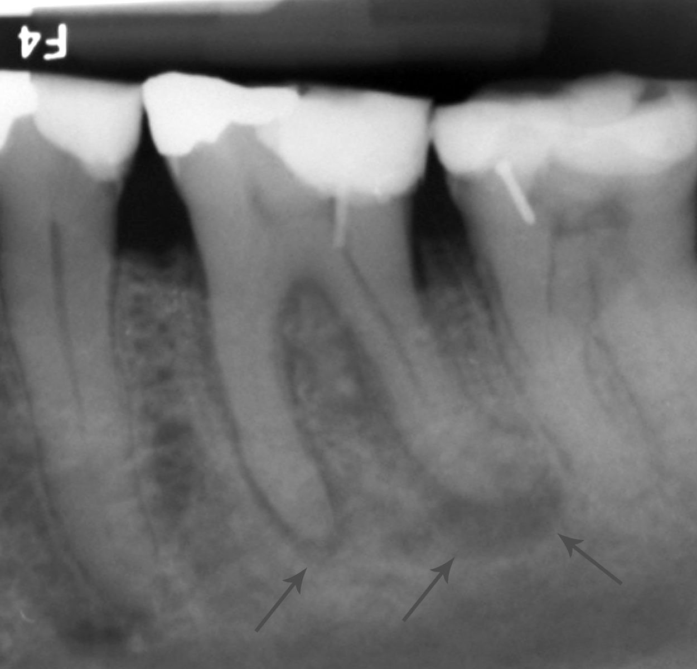

Зуб, який ниє вночі, хочеться закрити таблеткою. Часто цією таблеткою стає антибіотик, що лишився вдома або який порадили «пропити до стоматолога». Для пульпіту і для невеликого гнійника біля кореня це поганий план. Настанова Американської стоматологічної асоціації 2019 року, яку зібрали Lockhart і співавтори, каже прямо: антибіотик не рекомендують при пульпіті і при локальному верхівковому абсцесі, якщо зуб можна лікувати і немає поширеної інфекції чи загального залучення організму. Лікування тут означає те, що прибирає джерело: розкрити і дати відтік, пролікувати канали або видалити зуб.

Таблетка не дренує закриту пульпу. Гній і запалена тканина сидять усередині зуба або в кістці біля верхівки. Поки туди немає ходу, антибіотик у крові не випорожнює цю порожнину. Біль лишається, а наступний візит ускладнюється: складніше зрозуміти, що вже приймали, і легше отримати зайвий курс.

У Novadent такий зуб дивляться на прийомі, а не лікують перепискою. Лікар-стоматолог вищої категорії Голуб Олександр Олексійович з’ясовує, чи біль від холодного, чи він нічний, чи є набряк. Консультація безкоштовна. Кабінет у Вінниці на вул. Гоголя 15, телефон [075 177 75 67](tel:+380751777567).

## Що настанова відрізняє

Пульпіт — це запалення нерва всередині зуба. Він дає довгий біль, часто нічний, часто від гарячого. Локальний абсцес біля кореня — обмежене вогнище в кістці, інколи з припухлістю ясен над одним зубом. Якщо людина в іншому здорова, температура нормальна, набряк не розповзається по обличчю і зуб можна пролікувати або видалити, настанова радить не додавати антибіотик. Достатньо стоматологічної роботи і знеболення. Анестезія в цьому кабінеті коштує 200 грн. Як влаштовані пломба і канали, описано в записі [«Лікування карієсу і пульпіту»](2030-05-19-therapy.html).

Інша ситуація — коли інфекція пішла далі за зуб. Набряк, що росте і захоплює м’які тканини, температура, погане самопочуття, обмежене відкривання рота. Тоді антибіотик може бути частиною допомоги разом із невідкладним лікуванням зуба, а не замість нього. Доз і назв препаратів у цьому тексті немає. Їх не копіюють із минулого рецепта сусіда. Призначає лікар, який бачить людину і знає алергії.

На знімку локальне вогнище виглядає як темніша ділянка кістки біля верхівки кореня. Це ще не наказ «пити антибіотик». Це наказ лікувати зуб і розуміти, чи вогнище обмежене. Прицільний знімок на візіографі в кабінеті коштує 100 грн. Коли він потрібен і чим відрізняється від панорамного огляду, є в записі [«Знімок на візіографі»](2030-08-12-scan.html).

<figure>

<figcaption>Навчальний прицільний знімок: стрілки показують розрідження біля верхівок. Так виглядає вогнище біля кореня, його лікують у зубі. Автор: Coronation Dental Specialty Group, <a href="https://commons.wikimedia.org/wiki/File:Abscessed_tooth_periapical_radiograph.jpg" target="_blank" rel="noopener noreferrer">CC BY-SA 3.0</a>.</figcaption>

</figure>

## Коли це вже не «потерпіти до понеділка»

Набряк разом із температурою, біль і труднощі при ковтанні, відчуття, що важче дихати, — це відділення невідкладної допомоги того ж дня. Так виглядає інфекція, яка загрожує м’яким тканинам шиї і дихальним шляхам. Це не запис на пломбу наступного тижня і не привід допити домашній антибіотик «щоб спало». Якщо рот майже не відкривається, а набряк підіймається під око або під щелепу і наростає за години, чекати планового візиту небезпечно.

Після того як гостре минуло, зуб усе одно треба долікувати. Антибіотик, навіть якщо його дали в стаціонарі або в невідкладній допомозі, не пломбує канал і не прибирає порожнину. Джерело лишається. Через тижні біль може повернутися. Тому виписка з невідкладної допомоги — привід записатися до стоматолога, а не доказ, що зуб «уже вилікуваний уколами».

<figure>

<figcaption>На консультації з’ясовують, чи біль локальний, чи інфекція вже поширюється. Знімок ілюстративний.</figcaption>

</figure>

## Профілактика для серця — інше питання

Наукова заява Wilson і співавторів у Circulation (2021) теж про антибіотик, але не про зубний біль. Вона розглядає, кому перед деякими стоматологічними втручаннями взагалі доречна профілактика інфекційного ендокардиту. Йдеться про вузьку групу людей із найвищим ризиком тяжкого перебігу: наприклад, після протезування клапана або після вже перенесеного ендокардиту, і лише перед процедурами, які чіпають ясна, зону біля верхівки кореня або проходять крізь слизову. Це не схема «пропити щось від пульпіту». Людина без такої серцевої історії не отримує антибіотик лише тому, що в неї болить зуб.

Плутати ці дві розмови шкідливо в обидва боки. Хтось із протезом клапана може вирішити, що будь-який зубний біль лікується тією самою профілактичною таблеткою. Хтось без серцевої історії може почати курс «як після видалення в знайомого». На прийомі називають і біль, і серцеві операції, і алергію на антибіотики. Лікар розведе це на два різні рішення. Доз тут немає навмисно: і лікувальна, і профілактична схема залежать від людини, а не від абзацу в блозі.

Довідка Всесвітньої організації охорони здоров’я описує карієс як процес, який без лікування доходить до болю, втрати зуба й інфекції. Цукор, наліт і брак фтору годують цей шлях задовго до ночі, коли хочеться таблетку. Британський набір Delivering Better Oral Health зводить профілактику до фторованої пасти, чистих проміжків і рідшого цукру. Це не лікує вже запалений нерв. Це зменшує шанс наступного такого нерва. Коли біль уже є, дорога одна: огляд, знеболення, робота із зубом.

Маленький «прищик» на яснах над одним зубом і щільний набряк щоки — різні картини. Обмежений гнійник, який уже знайшов хід назовні, часто заспокоюється, коли хід відкривають і лікують сам зуб, без загального антибіотика, якщо температури немає і набряк не повзе далі. Щока, яка твердне і росте за кілька годин, до цієї мирної схеми не належить. Її не порівнюють із вчорашнім прищиком по телефону. Її дивляться, а при температурі й проблемі з ковтанням або диханням — у невідкладній допомозі.

На прийом приносять те, що вже встигли прийняти: коробку, блістер або хоча б назву й день, коли почали. Алергію на пеніцилін або будь-який інший антибіотик називають окремо від «мені від нього нудило». Нудота і висип ведуть до різних рішень, і плутати їх небезпечно. Старі знімки теж корисні, якщо вогнище біля кореня вже бачили рік тому.

Самостійно починати антибіотик «до понеділка» не варто навіть із доброї мотивації дотерпіти. Біль від закритої пульпи він часто не знімає. Зате наступний лікар отримує розмиту картину і вже витрачений курс. Знеболювальне, якщо його вам не забороняв свій лікар, на ці години чесніший за антибіотик. Чим відрізняється ібупрофен від парацетамолу і чого не роблять з опіоїдами, є в записі [«Знеболювальні при зубному болю»](2028-06-04-painkillers.html). Знеболювальне теж не замінює лікування. Воно дає дожити до крісла без зайвого антибіотика.

На консультації можна прийти з уже розпочатою упаковкою. Принесіть її або назву. Скасовувати чужий курс серед статті не будуть: якщо препарат призначив лікар через поширену інфекцію, його не кидають навмання. Якщо упаковку відкрили самі «від нерва», це теж кажуть, щоб не додати той самий клас ліків повторно і щоб не пропустити алергію.

Цей текст передає межу настанови ADA 2019 року і окремо пояснює профілактику ендокардиту. Він не призначає ліки і не замінює огляд.

## Джерела

<ol class="blog-sources">
<li><a href="https://doi.org/10.1016/j.adaj.2019.08.020" target="_blank" rel="noopener noreferrer">Lockhart PB, Tampi MP, Abt E, et al. Evidence-based clinical practice guideline on antibiotic use for the urgent management of pulpal- and periapical-related dental pain and intraoral swelling. J Am Dent Assoc. 2019;150:906–921.e12.</a></li>
<li><a href="https://doi.org/10.1161/CIR.0000000000000969" target="_blank" rel="noopener noreferrer">Wilson WR, Gewitz M, Lockhart PB, et al. Prevention of viridans group streptococcal infective endocarditis: a scientific statement from the American Heart Association. Circulation. 2021;143:e963–e978.</a></li>
<li><a href="https://www.who.int/news-room/fact-sheets/detail/oral-health" target="_blank" rel="noopener noreferrer">World Health Organization. Oral health. Fact sheet.</a></li>
<li><a href="https://www.gov.uk/government/publications/delivering-better-oral-health-an-evidence-based-toolkit-for-prevention" target="_blank" rel="noopener noreferrer">Office for Health Improvement and Disparities. Delivering better oral health: an evidence-based toolkit for prevention.</a></li>
</ol>
