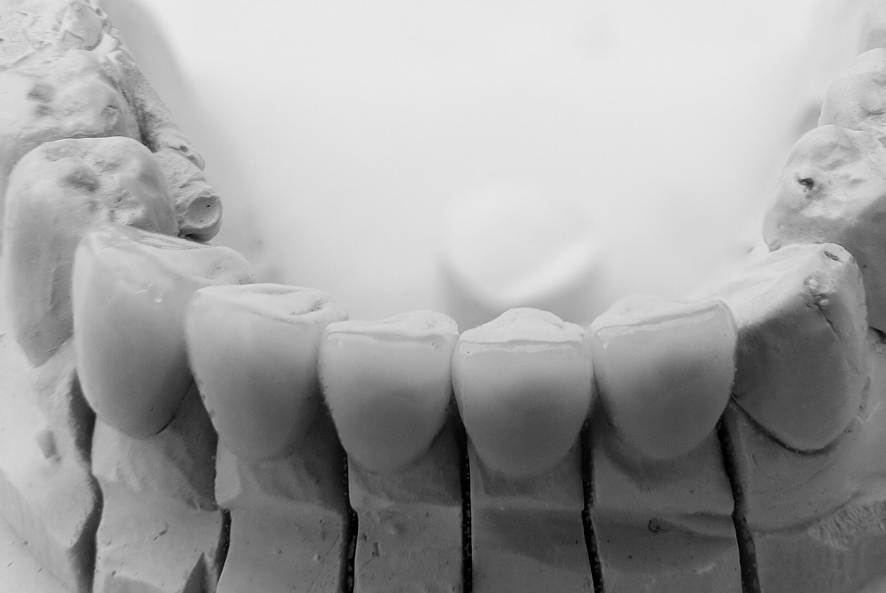
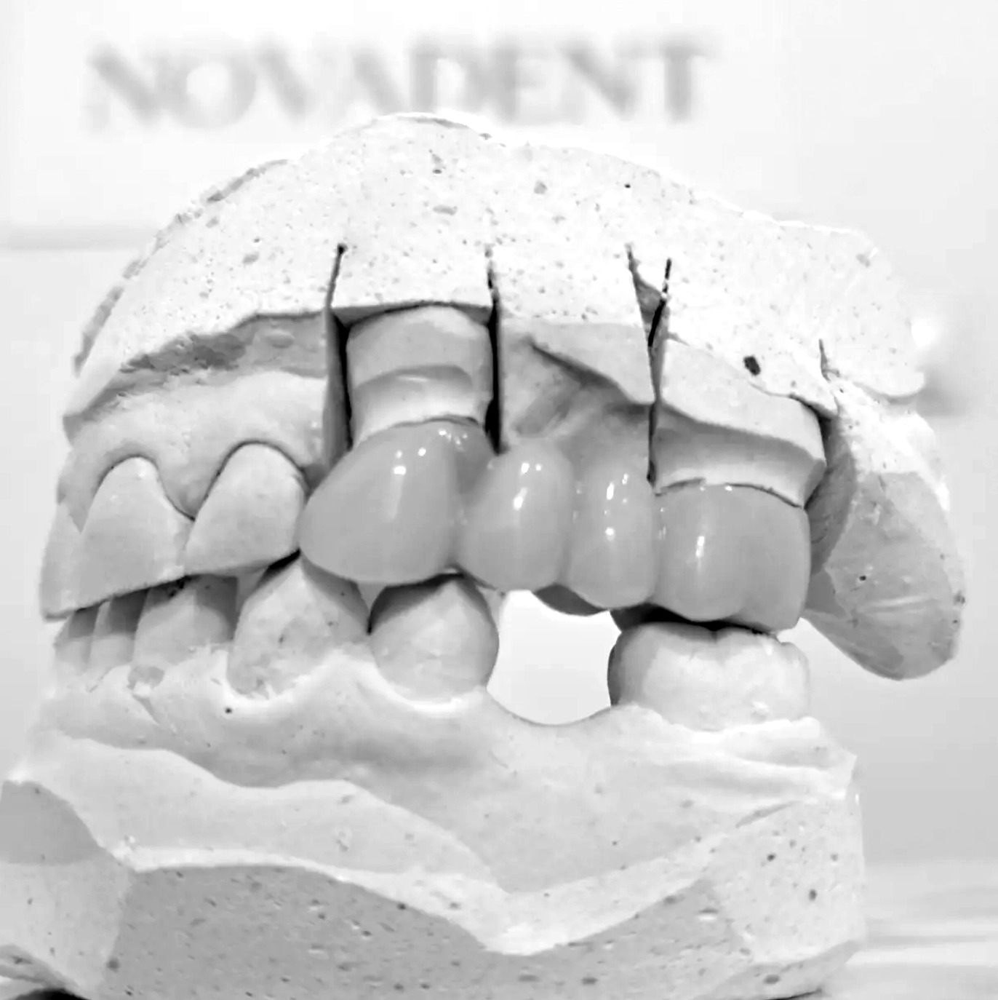

Спортивна капа закриває зуби в ту мить, коли обличчя зустрічає лікоть, м’яч, лід або кермо. Вона розподіляє удар і тримає губи від зубів. Всесвітня організація охорони здоров’я в фактологічній довідці про здоров’я порожнини рота називає захисне спорядження в спорті, на велосипеді й на мотоциклі одним зі способів зменшити ризик травм обличчя. Там само сказано, що ородентальна травма зачіпає близько мільярда людей, а серед дітей до 12 років її поширеність оцінюють приблизно у 20%. Це не відсоток «скільки саме капа віднімає». Окремої чесної цифри, на скільки відсотків індивідуальна капа ріже травму зубів у кожному виді спорту, цей текст не вигадує. Достатньо якісного формулювання: капа, яка сидить на місці, знижує ризик травми зубів.

Американська стоматологічна асоціація в темі про капи розрізняє три типи. Сторінка з цим розбором на сайті ADA на момент написання не відкривається, тому далі типи описані якісно, а клікабельне джерело щодо травми зубів — настанова Міжнародної асоціації дентальної травматології. У Novadent на вул. Гоголя 15 лікар Голуб Олександр Олексійович на безкоштовній консультації дивиться прикус і пояснює, чим спортивна капа відрізняється від нічної. Сам кабінет виготовляє коронки і знімні протези. Капу для матчу тут не плутають із лікувальною шиною і не ставлять у прайс «за замовчуванням».

## Три типи, і вони не рівні

Готова капа з полиці має один або два розміри. Вона товста, її доводиться утримувати стиснутими зубами, вона заважає дихати і говорити. На полі така капа часто висить у руці, а не в роті. Для контактного спорту це слабкий варіант.

Капа «зваріть і прикусіть» — компроміс. Заготовку розм’якшують у гарячій воді і прикушують. Якщо форму зняти обережно, вона тримається краще за магазинну болванку. Якщо прикусити занадто сильно, пластик стає тонким саме там, де потрібна товщина, і сидить криво. Для рідкого тренування дорослого з рівними зубами це інколи прийнятний тимчасовий крок. Для дитини, для брекетів, для вже стоячих коронок і для спорту, де удар імовірний щотижня, компроміс швидко закінчується.

Індивідуальну капу роблять за відбитком зубів. Вона повторює дугу, край ясен і те, як змикаються щелепи. Її не треба притримувати щелепою. Можна сказати коротку фразу партнеру і вдихнути. Саме посадка відрізняє її від двох попередніх: капа, яка злітає на першому ривку, захисту не дає, хоч би що було написано на коробці. Товщина теж має межу. Капа, через яку не зімкнути губи, випадає саме в сутичці. Індивідуальна робота лишає матеріал навпроти передніх зубів і не роздуває піднебіння. Готову капу «на виріст» дитині не беруть: вільний пластик не тримає зуб і створює враження, що захист уже лежить у сумці.

<figure>

<figcaption>Індивідуальну капу, як і коронку, планують на моделі зубів: важливі край, товщина і те, як змикаються щелепи. Фото: Bin im Garten, <a href="https://commons.wikimedia.org/wiki/File:VMK-Krone_Dental_crown_Focus_stacking_with_freeware_CombineZP_02.jpg" target="_blank" rel="noopener noreferrer">CC BY-SA 3.0</a>.</figcaption>
</figure>

## Спортивна капа не є нічною шиною

Нічний скрегіт і стискання — це діяльність жувальних м’язів уві сні або вдень. Консенсус Lobbezoo і співавторів (Journal of Oral Rehabilitation, 2018) описує бруксизм саме так: повторна м’язова активність, а не «хворий суглоб» і не спортивний удар. Капа на ніч, якщо її взагалі роблять, інша за товщиною, за часом носіння і за задачею. Вона може захистити зуби від стирання і інколи зменшити м’язовий біль. Спортивна капа розрахована на короткий епізод гри.

Спати в спортивній капі, особливо в м’якій «зваріть і прикусіть», не варто. Під час стискання м’який пластик просідає, і за місяці прикус може змінитися. Жорстка нічна шина теж не замінює захист на майданчику: вона не розрахована на удар м’яча і зазвичай не закриває зуби так, як це потрібно в контакті. Якщо болить суглоб або стерлися ріжучі краї, це окрема розмова, її логіка розібрана в записі про [біль у скронево-нижньощелепному суглобі](2028-09-28-tmd.html). На консультації ці дві капи називають різними словами, щоб людина не купила одну «на все».

## Кому вона доречна

Контакт і зіткнення: єдиноборства, бокс, хокей, баскетбол, регбі, футбол, гандбол. Сюди ж падіння з велосипеда, самоката, скейтборда, лиж, коли обличчя зустрічає покриття. Дитяча секція, де «ніхто сильно не б’є», все одно дає лікті і м’ячі на рівні рота. ВООЗ якраз згадує дитячий вік, коли травма зубів особливо часта.

Капа працює, коли вона в роті в момент епізоду. Тренерське правило «надіти перед грою і не знімати на лаві» корисніше за найдорожчий матеріал у сумці. Ортодонтичний апарат і нова коронка змінюють форму дуги: стара капа тоді або тисне, або не тримається. Після цементування коронки в цьому кабінеті про захист на секції варто сказати одразу, а не в сезон, коли капа вже не налазить.

Людині з частковим знімним протезом на час контакту протез зазвичай знімають, а питання капи вирішують за тими зубами, що лишилися. Повний протез на полі не є захистом. Імплантатів у Novadent не ставлять, і спортивна капа не є приводом обіцяти їх. Якщо зубів уже мало, спочатку дивляться, чим людина жує в будень, і лише потім — чим закрити обличчя на тренуванні.

<figure>

<figcaption>Модель із кабінету: так перевіряють форму коронок до фіксації. Індивідуальна капа теж починається з відбитка, а не з універсального розміру.</figcaption>
</figure>

## Догляд і заміна

Капу промивають прохолодною водою і м’яким милом, сушать і кладуть у коробку з отворами. Окріп і посудомийна машина жолоблять термопластик. Паста для зубів дряпає поверхню, у подряпині лишається слина і запах. Чужою капою не користуються: на ній кров і слина, навіть якщо гравець «просто позичив на тайм».

Міняють капу, коли вона порвана, прокушена наскрізь, стала вільною або, навпаки, тисне на ясна. У дитини привід частіший: міняються зуби, росте щелепа, з’являються і знімаються апарати. Дорослий теж перевіряє посадку раз на сезон, а після пломби на передньому зубі — одразу. Капа, яку доводиться підкручувати язиком, уже не та, яку робили.

Перед грою її не кип’ятять «для дезінфекції» і не залишають на сонці в закритому авто: форма пливе. Якщо після удару капа розкололася, а зуб хитнувся або вийшов із лунки, далі діє логіка травми, а не покупка нової капи. Вибитий постійний зуб везуть до лікаря того ж дня. Молочний у лунку не повертають. Це розписано окремо, і капа цієї допомоги не скасовує: вона зменшує шанс, що допомога знадобиться.

Запис на розмову про прикус і захист — [075 177 75 67](tel:+380751777567). Вінниця, вул. Гоголя 15. Консультація безкоштовна. На неї можна принести ту капу, яка вже є: по ній видно, тримається вона чи лише займає місце в шоломі.

Текст описує типи кап і межу між спортивним захистом і нічною шиною. Він не обіцяє конкретного відсотка зниження травм і не замінює огляд після удару.

## Джерела

<ol class="blog-sources">
<li><a href="https://www.iadt-dentaltrauma.org/" target="_blank" rel="noopener noreferrer">International Association of Dental Traumatology. Матеріали щодо дентальної травми. Американська стоматологічна асоціація в темі про капи розрізняє індивідуальну, термоформовану («зваріть і прикусіть») і готову капу; типи тут описані якісно.</a></li>
<li><a href="https://www.who.int/news-room/fact-sheets/detail/oral-health" target="_blank" rel="noopener noreferrer">World Health Organization. Oral health. Fact sheet, 17 March 2025. Ородентальна травма: близько 1 мільярда людей, поширеність близько 20% у дітей до 12 років; захисне спорядження в спорті, на велосипеді й мотоциклі зменшує ризик травм обличчя.</a></li>
<li><a href="https://doi.org/10.1111/joor.12663" target="_blank" rel="noopener noreferrer">Lobbezoo F, Ahlberg J, Raphael KG, et al. International consensus on the assessment of bruxism: report of a work in progress. J Oral Rehabil. 2018;45:837–844.</a></li>
</ol>
