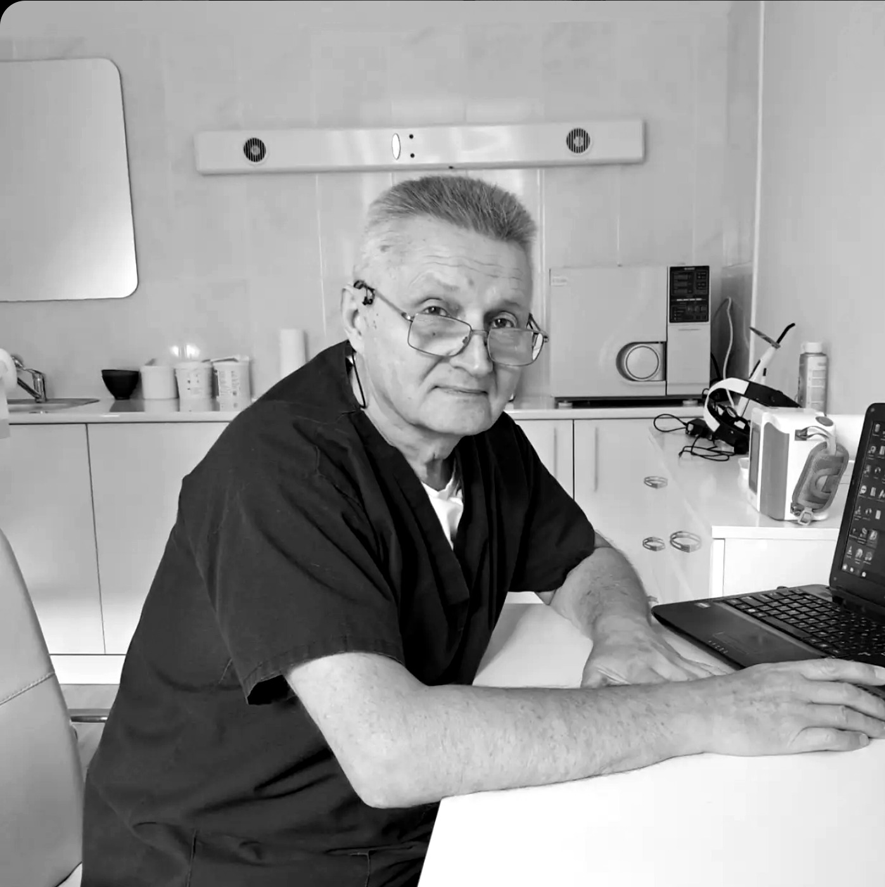

Біль біля вуха, втома жувальних м’язів до вечора і клацання, коли рот відкривається, часто звалюють в одну «проблему суглоба». Діагностичні критерії DC/TMD (Schiffman і співавт., Journal of Oral & Facial Pain and Headache, 2014) розкладають це на різні стани. Є біль м’язів. Є біль самого суглоба. Є зміщення диска, яке дає клацання, інколи зовсім без болю. Лікування з цього і починається: спочатку називають, що болить, і лише потім вирішують, чи чіпати зуби.

У більшості людей перший крок оборотний. Пояснення, коротка м’яка їжа, тепло, зуби нарізно вдень, короткий протизапальний засіб, якщо його дозволяє загальне здоров’я, і вправи, які показує лікар або фізіотерапевт. Зішліфувати горби «щоб суглоб став на місце» на старті не потрібно. Це незворотна зміна зуба, а біль часто сидить у м’язі.

Прийом у Novadent веде лікар Голуб Олександр Олексійович. Консультація безкоштовна. Кабінет у Вінниці на вул. Гоголя 15, телефон [075 177 75 67](tel:+380751777567). Тут дивляться зуби, які вже стерлися або болять від стискання, і можуть запропонувати нічну капу як захист. Імплантатів у цьому кабінеті не ставлять, і «переробити прикус на штифтах» не є планом при клацанні.

## М’яз, суглоб і клацання

М’язовий біль відчувається в щоці, виску, інколи віддає в зуб так, що хочеться лікувати канал у здоровому зубі. Вранці щелепа ніби натруджена. Натискання на м’яз відтворює знайомий біль. Суглобовий біль точніший: він сидить просто перед вухом, посилюється, коли палець лягає на суглоб, а рот відкривається. Обидва варіанти можуть існувати разом. DC/TMD якраз для того, щоб не назвати все це одним словом.

Клацання найчастіше означає, що диск у суглобі на мить зміщується і повертається. Якщо рот відкривається повністю, біль не наростає і людина їсть як звикла, таке клацання рідко потребує лікування. Його пояснюють і залишають у спокої. Полювання за тишею в суглобі через обточування зубів або довгу шину «доки не клацне востаннє» легко створює нову проблему: змінений прикус і біль у м’язах, які до цього мовчали.

Інша історія, коли клацання зникло, а рот раптом відкривається на два пальці і далі не йде. Тоді диск може не повертатися. Це привід прийти скоро, а не тижнями розтягувати щелепу саморобними вправами з інтернету. Чим свіжіше обмеження, тим спокійніше його дивляться.

<figure>

<figcaption>Скаргу на суглоб спочатку розкладають на біль м’яза, біль суглоба і клацання. Фото ілюстративне: це не прийом у кабінеті Novadent.</figcaption>
</figure>

## Що роблять на початку

Людині пояснюють, що щелепа не «вийшла з ладу назавжди» лише через клацання або ранкову втому. Цього пояснення часто бракує, і без нього будь-яка капа здається ліками від хвороби, якої не назвали. Кілька днів їжу ріжуть дрібно. Горіхи, жорстке м’ясо і великі бутерброди, які треба відривати зубами, відкладають. Жувальну гумку прибирають на цей період: вона тренує той самий м’яз, який уже болить.

Удень зуби не стискають. Між зубами лишається трохи вільного місця, губи стулені, язик спокійний. Це не «виправити прикус силою волі назавжди», а коротка звичка, яка знімає навантаження з м’яза в ті години, коли людина працює за комп’ютером або керує автівкою. Багато хто впізнає себе саме вдень, а не вночі. Консенсус щодо бруксизму (Lobbezoo і співавт., 2018) окремо описує денну і нічну активність м’язів. Денне стискання людина інколи може помітити. Нічне вона зазвичай лише здогадується за стертими зубами і вранішнім болем.

Тепло на щоку на 10–15 хвилин заспокоює частину м’язового болю. Лід доречний коротко після явного перенавантаження, не як режим на місяць. Протизапальний засіб коротким курсом можливий, якщо його не забороняють шлунок, нирки, вагітність, інші ліки і алергія. Дозу в цій статті немає: її узгоджують з тим, що людина вже п’є. Фізіотерапевт або лікар показує м’які рухи в безболісному діапазоні. Розтягувати рот до клацання через силу не потрібно.

Зішліфування зубів, щоб «вирівняти всі контакти», не є першим кроком. Його не чим замінити, якщо емаль уже зняли. Спочатку дивляться, чи стихає біль від режиму, тепла і часу. Багато епізодів м’язового болю якраз стихають. Якщо ні, план переглядають, а не автоматично переходять до коронок на всі зуби.

## Коли приходити швидше

Рот не відкривається, або відкривається криво і з кожним днем менше. Щелепа закрилася і не розмикається. Біль гострий після удару, набряк перед вухом, температура. Обличчя раптом стало асиметричним не від «втоми», а після травми. Усе це не чекає планової консультації через три тижні.

Те саме стосується зуба, який болить на накушування і не дає спати. Суглоб рідко будить людину о другій ночі гострим зубним болем. Такий біль частіше належить пульпі або тріщині, і його дивляться окремо, зі знімком. Прицільний кадр у кабінеті допомагає не сплутати верхівку кореня з виском. Панорама для цього занадто оглядова.

Якщо біль тримається попри щадний режим кілька тижнів, або відкривання стійко обмежене, лікар може скерувати до колеги, який займається болем обличчя щодня. Це не поразка плану. Це межа того, що чесно лікувати в загальному кріслі пломбою і капою.

<figure>

<figcaption>Лікар Голуб Олександр Олексійович у кабінеті на вул. Гоголя 15. Нічну капу тут обговорюють після огляду, як захист зубів, а не як обіцянку прибрати клацання.</figcaption>
</figure>

## Нічна капа

Капа на ніч може зменшити частину м’язового болю і вберегти зуби, які вже стираються один об одного. Вона не лікує диск і не вимикає бруксизм. Lobbezoo і співавтори наголошують, що сам бруксизм — це діяльність м’язів. Її не «видаляють» шматком пластмаси. Капа змінює те, як зуби зустрічаються, поки м’яз працює, і забирає на себе частину стирання.

Тому обіцянка «проносите місяць, і суглоб здоровий» була б нечесною. Комусь стає легше за дні. Комусь капа лише захищає емаль, а біль лишається і потребує іншого кроку: режиму, фізіотерапії, розбору денного стискання. Комусь жорстка капа навіть посилює стискання. Тоді її не героїчно доношують, а приходять і кажуть про це.

Спортивна капа з магазину для ночі не годиться. Вона м’яка, товста не там і розрахована на годину гри. Про різницю є окремий запис [«Капа для спорту»](2028-08-21-mouthguard.html). Нічну капу, якщо вона доречна, роблять за відбитком, перевіряють контакти і дивляться за кілька тижнів, чи біль змінився. Паралельно дивляться стерті зуби: якщо емалі вже немає і дентин болить на холод, розмова переходить до реставрації, а не лише до шини. Коронки в цьому кабінеті роблять, коли своєї тканини не вистачає. Покрити всі зуби «від суглоба» без болю і без зносу не пропонують.

На прийом корисно прийти з коротким описом: коли болить, чи клацає, чи відкривається рот на три пальці, чи стискаєте зуби вдень, які ліки вже п’єте. Консультація безкоштовна і ні до чого не зобов’язує. Телефон [075 177 75 67](tel:+380751777567).

Текст розрізняє біль м’язів, біль суглоба і безболісне клацання за критеріями DC/TMD. Він не замінює огляд, якщо рот не відкривається.

## Джерела

<ol class="blog-sources">
<li><a href="https://doi.org/10.11607/jop.1151" target="_blank" rel="noopener noreferrer">Schiffman E, Ohrbach R, Truelove E, et al. Diagnostic Criteria for Temporomandibular Disorders (DC/TMD) for Clinical and Research Applications: recommendations of the International RDC/TMD Consortium Network and Orofacial Pain Special Interest Group. J Oral Facial Pain Headache. 2014;28:6–27.</a></li>
<li><a href="https://doi.org/10.1111/joor.12663" target="_blank" rel="noopener noreferrer">Lobbezoo F, Ahlberg J, Raphael KG, et al. International consensus on the assessment of bruxism: report of a work in progress. J Oral Rehabil. 2018;45:837–844.</a></li>
</ol>
