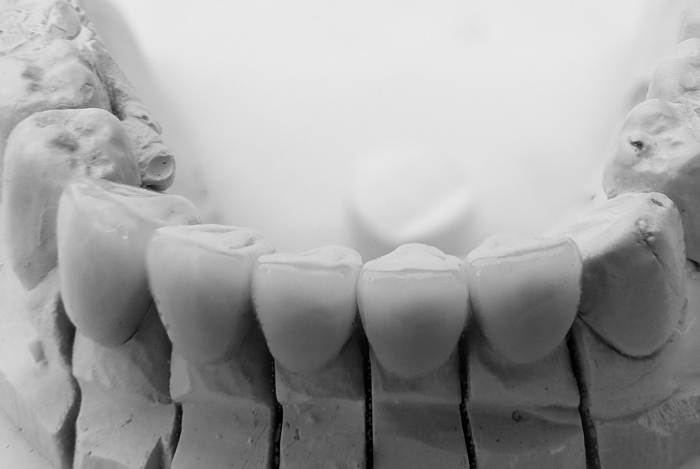

Зуб коротшає не з однієї причини. Емаль і дентин зникають від тертя зуба об зуб, від кислоти без участі бактерій і від стороннього тертя щіткою, пастою або предметом, який людина тримає в зубах. Часто все це змішане, і на одному різці видно одразу два сліди. Покрити такий зуб коронкою, не знайшовши кислоту або скрегіт, означає поставити нову поверхню в ту саму мішанку.

Lussi і Carvalho (Monographs in Oral Science, 2014) описують ерозивне стирання як зростаючу практичну проблему саме тому, що кислота і механічне зношування підсилюють одне одного. Розм’якшена кислотою поверхня стирається тим, що здорову емаль лише полірує. Тому розмова починається з історії, а не з прайсу коронок.

У Novadent коронки роблять, коли своєї стінки вже не вистачає для жування. Поки форма лише намітилася, її фотографують або знімають на модель і дивляться в динаміці. Лікар Голуб Олександр Олексійович приймає у Вінниці на вул. Гоголя 15. Консультація безкоштовна, телефон [075 177 75 67](tel:+380751777567). Імплантатів тут не ставлять: стирання лікують на тих зубах, які є.

## Три різні втрати

Стирання зуба об зуб називають аттрицією. Плоскі майданчики на жувальній поверхні збігаються з майданчиками зубів-суперників, коли щелепи стулити. Краї різців стають рівними, ніби їх підпиляли однією лінією. Поруч часто є втомлені жувальні м’язи або ранковий біль біля вуха. Це вже розмова про те, що м’язи працюють сильніше, ніж людині здається вдень. Міжнародний опис бруксизму (Lobbezoo і співавт., Journal of Oral Rehabilitation, 2018) називає його повторною діяльністю жувальних м’язів: стискання, скрегіт, упирання щелепою, уві сні або наяву. Сам по собі він не діагноз «хворий зуб». Він стає проблемою, коли від нього коротшає емаль або болить м’яз. Окремо про цю звичку є запис [«Скрегіт зубами»](2027-02-03-bruxism.html).

Ерозія — це кислота без карієсу. Бактерії тут не обов’язкові. Поверхня стає гладкою, блискучою, ніби оплавленою. На жувальних зубах з’являються чашоподібні заглибини, горби округлюються, а пломби починають стирчати над зубом, бо емаль навколо них зникла, а пломба лишилася. Кислота буває ззовні: газована вода, спортивні напої, вино, часте смоктання цитрусових, оцет. І зсередини: повернення кислоти зі шлунка, часте блювання, деякі розлади харчової поведінки. Друге людина не завжди називає на першому реченні, а для зубів воно важливе не менше за лимонад. Як кислота діє на емаль, розібрано в записі [«Кислота і емаль»](2028-01-27-erosion.html).

Абразія — слід стороннього тертя. Жорстка щітка з сильним тиском, абразивна паста, звичка гризти олівець, нитку, ніготь або тримати шпильки зубами лишають виїмку біля ясен або плоский фасет там, де емаль і так тонка. Клиноподібний дефект біля шийки часто збирає кілька механізмів одразу. Називати його лише «від щітки» або лише «від прикусу» до огляду рано.

<figure>

<figcaption>Емаль тонка на ріжучому краї й біля шийки. Коли вона зникає, дентин стирається швидше, а пульпа виявляється ближче до поверхні. Схема: Ian Furst, Goran tek-en, <a href="https://commons.wikimedia.org/wiki/File:Cross_sections_of_teeth_labels.png" target="_blank" rel="noopener noreferrer">CC BY-SA 3.0</a>.</figcaption>
</figure>

## Кислота і скрегіт разом

Чиста картина з підручника трапляється рідше, ніж суміш. Людина п’є кислий напій малими ковтками годину і вночі ще й стискає зуби. Вдень поверхня розм’якшується, вночі зуби її знімають. Окремо кожен епізод здавався б дрібницею. Разом за кілька років ріжучий край стає прозорим, а потім обламується.

Тому пошук причини практичний. Щоденник на тиждень часто показовіший за суперечку в кріслі: скільки кислих напоїв, чи п’ють їх ковтками через трубочку чи полощуть у роті, чи є печія, чи прокидається людина зі стиснутими зубами. Печію і блювання має бачити і лікар загальної практики. Стоматолог закриє дентин, але кислоту зі шлунка пломба не вимкне. Нова поверхня в кислому роті зітреться знову.

Карієс тут ні до чого плутати. Карієс розм’якшує зуб у місці нальоту і цукру, часто в фісурі або між зубами, і зондом там є шорсткість. Ерозія блищить і болить на холод широким полем, без дірки, в яку застрягає їжа. Лікують їх по-різному. Фторована паста потрібна в обох випадках, але при ерозії до неї додають інше: прибрати часту кислоту і не чистити зуби жорсткою щіткою в перші хвилини після кислого напою, коли поверхня ще м’яка. Досить сполоснути водою і зачекати.

Скрегіт без кислоти дає рівні фасети і рідко «оплавлені» горби. Кислота без скреготу дає гладкі чаші і короткі передні зуби, які не обов’язково збігаються площина в площину. Коли є і те, і те, у картці пишуть обидва слова. Інакше коронка отримає вину за знос, який продовжує пацієнт щовечора.

## Спочатку міряти, потім покривати

Поки чутливість терпима, а висота зубів ще тримає прикус, розумне спостереження. Фотографія в одному ракурсі або гіпсова модель раз на рік показує, чи процес іде. Пам’ять «мені здається, стало гірше» підводить: знос повільний. Знімок або модель не зобов’язує одразу до коронок. Вони якраз дозволяють не покривати все, поки втрата дрібна.

Коли дентин уже відкритий і реагує на холод, втрачену форму часто можна повернути додаванням, а не ковпачком. Композит нарощують на ту тканину, що лишилася, без значного зішліфування. Це оборотніше за коронку. Матеріал з часом стирається і сколюється, його підновлюють. Для людини, в якої кислота ще не прибрана, така починка чесніша за шість коронок, які доведеться міняти з тієї самої причини.

Коронка доречна, коли коронкової частини майже не лишилося, стінки не тримають пломбу, або зуби вже не зустрічаються так, щоб жувати. У цьому кабінеті роблять литі, металокерамічні, прес-керамічні та цирконієві коронки. Матеріал обирають за місцем зуба і за тим, скільки тканини доведеться зняти. Детальніше про це є запис [«Коронка на зуб»](2030-06-23-crowns.html). Покриття «всіх верхніх одразу для краси рівного краю» без болю і без втрати функції тут не є стандартним планом.

<figure>

<figcaption>Коронки на моделі мають сенс, коли своєї тканини вже мало. Поки знос лише почався, ту саму модель використовують, щоб порівняти форму через рік, а не щоб одразу все обточити. Фото: Bin im Garten, <a href="https://commons.wikimedia.org/wiki/File:VMK-Krone_Dental_crown_Focus_stacking_with_freeware_CombineZP_02.jpg" target="_blank" rel="noopener noreferrer">CC BY-SA 3.0</a>.</figcaption>
</figure>

## Що змінити в той самий тиждень

Кислий напій п’ють під час їжі, а не цілий вечір маленькими ковтками. Вода між прийомами їжі доречніша за спортивний напій «для бадьорості». Жувати лимон і тримати вино в роті перед тим, як ковтнути, для емалі гірше, ніж сам факт десерту. Після кислого рот споліскують водою. Жорстку щітку міняють на м’яку, тиск зменшують: розчепірена щетина якраз малює абразію біля ясен.

Якщо зуби стискаються вдень, про це говорять прямо. Коротке нагадування «зуби нарізно» в робочі години зменшує аттрицію не гірше за розмову про дорогу шину. Нічна капа може захистити те, що ще залишилось, але вона не вимикає м’яз і не прибирає кислоту. Її місце в плані з’являється після того, як причину названо. Клацання без болю і без зносу само по собі не є показанням стерегти всі зуби коронками.

На консультації корисно принести список напоїв і сказати про печію, якщо вона є. Лікар подивиться, чи процес активний, чи це старий слід, і назве варіанти: спостереження, нарощування, коронка на окремий зуб. Кошторис після цього відрізняється від ідеї «поміняти все». Запис за телефоном [075 177 75 67](tel:+380751777567), Вінниця, вул. Гоголя 15.

Текст розрізняє тертя зубів, кислоту й абразію. План покриття вирішують після огляду, а не за фотографією коротких різців.

## Джерела

<ol class="blog-sources">
<li><a href="https://doi.org/10.1159/000360380" target="_blank" rel="noopener noreferrer">Lussi A, Carvalho TS. Erosive tooth wear: a multifactorial condition of growing concern and increasing knowledge. Monogr Oral Sci. 2014;25:1–15.</a></li>
<li><a href="https://doi.org/10.1111/joor.12663" target="_blank" rel="noopener noreferrer">Lobbezoo F, Ahlberg J, Raphael KG, et al. International consensus on the assessment of bruxism: report of a work in progress. J Oral Rehabil. 2018;45:837–844.</a></li>
</ol>
