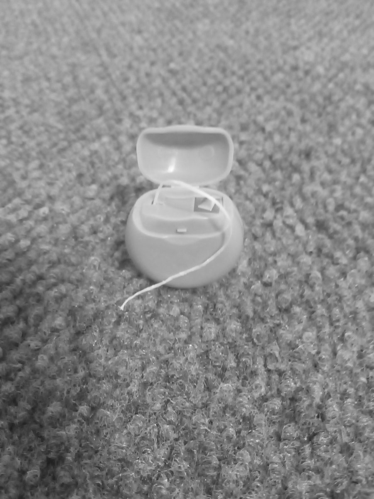
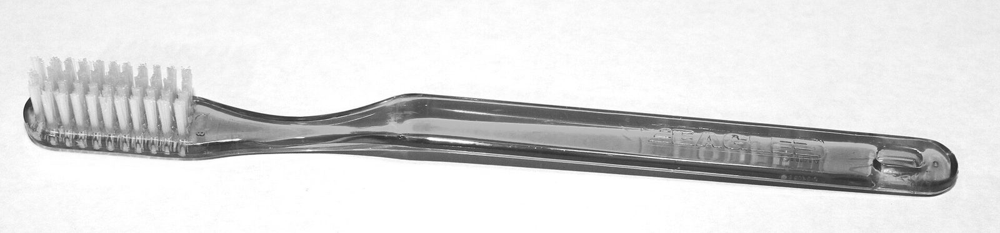

Ополіскувач не замінює чищення зубів пастою з фторидом. Він проходить повз наліт, який уже лежить між зубами і під краєм ясен. Нитка або йоршик цей наліт знімають. Щітка знімає його з поверхні. Рідина може зменшити частину мікробів, що плавають, і залишити смак м’яти. Запалені ясна від одного ковтка «свіжого подиху» не стають здоровими.

Британський набір Delivering Better Oral Health тримає порядок простим. Спочатку паста з фторидом, двічі на день. Пасту спльовують. Водою і ополіскувачем її одразу не змивають: фтор має лишитися на емалі. Хто після чищення набирає повний рот води або м’ятного ополіскувача, змиває якраз те, заради чого видавлював пасту. Кокранівський огляд Walsh і співавторів показує, що карієс зменшує фтор у пасті, а не аромат полоскання.

У Novadent на безкоштовній консультації дивляться, чи є взагалі привід для рідини: високий ризик карієсу, коротке призначення після втручання на яснах, сухий рот, у якому спиртовий ополіскувач лише пече. Лікар Голуб Олександр Олексійович, Вінниця, вул. Гоголя 15, [075 177 75 67](tel:+380751777567). Імплантатів тут не ставлять. Пломби і догляд за яснами — так.

## Сплюнути і не змивати

Дорослій людині зазвичай пасує паста близько 1000–1500 ppm фториду, той діапазон, який ВООЗ називає для щоденного чищення. Горошина пасти, щітка по всіх поверхнях, спльонути піну. Якщо хочеться прибрати смак, досить мінімуму води, а не стакана. Ополіскувач, навіть із фтором, у цю хвилину не вмикають. Його місце, якщо він взагалі потрібен, в інший час доби: після обіду, а не поверх свіжої пасти.

Це виглядає дрібницею і міняє концентрацію фтору на зубі сильніше, ніж вибір між двома зеленими пляшками. Дитині кількість пасти менша, а правило те саме: не вчити її полоскати рот водою одразу після щітки, поки вона ще ковтає пасту. Коли навчиться спльовувати, спльовує і не запиває.

Нитка лишається вечірньою справою там, де зуби стоять щільно. Йоршик — там, де проміжок ширший, біля коронок і під кламером протеза. Ополіскувач у ці щілини не заходить так, як заходить щетинка йоршика. Свіже дихання після рідини легко прийняти за чистоту. Наліт при цьому сидить на місці і до ранку знову дає запах.

<figure>

<figcaption>Нитка знімає наліт там, куди ополіскувач лише дотікає. Рідина цю роботу не замінює.</figcaption>
</figure>

## Фторидний ополіскувач і ефірні олії

Фторидне полоскання — додаток для людини з високим ризиком карієсу: часті нові дірки, сухість, оголені корені, багато цукру між їжею. Воно не скасовує пасту. Його використовують в інший час, щоб не змити пасту і щоб фтор прийшов на зуби ще раз. Кому ризик звичайний і паста вже з фтором двічі на день, окрема пляшка мало що додає. Її не купують «для комплекту».

Ополіскувачі з ефірними оліями мають невеликий додатковий ефект на наліт і гінгівіт, якщо ними користуються разом із щіткою, а не замість неї. Слово «невеликий» тут принципове. Вони не лікують кишеню, з якої йде гній, і не знімають камінь. Камінь твердий, його знімають інструментом. Після професійного чищення така рідина інколи допомагає утримати ясна спокійнішими. Без щітки вона лишає приємний смак і той самий наліт.

Спирт у складі — погана ідея при сухому роті. Він пече слизову, яка й так без слини, і відчуття сухості часто сильнішає. Людині на ліках, що сушать рот, дивляться етикетку. «Антибактеріальний» напис не означає, що спирт доречний щовечора. Дитині спиртові ополіскувачі не потрібні зовсім.

Косметичні рідини «для свіжого подиху» не лікують хворобу ясен. Вони маскують запах на годину. Запах, який повертається щодня, іде від нальоту на язиці, від каменю, від кишені, від сухості або від нежитого шлунка і мигдаликів. Полоскання м’ятою ці причини не розрізняє. Якщо ясна кровлять, коли ви спльовуєте, запис до лікаря чесніший за більшу пляшку.

## Хлоргексидин коротким курсом

Хлоргексидин — інший клас. Кокранівський огляд James і співавторів розглядає його як додаток до механічного чищення, коли йдеться про здоров’я ясен і наліт. Він зменшує наліт і ознаки гінгівіту поруч із щіткою. Він не замінює щітку. Довге щоденне полоскання «для профілактики і свіжості» фарбує зуби і пломби, змінює смак і не є косметичним засобом. Його місце — короткий курс, який називає лікар: після втручання, коли чистити боляче, або коли ясна гостро запалені і механічне чищення вже налагоджують.

Схему днів і концентрацію в цій статті немає. Їх підбирають під слизову, під протез і під те, чи немає причини, з якої антисептик людині не радять. Межі курсу розібрані в записі [«Хлоргексидин»](2029-06-08-chlorhexidine.html). Тут досить одного: пляшка хлоргексидину в ванній на місяці без паузи — це вже не призначення, а звичка, від якої жовтіють зуби, а ясна не стають здоровими самі.

Пасту і хлоргексидин теж не змішують в одну хвилину. Піна пасти може послабити антисептик, а антисептик змиває фтор, якщо ним полоскати одразу після щітки. Лікар, якщо призначає курс, каже, в який час доби його робити. Самовільно чергувати три різні пляшки «щоб точно подіяло» не потрібно.

<figure>

<figcaption>Щітка і паста з фторидом лишаються основою. Ополіскувач, якщо він доречний, іде в інший час доби, а не замість цієї щітки.</figcaption>
</figure>

## Кому рідина не потрібна щодня

Людині без нових дірок, із спокійними яснами і нормальною слиною досить щітки, фторованої пасти, нитки або йоршика і води як напою між їжею. Настанова ВООЗ щодо цукрів тримає вільні цукри нижче 10% енергії, за можливості нижче 5%. Частий солодкий перекус жоден ополіскувач не перекриває. Це чесніше сказати в кріслі, ніж додати в кошторис засіб, який приємно пахне.

Сухий рот лікують причиною, наскільки це можливо, і водою, а не спиртом. Карієс кореня при сухості стримують фтором і рідшим цукром. Про корінь є окремий запис [«Карієс кореня»](2028-11-15-root-caries.html). Про те, чому електрична щітка не скасовує пасту, — запис [«Електрична чи звичайна щітка»](2029-04-21-electric-brush.html).

Протез ополіскувачем для рота не дезінфікують «заодно». Акрил чистять механічно м’якою щіткою. Залишати протез на ніч у роті, щоб «ополіскувач його беріг», не можна: нічне носіння і погана гігієна якраз пов’язані з почервонінням під базисом. Протез на ніч знімають.

Якщо після тижня нормального чищення ясна все одно кровлять, пахнуть або набрякають, рідину не змінюють на міцнішу. Приходять на огляд. Може бути камінь, кишеня, край коронки, який нависає, або порожнина, куди заходить їжа. Це робота для інструмента і, за потреби, для пломби, а не для четвертого смаку м’яти.

Консультація безкоштовна. На неї можна принести ту пляшку, якою вже користуєтесь: по етикетці видно, чи там фтор, чи спирт, чи антисептик, який час сидіти на полиці не мав. Телефон [075 177 75 67](tel:+380751777567).

Текст розставляє пасту, нитку і ополіскувач у робочому порядку. Він не замінює огляд кровоточивих ясен.

## Джерела

<ol class="blog-sources">
<li><a href="https://www.gov.uk/government/publications/delivering-better-oral-health-an-evidence-based-toolkit-for-prevention" target="_blank" rel="noopener noreferrer">Office for Health Improvement and Disparities. Delivering better oral health: an evidence-based toolkit for prevention.</a> Після чищення пасту спльовують і не змивають одразу водою чи ополіскувачем.</li>
<li><a href="https://doi.org/10.1002/14651858.CD007868.pub3" target="_blank" rel="noopener noreferrer">Walsh T, Worthington HV, Glenny AM, Marinho VC, Jeroncic A. Fluoride toothpastes of different concentrations for preventing dental caries. Cochrane Database Syst Rev. 2019;CD007868.</a></li>
<li><a href="https://doi.org/10.1002/14651858.CD008676.pub2" target="_blank" rel="noopener noreferrer">James P, Worthington HV, Parnell C, et al. Chlorhexidine mouthrinse as an adjunctive treatment for gingival health. Cochrane Database Syst Rev. 2017;CD008676.</a></li>
<li><a href="https://www.who.int/news-room/fact-sheets/detail/oral-health" target="_blank" rel="noopener noreferrer">World Health Organization. Oral health. Fact sheet, 17 March 2025.</a> Паста з фторидом 1000–1500 ppm двічі на день.</li>
<li><a href="https://www.who.int/publications/i/item/9789241549028" target="_blank" rel="noopener noreferrer">World Health Organization. Guideline: sugars intake for adults and children. Geneva: WHO; 2015.</a></li>
</ol>
