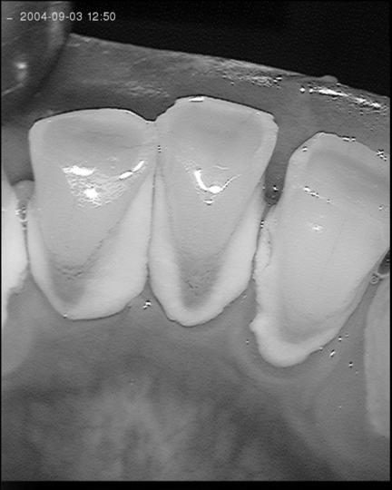

Хлоргексидин у полосканні вміє зменшувати зубний наліт. З цього зробили звичку: пляшка на полиці місяцями, замість пасти, «щоб ясна не кровіли» і «щоб зуби були світліші». Огляд Кокрейн, який зібрав Патрис Джеймс із колегами, каже вужче. Ополіскувач із хлоргексидином, доданий до звичайного чищення, зменшує наліт і має вплив на ясна. Він же дає зовнішнє забарвлення, серед побічних ефектів називають камінь і зміну смаку. Це короткий курс із приводу, а не косметика на роки і не заміна зубної пасти.

У Novadent полоскання не ставлять у прайс окремою «процедурою для білизни зубів». Лікар Олександр Олексійович Голуб на безкоштовній консультації спочатку дивиться, чи є запалення, камінь і чи людина взагалі може чистити зуби. Кабінет у Вінниці на вул. Гоголя 15, телефон [075 177 75 67](tel:+380751777567).

## Що показав огляд, а що ні

У огляді хлоргексидин вивчали як додаток до щітки і міжзубного чищення, не як єдиний засіб. За чотири–шість тижнів і за шість місяців такого додатка наліт зменшувався помітно, і цю частину доказів автори вважають високої якості. Ознаки гінгівіту в людей із легким запаленням теж зменшувались, але самі автори не визнали цю зміну клінічно важливою: запалення і так було невелике. Для помірного і важкого запалення ясен даних не вистачило, щоб сказати, наскільки саме полоскання його знімає. Немає і доказу, що одна концентрація краща за іншу. Тому «сильніший відсоток із аптеки» не є окремим планом лікування.

Побічні ефекти в включених дослідженнях повторюються. Полоскання чотири тижні і довше дає зовнішнє забарвлення зубів. Також повідомляли про наростання зубного каменю, тимчасову зміну смаку і подразнення слизової: печіння, болючість, інколи поверхневе злущення. Окремий зведений підрахунок саме щодо каменю автори визнали неостаточним. У переліку побічних ефектів камінь усе одно стоїть, і після курсу його нерідко доводиться знімати в кріслі, а не чекати, що наступна пляшка його розчинить.

Забарвлення зовнішнє. Емаль не перефарбовується зсередини. Коричневий наліт відходить під час професійного чищення, коли курс уже закінчено і наліт перестав сідати щодня. Це не привід купувати абразивну «відбілювальну» пасту і терти пляму щовечора: так стирають емаль, а не скасовують побічний ефект. Зняття відкладень у кабінеті є в розділі [цін](/index.html#prices). Відбілювання як окремої послуги в цьому прайсі немає.

<figure>

<figcaption>Зонд і пародонтальний зонд: спершу дивляться, чи ясна запалені, і лише потім вирішують, чи потрібне полоскання. Навчальне фото, не з кабінету Novadent. Автор: Coronation Dental Specialty Group, <a href="https://commons.wikimedia.org/wiki/File:Dental_explorer_and_periodontal_probe.jpg" target="_blank" rel="noopener noreferrer">CC BY-SA 3.0</a>.</figcaption>
</figure>

## Короткий курс, не пляшка на рік

Сенс хлоргексидину в тих тижнях, коли механічне чищення тимчасово не виходить або його замало. Після втручання, коли шов і рана не дають нормально провести щіткою. Коли рот болить так, що чищення фізично неможливе кілька днів. Коли ясна гостро запалені і лікар хоче зменшити наліт, поки людина вчиться чистити інакше. У кожному з цих випадків має бути кінець курсу. Дата на пляшці, яку людина сама продовжує «бо ясна колись кровіли», перетворює ліки на джерело плям і каменю без нової користі.

Полоскання не замінює пасту з фтором і не знімає вже твердий камінь. Огляд Волша і колег щодо фторпаст і британський набір профілактики Delivering Better Oral Health тримають базу іншою: чистити зуби пастою з фтором двічі на день. Для дорослого орієнтир концентрації, який дає Кокрейн-огляд паст, — 1000–1500 ppm. Хлоргексидин фтор у емаль не вносить. Людина, яка вилила пасту і лишила тільки ополіскувач, втрачає саме той засіб, для якого є випробування проти карієсу.

Гостре запалення ясен від полоскання не стає діагнозом. Кровоточивість може бути від каменю, від глибокої кишені, від пломби, що тисне на край, від коронки з загнаним краєм. Поки причину не видно в кріслі, пляшка лише маскує симптом. Якщо після короткого курсу ясна знову кровілять щодня, це привід на огляд, а не на більший флакон.

<figure>

<figcaption>Зубний камінь на передніх зубах. Хлоргексидин такі відкладення не розчиняє. Навчальне фото. Автор: Michael Ottenbruch, <a href="https://commons.wikimedia.org/wiki/File:Calculus.jpg" target="_blank" rel="noopener noreferrer">GFDL / CC BY-SA</a>.</figcaption>
</figure>

## Паста, діти і вагітність

Є побутова порада, яку дають до курсу і яка не є висновком огляду Кокрейн: між пастою і хлоргексидином роблять паузу. У частині паст є піноутворювач, і вважають, що він послаблює дію полоскання, якщо прополоскати рот одразу після чищення. Практично це виглядає так: почистили, сплюнули пасту, не запивали одразу ополіскувачем, витримали паузу і лише тоді прополоскали тим об’ємом, який сказав лікар. Ковтати засіб не потрібно. Залишок спльовують.

Маленькій дитині таке полоскання не ставлять пляшкою на полицю. Дитина ковтає рідину, яку мала спльовувати, і курс «для маминих ясен» легко опиняється в шлунку. Якщо дитина не вміє впевнено спльовувати, хлоргексидин у неї вдома не починають. Це не заміна дитячій пасті з фтором і не спосіб «продезінфікувати рот» після солодкого.

Вагітність не є ні забороною назавжди, ні дозволом полоскати місяцями самотужки. Короткий курс, коли є рана або гостре запалення і чистити не виходить, лікар може обговорити окремо. Довга домашня пляшка «бо при вагітності ясна кровілять» — інша історія. Кровоточивість вагітних ясен насамперед про наліт і чищення, а не про щоденний антисептик до пологів. Якщо сумнів, його знімають на прийомі, а не в аптеці за порадою полиці.

Смак після курсу зазвичай повертається, коли полоскання припиняють. Поки він змінений, людині здається, що їжа «металева» або порожня. Це очікуваний тимчасовий ефект, не алергія сама по собі. Стійке печіння, виразки або набряк — уже привід зупинити засіб і показати рот, а не терпіти заради дисципліни.

## Що лишається після пляшки

Наліт усе одно знімають щіткою двічі на день і чимось, що проходить між зубами: ниткою або йоршиком під розмір проміжку. Хлоргексидин дотягується до поверхні, поки він у роті, і не будує звички. Камінь, який уже стоїть біля ясен, як на навчальному фото, знімають інструментом. Полоскання його не відшаровує.

Після хірургічного дня лікар може якраз порадити короткий курс, бо щітка тимчасово не проходить по шву. Коли шов спокійний, повертаються до пасти. Якщо край пломби ріже ясна і через це призначили антисептик «надовго», чесніше поправити край. Про пломби Лателюкс, Карісма, Градія і нанокомпозит CeramX є запис [«Лікування карієсу і пульпіту»](2030-05-19-therapy.html).

Безкоштовна консультація для цього і є: подивитися, чи полоскання взагалі потрібне цього тижня, чи досить щітки, нитки і зняття каменю. Пляшка без дати закінчення — поганий сувенір із прийому.

Цей текст передає висновки огляду і настанов із профілактики. Схему і тривалість курсу для конкретного рота визначає огляд.

## Джерела

<ol class="blog-sources">
<li>James P, Worthington HV, Parnell C, et al. Chlorhexidine mouthrinse as an adjunctive treatment for gingival health. Cochrane Database of Systematic Reviews. 2017. <a href="https://doi.org/10.1002/14651858.CD008676.pub2" target="_blank" rel="noopener noreferrer">doi:10.1002/14651858.CD008676.pub2</a></li>
<li>Walsh T, Worthington HV, Glenny AM, Marinho VCC, Jeroncic A. Fluoride toothpastes of different concentrations for preventing dental caries. Cochrane Database of Systematic Reviews. 2019. <a href="https://doi.org/10.1002/14651858.CD007868.pub3" target="_blank" rel="noopener noreferrer">doi:10.1002/14651858.CD007868.pub3</a></li>
<li>Office for Health Improvement and Disparities, Department of Health and Social Care, NHS England. Delivering better oral health: an evidence-based toolkit for prevention. <a href="https://www.gov.uk/government/publications/delivering-better-oral-health-an-evidence-based-toolkit-for-prevention" target="_blank" rel="noopener noreferrer">gov.uk</a></li>
</ol>
