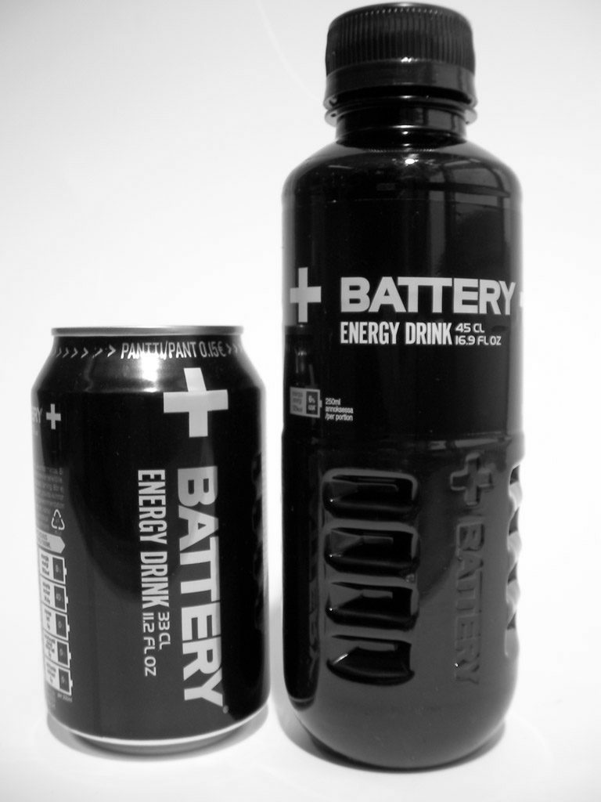
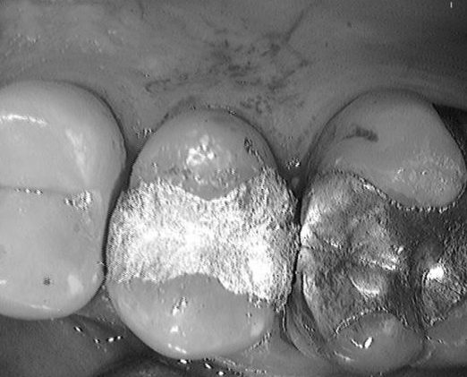

Солодка газована вода шкодить зубам двічі, і це різні пошкодження. Цукор годує бактерії нальоту, і вони роблять кислоту, від якої починається карієс. Кислота самого напою розчиняє емаль без бактерій. Це називають ерозією. Цукру в напої може не бути взагалі: солодка «нуль» усе одно кисла, і емаль від цього не в безпеці. Частота ковтків важливіша за героїчну відмову раз на місяць.

У Novadent це видно на огляді раніше, ніж людина помічає «прозорі» краї зубів. Лікар Олександр Олексійович Голуб на безкоштовній консультації відрізняє дірку від стертої поверхні. Кабінет у Вінниці на вул. Гоголя 15, телефон [075 177 75 67](tel:+380751777567).

## Цукор і кислота — не одна подія

Настанова Всесвітньої організації охорони здоров’я щодо вільних цукрів радить тримати їх нижче 10% енергії раціону, а за можливості нижче 5%. Вільні цукри — це ті, що додані у їжу і напої, плюс цукри меду, сиропів і соків. Для карієсу важлива не лише доля енергії, а й те, як часто цукор потрапляє в рот. Кожен солодкий епізод між прийомами їжі дає нальоту нову порцію. Фактологічна довідка ВООЗ щодо здоров’я рота ставить вільні цукри серед головних чинників карієсу. Вода цієї роботи не робить.

Ерозія — інший хімічний шлях. Адріан Луссі і колеги описують її як розчинення твердих тканин кислотами не бактерійного походження. Сюди входять газовані напої, енергетики, фруктові соки, спортивні напої, оцет, вода з лимоном чи лаймом і вино. Частина з них солодка, частина ні. Сік здається «кориснішим» за колою і лишається кислим. Вода з часточкою цитруса, яку п’ють весь ранок, теж тримає кислоту на зубах. Дієтичний напій без цукру знімає каріозну половину історії і залишає ерозивну.

На схемі зуба емаль — зовнішній шар. Під нею дентин, у центрі пульпа. Емаль не відростає. Коли вона тоншає, дентин просвічує жовтим, край різця стає прозорим, з’являється чутливість на холод. Це не «наліт, який відбілиться». Карієс при цьому може йти поруч: цукор і кислота часто живуть в одному келиху, але дірка і згладжена, блискуча втрата емалі виглядають по-різному. Зонд і огляд їх розрізняють. Плутати їх означає або полірувати карієс, або пломбувати те, що ще можна зупинити режимом пиття.

<figure>

<figcaption>Енергетик кислий навіть тоді, коли на банці написано «без цукру»: кислота лишається. Фото: Juice79, <a href="https://commons.wikimedia.org/wiki/File:Battery_Energy_Drink-can-bottle.jpg" target="_blank" rel="noopener noreferrer">суспільне надбання</a>.</figcaption>
</figure>

## Як п’ють, а не лише що п’ють

Луссі наголошує на частоті і на способі. Ковток за обідом — один кислотний епізод, після якого слина встигає нейтралізувати рот. Ковток що кілька хвилин упродовж години, пляшка біля комп’ютера, вино, яке тримають у роті, — це вже багато епізодів або один довгий. Слина не встигає. Той, хто «майже не п’є солодкого», але тягне енергетик півдня, для емалі має не перекус, а ванну.

Соломинка не є перепусткою. Вона може зменшити контакт напою з передніми зубами, якщо напій справді йде повз них і його не смокчуть повільно. Кислота все одно опиняється в роті, затікає на зуби, а довге потягування через соломинку якраз подовжує контакт. Соломинка не нейтралізує напій і не додає йому фтору. Ставити її і лишати літр коли на день — не план профілактики.

Після кислого не беруться за щітку одразу. Розм’якшена емаль стирається щетиною легше, ніж суха спокійна поверхня. Спочатку рот споліскують водою. Чистять пізніше, коли слина встигла прибрати кислоту, звичайною фторпастою, а не жорсткою «відбілювальною». Скільки саме хвилин чекати, на прийомі скажуть під звичку людини. У статті важливо інше: не чистити в ту саму хвилину, коли тільки поставили склянку. Британський набір Delivering Better Oral Health теж розносить кислотний епізод і чищення в часі та тримає фторпасту базою догляду.

Вода є напоєм за замовчуванням між їжею. Не вода з лимоном, не оцет «для обміну», не сік дитини, розведений «щоб був корисний» і поставлений у пляшку на прогулянку. Дитячий сік у пляшці, з якої сьорбають довго, поєднує цукор і кислоту з найгіршим режимом — частим контактом. Дорослий енергетик влаштований схоже, тільки пляшка більша.

Паста з фтором 1000–1500 ppm, двічі на день, лишається захистом, який має випробування. Огляд Волша і колег якраз про цей діапазон. Фтор не відрощує зниклу емаль і не дає дозволу на щогодинну колу. Він допомагає поверхні, яка ще є, протистояти і карієсу, і повторним кислотним атакам. Спльовувати пасту, не споліскуючи одразу весь фтор водою, — частина тієї самої щоденної схеми.

<figure>

<figcaption>Навчальне фото зубів із металевими пломбами. Це не знімок ерозії і не пацієнт Novadent. Автор: Michael Ottenbruch, <a href="https://commons.wikimedia.org/wiki/File:Human_teeth_with_metal_fillings.jpg" target="_blank" rel="noopener noreferrer">GFDL / CC BY-SA</a>.</figcaption>
</figure>

## Пломба, яка просіла, — не привід для «детоксу»

Кислота б’є і по краю старої пломби. Емаль навколо металу або композиту може піти, край починає чіпляти нитку, їжа застрягає. Це привід подивитися, чи є щілина і карієс, а не вирок матеріалу. На навчальному фото — зуби з металевими пломбами, тобто з амальгамою. Сам знімок нічого не каже про ерозію: він показує пломби. Справну металеву пломбу не знімають заради «виведення ртуті» чи детоксу. У прайсі Novadent такого рядка немає.

Політика Європейського Союзу щодо ртуті обмежує стоматологічну амальгаму як джерело ртуті в середовищі. Це екологічне правило про те, де і коли амальгаму ще можна застосувати, а не інструкція розсвердлити кожну стару пломбу в здоровому зубі. Заміну роблять, коли пломба зламалась, край протікає або під нею карієс. Матеріали в кабінеті інші: фотополімери Лателюкс, Карісма, Градія і нанокомпозит CeramX. Про вибір між спостереженням і пломбою є запис [«Лікування карієсу і пульпіту»](2030-05-19-therapy.html).

Якщо емаль зійшла так, що дентин уже не тримає жування, поверхню закривають. Інколи вистачає реставрації. Інколи, коли від зуба лишилися тонкі краї, розмова переходить до коронки. Коронки тут роблять. Про матеріали є запис [«Коронка на зуб»](2030-06-23-crowns.html). Закрити зуб і лишити щогодинний енергетик означає поставити коронку в ту саму кислоту. Край коронки від цього не стає вічним.

Окремий малюнок ерозії дає не напій, а кислота зі шлунка: піднебінні поверхні верхніх зубів. Це не друга стаття про колу. Якщо є печія, нічне покашлювання або кислий смак, про це кажуть і стоматологу, і своєму лікарю. Коротко це розібрано в записі [«Печія і рефлюкс»](2029-10-08-reflux.html).

На консультації корисно чесно сказати, що саме п’єте протягом дня, включно з «корисним» лимоном і вином увечері. План зазвичай нудний: вода як базовий напій, солодке і кисле з їжею, фторпаста, і пломба лише там, де тканина вже не тримається. Безкоштовна консультація ні до чого не зобов’язує.

Цей текст розділяє карієс від цукру і ерозію від кислоти. Він не підраховує, скільки склянок «ще можна»: такого універсального літра немає, є частота і те, що видно на емалі.

## Джерела

<ol class="blog-sources">
<li>World Health Organization. Guideline: sugars intake for adults and children. <a href="https://www.who.int/publications/i/item/9789241549028" target="_blank" rel="noopener noreferrer">who.int</a></li>
<li>World Health Organization. Oral health. <a href="https://www.who.int/news-room/fact-sheets/detail/oral-health" target="_blank" rel="noopener noreferrer">who.int, fact sheet</a></li>
<li>Lussi A, Carvalho TS. Erosive tooth wear: a multifactorial condition of growing concern and increasing knowledge. Monographs in Oral Science. 2014. <a href="https://doi.org/10.1159/000360380" target="_blank" rel="noopener noreferrer">doi:10.1159/000360380</a></li>
<li>Walsh T, Worthington HV, Glenny AM, Marinho VCC, Jeroncic A. Fluoride toothpastes of different concentrations for preventing dental caries. Cochrane Database of Systematic Reviews. 2019. <a href="https://doi.org/10.1002/14651858.CD007868.pub3" target="_blank" rel="noopener noreferrer">doi:10.1002/14651858.CD007868.pub3</a></li>
<li>Office for Health Improvement and Disparities, Department of Health and Social Care, NHS England. Delivering better oral health: an evidence-based toolkit for prevention. <a href="https://www.gov.uk/government/publications/delivering-better-oral-health-an-evidence-based-toolkit-for-prevention" target="_blank" rel="noopener noreferrer">gov.uk</a></li>
<li>European Commission. Mercury. <a href="https://environment.ec.europa.eu/topics/chemicals/mercury_en" target="_blank" rel="noopener noreferrer">environment.ec.europa.eu</a></li>
</ol>
