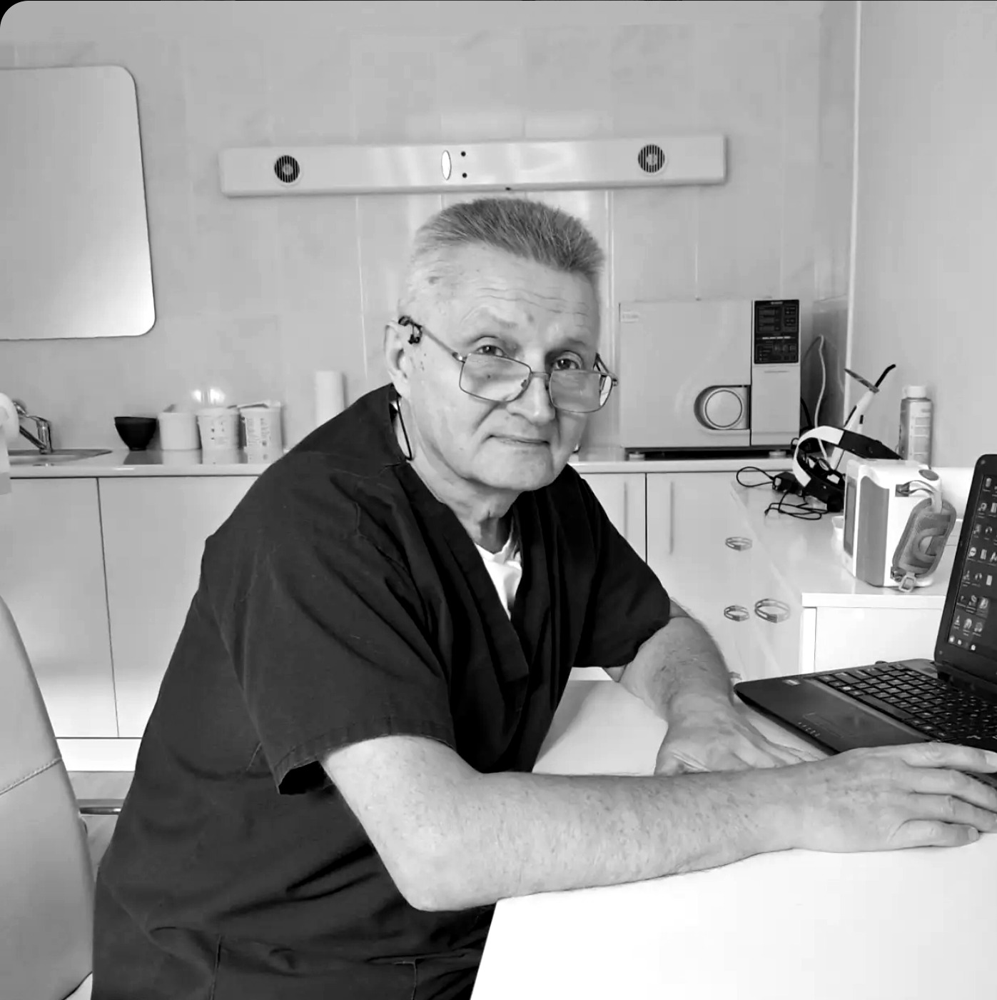

Печіння в роті, про яке тут ідеться, відчувається як опік, найчастіше на язиці, інколи на губах, а слизова при цьому виглядає звичайно. Немає виразки, немає білого нальоту, немає дірки, яку можна показати пальцем. Біль від цього не стає уявним. Його так і описують пацієнти, і так його варто чути: біль є, навіть коли фотографія язика «чиста».

Це діагноз виключення. Спочатку шукають місцеві й загальні причини, які вміють пекти так само: кандидоз, нестачу крові, сухість, алергію, рефлюкс, гострий край зуба або пломби. Поки їх не відклали, називати стан синдромом печіння рота рано. Частіше з цим приходять жінки в період навколо менопаузи і після неї. Слово «частіше» тут навмисне. Відсоток у статтю не ставиться.

У Novadent рот, протез і ознаки молочниці дивляться на місці. Аналіз крові призначає лікар, який веде людину загалом, не стоматолог замість нього. Лікар Олександр Олексійович Голуб робить стоматологічну половину на безкоштовній консультації. Кабінет у Вінниці на вул. Гоголя 15, телефон [075 177 75 67](tel:+380751777567).

На світлинах до запису немає «типового язика». Його й не має бути: при цьому стані слизова часто виглядає як здорова. Випадковий знімок виразки був би іншою хворобою.

## Коли язик пече, а виглядає спокійно

Людина зазвичай уже перепробувала полоскання. Печіння може бути з ранку слабшим і наростати до вечора, може заважати солоне, кисле і розмову. Смакова зміна, відчуття піску і сухість без видимої причини теж бувають у тій самій скарзі. Вода не завжди полегшує, бо причина не в забутій склянці.

Огляд потрібен саме тому, що слизова «нормальна» лише після того, як її подивились, а не тому, що в дзеркалі ванної нічого не видно. Стоматолог відсуває щоки, дивиться бічні поверхні язика, дно рота, під протезом, якщо він є. Білий наліт, який знімається, — це вже не цей діагноз, а привід думати про кандидоз. Мереживні лінії на щоках — інша історія, про неї є запис [«Плоский лишай рота»](2029-12-16-lichen.html). Виразка, яка не гоїться, теж не печіння при спокійній слизовій. Для незрозумілої виразки понад три тижні настанова NICE NG12 радить думати про скерування, а не про заспокійливий гель.

Гострий край пломби, шорстка коронка, кламер, який тре язик, дають біль у точці. Людина часто може показати місце кінчиком язика. При синдромі печіння точка зазвичай розмита, «горить усе», а палець не знаходить задирки. Якщо задирка є, її прибирають. Це може бути вся допомога, і тоді гучне ім’я синдрому не потрібне. Пломби в кабінеті — Лателюкс, Карісма, Градія, нанокомпозит CeramX. Коронку, яка стоїть високо або ріже, корегують або обговорюють заміну. Про коронки є запис [«Коронка на зуб»](2030-06-23-crowns.html).

<figure>

<figcaption>Печіння описують словами: на фото не висип і не «хворий язик». Слизова при цьому стані часто виглядає звичайно, і це не означає, що болю немає. Фото ілюстративне.</figcaption>
</figure>

## Що виключають, перш ніж назвати стан

Кандидоз, зокрема під протезом, може пекти і давати змінений смак. Білі плями, які знімаються, червона слизова під базисом, тріщини кутів рота — це шукає стоматолог. Протез, який не знімають на ніч, для грибка зручний. Лікувати тоді треба і рот, і протез, а не лише язик. Докладніше це в записі [«Герпес і молочниця в роті»](2030-02-13-herpes-candida.html) і в записі про догляд [«Знімний і бюгельний протез»](2030-07-18-denture.html). Знімні протези в кабінеті роблять. Новий протез не є ліками від печіння, якщо старий нічого не тре і грибка немає.

Сухість рота від ліків, від дихання ротом, від хвороби слинних залоз дає печіння і карієс біля ясен. Дивляться, чи є слини, які ліки людина приймає, чи не сидить цілий день з відкритим ротом через ніс, що не дихає. Порада «пийте воду» без цього огляду слабка. Вода потрібна, і вона не замінює причину сухості.

Алергія на матеріал протеза, на пасту, на ополіскувач інколи імітує печіння, і тоді є почервоніння саме там, де матеріал торкається слизової, або чіткий зв’язок із новим засобом. Прибрати підозрілий ополіскувач на час — розумна проба. Розводити самостійно «гіпоалергенну» схему з кількох ефірних олій не варто: частина з них якраз пече слизову.

Рефлюкс дає кислий смак і може дратувати. Стоматолог його не лікує і омепразол не починає. Якщо є печія, нічне покашлювання, кисле в роті, про це кажуть своєму лікарю. Зубний слід кислоти описаний окремо: [«Печія і рефлюкс»](2029-10-08-reflux.html). Не кожне печіння язика є рефлюксом, і не кожен рефлюкс пече язик при спокійних зубах.

Кров перевіряє лікар загальної практики або той фахівець, до якого він скерує. Серед аналізів, які в такій скарзі зазвичай переглядають, — вітамін B12, залізо і глюкоза. Це не список, який доводить, що кожне печіння є дефіцитом. У частини людей аналізи нормальні, і біль усе одно є. У частини знаходять анемію або порушення глюкози, і тоді лікують знахідку, а не «язик взагалі». Стоматолог не призначає ці аналізи замість лікаря і не трактує бланк заочно з фотографії в телефоні. Він може сказати, що такий бланк варто мати, перш ніж назвати стан синдромом виключення.

<figure>

<figcaption>Олександр Олексійович Голуб дивиться рот, протез і ознаки молочниці. Аналіз крові лишається за лікарем, який веде людину загалом.</figcaption>
</figure>

## Біль справжній, і дозу антидепресанта тут не радять

Коли місцеве і загальне виключені, лишається стан, який називають синдромом печіння рота або печінням порожнини рота. Механізм пов’язують із тим, як нерви передають відчуття з нормальної на вигляд слизової. Для людини це легко звучить образливо, ніби біль вигаданий. Зміст інший: слизова без виразки може боліти по-справжньому. Відмова сприймати скаргу всерйоз лікування не прискорює.

Ліки, які інколи застосовують при нейропатичному болю, включно з окремими антидепресантами в малих дозах, тут не розписуються. Дози в статті не буде. Такий засіб, якщо він взагалі доречний, підбирає лікар, який має право його вести і бачить інші ліки людини. Стоматологічний кабінет не починає цей рецепт «щоб язик заспокоївся до п’ятниці» і не радить подвоїти чиюсь чужу таблетку. Самодіяльність із заспокійливим з аптечки тут небезпечніша за ще один візит без назви.

Що можна сказати практично, без рецепта. Не ганяти по слизовій спиртові ополіскувачі і концентровані олії: вони підсилюють печіння. Не чистити язик жорсткою щіткою до крові. Паста з фтором 1000–1500 ppm лишається для зубів, як у огляді Волша, навіть якщо язик пече. Якщо якась паста явно посилює біль, її замінюють на іншу з фтором, а не на вугілля і не на порожню щітку. Їжа не зобов’язана бути героїчною: на час загострення прибирають те, що точно пече цю людину, зазвичай дуже гостре і кисле. Це полегшення, не лікування причини.

Карієс і ясна при цьому нікуди не діваються. Сухий або болючий рот легко запускають гігієну, і тоді до печіння додається справжнє запалення від нальоту. Чистити двічі на день і проходити проміжки все одно треба, м’яко. Британський набір Delivering Better Oral Health цю щоденну базу не скасовує через біль. Якщо біль заважає відкрити рот для щітки, про це кажуть на прийомі, і шукають, як почистити без героїзму, а не кидають зуби.

Консультація безкоштовна і може закінчитися трьома різними реченнями. Є край, який треба згладити. Є ознаки молочниці або поганий протез. Або рот спокійний, і далі шлях до лікаря з аналізом крові, а стоматолог лишається для зубів. Усі три чесні. Жодне з них не звучить як «вам здається».

Цей текст пояснює, чому печіння при спокійній слизовій шукають методом виключення. Він не ставить діагноз і не підбирає ліки від болю.

## Джерела

<ol class="blog-sources">
<li>National Institute for Health and Care Excellence. Suspected cancer: recognition and referral. NICE guideline NG12. <a href="https://www.nice.org.uk/guidance/ng12" target="_blank" rel="noopener noreferrer">nice.org.uk/guidance/ng12</a></li>
<li>Walsh T, Worthington HV, Glenny AM, Marinho VCC, Jeroncic A. Fluoride toothpastes of different concentrations for preventing dental caries. Cochrane Database of Systematic Reviews. 2019. <a href="https://doi.org/10.1002/14651858.CD007868.pub3" target="_blank" rel="noopener noreferrer">doi:10.1002/14651858.CD007868.pub3</a></li>
<li>Office for Health Improvement and Disparities, Department of Health and Social Care, NHS England. Delivering better oral health: an evidence-based toolkit for prevention. <a href="https://www.gov.uk/government/publications/delivering-better-oral-health-an-evidence-based-toolkit-for-prevention" target="_blank" rel="noopener noreferrer">gov.uk</a></li>
<li>Gendreau L, Loewy ZG. Epidemiology and etiology of denture stomatitis. J Prosthodont. 2011. <a href="https://doi.org/10.1111/j.1532-849X.2011.00700.x" target="_blank" rel="noopener noreferrer">doi:10.1111/j.1532-849X.2011.00700.x</a></li>
</ol>
