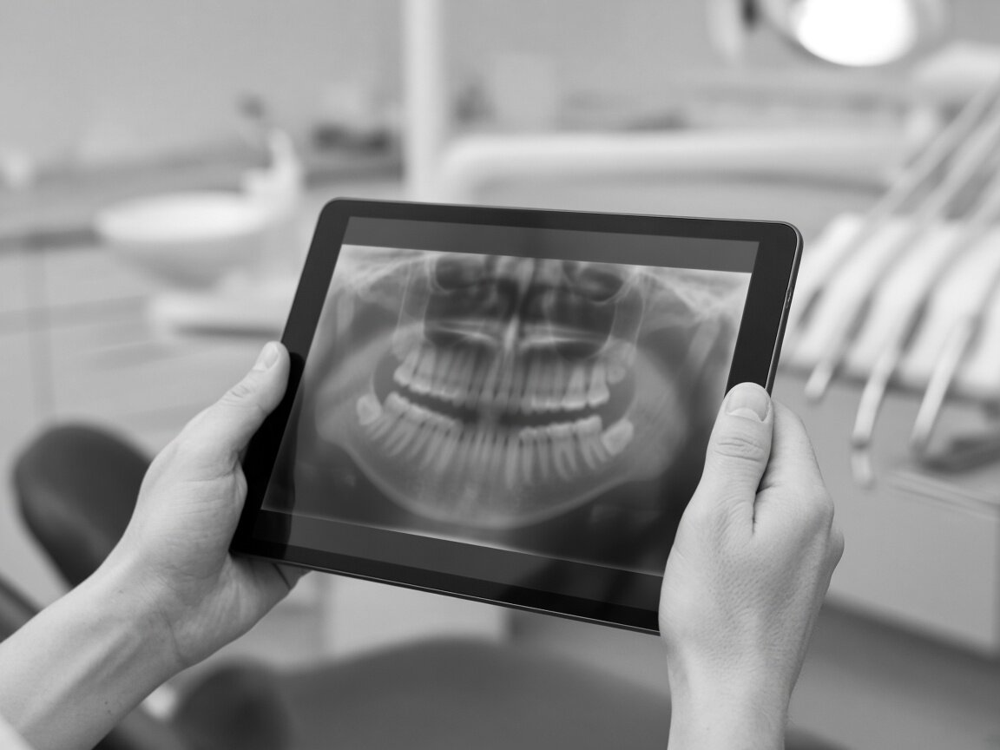
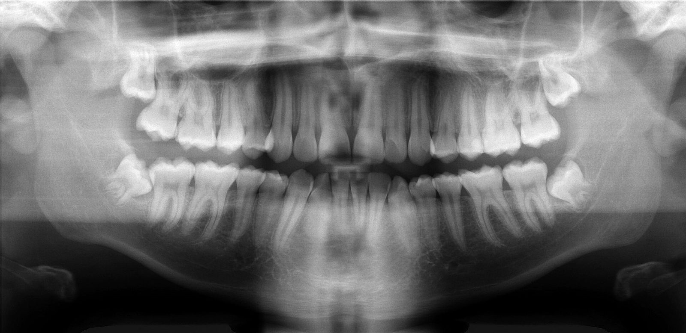

Раз на пів року — зручна звичка, а не медичний закон. Настанова NICE CG19 про інтервали між оглядами порожнини рота каже інше: строк до наступного візиту обирають окремо для кожної людини за тим, який у неї ризик хвороби. Найкоротший звичайний інтервал для всіх — 3 місяці. Для людей молодше 18 років найдовший — 12 місяців. Для дорослих 18 років і старших його можна поступово подовжити аж до 24 місяців, якщо рот стабільний і ризику не видно. Проміжні практичні кроки в настанові — 3, 6, 9 або 12 місяців у дітей і підлітків і далі через кожні три місяці аж до 24 у дорослих. Шість місяців лишаються одним із можливих кроків, а не обов’язком.

Інтервал коротший за три місяці для планового огляду зазвичай не потрібен. Частіше приходять з іншої причини: лікування, яке вже триває, гострий біль, контроль після травми. Це не «огляд за розкладом», це ведення хвороби. Довший за 24 місяці строк для дорослого настанова вважає небажаним: за два роки змінюються і звички, і ліки, і сам контакт із лікарем.

У Novadent цей строк називають уголос наприкінці прийому, коли лікування вже зроблене або коли лікувати нічого. Лікар Голуб Олександр Олексійович записує, згодні ви чи ні. Консультація безкоштовна. Кабінет у Вінниці на вул. Гоголя 15, телефон [075 177 75 67](tel:+380751777567).

## Не ритуал, а оцінка ризику

NICE просить зібрати історію, оглянути рот і дати першу профілактичну пораду. Разом із людиною дивляться, як на рот впливають гігієна, їжа, фтор, тютюн і алкоголь. Дивляться, що вийшло з минулого лікування і чи був попередній інтервал вдалим. Дивляться, чи людина взагалі може прийти в названий строк, і називають вартість огляду та того, що з нього випливе. Інтервал — спільне рішення, його записують. Наступного разу його переглядають: якщо рот спокійний, строк можна подовжити, якщо з’явилися нові дірки або кров, — скоротити.

Приходити раніше за запис потрібно, коли щось змінилося, не чекаючи дати в картці. Настанова прямо каже звертатися до лікаря до планового візиту, якщо змінився ризик. Сюди входять нові ліки, які сушать рот, вагітність, різке збільшення солодкого, відмова від чищення через біль, зламаний зуб, набряк, протез, який раптом натирає. Пів року або два роки — не привід терпіти біль «бо ще не час».

Жодної гарантії, що між візитами нічого не з’явиться, настанова не дає. Вона сама порівнює це зі старою звичкою ходити рівно раз на шість місяців: і там нова дірка може виникнути посередині інтервалу. Тому вдома лишаються щітка, фторована паста і рідший цукор. Огляд їх не замінює, він перевіряє, чи вони працюють.

<figure>

<figcaption>Панорамний знімок на екрані — огляд обох щелеп. Це ілюстрація, не кадр із кабінету. У Novadent на місці роблять прицільний знімок кількох зубів, коли він змінює рішення.</figcaption>
</figure>

## Кому раніше, кому рідше

Раніше кличуть людину з активним карієсом, із кровоточивими яснами і кишенями, із сухим ротом, із щойно закритими великими порожнинами, за якими треба подивитися край. Дитину і підлітка не відпускають на два роки: карієс у них може йти швидше, ніж у дорослого зі спокійним ротом, а зуби ще змінюються. Дванадцять місяців — стеля NICE для віку до 18, не стартова точка для кожної дитини. Якщо дірки з’являються кілька разів на рік, інтервал ближчий до трьох–шести місяців, і поруч змінюють цукор і фтор, а не лише календар.

Дорослий, у якого кілька років немає нових порожнин, ясна не кровлять, слина на місці, протез не натирає, може подовжувати інтервал крок за кроком. Два роки — верхня межа, а не мета, яку треба досягти будь-що. Якщо людина сама хоче приходити частіше, бо так спокійніше, це теж законне рішення. Настанова просить записати і згоду, і незгоду. «Мені казали раз на пів року все життя» не скасовує огляду ризику, але й не забороняє лишити шість місяців, якщо вони цій людині пасують.

Сухість від ліків, променеве лікування ділянки голови, часті перекуси, неможливість чистити зуби через артрит зсувають строк ближче. Той самий вік після шістдесяти сам по собі не означає візит щокварталу. Означає ризик, якщо корені оголені, протез нічний, а слина зникла. Про цей вік є окремий запис [«Рот після 60 років»](2028-12-23-after-60.html).

## Що саме перевіряють

Огляд — це не «подивитися, чи біле». Шукають нові порожнини, особливо між зубами і на оголених коренях, де емалі немає. Дивляться, чи кровлять ясна, коли їх обережно перевіряють, і чи немає кишені, з якої виходить гній. Перевіряють старі пломби і коронки: край, тріщину, рухомість, чи не відкрився дентин біля шийки. Дивляться слизову щік, язика, під язиком і на піднебінні. Виразка, яка не загоюється, біла пляма, що не знімається, ущільнення — не тема «до наступного разу через рік».

Протез знімають. Під ним дивляться, чи немає почервоніння, і чи край ще відповідає щелепі. Посадка, яка була доброю три роки тому, сьогодні може натирати, бо кістка змінилася. Опорні зуби під кламерами перевіряють окремо: там часто починається карієс, якого не видно, поки протез на місці.

Поруч називають прості речі, які NICE якраз включає в розмову огляду: як чистите, чи є фтор у пасті, скільки солодкого між їжею, чи є тютюн і алкоголь. ВООЗ тримає вільні цукри нижче 10% енергії раціону, за можливості нижче 5%, а пасту з фторидом 1000–1500 ppm — двічі на день. Це не лекція на додачу. Це частина того, чому наступний інтервал буде коротким або довгим.

<figure>

<figcaption>Панорама показує обидві щелепи загалом і погано замінює прицільний кадр, коли треба бачити один корінь або контакт між зубами. Навчальний знімок. Автор: Coronation Dental Specialty Group, <a href="https://commons.wikimedia.org/wiki/File:Basic_panoramic_radiograph.jpg" target="_blank" rel="noopener noreferrer">CC BY 3.0</a>. Чим візіограф у кабінеті відрізняється від такої оглядової картини, розібрано в записі <a href="2030-08-12-scan.html">«Знімок на візіографі»</a>.</figcaption>
</figure>

## Знімки теж за ризиком

Повний комплект кадрів не є частиною кожного візиту. Знімок роблять, коли він може змінити діагноз або лікування: підозра на карієс між зубами, біль без видимої дірки, контроль кореня, опора перед коронкою або кламером. Стабільний рот без нових скарг не потребує «профілактичної» серії щоразу, коли людина сідає в крісло.

Панорамний знімок — огляд. Він зручний, щоб побачити, чого в роті взагалі бракує, і погано показує дрібницю одного контакту. Візіограф у цьому кабінеті — маленький датчик на кілька зубів разом із коренями. Саме його вистачає для більшості рішень про пломбу, канал і опору протеза. Коли який кадр доречний, розписано окремо в записі [«Знімок на візіографі»](2030-08-12-scan.html). Старі знімки варто приносити: повторений кадр лише тому, що попередній лишився в іншому архіві, — зайве опромінення.

Після огляду має бути зрозуміло три речі. Що з зубами, яснами, слизовою і протезом зараз. Коли приходити наступного разу і чому строк саме такий. Що зробити вдома до того дня. Якщо потрібне лікування, кошторис називають до старту, а не замість інтервалу. Пломба, коронка і знімний протез у цьому кабінеті є. Імплантатів немає, і частий огляд їх не замінює і не обіцяє.

Запис — [075 177 75 67](tel:+380751777567). Якщо болить або набрякло, кажіть це одразу: такий візит не чекає планової дати, навіть якщо минулий інтервал був довгий.

Текст передає інтервали NICE CG19. Строк для конкретної людини називають після огляду.

## Джерела

<ol class="blog-sources">
<li><a href="https://www.nice.org.uk/guidance/cg19" target="_blank" rel="noopener noreferrer">National Institute for Health and Care Excellence. Dental checks: intervals between oral health reviews. Clinical guideline CG19. 2004.</a> Інтервал залежить від ризику. Найкоротший звичайний строк — 3 місяці. До 18 років найдовший — 12 місяців. Від 18 років найдовший — 24 місяці.</li>
<li><a href="https://www.who.int/news-room/fact-sheets/detail/oral-health" target="_blank" rel="noopener noreferrer">World Health Organization. Oral health. Fact sheet, 17 March 2025.</a> Паста з фторидом 1000–1500 ppm двічі на день.</li>
<li><a href="https://www.who.int/publications/i/item/9789241549028" target="_blank" rel="noopener noreferrer">World Health Organization. Guideline: sugars intake for adults and children. Geneva: WHO; 2015.</a> Вільні цукри нижче 10% енергії, за можливості нижче 5%.</li>
</ol>
