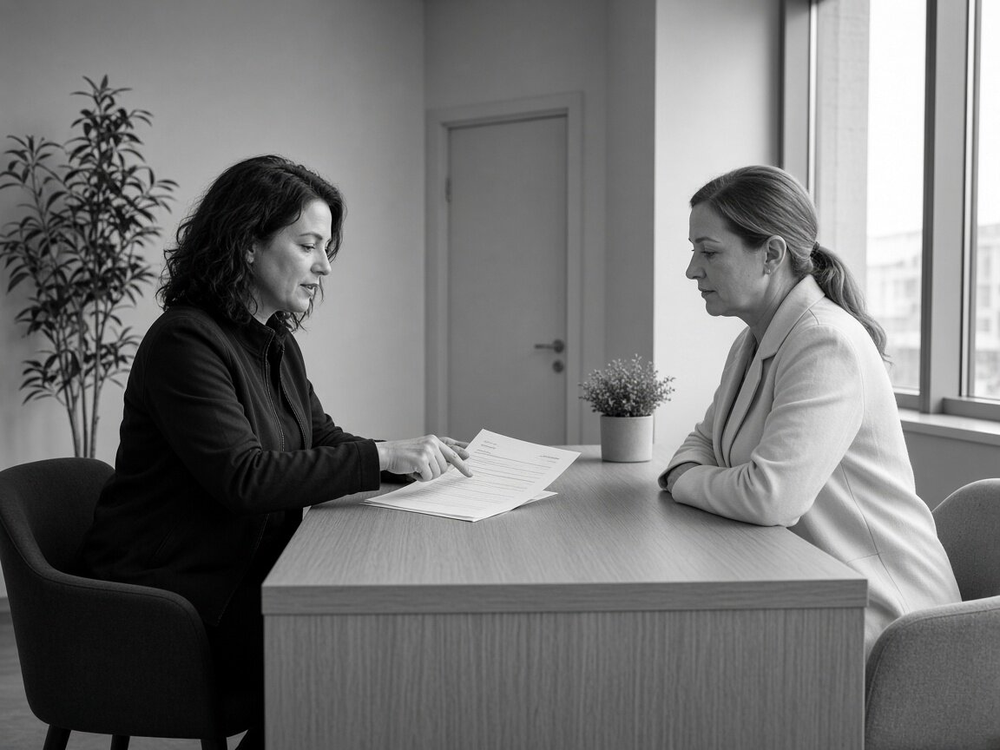

Первинна консультація в Novadent безкоштовна. На ній лікар розбирає стан зубів і ясен, пояснює варіанти лікування звичайною мовою і складає кошторис до початку роботи. Окремої плати за цей прийом немає: так побудована практика лікаря вищої категорії Олександра Олексійовича Голуба.

Консультація потрібна не для того, щоб «призначити процедуру», а щоб зрозуміти, що болить, що лише виглядає підозріло, а що можна залишити під наглядом. За звітом Всесвітньої організації охорони здоров’я 2022 року, хвороби порожнини рота зачіпають близько 3,5 мільярда людей. Карієс постійних зубів — найпоширеніший окремий стан: близько 2 мільярдів людей. Ще близько 520 мільйонів дітей мають карієс молочних зубів. Ці цифри зі зведення ВООЗ за даними Global Burden of Disease 2019. Вони не означають, що кожна темна фісура потребує бормашини. Вони означають, що план має відрізняти хворобу, яку треба лікувати зараз, від зміни, яку досить спостерігати.

## Що лікар з’ясовує до огляду

Розмова починається з причини візиту. Гострий біль уночі, біль на холод, що минає за секунди, набряк, зруйнована пломба і бажання замінити стару коронку — це різні задачі, навіть якщо людині здається, що «просто болить зуб». Далі йде медична історія. На план впливають цукровий діабет, препарати, що розріджують кров, ліки від остеопорозу і деякі протипухлинні схеми, вагітність, алергія на анестетик або латекс. Спільний звіт Європейської федерації пародонтології та Американської академії пародонтології (Chapple і Genco, 2013) описує двосторонній зв’язок діабету і запалення ясен: гірший контроль цукру ускладнює ясна, а важкий пародонтит пов’язаний із гіршим контролем глюкози. Це не привід відкладати лікування, але привід назвати діагноз і ліки на початку прийому.

Кроворозріджувальні препарати самовільно не скасовують перед пломбою. Більшість терапевтичних втручань не вимагає перерви в такій терапії, а рішення про видалення приймають окремо. Препарати, що впливають на перебудову кістки, важливі насамперед тоді, коли йдеться про видалення зуба, а не про пломбу чи коронку. Якщо ви вагітні, інфекцію і біль лікувати безпечніше, ніж залишати їх «на потім»: термін і обсяг роботи лікар узгоджує з вами.

На прийом корисно взяти список ліків, попередні знімки, якщо вони є, і перелік того, що вже пробували. Старі знімки інколи позбавляють потреби повторювати опромінення.

<figure>

<figcaption>Зонд і пародонтальний зонд: перший перевіряє поверхню зуба, другий — борозну між зубом і яснами. Навчальне фото, не з кабінету Novadent. Автор: Coronation Dental Specialty Group, <a href="https://commons.wikimedia.org/wiki/File:Dental_explorer_and_periodontal_probe.jpg" target="_blank" rel="noopener noreferrer">CC BY-SA 3.0</a>.</figcaption>
</figure>

## Що видно в кріслі, а що ні

Огляд охоплює зуби, старі пломби і коронки, ясна, прикус і те, як змикаються щелепи. Зондом перевіряють, чи є розм’якшення під плямою. Пародонтальний зонд показує глибину борозни: кровоточивість і кишені — це вже розмова про ясна, а не лише про дірку в емалі. Рання каріозна пляма без порожнини часто зупиняється, якщо прибрати часті цукрові перекуси і користуватися фторвмісною пастою. Порожнина, куди заходить зонд і де застрягає їжа, сама не «заросте».

Не кожне затемнення на емалі є карієсом. Пігмент у фісурах, клиноподібний дефект біля ясен і стара пломба з забарвленим краєм виглядають схоже, а лікуються по-різному. Саме тому кошторис після огляду відрізняється від ціни, яку людина прикинула вдома за прайсом.

Знімок на візіографі роблять тут же, у кабінеті, коли він змінює рішення: глибокий карієс, підозра на запалення нерва, контроль перед коронкою або протезом, біль без видимої порожнини. Настанова Американської стоматологічної асоціації 2024 року (Benavides і співавт., Journal of the American Dental Association) прямо каже: спочатку огляд і розпитування, і лише потім знімок, якщо від нього є користь для діагнозу або лікування. Подробніше про дозу і відмінність прицільного знімка від панорамного — в записі [«Знімок на візіографі»](2030-08-12-scan.html).

<figure>

<figcaption>План і кошторис мають бути зрозумілі до того, як почнеться лікування.</figcaption>
</figure>

## Кілька шляхів, а не один «правильний»

Сучасна одонтотерапія змістилася від гасла «вичистити все до твердого дентину» до збереження живого нерва там, де це ще можливо. Спільна настанова європейських товариств консервативної стоматології, ендодонтії та вивчення карієсу 2026 року (Schwendicke і співавт., Clinical Oral Investigations) для глибокого карієсу без симптомів або з оборотною реакцією на холод радить вибіркове чи поетапне видалення розм’якшеного дентину, а не тотальне вичищення до твердого. Якість доказів у різних пунктах різна: від дуже низької до помірної. На прийомі це звучить просто. Є варіант меншого втручання, є варіант лікування каналів, є варіант коронки або спостереження. У кожного свої шанси, термін і ціна.

Спільне рішення означає, що лікар називає ці розвилки, а людина обирає з урахуванням болю, жування, зовнішнього вигляду і бюджету. Безкоштовна консультація якраз для цього. Кошторис збирають із позицій, які потім стоять у розділі [цін](/index.html#prices): пломба, анестезія, знімок, лікування каналу, коронка. Прихованої другої суми після старту роботи бути не повинно. Якщо під час лікування відкривається те, чого не було видно, обсяг переглядають і проговорюють, а не додають мовчки.

Телефонна розмова теж можлива, якщо ви далеко або хочете зрозуміти, чи варто їхати. По телефону можна обговорити скаргу і приблизний порядок цін. Поставити діагноз, побачити тріщину, виміряти кишеню і скласти остаточний кошторис можна лише в кріслі.

## Що входить у план, крім лікування

Профілактика — частина консультації, а не додаток «якщо залишиться час». ВООЗ вважає пасту з фторидом 1000–1500 ppm базовим засобом профілактики карієсу; чистити зуби нею варто двічі на день. Дорослій людині зазвичай пасує паста близько 1450 ppm, якщо іншої дози не порадив лікар. Настанова ВООЗ щодо вільних цукрів радить тримати їх нижче 10% енергії раціону, а за можливості — нижче 5%. Для зубів важлива не лише кількість цукру, а й те, як часто він потрапляє в рот: кожен солодкий напій між прийомами їжі — окремий кислотний удар по емалі. Міжзубні проміжки щітка не вичищає. Йоршик або нитка підбирають під проміжки, а не «як у рекламі».

Якщо зубів уже бракує, на консультації дивляться, чи потрібен протез зараз. Концепція вкороченого зубного ряду, яку десятиліттями розвивала група Käyser, а згодом узагальнили Kanno і Carlsson (Journal of Oral Rehabilitation, 2006), показує: людина часто добре жує, коли збережені передні зуби і премоляри, навіть без частини молярів. Протез пропонують там, де є проміжок, який заважає, перевантажує сусідні зуби або непокоїть зовні, а не тому, що на схемі «має бути 32 зуби».

## З чим ви виходите

Після прийому має бути зрозуміло чотири речі. Що відбувається із зубом або яснами. Які є варіанти, включно з тим, що буде, якщо почекати. У якому порядку це робити: спочатку біль і інфекція, потім жування і вигляд. Скільки це коштує в цьому кабінеті і від чого сума залежить. Наприклад, лікування пульпіту рахують за кількістю каналів, а не однією ціною «за зуб».

Кабінет працює у Вінниці на вул. Гоголя 15, у будні з 9:00 до 18:00, у суботу з 9:00 до 15:00. Телефон — [075 177 75 67](tel:+380751777567). Запис на консультацію ні до чого не зобов’язує: план можна забрати з собою і вирішити спокійно.

Цей текст пояснює загальні висновки досліджень. Він не ставить діагноз і не замінює огляд.

## Джерела

<ol class="blog-sources">
<li>World Health Organization. Global oral health status report: towards universal health coverage for oral health by 2030. Geneva: WHO; 2022. Також фактологічна довідка ВООЗ щодо здоров’я порожнини рота, що спирається на Global Burden of Disease 2019.</li>
<li>World Health Organization. Guideline: sugars intake for adults and children. Geneva: WHO; 2015.</li>
<li>World Health Organization. Fluoride toothpaste as a public health measure: пасти з 1000–1500 ppm фториду. Матеріали Комітету з переліку основних лікарських засобів.</li>
<li>Chapple ILC, Genco R. Diabetes and periodontal diseases: consensus report of the Joint EFP/AAP Workshop on Periodontitis and Systemic Diseases. J Clin Periodontol. 2013;40 Suppl 14:S106–S112.</li>
<li>Benavides E, Krecioch JR, Connolly RT, et al. Optimizing radiation safety in dentistry. J Am Dent Assoc. 2024.</li>
<li>Schwendicke F, Kosan E, Banerjee A, et al. Deep caries management: EFCD–ESE–ORCA S3-level clinical practice guideline. Clin Oral Investig. 2026;30:186.</li>
<li>Kanno T, Carlsson GE. A review of the shortened dental arch concept focusing on the work by the Käyser/Nijmegen group. J Oral Rehabil. 2006;33:850–862.</li>
</ol>
