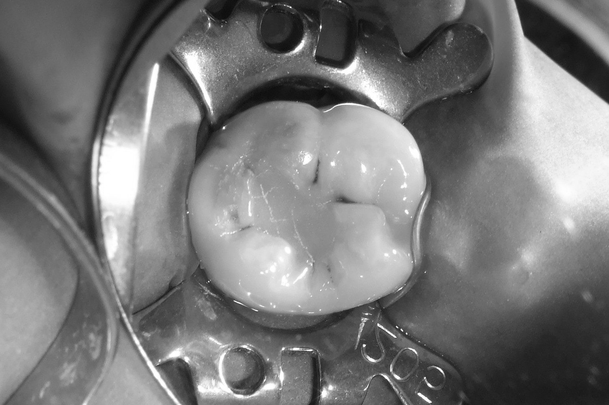
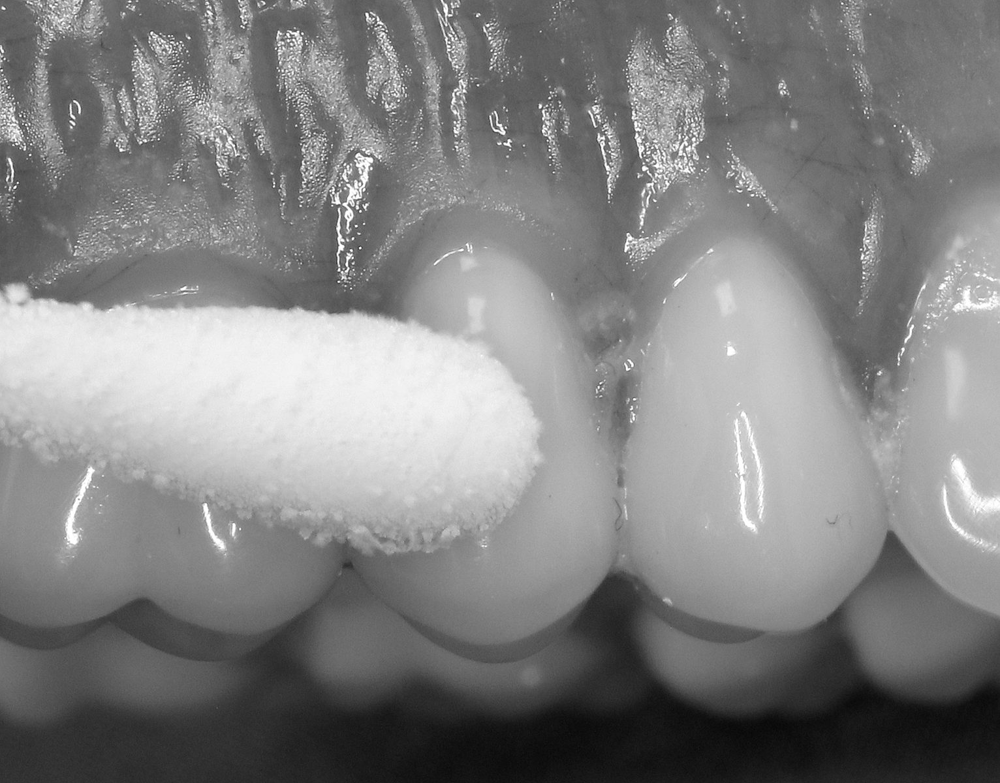

Карієс, пульпіт і періодонтит — це не три різні «поломки», а стадії однієї історії: бактерії в зубному нальоті за наявності цукру розчиняють тверді тканини, і запалення може дійти до нерва, а потім до кістки біля кореня. У Novadent це лікують в одному кабінеті. Пломбу, художню реставрацію, чистку і лікування каналів планують після огляду, а вартість пульпіту залежить від кількості каналів.

Ранню пляму без порожнини часто можна зупинити. Коли емаль уже провалена і в дентин заходить зонд, тканина сама не відновлюється: порожнину закривають пломбою, інакше процес іде глибше. Це базова межа, від якої відштовхуються і підручники, і клінічні настанови останніх років.

## Що змінилось у лікуванні глибокого карієсу

Довго вважали правильним вичистити розм’якшений дентин до твердого, навіть якщо під ним уже тонкий дах над нервом. Сьогодні для глибокого карієсу в постійному зубі без симптомів або з оборотною реакцією на холод європейська настанова найвищого для Німеччини рівня S3 (EFCD, ESE, ORCA і Німецьке товариство консервативної стоматології; Schwendicke і співавт., Clinical Oral Investigations, 2026) пропонує інше. Вибіркове видалення до м’якого дентину або поетапне видалення зменшує ризик розкрити нерв порівняно з повним вичищенням до твердого дентину. Рутинна «лікувальна прокладка» під пломбу сталої користі не показала, і настанова не радить ставити її за звичкою.

Це не дозвіл залишати карієс під дірявою пломбою. Края порожнини мають бути очищені так, щоб пломба сіла щільно. Йдеться про дно глибокої порожнини, де зайвий міліметр бормашини відкриває пульпу. Якість доказів автори самі оцінюють обережно: від дуже низької до помірної. Рішення ухвалюють за симптомами, знімком і тим, чи можна надійно закрити зуб.

<figure>

<figcaption>Жувальний зуб під кофердамом. Суха зона потрібна, щоб фотополімер зчепився з тканинами. Навчальне фото. Автор: Albert, <a href="https://commons.wikimedia.org/wiki/File:Composite_resin_fillng_1.jpg" target="_blank" rel="noopener noreferrer">CC BY-SA 3.0</a>.</figcaption>
</figure>

У кабінеті для реставрацій використовують фотополімери різної міцності й ціни: Лателюкс, Карісма, Градія і нанокомпозит Ceram.X. Суми є в розділі [цін](/index.html#prices). Композит тримається на адгезиві, тому волога слина для нього шкідлива. Кофердам — гумова хустка, яка відгороджує зуб, — у дослідженнях лікування каналів і в настановах щодо збереження пульпи входить до ретельного протоколу. Чи ставлять його на конкретний зуб, залежить від доступу і від того, наскільки глибоко треба працювати.

Анестезія в прайсі окремим рядком. Глибокий карієс і тим більше канали без знеболення — погана ідея: біль заважає і пацієнту, і якості роботи.

## Коли болить на холод, а коли вже пізно «просто запломбувати»

Живий зуб відповідає на холод, і відчуття минає за кілька секунд. Довгий ниючий біль, нічний біль, біль без подразника частіше говорять про необоротне запалення пульпи. Холодова проба якраз розрізняє ці стани: ватку з холодовим агентом прикладають до сухого зуба і дивляться, чи є відповідь і як швидко вона згасає.

<figure>

<figcaption>Холодова проба допомагає зрозуміти, чи нерв ще живий і чи біль оборотний. Навчальне фото. Автор: Coronation Dental Specialty Group, <a href="https://commons.wikimedia.org/wiki/File:Cold_test_with_ethyl_chloride.jpg" target="_blank" rel="noopener noreferrer">CC BY-SA 3.0</a>.</figcaption>
</figure>

Якщо під час чистки глибокого карієсу нерв усе ж відкрився, а зуб до того мовчав або реагував оборотно, пульпу намагаються зберегти. Огляд Cushley і співавторів (International Endodontic Journal, 2021) зібрав результати прямого покриття пульпи після каріозного розкриття. Через 2–3 роки успіх гідроксиду кальцію був близько 59%, мінерал триоксид агрегату — близько 84%, біодентину — близько 86%. Автори прямо пишуть, що докази невисокої якості, але різниця на користь гідравлічних кальцій-силікатних цементів повторюється. Настанова 2026 року теж радить саме ці цементи, а не гідроксид кальцію, і для покриття, і для ампутації коронкової пульпи.

Там само сказано, що за ознак необоротного пульпіту ампутація пульпи може бути альтернативою повному видаленню нерва з каналів, якщо вдається зупинити кров і працюють під збільшенням, з антисептичною іригацією і щільним закриттям. Це вузький протокол. Повне лікування каналів лишається перевіреним шляхом, коли пульпа вже гнійно або необоротно запалена, коли зупинити кров не вдається або коли біля кореня на знімку є вогнище. Саме лікування каналів розписане в прайсі Novadent: пульпіт одного каналу, двох і трьох. У моляра каналів буває три або чотири, у різця зазвичай один. Звідси і різна сума, а не «ціна за візит».

Систематичний огляд Ng, Mann і Gulabivala (International Endodontic Journal, 2008) показав, що первинне лікування каналів частіше завершується успіхом, якщо біля кореня ще немає запального вогнища, канали запломбовані щільно, а коронку зуба потім надійно відновлено. Зведений відсоток у різних роботах стрибає, бо «успіх» визначають то як зникнення болю, то як повне загоєння кістки на знімку. Тому чесний прогноз звучить після огляду конкретного зуба. Зуб нерідко служить роками навіть тоді, коли вогнище на контрольному знімку зменшується повільно.

## Антибіотик пульпіт не лікує

Біль у живому або щойно розкритому зубі майже ніколи не є приводом для антибіотика. Настанова Американської стоматологічної асоціації щодо невідкладного зубного болю і прикореневого запалення (Lockhart і співавт., Journal of the American Dental Association, 2019) радить не призначати антибіотик при пульпіті і локальному періодонтиті, якщо немає поширеного набряку і ознак інфекції, що вийшла за межі зуба. Таблетка не дренує гній з каналу і не знімає запалення закритої пульпи. Потрібні знеболення і лікування зуба: пломба, покриття пульпи або канали. Антибіотик додають, коли є розлитий набряк, температура, важкий загальний стан або знижений імунітет. Самостійно починати його «щоб дотерпіти до понеділка» не варто: біль лишиться, а наступне знеболення і вибір ліків ускладняться.

Періодонтит у цьому контексті — запалення біля верхівки кореня, а не «пародонтит» ясен, хоча в розмові слова плутають. На прицільному знімку це темна ділянка кістки навколо кореня. Лікування — ті самі канали, інколи повторне, якщо канали вже пломбували і вогнище не загоїлось. Контрольний знімок роблять не наступного дня: кістка перебудовується місяцями.

## Після пломби або каналів

Пломба відновлює форму, але не скасовує причину. Той самий частий цукор і пропущені міжзубні проміжки дають карієс поруч із новою реставрацією. Край пломби має не чіпляти нитку і не тиснути на ясна. Якщо від зуба лишилися тонкі стінки, велика пломба тримає гірше за коронку: жувальний бугор може відколотися через місяці. Коли це вже історія про коронку, а не про ще одну порцію композиту, розмова продовжується в записі [«Коронка на зуб»](2030-06-23-crowns.html).

Титановий штифт, який є в прайсі, ставлять не «для міцності кореня». Штифт утримує відбудову, на яку потім сідає пломба або коронка, якщо своєї коронкової частини майже не лишилось. Корінь він не зміцнює. Зуб зі штифтом усе одно потребує щільного краю і нормальної висоти власних тканин, інакше ламається вже не пломба, а корінь.

Біль після лікування каналів добу чи дві, чутливість на накушування — очікувана реакція тканин. Наростаючий набряк, температура або біль, який не знімається призначеним знеболювальним, — привід зателефонувати, а не чекати планового огляду. Кабінет на вул. Гоголя 15, телефон [075 177 75 67](tel:+380751777567). З чого почати, якщо зуб лише підозрілий і ще не болить, краще вирішити на [консультації](2030-04-08-consult.html): вона безкоштовна.

Цей текст передає висновки оглядів і настанов. Схему для вашого зуба визначає огляд і знімок.

## Джерела

<ol class="blog-sources">
<li>Schwendicke F, Kosan E, Banerjee A, et al. Deep caries management: EFCD–ESE–ORCA S3-level clinical practice guideline. Clin Oral Investig. 2026;30:186. doi:10.1007/s00784-025-06727-1</li>
<li>Duncan HF, Kirkevang LL, Peters OA, et al. Treatment of pulpal and apical disease: the European Society of Endodontology S3-level clinical practice guideline. Int Endod J. 2023. doi:10.1111/iej.13974</li>
<li>Cushley S, Duncan HF, Lappin MJ, et al. Efficacy of direct pulp capping for management of cariously exposed pulps in permanent teeth: a systematic review and meta-analysis. Int Endod J. 2021;54:556–571. doi:10.1111/iej.13449</li>
<li>Ng YL, Mann V, Rahbaran S, Lewsey J, Gulabivala K. Outcome of primary root canal treatment: systematic review of the literature — Part 2. Int Endod J. 2008;41:6–31.</li>
<li>Lockhart PB, Tampi MP, Abt E, et al. Evidence-based clinical practice guideline on antibiotic use for the urgent management of pulpal- and periapical-related dental pain and intraoral swelling. J Am Dent Assoc. 2019;150:906–921.</li>
</ol>
