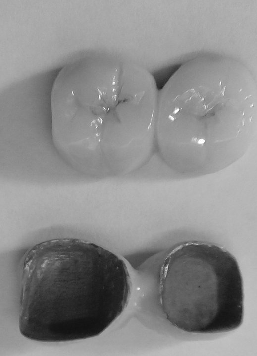
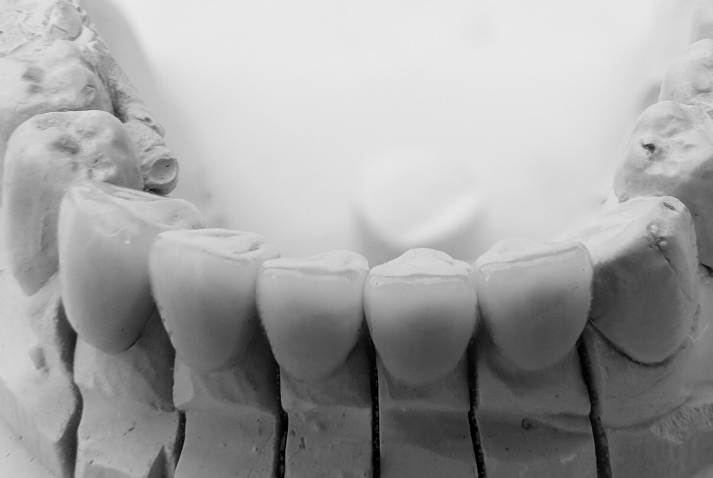

Коронка — це ковпачок, який покриває зуб, що втратив забагато власних стінок, щоб велика пломба тримала жувальне навантаження. У Novadent її роблять із металу (лита коронка), металокераміки, безметалевої прес-кераміки або цирконію. Матеріал обирають за тим, де стоїть зуб, скільки від нього лишилось, який потрібен колір і який бюджет. Ціни цих чотирьох варіантів різні; вони зібрані в розділі [цін](/index.html#prices).

Пломба доречна, поки навколо порожнини є міцні стінки. Коли від жувального зуба лишилися тонкі краї або відколовся бугор, наступна пломба часто більша за попередню і тримається на тому, що ще вціліло. Коронка переносить навантаження на обід зуба по периметру. Для зуба після лікування каналів це особливо важливо: такий зуб не болить при надломі стінки, бо нерва вже немає, і людина помічає біду, коли фрагмент уже в руці. Огляди результатів лікування каналів, зокрема Ng і співавтори (International Endodontic Journal, 2008), називають якість остаточного відновлення коронкової частини одним із чинників, від яких залежить доля зуба. Коронка при цьому не є автоматичною відповіддю на кожні канали. Якщо збереглися кілька міцних стінок, інколи вистачає накладки або міцної реставрації. Це вирішують на огляді, а не за шаблоном «канал — значить коронка».

## Чотири матеріали і що про них відомо

Лита металева коронка міцна, потребує порівняно ощадного зішліфування і майже не сколюється. Її добре видно, тому вона доречна на дальніх жувальних зубах, де колір нікого не обходить. Це найдоступніший із чотирьох варіантів у прайсі кабінету.

Металокераміка — металевий ковпачок, спечений із шаром кераміки. Ззовні зуб світлий, зсередини лишається металева основа. На просвіт біля ясен інколи проступає сірий край, якщо ясна тонкі або з часом піднялися. Великий огляд зубних коронок Sailer і співавторів (Dental Materials, 2015) оцінив п’ятирічне виживання металокераміки приблизно в 95%. Це досі орієнтир, з яким порівнюють новішу кераміку. Типове ускладнення — невеликий скол облицювання, який не завжди означає заміну всієї коронки.

<figure>

<figcaption>Металокераміка з двох боків: зовні кераміка, зсередини металевий ковпачок. Фото: Nizil Shah, <a href="https://commons.wikimedia.org/wiki/File:Porcelain_Fused_to_Metal_Dental_Crown_Showing_interior_and_exterior_surfaces.jpg" target="_blank" rel="noopener noreferrer">CC BY-SA 4.0</a>.</figcaption>
</figure>

Безметалева прес-кераміка в практиці — це зазвичай склокераміка, найчастіше на основі дисилікату літію. Вона прозора глибше, ніж метал під керамікою, тому на передніх зубах і премолярах дає спокійніший колір. У тому самому огляді Sailer 2015 п’ятирічне виживання коронок зі склокераміки, зміцненої лейцитом або дисилікатом літію, становило 96,6% — поруч із металокерамікою. Окремий огляд саме дисилікату літію (Pieger, Salman, Bidra, Journal of Prosthetic Dentistry, 2014) дав для одиночних коронок близько 98% через п’ять років. Дані після цього строку тонші й тримаються на меншій кількості робіт, тож обіцянка «на все життя» з них не випливає. Склокераміка гірше пробачає дуже тонкі стінки і сильне навантаження на далеких молярах, якщо шар матеріалу замалий.

Цирконій — оксидна кераміка високої міцності. Ранні коронки робили з цирконієвого каркаса, облицьованого порцеляною, і саме облицювання сколювалося. Через це огляд 2015 року ставився до цирконію стримано. Пізніші монолітні коронки, вирізані з одного блока і лише підфарбовані, цієї слабкої ланки не мають. Метааналіз Mazza і співавторів (Journal of Prosthetic Dentistry, 2022) зібрав 1061 монолітну керамічну коронку на своїх зубах, серед них дисилікат літію і цирконій. Частка невдач була близько 1% (довірчий інтервал 0–3%), технічних ускладнень — близько 2%. Прямої переваги над облицьованою керамікою в небагатьох порівняльних дослідженнях не вийшло, а спостереження часто коротші за десять років. Практичний висновок спокійний: монолітний цирконій — міцний варіант для жувальних зубів, коли потрібен світлий колір без металевого краю. На передньому зубі прозорість прес-кераміки інколи виглядає природніше. У прайсі цирконій дорожчий за металокераміку і прес-кераміку, і ця різниця має купувати саме властивість, яка потрібна цьому зубу, а не «найновішу назву».

<figure>

<figcaption>Керамічні коронки на моделі: так перевіряють форму і контакти до фіксації в роті. Фото: Bin im Garten, <a href="https://commons.wikimedia.org/wiki/File:VMK-Krone_Dental_crown_Focus_stacking_with_freeware_CombineZP_02.jpg" target="_blank" rel="noopener noreferrer">CC BY-SA 3.0</a>.</figcaption>
</figure>

## Обточування, обід зуба і цемент

Під коронку зуб зменшують на товщину майбутнього ковпачка. Чим міцніший і непрозоріший матеріал, тим часто менший цей шар, але «взагалі без обточування» одиночна коронка на зруйнованому зубі не тримається. Межа проходить там, де її можна очистити щіткою. Загнана глибоко під ясна межа без потреби запалює край і ускладнює знімок відбитка.

Для зуба після каналів має значення обід власного дентину — так званий ферул: кільце твердої тканини над рівнем кореня, яке коронка охоплює. Огляд Juloski і співавторів (Journal of Endodontics, 2012) пов’язує наявність такого обода, орієнтовно 1,5–2 мм висотою, з кращою стійкістю до перелому. Якщо обода немає, коронка сидить на штифті і відбудові, а ламається вже корінь. Штифт, у тому числі титановий з прайсу кабінету, потрібен, щоб утримати відбудову, коли своєї коронкової частини майже не залишилось. Він не армує корінь і не замінює ферул.

Цемент обирають під матеріал і під висоту кукси. У кабінеті фіксують фосфатним цементом, склоіономером Ketac Cem або Fuji; ціни фіксації теж вказані окремо. Металева і металокерамічна коронка з достатньою висотою стінок надійно сидить на склоіономері. Монолітний цирконій за хорошої ретенції теж фіксують традиційним цементом. Склокераміка, особливо якщо кукса низька і конусність велика, краще тримається на адгезивному протоколі: поверхню кераміки протравлюють і садять на композитний цемент. Якщо для конкретного зуба потрібен саме такий протокол, це проговорюють до обточування, а не в день здачі.

Перед коронкою зуб має бути спокійним. Карієс під старою пломбою, запалення нерва і вогнище біля кореня спочатку лікують. Інакше коронка закриє проблему, яку потім доведеться розбирати. Прицільний знімок у кабінеті показує канали, пломбувальний матеріал і кістку навколо кореня. Чим він відрізняється від оглядового панорамного знімка, розібрано в записі [«Знімок на візіографі»](2030-08-12-scan.html).

## Як обирати без гонки за матеріалом

На консультації порівнюють не «погане і хороше», а чотири придатні речі. Далекий моляр у людині, якій важливий бюджет і міцність, часто закривають литою або металокерамічною коронкою. Премоляр у посмішці — прес-керамікою або цирконієм. Зуб із темним коренем після каналів інколи краще перекрити менш прозорим матеріалом, бо склокераміка може просвічувати сіре. Ясна, прикус і те, чи є зуб-антагоніст, змінюють вибір не менше, ніж таблиця виживання.

П’ять років у оглядах — це не гарантійний талон і не строк, після якого коронку викидають. Більшість коронок із цих матеріалів служить довше, якщо край чистий, прикус не б’є в одну точку, а під коронкою не лишили карієс. Нічний скрегіт підвищує ризик сколу облицювання і стирання зуба-супротивника; про це кажуть до цементування, інколи потрібна капа. Коронка не звільняє від щітки: карієс кореня починається якраз на межі коронки і зуба, там, де затримується наліт.

Остаточний вибір і кошторис — на безкоштовній консультації в кабінеті на вул. Гоголя 15, телефон [075 177 75 67](tel:+380751777567). Якщо зуб ще можна зберегти пломбою, так і скажуть: коронка не є метою сама по собі.

Текст спирається на систематичні огляди. Він не підбирає матеріал заочно.

## Джерела

<ol class="blog-sources">
<li>Sailer I, Makarov NA, Thoma DS, Zwahlen M, Pjetursson BE. All-ceramic or metal-ceramic tooth-supported fixed dental prostheses? A systematic review of the survival and complication rates. Part I: Single crowns. Dent Mater. 2015;31:603–623.</li>
<li>Pieger S, Salman A, Bidra AS. Clinical outcomes of lithium disilicate single crowns and partial fixed dental prostheses: a systematic review. J Prosthet Dent. 2014;112:22–30.</li>
<li>Mazza LC, Lemos CAA, Pesqueira AA, Pellizzer EP. Survival and complications of monolithic ceramic for tooth-supported fixed dental prostheses: a systematic review and meta-analysis. J Prosthet Dent. 2022. doi:10.1016/j.prosdent.2021.01.020</li>
<li>Juloski J, Radovic I, Goracci C, Vulicevic ZR, Ferrari M. Ferrule effect: a literature review. J Endod. 2012;38:11–19.</li>
<li>Ng YL, Mann V, Rahbaran S, Lewsey J, Gulabivala K. Outcome of primary root canal treatment: systematic review of the literature — Part 2. Int Endod J. 2008;41:6–31.</li>
</ol>
